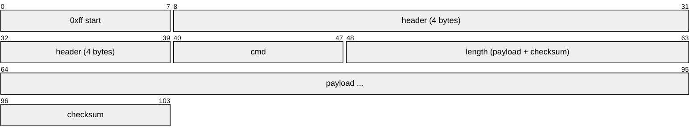
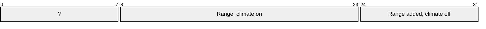
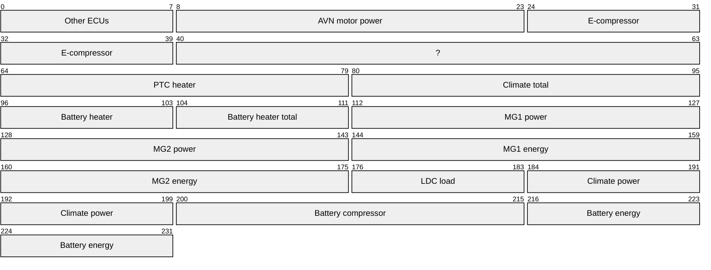

# HKMC Gen5 Wide, EV/HEV layouts (HEVService)

Variant `hkmc-gen5w-ev`, extending `hkmc-gen5w` (merged here).

- [How to read this](#how-to-read-this)
- [Confidence](#confidence)
- [Headers](#headers)
- [Enums](#enums)
- [Messages from micom](#messages-from-micom)
- [Send (the control socket may send)](#send-the-control-socket-may-send)

## How to read this

Every frame on the serial link has this shape; the payload is what the message tables below describe, byte 0 first.

The 4 header bytes are `sender receiver type func`; a header and its reverse (`0d 8f ..` and `8f 0d ..`) are the two directions of one conversation.

How well each thing is known (per message, signal or header; the files do not grade single fields):

- 🟢 **captured**: seen on the wire or on the live unit.
- 🟡 **code**: read from stock code, not yet seen to match the car.
- 🟠 **inferred**: worked out from code or the frame rule.

A message is a header plus a cmd. Find the header, then the cmd under it; its field table says which payload byte holds what.

## Confidence

| Status | Messages |
| --- | --- |
| 🟢 captured | 3 |
| 🟡 code | 15 |

Not yet backed by a capture:

| Message | Header | Cmd | Status | Ref |
| --- | --- | --- | --- | --- |
| Variant code | `system_rx` | 0x17 | 🟡 code | micom firmware 0x0117 handler; 61 S5W_M micom builds in emulation (en/ko, country 01/00); EV6 V015.012 automotive-service SystemService.onVariantCode/sendVariantCodeSave, automotive VariantCoding tables |
| Status flag | `0c 88 ?? 8c` | 0x02 | 🟡 code | HEVService status-flag setter; seen live as 57 00 NN |
| Charge time estimate, DC | `0c 88 ?? 8c` | 0x02 | 🟡 code | HEVService item 0x0e QC_REM_TIME: a DC fast charge's time to full, while not charging; 10-41 seen |
| Charge time estimate, AC | `0c 88 ?? 8c` | 0x02 | 🟡 code | HEVService item 0x13 SC_REM_TIME_EVSE_PHEV, an EV's NOT_CHAR_EVSE_REM_TIME (CAN DB generation > 0): a wallbox's time to full, while not charging; 20-220 seen, rising as the charge fell |
| Charge time estimate, DC custom | `0c 88 ?? 8c` | 0x02 | 🟡 code | HEVService item 0x61 VCRM_QCHCHRGRMNTIMEVALCUSTOM: DC time to full at the custom charge power |
| Charge limit, AC | `0c 88 ?? 8c` | 0x02 | 🟡 code | HEVService item 0x21 SOC_SC_CHG (TARGET_SOC_SLOW): x0.5 % from the set side's pct / 0.5; never seen |
| Charge limit, DC | `0c 88 ?? 8c` | 0x02 | 🟡 code | HEVService item 0x22 SOC_QC_CHG (TARGET_SOC_QUICK): x0.5 % from the set side's pct / 0.5; never seen |
| Range at charge limit, AC | `0c 88 ?? 8c` | 0x02 | 🟡 code | HEVService item 0x1f SOC_DTE_SC_CHG (DTE_SLOW_CHARGER_SOC); 406-414 seen |
| Range at charge limit, DC | `0c 88 ?? 8c` | 0x02 | 🟡 code | HEVService item 0x20 SOC_DTE_QC_CHG (DTE_QUICK_CHARGER_SOC) |
| Trip energy | `0c 88 ?? 8c` | 0x02 | 🟡 code | HEVService item 0x5e XEV_BATPWRSUM_KWH: the battery energy used; x0.1 kWh is a fit (20 -> 360 while the pack's energy fell 33 kWh), medium confidence |
| Average efficiency | `0c 88 ?? 8c` | 0x02 | 🟡 code | HEVService item 0x06 CLU_AVGFCL (AVG_FCI): 0-0x3ff; x0.1, per kWh in the unit item 0x05 gives (km or mi), is a guess, medium confidence; 31-41 seen |
| HEV status | `0c 88 ?? 8c` | 0x01 | 🟡 code | HEVService DATA_M_RESP (func 0x8c01, len >= 0x40) into flags ADDED_DIST_DATC_OFF, AVG_FCI, the charge times (the AC one at 29, CAN DB generation > 0), TARGET_SOC_SLOW/QUICK and DTE_SLOW/QUICK_CHARGER_SOC |
| EV power block | `0c 88 ?? 8c` | 0x5c | 🟡 code | HEVService setHEVStatusValue calls |
| Departure timers | `0c 88 ?? 8c` | 0x55 | 🟡 code | HEVService; captured only at the default |
| Charger state | `0c 88 ?? 8c` | 0x4f | 🟡 code | HEVService OBC ready (CAN DB generation < 2) |

## Headers

| Name | Header | Direction | Status | Ref |
| --- | --- | --- | --- | --- |
| audio_tx | `85 02 01 02` | to_micom | 🟢 captured | stock micomd strace, source switch |
| hev | `0c 88 01 8c` | from_micom | 🟢 captured | logcat MicomD 2026-10-16 |
| hev_tx | `88 0c 01 0c` | to_micom | 🟢 captured | the poll frame's; HEVService sendPacket(0x88, 0x0c, func) |
| system_rx | `01 8a 01 81` | from_micom | 🟢 captured | the CPU-alive request |
| system_tx | `8a 01 01 01` | to_micom | 🟢 captured | the CPU-alive reply |

## Enums

| Enum | Values | Used by |
| --- | --- | --- |
| adm | **0** off **1** on | Variant code: ADM |
| camera | **0** r_cam **1** r_cam_old **2** lvs **3** avm | Variant code: Camera |
| camera_mode | **0** analog **1** digital | Variant code: Camera mode |
| country | 9 values, below | Variant code: Country |
| distance_unit | **0** m **1** km **2** mi **3** ft **4** yd |  |
| dvd_region | **0** worldwide **1** us **2** eur **3** kor **4** c_s_america **5** rus **6** chn | Variant code: DVD region |
| external_amp | **0** actune **1** lexicon | Variant code: External amp |
| hu_type | **0** daudio **1** daudio_plus | Variant code: HU type |
| maneuver | 40 values, below |  |
| radio_region | **0** khz_9_100 **1** khz_10_200 **2** khz_9_50 **3** khz_10_100 **4** khz_9_200 | Variant code: Radio region |
| vehicle | **110** dn8 **189** neev **204** cvev | Variant code: Vehicle |

### country

| Value | Name |
| --- | --- |
| 0 | korea |
| 1 | us |
| 2 | china |
| 3 | general |
| 4 | middleeast |
| 5 | europe |
| 6 | canada |
| 7 | russia |
| 22 | malaysia |

### maneuver

| Value | Name |
| --- | --- |
| 0 | none |
| 1 | no_info |
| 2 | depart |
| 3 | dest_reached |
| 4 | near_dest |
| 5 | arrived_off_map |
| 6 | off_road |
| 7 | off_map |
| 8 | no_route_guide |
| 9 | calc_route |
| 10 | recalc_route |
| 32 | roundabout_exit_right |
| 33 | roundabout_exit_left |
| 64 | unknown |
| 65 | straight |
| 66 | slight_right |
| 67 | turn_right |
| 68 | sharp_right |
| 69 | sharp_left |
| 70 | turn_left |
| 71 | slight_left |
| 72 | uturn_left |
| 73 | uturn_right |
| 81 | off_ramp_right |
| 82 | off_ramp_left |
| 86 | off_ramp |
| 96 | roundabout_96 |
| 97 | roundabout_97 |
| 99 | roundabout_99 |
| 100 | roundabout_100 |
| 102 | roundabout_102 |
| 103 | roundabout_103 |
| 105 | roundabout_105 |
| 106 | roundabout_106 |
| 112 | destination |
| 115 | arrived |
| 172 | on_ramp |
| 173 | on_ramp_right |
| 174 | on_ramp_left |
| 176 | ferry |

## Messages from micom

### system_rx

`01 8a 01 81`: the CPU-alive request

#### Variant code

cmd `0x17`, length ≥ 13 · 🟡 code

> micom firmware 0x0117 handler; 61 S5W_M micom builds in emulation (en/ko, country 01/00); EV6 V015.012 automotive-service SystemService.onVariantCode/sendVariantCodeSave, automotive VariantCoding tables

| Field | At | Type | Enum |
| --- | --- | --- | --- |
| Vehicle | byte 0 |  | vehicle |
| Country | byte 1 |  | country |
| Navigation | byte 2 bits 7 |  |  |
| Modem | byte 2 bits 6 |  |  |
| Internal amp | byte 2 bits 5 |  |  |
| Rear monitor | byte 2 bits 4 |  |  |
| Radio region | byte 2 bits 3:1 |  | radio_region |
| DMB | byte 2 bits 0 |  |  |
| RHD | byte 3 bits 7 |  |  |
| Limo | byte 3 bits 6 |  |  |
| External amp | byte 3 bits 5 |  | external_amp |
| Camera | byte 3 bits 4:3 |  | camera |
| Advanced cluster | byte 3 bits 2 |  |  |
| HUD | byte 3 bits 1 |  |  |
| Rear USB | byte 3 bits 0 |  |  |
| RRC | byte 4 bits 7 |  |  |
| CDC | byte 4 bits 6 |  |  |
| ISDB | byte 4 bits 5 |  |  |
| HD Radio | byte 4 bits 4 |  |  |
| CMMB | byte 4 bits 3 |  |  |
| Internal CDP | byte 4 bits 2 |  |  |
| External CDP | byte 4 bits 1 |  |  |
| Telematics | byte 4 bits 0 |  |  |
| Diranarom | byte 5 bits 7 |  |  |
| DAB | byte 5 bits 6 |  |  |
| HU type | byte 5 bits 5 |  | hu_type |
| Camera mode | byte 5 bits 4 |  | camera_mode |
| GPS | byte 5 bits 3 |  |  |
| Ext CDP feature | byte 5 bits 2 |  |  |
| Sub board | byte 5 bits 1 |  |  |
| RDS | byte 5 bits 0 |  |  |
| DVD region | byte 6 |  | dvd_region |
| Language | byte 7 | str |  |
| CPU variant 9 | byte 9 |  |  |
| CPU variant 10 | byte 10 |  |  |
| CPU variant 11 | byte 11 |  |  |
| ADM | byte 12 |  | adm |

### 0c 88 ?? 8c

#### Status flag

cmd `0x02`, length 3 · 🟡 code

> HEVService status-flag setter; seen live as 57 00 NN

| Field | At | Type | Unit |
| --- | --- | --- | --- |
| Climate power draw | byte 1 | u16 | W |

#### Range, climate

cmd `0x02`, length 4 · 🟢 captured

> HEVService flag ADDED_DIST_DATC_OFF (0x26); seen live as 2a 00 f3 08 beside cluster Range=243 km

| Field | At | Type | Unit |
| --- | --- | --- | --- |
| Range, climate on | byte 1 | u16 | km |
| Range added, climate off | byte 3 |  | km |

#### Range, climate (0x25)

cmd `0x02`, length 4 · 🟢 captured

> HEVService flag ADDED_DIST_DATC_OFF (0x26); seen live as 25 01 6b 07

| Field | At | Type | Unit |
| --- | --- | --- | --- |
| Range, climate on | byte 1 | u16 | km |
| Range added, climate off | byte 3 |  | km |

#### Charge time to full

cmd `0x02`, length 3 · 🟢 captured

> HEVService item 0x14 REAL_SC_REM_TIME (HEVFlag CHARGING_INTEGRATED_REM_TIME): the time left while charging; seen live falling 1 a minute to 0 at the end

| Field | At | Type | Unit |
| --- | --- | --- | --- |
| Charge time to full | byte 1 | u16 | min |

#### Charge time estimate, DC

cmd `0x02`, length 3 · 🟡 code

> HEVService item 0x0e QC_REM_TIME: a DC fast charge's time to full, while not charging; 10-41 seen

| Field | At | Type | Unit |
| --- | --- | --- | --- |
| Charge time estimate, DC | byte 1 | u16 | min |

#### Charge time estimate, AC

cmd `0x02`, length 3 · 🟡 code

> HEVService item 0x13 SC_REM_TIME_EVSE_PHEV, an EV's NOT_CHAR_EVSE_REM_TIME (CAN DB generation > 0): a wallbox's time to full, while not charging; 20-220 seen, rising as the charge fell

| Field | At | Type | Unit |
| --- | --- | --- | --- |
| Charge time estimate, AC | byte 1 | u16 | min |

#### Charge time estimate, DC custom

cmd `0x02`, length 3 · 🟡 code

> HEVService item 0x61 VCRM_QCHCHRGRMNTIMEVALCUSTOM: DC time to full at the custom charge power

| Field | At | Type | Unit |
| --- | --- | --- | --- |
| Charge time estimate, DC custom | byte 1 | u16 | min |

#### Charge limit, AC

cmd `0x02`, length 3 · 🟡 code

> HEVService item 0x21 SOC_SC_CHG (TARGET_SOC_SLOW): x0.5 % from the set side's pct / 0.5; never seen

| Field | At | Scale | Unit |
| --- | --- | --- | --- |
| Charge limit, AC | byte 2 | 0.5 | % |

#### Charge limit, DC

cmd `0x02`, length 3 · 🟡 code

> HEVService item 0x22 SOC_QC_CHG (TARGET_SOC_QUICK): x0.5 % from the set side's pct / 0.5; never seen

| Field | At | Scale | Unit |
| --- | --- | --- | --- |
| Charge limit, DC | byte 2 | 0.5 | % |

#### Range at charge limit, AC

cmd `0x02`, length 3 · 🟡 code

> HEVService item 0x1f SOC_DTE_SC_CHG (DTE_SLOW_CHARGER_SOC); 406-414 seen

| Field | At | Type | Unit |
| --- | --- | --- | --- |
| Range at charge limit, AC | byte 1 | u16 | km |

#### Range at charge limit, DC

cmd `0x02`, length 3 · 🟡 code

> HEVService item 0x20 SOC_DTE_QC_CHG (DTE_QUICK_CHARGER_SOC)

| Field | At | Type | Unit |
| --- | --- | --- | --- |
| Range at charge limit, DC | byte 1 | u16 | km |

#### Trip energy

cmd `0x02`, length 3 · 🟡 code

> HEVService item 0x5e XEV_BATPWRSUM_KWH: the battery energy used; x0.1 kWh is a fit (20 -> 360 while the pack's energy fell 33 kWh), medium confidence

| Field | At | Type | Scale | Unit |
| --- | --- | --- | --- | --- |
| Trip energy | byte 1 | u16 | 0.1 | kWh |

#### Average efficiency

cmd `0x02`, length 3 · 🟡 code

> HEVService item 0x06 CLU_AVGFCL (AVG_FCI): 0-0x3ff; x0.1, per kWh in the unit item 0x05 gives (km or mi), is a guess, medium confidence; 31-41 seen

| Field | At | Type | Scale |
| --- | --- | --- | --- |
| Average efficiency | byte 1 | u16 | 0.1 |

#### HEV status

cmd `0x01`, length ≥ 64 · 🟡 code

> HEVService DATA_M_RESP (func 0x8c01, len >= 0x40) into flags ADDED_DIST_DATC_OFF, AVG_FCI, the charge times (the AC one at 29, CAN DB generation > 0), TARGET_SOC_SLOW/QUICK and DTE_SLOW/QUICK_CHARGER_SOC

| Field | At | Type | Scale | Unit |
| --- | --- | --- | --- | --- |
| Range, climate on | byte 60 | u16 |  | km |
| Range added, climate off | byte 54 |  |  | km |
| Average efficiency | byte 9 | u16 | 0.1 |  |
| Charge time estimate, DC | byte 19 | u16 |  | min |
| Charge time estimate, AC | byte 29 | u16 |  | min |
| Charge time to full | byte 31 | u16 |  | min |
| Range at charge limit, AC | byte 46 | u16 |  | km |
| Range at charge limit, DC | byte 48 | u16 |  | km |
| Charge limit, AC | byte 50 |  | 0.5 | % |
| Charge limit, DC | byte 51 |  | 0.5 | % |

#### EV power block

cmd `0x5c`, length ≥ 29 · 🟡 code

> HEVService setHEVStatusValue calls

| Field | At | Type | Unit | Notes |
| --- | --- | --- | --- | --- |
| Other ECUs | byte 0 |  |  | invalid 255 |
| AVN motor power | byte 1 | u16 |  | invalid 65535 |
| E-compressor | byte 3 | u16 |  | invalid 65535 |
| PTC heater | byte 8 | u16 |  | invalid 65535 |
| Climate total | byte 10 | u16 | W | invalid 65535 |
| Battery heater | byte 12 |  | W | invalid 255 |
| Battery heater total | byte 13 |  | Wh | invalid 255 |
| MG1 power | byte 14 | u16 | kW | invalid 65535 |
| MG2 power | byte 16 | u16 | kW | invalid 65535 |
| MG1 energy | byte 18 | u16 | Wh | invalid 65535 |
| MG2 energy | byte 20 | u16 | Wh | invalid 65535 |
| LDC load | byte 22 |  |  | invalid 255 |
| Climate power | byte 23 | u16 | W | invalid 65535 |
| Battery compressor | byte 25 | u16 | W | invalid 65535 |
| Battery energy | byte 27 | u16 | Wh | invalid 65535 |

#### Departure timers

cmd `0x55`, length ≥ 5 · 🟡 code

> HEVService; captured only at the default

| Field | At |
| --- | --- |
| Departure 1 hour | byte 3 bits 4:0 |
| Departure 1 minute bits | byte 3 bits 7:5 |
| Departure 2 hour | byte 4 bits 4:0 |
| Departure 2 minute bits | byte 4 bits 7:5 |

#### Charger state

cmd `0x4f`, length ≥ 4 · 🟡 code

> HEVService OBC ready (CAN DB generation < 2)

| Field | At |
| --- | --- |
| Charger ready | byte 3 bits 7:6 |

## Send (the control socket may send)

| Name | Frame | Pattern | Status | Ref |
| --- | --- | --- | --- | --- |
| sys-power-config |  | `ff 8a 01 01 01 02 00 02 [00-ff] ..` | 🟠 inferred | jadx SystemService; EV6 micom dispatcher cmd 0x02, micom-run |
| rear-camera-reset | `ff 8a 01 01 01 05 00 01 70` |  | 🟠 inferred | jadx SystemService |
| last-info-init | `ff 8a 01 01 01 07 00 01 72` |  | 🟠 inferred | jadx SystemService |
| variant-code-save |  | `ff 8a 01 01 01 18 00 02 [00-ff] ..` | 🟠 inferred | jadx SystemService |
| spi-sending-stop | `ff 8a 01 01 01 1e 00 01 6b` |  | 🟠 inferred | jadx SystemService |
| vbus-off-on | `ff 8a 01 01 01 28 00 01 5d` |  | 🟠 inferred | jadx SystemService |
| hev-status-request | `ff 88 0c 01 0c 01 00 01 76` |  | 🟠 inferred | HEVService requestInitHevStatus: func 0x0c01, empty payload; answered by 0x8c01 |

