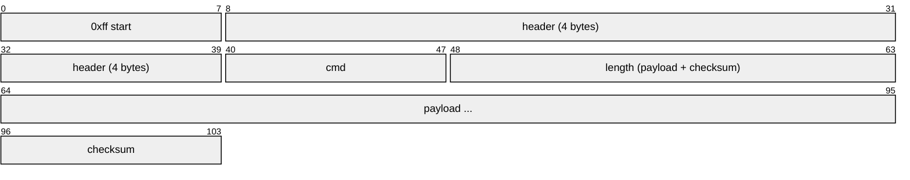
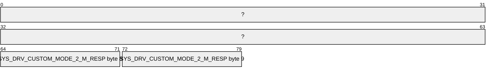

# HKMC Gen5 Wide family base: keepalive and shared layouts only

Variant `hkmc-gen5w`.

- [How to read this](#how-to-read-this)
- [Confidence](#confidence)
- [Headers](#headers)
- [Enums](#enums)
- [Messages from micom](#messages-from-micom)
- [Send (the control socket may send)](#send-the-control-socket-may-send)

## How to read this

Every frame on the serial link has this shape; the payload is what the message tables below describe, byte 0 first.



The 4 header bytes are `sender receiver type func`; a header and its reverse (`0d 8f ..` and `8f 0d ..`) are the two directions of one conversation.

How well each thing is known (per message, signal or header; the files do not grade single fields):

- 🟢 **captured**: seen on the wire or on the live unit.
- 🟡 **code**: read from stock code, not yet seen to match the car.
- 🟠 **inferred**: worked out from code or the frame rule.

A message is a header plus a cmd. Find the header, then the cmd under it; its field table says which payload byte holds what.

## Confidence

| Status | Messages |
| --- | --- |
| 🟡 code | 76 |

Not yet backed by a capture:

| Message | Header | Cmd | Status | Ref |
| --- | --- | --- | --- | --- |
| Variant code | `system_rx` | 0x17 | 🟡 code | micom firmware 0x0117 handler; 61 S5W_M micom builds in emulation (en/ko, country 01/00); EV6 V015.012 automotive-service SystemService.onVariantCode/sendVariantCodeSave, automotive VariantCoding tables |
| Module versions | `system_rx` | 0x74 | 🟡 code | EV6 V015.011 HKMC_EngineerMode VersionModule: registerCallback("MicomDataSVM", 0x8a), onEvent accepts func 0x8174 with 42+ bytes (parser needs 96), parsed by g([B); labels from res string ver_module_*; never captured |
| Version info | `system_rx` | 0x16 | 🟡 code | EV6 V015.011 automotive EngineeringModeVersion.checkVersion; EngineeringModeService.onVersion; SystemService func 0x8116 -> onVersion; HKMC_EngineerMode MicomVersionInfo (indices 1, 4, 5, 8); never captured |
| Part number | `system_rx` | 0x99 | 🟡 code | EV6 V015.011 SystemService\$MicomEventHandler SYS_PART_NUMBER_M_RESP: new String(data, US-ASCII) -> sys.product.partnumber |
| Vehicle trim | `system_rx` | 0x75 | 🟡 code | EV6 V015.011 SystemService func 0x8175 -> InitialCarInfo.setVehicleTrimInfo, USMService/BlackScreenService readers |
| Front/rear camera status | `system_rx` | 0x04 | 🟡 code | SYS_FRONT_REAR_CAMERA_STATUS_M 0x8104 -> onFRCameraStatus |
| Distance to empty | `system_rx` | 0x2a | 🟡 code | SYS_DISTANCE_TO_EMPTY_STATUS_M 0x812a -> onDTEInfoChanged(unit, bytesToInt(data, 1, 2)) |
| Ambient temperature (C) | `system_rx` | 0x2b | 🟡 code | SYS_AMBIENT_TEMP_C_STATUS_M 0x812b -> onAmbientCelciusTempChanged; scaling not read |
| Ambient temperature (F) | `system_rx` | 0x2c | 🟡 code | SYS_AMBIENT_TEMP_F_STATUS_M 0x812c -> onAmbientFahrenheitTempChanged; scaling not read |
| Vehicle warning | `system_rx` | 0x34 | 🟡 code | SYS_VEHICLE_WARNING_M 0x8134 -> onVehicleWarningStatus(b0, b1); meaning not read |
| IGN3 status | `system_rx` | 0x35 | 🟡 code | SYS_IGN3_STATUS_M 0x8135: 1 is on -> onIGNStatus |
| DCT warning | `system_rx` | 0x38 | 🟡 code | SYS_DCT_WARNING_M 0x8138 -> onDctWarning |
| HVAC type | `system_rx` | 0x3a | 🟡 code | SYS_HVAC_TYPE_M 0x813a: stock keeps it in persist.sys.hvactype |
| Fuel type | `system_rx` | 0x3b | 🟡 code | SYS_FUEL_TYPE_M 0x813b -> SystemService.getFuelType |
| FSOC check result | `system_rx` | 0x59 | 🟡 code | SYS_FSOC_M_RESP 0x8159 -> broadcast com.mobis.action.FSOC_CHECK_RESULT with extras FSOC_CHECK_RESULT and BSOC_CHECK_RESULT; answer to fsoc request 0x0159 |
| Eco coasting status | `system_rx` | 0x5c | 🟡 code | SYS_ECO_COASTING_STATUS_M_RESP 0x815c -> SystemService.getEcoCoastingStatus |
| Terrain mode | `system_rx` | 0x64 | 🟡 code | SYS_TERRAIN_MODE_M 0x8164 -> broadcast com.mobis.action.TERRAIN_MODE_STATUS (terrainMode, support: byte 1 > 0) |
| WPC status | `system_rx` | 0x70 | 🟡 code | SYS_WPCWARNING_M_RESP 0x8170 -> broadcast com.mobis.intent.action.WPC_STATUS_CHANGED (WPC_STATUS); answer to wpc request 0x0170 |
| Class status | `system_rx` | 0x98 | 🟡 code | SYS_CLASS_STA_M_RESP 0x8198 -> onClassStatus(byteToInt(b0)); answer to class request 0x0198 |
| SYS_DRV_CUSTOM_MODE_2_M_RESP | `01 8a ?? 81` | 0x87 | 🟡 code | stock SystemService constant SYS_DRV_CUSTOM_MODE_2_M_RESP; the EV6 firmware sends it in emulation when its CAN input changes |
| SYS_IGN_AUTO_OFF_WARN_STATUS_M | `01 8a ?? 81` | 0x88 | 🟡 code | stock SystemService constant SYS_IGN_AUTO_OFF_WARN_STATUS_M; the EV6 firmware sends it in emulation when its CAN input changes |
| SYS_DRV_NEW_MY_DRV_MODE_M_RESP | `01 8a ?? 81` | 0x8a | 🟡 code | stock SystemService constant SYS_DRV_NEW_MY_DRV_MODE_M_RESP; the EV6 firmware sends it in emulation when its CAN input changes |
| HANDSHAKING_RX_SIG | `0d 8f ?? 8d` | 0x2e | 🟡 code | stock Navigation constant HANDSHAKING_RX_SIG; the EV6 firmware sends it in emulation when its CAN input changes |
| NSCC_C_REQ | `0d 8f ?? 8d` | 0x41 | 🟡 code | stock Navigation constant NSCC_C_REQ; the EV6 firmware sends it in emulation when its CAN input changes |
| DAW_WRN_C_REQ | `0d 8f ?? 8d` | 0x44 | 🟡 code | stock Navigation constant DAW_WRN_C_REQ; the EV6 firmware sends it in emulation when its CAN input changes |
| HDA_LINE_NUM_VAL_C_REQ | `0d 8f ?? 8d` | 0x45 | 🟡 code | stock Navigation constant HDA_LINE_NUM_VAL_C_REQ; the EV6 firmware sends it in emulation when its CAN input changes |
| USM_UserProfile_Rx_NFC_0_Short_M PHONEPAIRINGRVALUE | `11 92 ?? 91` | 0x16 | 🟡 code | stock USM_UserProfile_Rx_NFC_0_Short_M, item 1 PHONEPAIRINGRVALUE (USM\$NFC0_SHORT); the EV6 firmware sends it in emulation when CAN 0x434 byte 1 bits 0..1 changes |
| USM_UserProfile_Rx_NFC_0_Short_M NFC_SUPPORT_RESULT | `11 92 ?? 91` | 0x16 | 🟡 code | stock USM_UserProfile_Rx_NFC_0_Short_M, item 4 NFC_SUPPORT_RESULT (USM\$NFC0_SHORT); the EV6 firmware sends it in emulation when CAN 0x434 byte 0 bits 0..1 changes |
| USM_UserProfile_Rx_NFC_0_Short_M OWNER_PHONERVALUE | `11 92 ?? 91` | 0x16 | 🟡 code | stock USM_UserProfile_Rx_NFC_0_Short_M, item 7 OWNER_PHONERVALUE (USM\$NFC0_SHORT); the EV6 firmware sends it in emulation when CAN 0x434 byte 3 bits 2..3 changes |
| USM_UserProfile_Rx_NFC_0_Short_M DIGITALKEYENABLERVALUE | `11 92 ?? 91` | 0x16 | 🟡 code | stock USM_UserProfile_Rx_NFC_0_Short_M, item 8 DIGITALKEYENABLERVALUE (USM\$NFC0_SHORT); the EV6 firmware sends it in emulation when CAN 0x434 byte 3 bits 0..1 changes |
| USM_UserProfile_Rx_NFC_1_Short_M IDRVALUE | `11 92 ?? 91` | 0x18 | 🟡 code | stock USM_UserProfile_Rx_NFC_1_Short_M, item 2 IDRVALUE (USM\$NFC1_SHORT); the EV6 firmware sends it in emulation when CAN 0x434 byte 1 bits 2..5 changes |
| USM_UserProfile_Rx_NFC_1_Short_M DIGITALKEYGUIDE | `11 92 ?? 91` | 0x18 | 🟡 code | stock USM_UserProfile_Rx_NFC_1_Short_M, item 4 DIGITALKEYGUIDE (USM\$NFC1_SHORT); the EV6 firmware sends it in emulation when CAN 0x434 byte 2 bits 0..3 changes |
| USM_HUD_SET_Disp_Ctrl_M_RESP | `11 92 ?? 91` | 0x02 | 🟡 code | stock USM\$ table HUDDisplayControl; the EV6 firmware answers its request (0x1102) in emulation with 4 bytes |
| USM_HUD_SET_Content_Selection_M_RESP | `11 92 ?? 91` | 0x03 | 🟡 code | stock USM\$ table HUDContentSelection; the EV6 firmware answers its request (0x1103) in emulation with 8 bytes |
| USM_HUD_SET_Speed_Odometer_M_RESP | `11 92 ?? 91` | 0x04 | 🟡 code | stock USM\$ table HUDSpeedOdometer; the EV6 firmware answers its request (0x1104) in emulation with 3 bytes |
| USM_Driver_Assi_SET_DrAssi_M_RESP | `11 92 ?? 91` | 0x06 | 🟡 code | stock USM\$ table DriverAssist; the EV6 firmware answers its request (0x1106) in emulation with 15 bytes |
| USM_Driver_Assi_SET_Warn_M_RESP | `11 92 ?? 91` | 0x07 | 🟡 code | stock USM\$ table Warning; the EV6 firmware answers its request (0x1107) in emulation with 15 bytes |
| USM_Driver_Assi_SET_Safety_M_RESP | `11 92 ?? 91` | 0x08 | 🟡 code | stock USM\$ table Safety; the EV6 firmware answers its request (0x1108) in emulation with 35 bytes |
| USM_DrTk_SET_M_RESP | `11 92 ?? 91` | 0x09 | 🟡 code | stock USM\$ table Door; the EV6 firmware answers its request (0x1109) in emulation with 22 bytes |
| USM_Cluster_SET_Service_M_RESP | `11 92 ?? 91` | 0x0a | 🟡 code | stock USM\$ table ClusterService; the EV6 firmware answers its request (0x110a) in emulation with 12 bytes |
| USM_Cluster_SET_Content_Vol_M_RESP | `11 92 ?? 91` | 0x0c | 🟡 code | stock USM\$ table ClusterContent; the EV6 firmware answers its request (0x110c) in emulation with 12 bytes |
| USM_Light_SET_Lamp_M_RESP | `11 92 ?? 91` | 0x0d | 🟡 code | stock USM\$ table Lights; the EV6 firmware answers its request (0x110d) in emulation with 15 bytes |
| USM_Convenience_SET_ETC_M_RESP | `11 92 ?? 91` | 0x0f | 🟡 code | stock USM\$ table ConvenienceEtc; the EV6 firmware answers its request (0x110f) in emulation with 18 bytes |
| USM_Pwr_Folding_M_RESP | `11 92 ?? 91` | 0x1a | 🟡 code | stock USM\$ table PowerFoldingSeat; the EV6 firmware answers its request (0x111a) in emulation with 23 bytes |
| USM_Eco_Vehicle_M_RESP | `11 92 ?? 91` | 0x1b | 🟡 code | stock USM\$ table EcoVehicle; the EV6 firmware answers its request (0x111b) in emulation with 20 bytes |
| USM_RearSeat_H_M_RESP | `11 92 ?? 91` | 0x1c | 🟡 code | stock USM\$ table RearSeatHeat; the EV6 firmware answers its request (0x111c) in emulation with 7 bytes |
| USM_HealthCare_M_RESP | `11 92 ?? 91` | 0x20 | 🟡 code | stock USM\$ table HealthCare; the EV6 firmware answers its request (0x1120) in emulation with 4 bytes |
| USM_SmartIMS20_M_RESP | `11 92 ?? 91` | 0x21 | 🟡 code | stock USM\$ table SmartIMS20; the EV6 firmware answers its request (0x1121) in emulation with 7 bytes |
| USM_Seat_ETC_M_RESP | `11 92 ?? 91` | 0x22 | 🟡 code | stock USM\$ table SeatETC; the EV6 firmware answers its request (0x1122) in emulation with 3 bytes |
| USM_HUD_SET_ETC_M_RESP | `11 92 ?? 91` | 0x23 | 🟡 code | stock USM\$ table HUDEtc; the EV6 firmware answers its request (0x1123) in emulation with 7 bytes |
| USM_CLU_SET_ETC_M_RESP | `11 92 ?? 91` | 0x24 | 🟡 code | stock USM\$ table ClusterETC; the EV6 firmware answers its request (0x1124) in emulation with 6 bytes |
| USM_DrTk_SET_ETC_M_RESP | `11 92 ?? 91` | 0x25 | 🟡 code | stock USM\$ table DoorETC; the EV6 firmware answers its request (0x1125) in emulation with 3 bytes |
| USM_SWRC_SET_M_RESP | `11 92 ?? 91` | 0x27 | 🟡 code | stock USM\$ table SWRC; the EV6 firmware answers its request (0x1127) in emulation with 5 bytes |
| USM_Front_Seat_Heat_SET_M_RESP | `11 92 ?? 91` | 0x28 | 🟡 code | stock USM\$ table FrontSeatHeat; the EV6 firmware answers its request (0x1128) in emulation with 5 bytes |
| USM_All_Seat_Moving_SET_M_RESP | `11 92 ?? 91` | 0x29 | 🟡 code | stock USM\$ table AllSeatMoving; the EV6 firmware answers its request (0x1129) in emulation with 14 bytes |
| USM_CMS_SET_M_RESP | `11 92 ?? 91` | 0x2a | 🟡 code | stock USM\$ table CameraMonitorSystem; the EV6 firmware answers its request (0x112a) in emulation with 8 bytes |
| USM_Convenience_SET_ETC_ADD_M_RESP | `11 92 ?? 91` | 0x2b | 🟡 code | stock USM\$ table ConvenienceEtcAdd; the EV6 firmware answers its request (0x112b) in emulation with 5 bytes |
| USM_Clu_Right_Gauge_M_RESP | `11 92 ?? 91` | 0x2c | 🟡 code | stock USM\$ table ClusterRightGauge; the EV6 firmware answers its request (0x112c) in emulation with 14 bytes |
| USM_Body_Type_M_RESP | `11 92 ?? 91` | 0x2d | 🟡 code | stock USM\$ table BodyType; the EV6 firmware answers its request (0x112d) in emulation with 2 bytes |
| USM_ERGO_M_RESP | `11 92 ?? 91` | 0x2e | 🟡 code | stock USM\$ table Ergo; the EV6 firmware answers its request (0x112e) in emulation with 9 bytes |
| USM_Seat_2nd_Reg_L_M_RESP | `11 92 ?? 91` | 0x2f | 🟡 code | stock USM\$ table SEATBACKRECLINE_RLPSU; the EV6 firmware answers its request (0x112f) in emulation with 10 bytes |
| USM_Seat_2nd_Reg_R_M_RESP | `11 92 ?? 91` | 0x30 | 🟡 code | stock USM\$ table SEATBACKRECLINE_RRPSU; the EV6 firmware answers its request (0x1130) in emulation with 10 bytes |
| USM_Eco_Vehicle_ETC_M_RESP | `11 92 ?? 91` | 0x31 | 🟡 code | stock USM\$ table EcoVehicleETC; the EV6 firmware answers its request (0x1131) in emulation with 3 bytes |
| USM_TOWMODE_M_RESP | `11 92 ?? 91` | 0x33 | 🟡 code | stock USM\$ table TOWMODE; the EV6 firmware answers its request (0x1133) in emulation with 2 bytes |
| USM_Convenience_SET_Ventilated_M_RESP | `11 92 ?? 91` | 0x0e | 🟡 code | stock USM\$ table ConvenienceVentilate; the EV6 firmware answers its request (0x110e) in emulation with 10 bytes; ids 2 and 3 only, not 1..N, and the reply is longer than max id + 1 |
| USM_Driver_Assi_SET_ETC_M_RESP | `11 92 ?? 91` | 0x26 | 🟡 code | stock USM\$ table DriverAssistETC; the EV6 firmware answers its request (0x1126) in emulation with 17 bytes; ids 1-4 and 6-17 (no 5); id 17 BLINDSPOTSAFETYWARNINGSOUND would sit at byte 17, past the reply, so it is not read |
| USM_DIGITALKEY_2nd_M_RESP | `11 92 ?? 91` | 0x34 | 🟡 code | stock USM\$ table DigitalKeyInfo2; the EV6 firmware answers its request (0x1134) in emulation with 10 bytes; item 6 NFCCARD1_SERIAL is a string, probably bytes 6-9, unread |
| USM_Dual_Light_SET_LAMP_M_RESP | `11 92 ?? 91` | 0x35 | 🟡 code | stock USM\$ table DualLight; the EV6 firmware answers its request (0x1135) in emulation with 10 bytes; byte 0 is 02 here, not 0xfa, so it is left unnamed; id 100 MLMALL is the write-all id and has no byte |
| USM_HUD_SET_ON_OFF_M_RESP | `11 92 ?? 91` | 0x01 | 🟡 code | no stock table; the EV6 firmware answers its request (0x1101) in emulation with 3 bytes |
| USM_Driver_Assi_SET_SCC_M_RESP | `11 92 ?? 91` | 0x05 | 🟡 code | no stock table; the EV6 firmware answers its request (0x1105) in emulation with 1 bytes; 0xfa when unset |
| USM_Cluster_SET_ENG_Reset_M_RESP | `11 92 ?? 91` | 0x0b | 🟡 code | no stock table; the EV6 firmware answers its request (0x110b) in emulation with 2 bytes |
| USM_Reset_USM_SETTING_M_RESP | `11 92 ?? 91` | 0x10 | 🟡 code | no stock table; the EV6 firmware answers its request (0x1110) in emulation with 1 bytes |
| USM_UserProfile_ALL_NFC_0_M_REQ | `11 92 ?? 91` | 0x13 | 🟡 code | stock USMService.onEvent, UserProfile fields in log order (byte-to-field pairing is that order, not a setter name); bytes 4-9 are the NFC BD address as hex; the EV6 firmware answers request 0x1113 in emulation with 14 bytes; named _REQ in the stock table although it is micom to SoC |
| USM_UserProfile_ALL_NFC_1_M_REQ | `11 92 ?? 91` | 0x14 | 🟡 code | stock USMService.onEvent, UserProfile fields in log order; bytes 2-7 are a number the SoC formats as hex (%06X of bytes 2-4, %X of bytes 5-7, each little-endian), shown as two halves; the field name PhoneNumberOnWPC is a guess from the stock field list; the EV6 firmware answers request 0x1114 in emulation with 10 bytes; named _REQ in the stock table although it is micom to SoC |
| USM_DigitalKey_Info_M_RESP | `11 92 ?? 91` | 0x1e | 🟡 code | stock USMService.onEvent: Item 1-6 (or 0xfa for all) says which of Manufacturer, Serial, VendorCode, Year, Month, Date the reply carries, each big-endian at its own offset; the string fields are the stock hex of those bytes; Year, Month and Date indices are from the getters, the three strings are assumed in that order; the EV6 firmware answers request 0x111e in emulation with 14 bytes |
| USM_UserProfile_Rx_NFC_2_M_RESP | `11 92 ?? 91` | 0x1f | 🟡 code | stock USMService.onEvent: all 8 bytes are UserProfile PhoneNumber, little-endian, which the SoC formats as hex (%08X of bytes 0-3, then %X of bytes 4-7), shown as two halves; the stock's %X drops leading zeros, these halves keep them; the EV6 firmware answers request 0x111f in emulation with 8 bytes |

## Headers

| Name | Header | Direction | Status | Ref |
| --- | --- | --- | --- | --- |
| audio_tx | `85 02 01 02` | to_micom | 🟢 captured | stock micomd strace, source switch |
| monitor_tx | `8c 08 01 08` | to_micom | 🟡 code | stock lights.tcc803x.so set_backlight_state; MicomHeader\$DeviceId MID_MONITOR = 8 |
| system_rx | `01 8a 01 81` | from_micom | 🟢 captured | the CPU-alive request |
| system_tx | `8a 01 01 01` | to_micom | 🟢 captured | the CPU-alive reply |

## Enums

| Enum | Values | Used by |
| --- | --- | --- |
| adm | **0** off<br>**1** on | Variant code: ADM |
| boot_mode | 19 values, below |  |
| camera | **0** r_cam<br>**1** r_cam_old<br>**2** lvs<br>**3** avm | Variant code: Camera |
| camera_mode | **0** analog<br>**1** digital | Variant code: Camera mode |
| camera_status | **0** cameraoff<br>**1** front_camera_on<br>**2** rear_camera_on | Front/rear camera status: Camera |
| country | 23 values, below | Variant code: Country; Version info: Micom region |
| dct_warning | **0** normal_display<br>**1** clutch_off<br>**2** none_eol<br>**3** start_hold<br>**255** none | DCT warning: Warning |
| distance_unit | **0** m<br>**1** km<br>**2** mi<br>**3** ft<br>**4** yd |  |
| dvd_region | **0** worldwide<br>**1** us<br>**2** eur<br>**3** kor<br>**4** c_s_america<br>**5** rus<br>**6** chn | Variant code: DVD region |
| external_amp | **0** actune<br>**1** lexicon | Variant code: External amp |
| fuel_type | **0** none<br>**1** gas<br>**2** lpg<br>**3** diesel<br>**4** ffv | Fuel type: Type |
| hu_type | **0** daudio<br>**1** daudio_plus | Variant code: HU type |
| hvac_type | **0** mtc<br>**1** fatc<br>**255** none | HVAC type: Type |
| maneuver | 40 values, below |  |
| radio_region | **0** khz_9_100<br>**1** khz_10_200<br>**2** khz_9_50<br>**3** khz_10_100<br>**4** khz_9_200 | Variant code: Radio region |
| reset_reason | 20 values, below |  |
| trip_unit | **1** km<br>**2** mile | Distance to empty: Unit |
| vehicle | 128 values, below | Variant code: Vehicle; Version info: Micom vehicle |

### boot_mode

| Value | Name |
| --- | --- |
| 1 | boot_normal |
| 2 | door_unlock |
| 3 | balarm_status |
| 4 | panic |
| 5 | sms_message |
| 6 | cd_eject |
| 7 | door_open |
| 8 | charging |
| 9 | update_reservation |
| 10 | rrseatremand_alarm |
| 11 | wlight_on |
| 12 | bat_soc_alert |
| 13 | trunk_open |
| 14 | rmt_eng_run |
| 15 | batt_status_alarm |
| 16 | dvrs_rec_crash_prk_alarm |
| 17 | modem_96_168_end |
| 18 | reservation_download |
| 255 | rtc_wakeup |

### country

| Value | Name |
| --- | --- |
| 0 | korea |
| 1 | us |
| 2 | china |
| 3 | general |
| 4 | middleeast |
| 5 | europe |
| 6 | canada |
| 7 | russia |
| 8 | turkey |
| 9 | australia |
| 10 | guam |
| 11 | india |
| 12 | mexico |
| 13 | brazil |
| 14 | iran |
| 15 | ge |
| 16 | japan |
| 17 | indonesia |
| 18 | singapore |
| 19 | thailand |
| 20 | vietnam |
| 21 | philippines |
| 22 | malaysia |

### maneuver

| Value | Name |
| --- | --- |
| 0 | none |
| 1 | no_info |
| 2 | depart |
| 3 | dest_reached |
| 4 | near_dest |
| 5 | arrived_off_map |
| 6 | off_road |
| 7 | off_map |
| 8 | no_route_guide |
| 9 | calc_route |
| 10 | recalc_route |
| 32 | roundabout_exit_right |
| 33 | roundabout_exit_left |
| 64 | unknown |
| 65 | straight |
| 66 | slight_right |
| 67 | turn_right |
| 68 | sharp_right |
| 69 | sharp_left |
| 70 | turn_left |
| 71 | slight_left |
| 72 | uturn_left |
| 73 | uturn_right |
| 81 | off_ramp_right |
| 82 | off_ramp_left |
| 86 | off_ramp |
| 96 | roundabout_96 |
| 97 | roundabout_97 |
| 99 | roundabout_99 |
| 100 | roundabout_100 |
| 102 | roundabout_102 |
| 103 | roundabout_103 |
| 105 | roundabout_105 |
| 106 | roundabout_106 |
| 112 | destination |
| 115 | arrived |
| 172 | on_ramp |
| 173 | on_ramp_right |
| 174 | on_ramp_left |
| 176 | ferry |

### reset_reason

| Value | Name |
| --- | --- |
| 0 | normal |
| 1 | micom_watch_dog |
| 2 | reset_request_pin |
| 3 | reset_protocol |
| 4 | manual_reset |
| 5 | cpu_alive_not_recv |
| 6 | fram_init |
| 7 | self_diag |
| 8 | variant_save |
| 9 | reset_packet_log_dump |
| 10 | ket_reset |
| 11 | factory_reset |
| 12 | uart_dma_deactive |
| 13 | batt_4_5_off |
| 14 | micom_internal |
| 15 | cpu_only_reset |
| 16 | shutdown_reserve_update |
| 17 | dsp_init_error |
| 18 | stuck_cpu_boot_pin |
| 19 | stuck_cpu_boot_msg |

### vehicle

| Value | Name |
| --- | --- |
| 0 | ckpe23 |
| 2 | dn823 |
| 4 | dn823hev |
| 5 | neev23 |
| 10 | ospe23 |
| 13 | tm23 |
| 15 | tmhev23 |
| 16 | tmphev23 |
| 20 | cn723 |
| 21 | cn7hev23 |
| 54 | neev23se |
| 83 | sk3 |
| 84 | sk3ev |
| 87 | jsn |
| 88 | tlfl |
| 99 | on |
| 101 | adpe |
| 102 | lx2 |
| 103 | sq |
| 110 | dn8 |
| 114 | oshev |
| 115 | dn8hev |
| 116 | dn8phev |
| 122 | sp2i |
| 126 | aepeev |
| 127 | aepehev |
| 128 | aepephev |
| 130 | depehev |
| 131 | depephev |
| 133 | osev20 |
| 134 | ygpe |
| 135 | ygpehev |
| 136 | dl3 |
| 137 | dl3hev |
| 140 | qlcpe |
| 141 | bdc |
| 142 | bdcphev |
| 143 | igpe |
| 144 | igpehev |
| 147 | sqcev |
| 148 | adfl |
| 149 | hmpe2 |
| 150 | mq4 |
| 151 | mq4hev |
| 152 | adipe |
| 154 | tl20my |
| 155 | cn7 |
| 157 | cn7hev |
| 158 | bi3 |
| 159 | tam20 |
| 161 | jape |
| 162 | nx4 |
| 163 | nx4hev |
| 164 | ka4 |
| 165 | ybpe |
| 167 | ckpe |
| 168 | de20ev |
| 169 | csev |
| 170 | bdcev |
| 171 | pdenpe |
| 172 | gzfl |
| 173 | tmfl |
| 174 | tmhev |
| 175 | tmphev |
| 177 | ikfl |
| 178 | qx20my |
| 179 | csfl |
| 180 | nx4phev |
| 181 | mq4_p_22 |
| 182 | ospe |
| 183 | hm21 |
| 185 | qy |
| 186 | sk321 |
| 187 | sk3ev21 |
| 188 | us4 |
| 189 | neev |
| 190 | gl3 |
| 191 | gl3hev |
| 192 | osn_pe |
| 193 | su2b |
| 194 | ospeev |
| 195 | ospehev |
| 196 | cv |
| 197 | qx21 |
| 198 | sp2_21 |
| 199 | bdpe |
| 200 | de_e_22 |
| 201 | de_h_22 |
| 202 | de_p_22 |
| 203 | sg2_h |
| 204 | cvev |
| 205 | qx21my |
| 206 | nq5 |
| 207 | nq5_h |
| 208 | sg2_p |
| 209 | nq5_p |
| 210 | cn7n |
| 211 | ax1 |
| 214 | sp2_22 |
| 215 | nx4ob |
| 216 | sk3_22 |
| 217 | sk3_e_22 |
| 218 | ky1 |
| 219 | dn8_22 |
| 220 | dn8_h_22 |
| 221 | dl3_22 |
| 222 | dl3_h_22 |
| 223 | mq4_22 |
| 224 | mq4_h_22 |
| 225 | igpe_22 |
| 226 | igpe_h_22 |
| 227 | on_22 |
| 228 | gz_22 |
| 229 | sg2_e |
| 230 | hr_e_22 |
| 231 | pu_e |
| 232 | ce_e |
| 233 | lx2pe |
| 234 | tam_22 |
| 235 | jape_22 |
| 236 | igpe_21 |
| 237 | igpe_h_21 |
| 238 | ka4_22 |
| 239 | ckpe_22 |
| 240 | tm_22 |
| 241 | tm_h_22 |
| 242 | hmpe2_22 |
| 250 | deevpbv |

## Messages from micom

### system_rx

`01 8a 01 81`: the CPU-alive request

#### Variant code

cmd `0x17`, length ≥ 13 · 🟡 code

> micom firmware 0x0117 handler; 61 S5W_M micom builds in emulation (en/ko, country 01/00); EV6 V015.012 automotive-service SystemService.onVariantCode/sendVariantCodeSave, automotive VariantCoding tables

| Field | At | Type | Enum |
| --- | --- | --- | --- |
| Vehicle | byte 0 |  | vehicle |
| Country | byte 1 |  | country |
| Navigation | byte 2 bits 7 |  |  |
| Modem | byte 2 bits 6 |  |  |
| Internal amp | byte 2 bits 5 |  |  |
| Rear monitor | byte 2 bits 4 |  |  |
| Radio region | byte 2 bits 3:1 |  | radio_region |
| DMB | byte 2 bits 0 |  |  |
| RHD | byte 3 bits 7 |  |  |
| Limo | byte 3 bits 6 |  |  |
| External amp | byte 3 bits 5 |  | external_amp |
| Camera | byte 3 bits 4:3 |  | camera |
| Advanced cluster | byte 3 bits 2 |  |  |
| HUD | byte 3 bits 1 |  |  |
| Rear USB | byte 3 bits 0 |  |  |
| RRC | byte 4 bits 7 |  |  |
| CDC | byte 4 bits 6 |  |  |
| ISDB | byte 4 bits 5 |  |  |
| HD Radio | byte 4 bits 4 |  |  |
| CMMB | byte 4 bits 3 |  |  |
| Internal CDP | byte 4 bits 2 |  |  |
| External CDP | byte 4 bits 1 |  |  |
| Telematics | byte 4 bits 0 |  |  |
| Diranarom | byte 5 bits 7 |  |  |
| DAB | byte 5 bits 6 |  |  |
| HU type | byte 5 bits 5 |  | hu_type |
| Camera mode | byte 5 bits 4 |  | camera_mode |
| GPS | byte 5 bits 3 |  |  |
| Ext CDP feature | byte 5 bits 2 |  |  |
| Sub board | byte 5 bits 1 |  |  |
| RDS | byte 5 bits 0 |  |  |
| DVD region | byte 6 |  | dvd_region |
| Language | byte 7 | str |  |
| CPU variant 9 | byte 9 |  |  |
| CPU variant 10 | byte 10 |  |  |
| CPU variant 11 | byte 11 |  |  |
| ADM | byte 12 |  | adm |

#### Module versions

cmd `0x74`, length ≥ 96 · 🟡 code

> EV6 V015.011 HKMC_EngineerMode VersionModule: registerCallback("MicomDataSVM", 0x8a), onEvent accepts func 0x8174 with 42+ bytes (parser needs 96), parsed by g([B); labels from res string ver_module_*; never captured

| Field | At | Type |
| --- | --- | --- |
| HUD | byte 0 | str |
| Cluster | byte 7 | str |
| PSM | byte 14 | str |
| APSM | byte 17 | str |
| IBU | byte 20 | str |
| WPC | byte 23 | str |
| RWPC | byte 26 | str |
| IAU | byte 29 | str |
| DVRS | byte 32 | str |
| DATC a | byte 35 | str |
| RVM 0 | byte 38 |  |
| RVM 1 | byte 39 |  |
| AVM 0 | byte 40 |  |
| AVM 1 | byte 41 |  |
| SCM | byte 42 | str |
| VESS a 0 | byte 45 |  |
| VESS a 1 | byte 46 |  |
| ADP a 0 | byte 47 |  |
| ADP a 1 | byte 48 |  |
| ADP a 2 | byte 49 |  |
| ADP a 3 | byte 50 |  |
| ADP a 4 | byte 51 |  |
| MKBD 0 | byte 52 |  |
| MKBD 1 | byte 53 |  |
| MKBD 2 | byte 54 |  |
| AMP Binary 0 | byte 55 |  |
| AMP Binary 1 | byte 56 |  |
| AMP Binary 2 | byte 57 |  |
| VESS Binary 0 | byte 58 |  |
| VESS Binary 1 | byte 59 |  |
| ADP Binary 0 | byte 60 |  |
| ADP Binary 1 | byte 61 |  |
| ADP Binary 2 | byte 62 |  |
| FR_CMR 0 | byte 63 |  |
| FR_CMR 1 | byte 64 |  |
| ADAS_DRV 0 | byte 65 |  |
| ADAS_DRV 1 | byte 66 |  |
| HCU | byte 67 |  |
| ECS 0 | byte 68 |  |
| ECS 1 | byte 69 |  |
| TCU | byte 70 | str |
| SML 0 | byte 73 |  |
| SML 1 | byte 74 |  |
| Unused | byte 75 |  |
| VCU | byte 76 |  |
| AMP 0 | byte 77 |  |
| AMP 1 | byte 78 |  |
| AMP 2 | byte 79 |  |
| ADP b 0 | byte 80 |  |
| ADP b 1 | byte 81 |  |
| ADP b 2 | byte 82 |  |
| RRC 0 | byte 83 |  |
| RRC 1 | byte 84 |  |
| RDC | byte 85 | str |
| DATC b | byte 88 | str |
| VESS b 0 | byte 90 |  |
| VESS b 1 | byte 91 |  |
| VESS b 2 | byte 92 |  |
| VESS b 3 | byte 93 |  |
| VESS b 4 | byte 94 |  |
| VESS b 5 | byte 95 |  |

#### Version info

cmd `0x16`, length ≥ 86 · 🟡 code

> EV6 V015.011 automotive EngineeringModeVersion.checkVersion; EngineeringModeService.onVersion; SystemService func 0x8116 -> onVersion; HKMC_EngineerMode MicomVersionInfo (indices 1, 4, 5, 8); never captured

| Field | At | Type | Enum |
| --- | --- | --- | --- |
| Board HW | byte 0 |  |  |
| Board HW 1 | byte 1 |  |  |
| Board HW 2 | byte 2 |  |  |
| Micom vehicle | byte 3 |  | vehicle |
| Micom region | byte 4 |  | country |
| Micom number | byte 5 | u16 |  |
| Micom build date | byte 7 | str |  |
| MM CAN DB 0 | byte 18 |  |  |
| MM CAN DB 1 | byte 19 |  |  |
| MM CAN DB 2 | byte 20 |  |  |
| MM CAN DB 3 | byte 21 |  |  |
| Body CAN DB 0 | byte 22 |  |  |
| Body CAN DB 1 | byte 23 |  |  |
| Body CAN DB 2 | byte 24 |  |  |
| Body CAN DB 3 | byte 25 |  |  |
| External amp 0 | byte 26 |  |  |
| External amp 1 | byte 27 |  |  |
| External amp tuning 0 | byte 28 |  |  |
| External amp tuning 1 | byte 29 |  |  |
| External monitor 0 | byte 30 |  |  |
| External monitor 1 | byte 31 |  |  |
| External CD 0 | byte 32 |  |  |
| External CD 1 | byte 33 |  |  |
| Audio DSP tuning | byte 34 | str |  |
| Radio DSP tuning | byte 42 | str |  |
| HD module | byte 50 | str |  |

#### Part number

cmd `0x99`, length ≥ 1 · 🟡 code

> EV6 V015.011 SystemService\$MicomEventHandler SYS_PART_NUMBER_M_RESP: new String(data, US-ASCII) -> sys.product.partnumber

| Field | At | Type |
| --- | --- | --- |
| Part number | byte 0 | str |


#### Vehicle trim

cmd `0x75`, length ≥ 1 · 🟡 code

> EV6 V015.011 SystemService func 0x8175 -> InitialCarInfo.setVehicleTrimInfo, USMService/BlackScreenService readers

| Field | At |
| --- | --- |
| Trim | byte 0 |


#### Front/rear camera status

cmd `0x04`, length ≥ 1 · 🟡 code

> SYS_FRONT_REAR_CAMERA_STATUS_M 0x8104 -> onFRCameraStatus

| Field | At | Enum |
| --- | --- | --- |
| Camera | byte 0 | camera_status |


#### Distance to empty

cmd `0x2a`, length ≥ 3 · 🟡 code

> SYS_DISTANCE_TO_EMPTY_STATUS_M 0x812a -> onDTEInfoChanged(unit, bytesToInt(data, 1, 2))

| Field | At | Type | Enum |
| --- | --- | --- | --- |
| Unit | byte 0 |  | trip_unit |
| Distance | byte 1 | u16 |  |


#### Ambient temperature (C)

cmd `0x2b`, length ≥ 1 · 🟡 code

> SYS_AMBIENT_TEMP_C_STATUS_M 0x812b -> onAmbientCelciusTempChanged; scaling not read

| Field | At |
| --- | --- |
| Temperature | byte 0 |


#### Ambient temperature (F)

cmd `0x2c`, length ≥ 1 · 🟡 code

> SYS_AMBIENT_TEMP_F_STATUS_M 0x812c -> onAmbientFahrenheitTempChanged; scaling not read

| Field | At |
| --- | --- |
| Temperature | byte 0 |


#### Vehicle warning

cmd `0x34`, length ≥ 2 · 🟡 code

> SYS_VEHICLE_WARNING_M 0x8134 -> onVehicleWarningStatus(b0, b1); meaning not read

| Field | At |
| --- | --- |
| Warning 0 | byte 0 |
| Warning 1 | byte 1 |


#### IGN3 status

cmd `0x35`, length ≥ 1 · 🟡 code

> SYS_IGN3_STATUS_M 0x8135: 1 is on -> onIGNStatus

| Field | At | Type |
| --- | --- | --- |
| On | byte 0 | bool |


#### DCT warning

cmd `0x38`, length ≥ 1 · 🟡 code

> SYS_DCT_WARNING_M 0x8138 -> onDctWarning

| Field | At | Enum |
| --- | --- | --- |
| Warning | byte 0 | dct_warning |


#### HVAC type

cmd `0x3a`, length ≥ 1 · 🟡 code

> SYS_HVAC_TYPE_M 0x813a: stock keeps it in persist.sys.hvactype

| Field | At | Enum |
| --- | --- | --- |
| Type | byte 0 | hvac_type |


#### Fuel type

cmd `0x3b`, length ≥ 1 · 🟡 code

> SYS_FUEL_TYPE_M 0x813b -> SystemService.getFuelType

| Field | At | Enum |
| --- | --- | --- |
| Type | byte 0 | fuel_type |


#### FSOC check result

cmd `0x59`, length ≥ 2 · 🟡 code

> SYS_FSOC_M_RESP 0x8159 -> broadcast com.mobis.action.FSOC_CHECK_RESULT with extras FSOC_CHECK_RESULT and BSOC_CHECK_RESULT; answer to fsoc request 0x0159

| Field | At |
| --- | --- |
| FSOC result | byte 0 |
| BSOC result | byte 1 |


#### Eco coasting status

cmd `0x5c`, length ≥ 1 · 🟡 code

> SYS_ECO_COASTING_STATUS_M_RESP 0x815c -> SystemService.getEcoCoastingStatus

| Field | At |
| --- | --- |
| Status | byte 0 |


#### Terrain mode

cmd `0x64`, length ≥ 2 · 🟡 code

> SYS_TERRAIN_MODE_M 0x8164 -> broadcast com.mobis.action.TERRAIN_MODE_STATUS (terrainMode, support: byte 1 > 0)

| Field | At | Type |
| --- | --- | --- |
| Mode | byte 0 |  |
| Supported | byte 1 | bool |


#### WPC status

cmd `0x70`, length ≥ 1 · 🟡 code

> SYS_WPCWARNING_M_RESP 0x8170 -> broadcast com.mobis.intent.action.WPC_STATUS_CHANGED (WPC_STATUS); answer to wpc request 0x0170

| Field | At |
| --- | --- |
| Status | byte 0 |


#### Class status

cmd `0x98`, length ≥ 1 · 🟡 code

> SYS_CLASS_STA_M_RESP 0x8198 -> onClassStatus(byteToInt(b0)); answer to class request 0x0198

| Field | At |
| --- | --- |
| Class | byte 0 |


### 01 8a ?? 81


#### SYS_DRV_CUSTOM_MODE_2_M_RESP

cmd `0x87`, length ≥ 14 · 🟡 code

> stock SystemService constant SYS_DRV_CUSTOM_MODE_2_M_RESP; the EV6 firmware sends it in emulation when its CAN input changes

| Field | At |
| --- | --- |
| SYS_DRV_CUSTOM_MODE_2_M_RESP byte 8 | byte 8 |
| SYS_DRV_CUSTOM_MODE_2_M_RESP byte 9 | byte 9 |



#### SYS_IGN_AUTO_OFF_WARN_STATUS_M

cmd `0x88`, length ≥ 1 · 🟡 code

> stock SystemService constant SYS_IGN_AUTO_OFF_WARN_STATUS_M; the EV6 firmware sends it in emulation when its CAN input changes

| Field | At |
| --- | --- |
| SYS_IGN_AUTO_OFF_WARN_STATUS_M | byte 0 |


#### SYS_DRV_NEW_MY_DRV_MODE_M_RESP

cmd `0x8a`, length ≥ 6 · 🟡 code

> stock SystemService constant SYS_DRV_NEW_MY_DRV_MODE_M_RESP; the EV6 firmware sends it in emulation when its CAN input changes

| Field | At |
| --- | --- |
| SYS_DRV_NEW_MY_DRV_MODE_M_RESP byte 0 | byte 0 |
| SYS_DRV_NEW_MY_DRV_MODE_M_RESP byte 1 | byte 1 |
| SYS_DRV_NEW_MY_DRV_MODE_M_RESP byte 2 | byte 2 |


### 0d 8f ?? 8d


#### HANDSHAKING_RX_SIG

cmd `0x2e`, length ≥ 16 · 🟡 code

> stock Navigation constant HANDSHAKING_RX_SIG; the EV6 firmware sends it in emulation when its CAN input changes

| Field | At |
| --- | --- |
| HANDSHAKING_RX_SIG | byte 0 |

```mermaid
packet-beta
0-7: "HANDSHAKING_RX_SIG"
```

#### NSCC_C_REQ

cmd `0x41`, length ≥ 1 · 🟡 code

> stock Navigation constant NSCC_C_REQ; the EV6 firmware sends it in emulation when its CAN input changes

| Field | At |
| --- | --- |
| NSCC_C_REQ | byte 0 |

```mermaid
packet-beta
0-7: "NSCC_C_REQ"
```

#### DAW_WRN_C_REQ

cmd `0x44`, length ≥ 1 · 🟡 code

> stock Navigation constant DAW_WRN_C_REQ; the EV6 firmware sends it in emulation when its CAN input changes

| Field | At |
| --- | --- |
| DAW_WRN_C_REQ | byte 0 |

```mermaid
packet-beta
0-7: "DAW_WRN_C_REQ"
```

#### HDA_LINE_NUM_VAL_C_REQ

cmd `0x45`, length ≥ 2 · 🟡 code

> stock Navigation constant HDA_LINE_NUM_VAL_C_REQ; the EV6 firmware sends it in emulation when its CAN input changes

| Field | At |
| --- | --- |
| HDA_LINE_NUM_VAL_C_REQ | byte 0 |

```mermaid
packet-beta
0-7: "HDA_LINE_NUM_VAL_C_REQ"
```

### 11 92 ?? 91


#### USM_UserProfile_Rx_NFC_0_Short_M PHONEPAIRINGRVALUE

cmd `0x16`, length ≥ 2 · 🟡 code

> stock USM_UserProfile_Rx_NFC_0_Short_M, item 1 PHONEPAIRINGRVALUE (USM\$NFC0_SHORT); the EV6 firmware sends it in emulation when CAN 0x434 byte 1 bits 0..1 changes

| Field | At |
| --- | --- |
| PHONEPAIRINGRVALUE | byte 1 |

```mermaid
packet-beta
0-7: "?"
8-15: "PHONEPAIRINGRVALUE"
```

#### USM_UserProfile_Rx_NFC_0_Short_M NFC_SUPPORT_RESULT

cmd `0x16`, length ≥ 2 · 🟡 code

> stock USM_UserProfile_Rx_NFC_0_Short_M, item 4 NFC_SUPPORT_RESULT (USM\$NFC0_SHORT); the EV6 firmware sends it in emulation when CAN 0x434 byte 0 bits 0..1 changes

| Field | At |
| --- | --- |
| NFC_SUPPORT_RESULT | byte 1 |

```mermaid
packet-beta
0-7: "?"
8-15: "NFC_SUPPORT_RESULT"
```

#### USM_UserProfile_Rx_NFC_0_Short_M OWNER_PHONERVALUE

cmd `0x16`, length ≥ 2 · 🟡 code

> stock USM_UserProfile_Rx_NFC_0_Short_M, item 7 OWNER_PHONERVALUE (USM\$NFC0_SHORT); the EV6 firmware sends it in emulation when CAN 0x434 byte 3 bits 2..3 changes

| Field | At |
| --- | --- |
| OWNER_PHONERVALUE | byte 1 |

```mermaid
packet-beta
0-7: "?"
8-15: "OWNER_PHONERVALUE"
```

#### USM_UserProfile_Rx_NFC_0_Short_M DIGITALKEYENABLERVALUE

cmd `0x16`, length ≥ 2 · 🟡 code

> stock USM_UserProfile_Rx_NFC_0_Short_M, item 8 DIGITALKEYENABLERVALUE (USM\$NFC0_SHORT); the EV6 firmware sends it in emulation when CAN 0x434 byte 3 bits 0..1 changes

| Field | At |
| --- | --- |
| DIGITALKEYENABLERVALUE | byte 1 |

```mermaid
packet-beta
0-7: "?"
8-15: "DIGITALKEYENABLERVALUE"
```

#### USM_UserProfile_Rx_NFC_1_Short_M IDRVALUE

cmd `0x18`, length ≥ 2 · 🟡 code

> stock USM_UserProfile_Rx_NFC_1_Short_M, item 2 IDRVALUE (USM\$NFC1_SHORT); the EV6 firmware sends it in emulation when CAN 0x434 byte 1 bits 2..5 changes

| Field | At |
| --- | --- |
| IDRVALUE | byte 1 |

```mermaid
packet-beta
0-7: "?"
8-15: "IDRVALUE"
```

#### USM_UserProfile_Rx_NFC_1_Short_M DIGITALKEYGUIDE

cmd `0x18`, length ≥ 2 · 🟡 code

> stock USM_UserProfile_Rx_NFC_1_Short_M, item 4 DIGITALKEYGUIDE (USM\$NFC1_SHORT); the EV6 firmware sends it in emulation when CAN 0x434 byte 2 bits 0..3 changes

| Field | At |
| --- | --- |
| DIGITALKEYGUIDE | byte 1 |

```mermaid
packet-beta
0-7: "?"
8-15: "DIGITALKEYGUIDE"
```

#### USM_HUD_SET_Disp_Ctrl_M_RESP

cmd `0x02`, length ≥ 4 · 🟡 code

> stock USM\$ table HUDDisplayControl; the EV6 firmware answers its request (0x1102) in emulation with 4 bytes

| Field | At | Notes |
| --- | --- | --- |
| Item | byte 0 |  |
| HEIGHT | byte 1 | invalid 250 |
| ROTATION | byte 2 | invalid 250 |
| BRIGHTNESS | byte 3 | invalid 250 |

```mermaid
packet-beta
0-7: "Item"
8-15: "HEIGHT"
16-23: "ROTATION"
24-31: "BRIGHTNESS"
```

#### USM_HUD_SET_Content_Selection_M_RESP

cmd `0x03`, length ≥ 8 · 🟡 code

> stock USM\$ table HUDContentSelection; the EV6 firmware answers its request (0x1103) in emulation with 8 bytes

| Field | At | Notes |
| --- | --- | --- |
| Item | byte 0 |  |
| TURNBYTURN | byte 1 | invalid 250 |
| TRAFFICINFO | byte 2 | invalid 250 |
| DRIVINGASSISTINFO | byte 3 | invalid 250 |
| LANESAFETYINFO | byte 4 | invalid 250 |
| BLINDSPOTSAFETYINFO | byte 6 | invalid 250 |
| AVINFO | byte 7 | invalid 250 |

```mermaid
packet-beta
0-7: "Item"
8-15: "TURNBYTURN"
16-23: "TRAFFICINFO"
24-31: "DRIVINGASSISTINFO"
32-39: "LANESAFETYINFO"
40-47: "?"
48-55: "BLINDSPOTSAFETYINFO"
56-63: "AVINFO"
```

#### USM_HUD_SET_Speed_Odometer_M_RESP

cmd `0x04`, length ≥ 3 · 🟡 code

> stock USM\$ table HUDSpeedOdometer; the EV6 firmware answers its request (0x1104) in emulation with 3 bytes

| Field | At | Notes |
| --- | --- | --- |
| Item | byte 0 |  |
| SPEEDNUMBERSIZE | byte 1 | invalid 250 |
| SPEEDCOLOR | byte 2 | invalid 250 |

```mermaid
packet-beta
0-7: "Item"
8-15: "SPEEDNUMBERSIZE"
16-23: "SPEEDCOLOR"
```

#### USM_Driver_Assi_SET_DrAssi_M_RESP

cmd `0x06`, length ≥ 15 · 🟡 code

> stock USM\$ table DriverAssist; the EV6 firmware answers its request (0x1106) in emulation with 15 bytes

| Field | At | Notes |
| --- | --- | --- |
| Item | byte 0 |  |
| LEADINGVEHICLEDEPARTURENOTICE | byte 1 | invalid 250 |
| LANEFOLLOWING | byte 2 | invalid 250 |
| HIGHWAYDRIVING | byte 3 | invalid 250 |
| HIGHWAYAUTOSPEEDZONESLOWDOWN | byte 4 | invalid 250 |
| HIGHWAYAUTOCURVEZONESLOWDOWN | byte 5 | invalid 250 |
| SPEEDLIMITDISPLAY | byte 6 | invalid 250 |
| SPEEDLIMITOFFSET | byte 7 | invalid 250 |
| SPEEDLIMITAUTOSPEEDCHANGE | byte 8 | invalid 250 |
| SPEEDLIMITSTATUS | byte 9 | invalid 250 |
| SPEEDLIMITOFFSETUS | byte 10 | invalid 250 |
| SPEEDLIMITCNTRYCURRENT | byte 11 | invalid 250 |
| SPEEDLIMITCNTRYPREVIOUS | byte 12 | invalid 250 |
| SPEEDLIMITCNTRYVERTYP | byte 13 | invalid 250 |
| SPEEDLIMITSTATUS2 | byte 14 | invalid 250 |

```mermaid
packet-beta
0-7: "Item"
8-15: "LEADINGVEHICLEDEPARTURENOTICE"
16-23: "LANEFOLLOWING"
24-31: "HIGHWAYDRIVING"
32-39: "HIGHWAYAUTOSPEEDZONESLOWDOWN"
40-47: "HIGHWAYAUTOCURVEZONESLOWDOWN"
48-55: "SPEEDLIMITDISPLAY"
56-63: "SPEEDLIMITOFFSET"
64-71: "SPEEDLIMITAUTOSPEEDCHANGE"
72-79: "SPEEDLIMITSTATUS"
80-87: "SPEEDLIMITOFFSETUS"
88-95: "SPEEDLIMITCNTRYCURRENT"
96-103: "SPEEDLIMITCNTRYPREVIOUS"
104-111: "SPEEDLIMITCNTRYVERTYP"
112-119: "SPEEDLIMITSTATUS2"
```

#### USM_Driver_Assi_SET_Warn_M_RESP

cmd `0x07`, length ≥ 15 · 🟡 code

> stock USM\$ table Warning; the EV6 firmware answers its request (0x1107) in emulation with 15 bytes

| Field | At | Notes |
| --- | --- | --- |
| Item | byte 0 |  |
| DRIVERATTENTIONWARNING | byte 1 | invalid 250 |
| WARNINGTIMING | byte 2 | invalid 250 |
| WARNINGVOLUME | byte 3 | invalid 250 |
| HAPTICWARNING | byte 4 | invalid 250 |
| ICUHAPTICOPTION | byte 5 | invalid 250 |
| SCMHAPTICOPTION | byte 6 | invalid 250 |
| HAPTICWARNINGICU | byte 7 | invalid 250 |
| HAPTICWARNINGSCM | byte 8 | invalid 250 |
| HAPTICWARNINGICUPOPUP | byte 9 | invalid 250 |
| HAPTICWARNINGSCMPOPUP | byte 10 | invalid 250 |
| HAPTICWARNINGPOPUP | byte 11 | invalid 250 |
| FORWARDATTENTIONWARN | byte 12 | invalid 250 |
| LKAWARNINGOFF | byte 13 | invalid 250 |
| LKAWARNINGBEEP | byte 14 | invalid 250 |

```mermaid
packet-beta
0-7: "Item"
8-15: "DRIVERATTENTIONWARNING"
16-23: "WARNINGTIMING"
24-31: "WARNINGVOLUME"
32-39: "HAPTICWARNING"
40-47: "ICUHAPTICOPTION"
48-55: "SCMHAPTICOPTION"
56-63: "HAPTICWARNINGICU"
64-71: "HAPTICWARNINGSCM"
72-79: "HAPTICWARNINGICUPOPUP"
80-87: "HAPTICWARNINGSCMPOPUP"
88-95: "HAPTICWARNINGPOPUP"
96-103: "FORWARDATTENTIONWARN"
104-111: "LKAWARNINGOFF"
112-119: "LKAWARNINGBEEP"
```

#### USM_Driver_Assi_SET_Safety_M_RESP

cmd `0x08`, length ≥ 35 · 🟡 code

> stock USM\$ table Safety; the EV6 firmware answers its request (0x1108) in emulation with 35 bytes

| Field | At | Notes |
| --- | --- | --- |
| Item | byte 0 |  |
| FORWARDSAFETYWARNING | byte 1 | invalid 250 |
| LANESAFETY | byte 2 | invalid 250 |
| BLINDSPOTSAFETYVIEW | byte 3 | invalid 250 |
| BLINDSPOTSAFETYSAFEEXITASSIST | byte 4 | invalid 250 |
| BLINDSPOTSAFETYREARCROSSTRAFFIC | byte 5 | invalid 250 |
| BLINDSPOTSAFETYWARNING | byte 6 | invalid 250 |
| BLINDSPOTSAFETYONOFF | byte 7 | invalid 250 |
| PARKINGDISTANCEWARNING | byte 8 | invalid 250 |
| PARKINGSAFETY | byte 9 | invalid 250 |
| ADASMENU_SHORTCUT | byte 10 | invalid 250 |
| SVMAUTOONOFF | byte 11 | invalid 250 |
| DRIVERATTENTIONWARNINGONOFF | byte 12 | invalid 250 |
| LEADINGVEHICLEDEPARTUREALERT | byte 13 | invalid 250 |
| PARKINGDISTANCEWARNINGRVALUE | byte 14 | invalid 250 |
| LANESAFETYTYPE | byte 15 | invalid 250 |
| LANESAFETYTYPENEW | byte 16 | invalid 250 |
| HIGHWAYAUTOSPEEDZONESLOWDOWNHCU | byte 17 | invalid 250 |
| FORWARDSAFETYONOFFINNMODE | byte 18 | invalid 250 |
| BLINDSPOTSAFETYREARCROSSTRAFFICNEW | byte 19 | invalid 250 |
| HIGHWAYAUTOSPEEDCHANGE | byte 20 | invalid 250 |
| BLINDSPOTSAFETYREARCROSSTRAFFICRCCA | byte 21 | invalid 250 |
| BLINDSPOTSAFETYSAFEEXITASSISTNEW | byte 22 | invalid 250 |
| BLINDSPOTSAFETYSAFEEXITWARNING | byte 23 | invalid 250 |
| FORWARDCROSSASSISTANCE | byte 24 | invalid 250 |
| BLINDSPOTCROSSASSISTANCE | byte 25 | invalid 250 |
| ADASINHIBIT | byte 26 | invalid 250 |
| BLINDSPOTSAFETYONOFFNEW | byte 27 | invalid 250 |
| FORWARDSAFETYWARNINGTIME | byte 28 | invalid 250 |
| FORWARDCROSSTRAFFICSAFETYNEW | byte 29 | invalid 250 |
| FORWARDSIDESAFETYNEW | byte 30 | invalid 250 |
| LANESAFETYTYPENEW2 | byte 31 | invalid 250 |
| BLINDSAFETYEXITNEW2 | byte 32 | invalid 250 |
| BLINDSAFETYWARNINGNEW2 | byte 33 | invalid 250 |
| PEDALMISAPPLICATIONSAFETYASSIST | byte 34 | invalid 250 |

```mermaid
packet-beta
0-7: "Item"
8-15: "FORWARDSAFETYWARNING"
16-23: "LANESAFETY"
24-31: "BLINDSPOTSAFETYVIEW"
32-39: "BLINDSPOTSAFETYSAFEEXITASSIST"
40-47: "BLINDSPOTSAFETYREARCROSSTRAFFIC"
48-55: "BLINDSPOTSAFETYWARNING"
56-63: "BLINDSPOTSAFETYONOFF"
64-71: "PARKINGDISTANCEWARNING"
72-79: "PARKINGSAFETY"
80-87: "ADASMENU_SHORTCUT"
88-95: "SVMAUTOONOFF"
96-103: "DRIVERATTENTIONWARNINGONOFF"
104-111: "LEADINGVEHICLEDEPARTUREALERT"
112-119: "PARKINGDISTANCEWARNINGRVALUE"
120-127: "LANESAFETYTYPE"
128-135: "LANESAFETYTYPENEW"
136-143: "HIGHWAYAUTOSPEEDZONESLOWDOWNHCU"
144-151: "FORWARDSAFETYONOFFINNMODE"
152-159: "BLINDSPOTSAFETYREARCROSSTRAFFICNEW"
160-167: "HIGHWAYAUTOSPEEDCHANGE"
168-175: "BLINDSPOTSAFETYREARCROSSTRAFFICRCCA"
176-183: "BLINDSPOTSAFETYSAFEEXITASSISTNEW"
184-191: "BLINDSPOTSAFETYSAFEEXITWARNING"
192-199: "FORWARDCROSSASSISTANCE"
200-207: "BLINDSPOTCROSSASSISTANCE"
208-215: "ADASINHIBIT"
216-223: "BLINDSPOTSAFETYONOFFNEW"
224-231: "FORWARDSAFETYWARNINGTIME"
232-239: "FORWARDCROSSTRAFFICSAFETYNEW"
240-247: "FORWARDSIDESAFETYNEW"
248-255: "LANESAFETYTYPENEW2"
256-263: "BLINDSAFETYEXITNEW2"
264-271: "BLINDSAFETYWARNINGNEW2"
272-279: "PEDALMISAPPLICATIONSAFETYASSIST"
```

#### USM_DrTk_SET_M_RESP

cmd `0x09`, length ≥ 22 · 🟡 code

> stock USM\$ table Door; the EV6 firmware answers its request (0x1109) in emulation with 22 bytes

| Field | At | Notes |
| --- | --- | --- |
| Item | byte 0 |  |
| AUTOLOCK | byte 1 | invalid 250 |
| AUTOUNLOCK | byte 2 | invalid 250 |
| POWERTRUNK | byte 3 | invalid 250 |
| SMARTTRUNK | byte 4 | invalid 250 |
| POWERTRUNKSPEED | byte 5 | invalid 250 |
| TWOPRESSUNLOCK | byte 6 | invalid 250 |
| WALKAWAYLOCK | byte 7 | invalid 250 |
| APPROACHUNLOCK | byte 8 | invalid 250 |
| HORNFEEDBACK | byte 9 | invalid 250 |
| TRUNKOPENINGHEIGHT | byte 10 | invalid 250 |
| TRUNKOPENINGSPEEDWARNING | byte 11 | invalid 250 |
| AUTODOORLOCKOPTIONINFO | byte 12 | invalid 250 |
| TRUNKOPENINGHEIGHTWARNING | byte 13 | invalid 250 |
| TRUNKOPTION | byte 14 | invalid 250 |
| TRUNKAWAYCLOSE | byte 15 | invalid 250 |
| SMARTSLIDINGDOOR | byte 16 | invalid 250 |
| AUTOLOCKIBU | byte 17 | invalid 250 |
| AUTOUNLOCKIBU | byte 18 | invalid 250 |
| TWOPRESSUNLOCKIBU | byte 19 | invalid 250 |
| AUTODOORLOCKOPTIONINFOIBU | byte 20 | invalid 250 |
| AUTOLOCK2 | byte 21 | invalid 250 |

```mermaid
packet-beta
0-7: "Item"
8-15: "AUTOLOCK"
16-23: "AUTOUNLOCK"
24-31: "POWERTRUNK"
32-39: "SMARTTRUNK"
40-47: "POWERTRUNKSPEED"
48-55: "TWOPRESSUNLOCK"
56-63: "WALKAWAYLOCK"
64-71: "APPROACHUNLOCK"
72-79: "HORNFEEDBACK"
80-87: "TRUNKOPENINGHEIGHT"
88-95: "TRUNKOPENINGSPEEDWARNING"
96-103: "AUTODOORLOCKOPTIONINFO"
104-111: "TRUNKOPENINGHEIGHTWARNING"
112-119: "TRUNKOPTION"
120-127: "TRUNKAWAYCLOSE"
128-135: "SMARTSLIDINGDOOR"
136-143: "AUTOLOCKIBU"
144-151: "AUTOUNLOCKIBU"
152-159: "TWOPRESSUNLOCKIBU"
160-167: "AUTODOORLOCKOPTIONINFOIBU"
168-175: "AUTOLOCK2"
```

#### USM_Cluster_SET_Service_M_RESP

cmd `0x0a`, length ≥ 12 · 🟡 code

> stock USM\$ table ClusterService; the EV6 firmware answers its request (0x110a) in emulation with 12 bytes

| Field | At | Notes |
| --- | --- | --- |
| Item | byte 0 |  |
| SERVICEREMINDERMODE | byte 1 | invalid 250 |
| ENABLESERVICEINTERNAL | byte 2 | invalid 250 |
| DISTANCETYPE | byte 4 | invalid 250 |
| DISTANCE | byte 5 | invalid 250 |
| DURATIONTYPE | byte 8 | invalid 250 |
| DURATION | byte 9 | invalid 250 |
| SERVICEREMINDERUNIT | byte 11 | invalid 250 |

```mermaid
packet-beta
0-7: "Item"
8-15: "SERVICEREMINDERMODE"
16-23: "ENABLESERVICEINTERNAL"
24-31: "?"
32-39: "DISTANCETYPE"
40-47: "DISTANCE"
48-63: "?"
64-71: "DURATIONTYPE"
72-79: "DURATION"
80-87: "?"
88-95: "SERVICEREMINDERUNIT"
```

#### USM_Cluster_SET_Content_Vol_M_RESP

cmd `0x0c`, length ≥ 12 · 🟡 code

> stock USM\$ table ClusterContent; the EV6 firmware answers its request (0x110c) in emulation with 12 bytes

| Field | At | Notes |
| --- | --- | --- |
| Item | byte 0 |  |
| GEARPOSITIONPOPUP | byte 1 | invalid 250 |
| WIPERLIGHTSDISPLAY | byte 2 | invalid 250 |
| TRAFFICINFO | byte 3 | invalid 250 |
| ICYROADWARNING | byte 4 | invalid 250 |
| VOICEGUIDANCEVOLUME | byte 5 | invalid 250 |
| WELCOMESOUND | byte 6 | invalid 250 |
| SPEEDODOMETERSUBSCALE | byte 7 | invalid 250 |
| THEMESTATUS | byte 8 | invalid 250 |
| THEMECOUNT | byte 9 | invalid 250 |
| THEMEAUTOSETSTATUS | byte 10 | invalid 250 |
| AUTOSTOPTIMERRESETSTATUS | byte 11 | invalid 250 |

```mermaid
packet-beta
0-7: "Item"
8-15: "GEARPOSITIONPOPUP"
16-23: "WIPERLIGHTSDISPLAY"
24-31: "TRAFFICINFO"
32-39: "ICYROADWARNING"
40-47: "VOICEGUIDANCEVOLUME"
48-55: "WELCOMESOUND"
56-63: "SPEEDODOMETERSUBSCALE"
64-71: "THEMESTATUS"
72-79: "THEMECOUNT"
80-87: "THEMEAUTOSETSTATUS"
88-95: "AUTOSTOPTIMERRESETSTATUS"
```

#### USM_Light_SET_Lamp_M_RESP

cmd `0x0d`, length ≥ 15 · 🟡 code

> stock USM\$ table Lights; the EV6 firmware answers its request (0x110d) in emulation with 15 bytes

| Field | At | Notes |
| --- | --- | --- |
| Item | byte 0 |  |
| ONETOUCHTURNSIGNAL | byte 1 | invalid 250 |
| SEQUENTIALTURNLAMP | byte 2 | invalid 250 |
| HEADLIGHTDELAY | byte 3 | invalid 250 |
| TRAVELMODE | byte 4 | invalid 250 |
| PROXIMITYSENSOR | byte 5 | invalid 250 |
| HIGHBEAMASSIST | byte 6 | invalid 250 |
| AMBIENTLIGHTDIMMED | byte 7 | invalid 250 |
| AMBIENTLIGHTDRIVEMODE | byte 8 | invalid 250 |
| LHINTELLIGENTFRONTLIGHTINGSYSTEM | byte 9 | invalid 250 |
| RHINTELLIGENTFRONTLIGHTINGSYSTEM | byte 10 | invalid 250 |
| AMBIENTLIGHTBRIGHTONLY | byte 11 | invalid 250 |
| AMBIENTFADEINOUT | byte 12 | invalid 250 |
| AMBIENTAIVOICE | byte 13 | invalid 250 |
| AMBIENTILLUMISTA | byte 14 | invalid 250 |

```mermaid
packet-beta
0-7: "Item"
8-15: "ONETOUCHTURNSIGNAL"
16-23: "SEQUENTIALTURNLAMP"
24-31: "HEADLIGHTDELAY"
32-39: "TRAVELMODE"
40-47: "PROXIMITYSENSOR"
48-55: "HIGHBEAMASSIST"
56-63: "AMBIENTLIGHTDIMMED"
64-71: "AMBIENTLIGHTDRIVEMODE"
72-79: "LHINTELLIGENTFRONTLIGHTINGSYSTEM"
80-87: "RHINTELLIGENTFRONTLIGHTINGSYSTEM"
88-95: "AMBIENTLIGHTBRIGHTONLY"
96-103: "AMBIENTFADEINOUT"
104-111: "AMBIENTAIVOICE"
112-119: "AMBIENTILLUMISTA"
```

#### USM_Convenience_SET_ETC_M_RESP

cmd `0x0f`, length ≥ 18 · 🟡 code

> stock USM\$ table ConvenienceEtc; the EV6 firmware answers its request (0x110f) in emulation with 18 bytes

| Field | At | Notes |
| --- | --- | --- |
| Item | byte 0 |  |
| STEERINGEASYACCESS | byte 1 | invalid 250 |
| SEATEASYACCESS | byte 2 | invalid 250 |
| REAROCCUPANTALERT | byte 3 | invalid 250 |
| ENABLEONDOORUNLOCK | byte 4 | invalid 250 |
| ENABLEONDRIVERAPPROACH | byte 5 | invalid 250 |
| WIRELESSCHARGINGSYSTEMFRONT | byte 6 | invalid 250 |
| WIRELESSCHARGINGSYSTEMREAR | byte 7 | invalid 250 |
| AUTOMATICCONTROLBEFORETUNNEL | byte 8 | invalid 250 |
| TUNNELINDICATE | byte 9 | invalid 250 |
| DATCTUNFUNCOFFADS | byte 10 | invalid 250 |
| WELCOMEMIRRORLIGHTTITLE | byte 11 | invalid 250 |
| AUTOREARWIPER | byte 12 | invalid 250 |
| SEATEASYACCESSUPDOWN | byte 13 | invalid 250 |
| SECONDARYBATTERYSAVER | byte 14 | invalid 250 |
| POWERAUTOOFFTIME | byte 15 | invalid 250 |
| ADVANCEDANTITHEFT | byte 16 | invalid 250 |
| ENABLEONDOORDRIVER | byte 17 | invalid 250 |

```mermaid
packet-beta
0-7: "Item"
8-15: "STEERINGEASYACCESS"
16-23: "SEATEASYACCESS"
24-31: "REAROCCUPANTALERT"
32-39: "ENABLEONDOORUNLOCK"
40-47: "ENABLEONDRIVERAPPROACH"
48-55: "WIRELESSCHARGINGSYSTEMFRONT"
56-63: "WIRELESSCHARGINGSYSTEMREAR"
64-71: "AUTOMATICCONTROLBEFORETUNNEL"
72-79: "TUNNELINDICATE"
80-87: "DATCTUNFUNCOFFADS"
88-95: "WELCOMEMIRRORLIGHTTITLE"
96-103: "AUTOREARWIPER"
104-111: "SEATEASYACCESSUPDOWN"
112-119: "SECONDARYBATTERYSAVER"
120-127: "POWERAUTOOFFTIME"
128-135: "ADVANCEDANTITHEFT"
136-143: "ENABLEONDOORDRIVER"
```

#### USM_Pwr_Folding_M_RESP

cmd `0x1a`, length ≥ 23 · 🟡 code

> stock USM\$ table PowerFoldingSeat; the EV6 firmware answers its request (0x111a) in emulation with 23 bytes

| Field | At | Notes |
| --- | --- | --- |
| Item | byte 0 |  |
| LH_FOLDING_POSITION | byte 5 | invalid 250 |
| LH_FOLDING_STATE_POPUP | byte 6 | invalid 250 |
| RH_FOLDING_POSITION | byte 7 | invalid 250 |
| RH_FOLDING_STATE_POPUP | byte 8 | invalid 250 |
| RLPSU_PWRSEATOPT | byte 13 | invalid 250 |
| RRPSU_PWRSEATOPT | byte 14 | invalid 250 |
| RLPSU_PWRSEATPOS | byte 15 | invalid 250 |
| RRPSU_PWRSEATPOS | byte 16 | invalid 250 |
| RLPSU_RCLFWDDIS | byte 17 | invalid 250 |
| RRPSU_RCLFWDDIS | byte 18 | invalid 250 |
| RLPSU_RCLBWDDIS | byte 19 | invalid 250 |
| RRPSU_RCLBWDDIS | byte 20 | invalid 250 |
| RLPSU_RECLINING_STATE_POPUP | byte 21 | invalid 250 |
| RRPSU_RECLINING_STATE_POPUP | byte 22 | invalid 250 |

```mermaid
packet-beta
0-7: "Item"
8-39: "?"
40-47: "LH_FOLDING_POSITION"
48-55: "LH_FOLDING_STATE_POPUP"
56-63: "RH_FOLDING_POSITION"
64-71: "RH_FOLDING_STATE_POPUP"
72-103: "?"
104-111: "RLPSU_PWRSEATOPT"
112-119: "RRPSU_PWRSEATOPT"
120-127: "RLPSU_PWRSEATPOS"
128-135: "RRPSU_PWRSEATPOS"
136-143: "RLPSU_RCLFWDDIS"
144-151: "RRPSU_RCLFWDDIS"
152-159: "RLPSU_RCLBWDDIS"
160-167: "RRPSU_RCLBWDDIS"
168-175: "RLPSU_RECLINING_STATE_POPUP"
176-183: "RRPSU_RECLINING_STATE_POPUP"
```

#### USM_Eco_Vehicle_M_RESP

cmd `0x1b`, length ≥ 20 · 🟡 code

> stock USM\$ table EcoVehicle; the EV6 firmware answers its request (0x111b) in emulation with 20 bytes

| Field | At | Notes |
| --- | --- | --- |
| Item | byte 0 |  |
| COASTINGGUIDE | byte 1 | invalid 250 |
| COASTINGGUIDESOUND | byte 2 | invalid 250 |
| STARTCOASTING | byte 3 | invalid 250 |
| SMARTREGENERATION | byte 4 | invalid 250 |
| CHARGINGCONNECTORLOCKINGMODE | byte 5 | invalid 250 |
| VESSCONTROL | byte 6 | invalid 250 |
| GREENZONEDRIVE | byte 7 | invalid 250 |
| CHARGINGCONNECTORLOCKINGMODETYPE | byte 8 | invalid 250 |
| CHARGINGCONNECTORLOCKINGMODEVCMSTYPE | byte 9 | invalid 250 |
| CHARGINGCONNECTORLOCKINGMODEVCMS | byte 10 | invalid 250 |
| VESSGUIDEMODESTATE | byte 11 | invalid 250 |
| VESSGUIDEMODELEVELSTATE | byte 12 | invalid 250 |
| VESSSMARTCONTROL | byte 13 | invalid 250 |
| IPEDAL | byte 14 | invalid 250 |
| TOWWEIGHT | byte 15 | invalid 250 |
| OILCHANGEREMINDER_ENABLE | byte 16 | invalid 250 |
| OILCHANGEREMINDER_RATIO | byte 17 | invalid 250 |
| HEVOILCHANGEREMINDER_ENABLE | byte 18 | invalid 250 |
| HEVOILCHANGEREMINDER_RATIO | byte 19 | invalid 250 |

```mermaid
packet-beta
0-7: "Item"
8-15: "COASTINGGUIDE"
16-23: "COASTINGGUIDESOUND"
24-31: "STARTCOASTING"
32-39: "SMARTREGENERATION"
40-47: "CHARGINGCONNECTORLOCKINGMODE"
48-55: "VESSCONTROL"
56-63: "GREENZONEDRIVE"
64-71: "CHARGINGCONNECTORLOCKINGMODETYPE"
72-79: "CHARGINGCONNECTORLOCKINGMODEVCMSTYPE"
80-87: "CHARGINGCONNECTORLOCKINGMODEVCMS"
88-95: "VESSGUIDEMODESTATE"
96-103: "VESSGUIDEMODELEVELSTATE"
104-111: "VESSSMARTCONTROL"
112-119: "IPEDAL"
120-127: "TOWWEIGHT"
128-135: "OILCHANGEREMINDER_ENABLE"
136-143: "OILCHANGEREMINDER_RATIO"
144-151: "HEVOILCHANGEREMINDER_ENABLE"
152-159: "HEVOILCHANGEREMINDER_RATIO"
```

#### USM_RearSeat_H_M_RESP

cmd `0x1c`, length ≥ 7 · 🟡 code

> stock USM\$ table RearSeatHeat; the EV6 firmware answers its request (0x111c) in emulation with 7 bytes

| Field | At | Notes |
| --- | --- | --- |
| Item | byte 0 |  |
| REARSEATHEATLEFTOPTION | byte 3 | invalid 250 |
| REARSEATHEATRIGHTOPTION | byte 4 | invalid 250 |
| REARSEATHEATLEFTSTATE | byte 5 | invalid 250 |
| REARSEATHEATRIGHTSTATE | byte 6 | invalid 250 |

```mermaid
packet-beta
0-7: "Item"
8-23: "?"
24-31: "REARSEATHEATLEFTOPTION"
32-39: "REARSEATHEATRIGHTOPTION"
40-47: "REARSEATHEATLEFTSTATE"
48-55: "REARSEATHEATRIGHTSTATE"
```

#### USM_HealthCare_M_RESP

cmd `0x20`, length ≥ 4 · 🟡 code

> stock USM\$ table HealthCare; the EV6 firmware answers its request (0x1120) in emulation with 4 bytes

| Field | At | Notes |
| --- | --- | --- |
| Item | byte 0 |  |
| HEALTHCARE_SET_STATE | byte 1 | invalid 250 |
| HEALTHCARE_SOS_STATE | byte 2 | invalid 250 |
| HEALTHCARE_SOS_REQUEST | byte 3 | invalid 250 |

```mermaid
packet-beta
0-7: "Item"
8-15: "HEALTHCARE_SET_STATE"
16-23: "HEALTHCARE_SOS_STATE"
24-31: "HEALTHCARE_SOS_REQUEST"
```

#### USM_SmartIMS20_M_RESP

cmd `0x21`, length ≥ 7 · 🟡 code

> stock USM\$ table SmartIMS20; the EV6 firmware answers its request (0x1121) in emulation with 7 bytes

| Field | At | Notes |
| --- | --- | --- |
| Item | byte 0 |  |
| SMARTIMS20_ONOFF | byte 1 | invalid 250 |
| SMARTIMS20_STATUS | byte 2 | invalid 250 |
| SMARTIMS20_1H | byte 3 | invalid 250 |
| SMARTIMS20_2H | byte 4 | invalid 250 |
| SMARTIMS20_ONETOUCHSTRETCH | byte 5 | invalid 250 |
| SMARTIMS20_LUMBARSTABILIZATION | byte 6 | invalid 250 |

```mermaid
packet-beta
0-7: "Item"
8-15: "SMARTIMS20_ONOFF"
16-23: "SMARTIMS20_STATUS"
24-31: "SMARTIMS20_1H"
32-39: "SMARTIMS20_2H"
40-47: "SMARTIMS20_ONETOUCHSTRETCH"
48-55: "SMARTIMS20_LUMBARSTABILIZATION"
```

#### USM_Seat_ETC_M_RESP

cmd `0x22`, length ≥ 3 · 🟡 code

> stock USM\$ table SeatETC; the EV6 firmware answers its request (0x1122) in emulation with 3 bytes

| Field | At | Notes |
| --- | --- | --- |
| Item | byte 0 |  |
| LATERAL_SEAT_SUPPORT | byte 1 | invalid 250 |
| CLIMATE_CONTROL_ECO_MODE | byte 2 | invalid 250 |

```mermaid
packet-beta
0-7: "Item"
8-15: "LATERAL_SEAT_SUPPORT"
16-23: "CLIMATE_CONTROL_ECO_MODE"
```

#### USM_HUD_SET_ETC_M_RESP

cmd `0x23`, length ≥ 7 · 🟡 code

> stock USM\$ table HUDEtc; the EV6 firmware answers its request (0x1123) in emulation with 7 bytes

| Field | At | Notes |
| --- | --- | --- |
| Item | byte 0 |  |
| INSPORTMODE | byte 1 | invalid 250 |
| SPEED | byte 2 | invalid 250 |
| ARLEFTRIGHT | byte 3 | invalid 250 |
| ARVIEW | byte 4 | invalid 250 |
| INSPORTMODE2 | byte 5 | invalid 250 |
| IMSAUTOSAVESTATUS | byte 6 | invalid 250 |

```mermaid
packet-beta
0-7: "Item"
8-15: "INSPORTMODE"
16-23: "SPEED"
24-31: "ARLEFTRIGHT"
32-39: "ARVIEW"
40-47: "INSPORTMODE2"
48-55: "IMSAUTOSAVESTATUS"
```

#### USM_CLU_SET_ETC_M_RESP

cmd `0x24`, length ≥ 6 · 🟡 code

> stock USM\$ table ClusterETC; the EV6 firmware answers its request (0x1124) in emulation with 6 bytes

| Field | At | Notes |
| --- | --- | --- |
| Item | byte 0 |  |
| CLUSTER_3D_STATUS | byte 1 | invalid 250 |
| THEMESTATUSNEW | byte 2 | invalid 250 |
| CLUSTER_DISPLAY_TYPE | byte 3 | invalid 250 |
| CLUSTER_THEME_OPT | byte 4 | invalid 250 |
| CLUSTER_ISGTEXT_OPT | byte 5 | invalid 250 |

```mermaid
packet-beta
0-7: "Item"
8-15: "CLUSTER_3D_STATUS"
16-23: "THEMESTATUSNEW"
24-31: "CLUSTER_DISPLAY_TYPE"
32-39: "CLUSTER_THEME_OPT"
40-47: "CLUSTER_ISGTEXT_OPT"
```

#### USM_DrTk_SET_ETC_M_RESP

cmd `0x25`, length ≥ 3 · 🟡 code

> stock USM\$ table DoorETC; the EV6 firmware answers its request (0x1125) in emulation with 3 bytes

| Field | At | Notes |
| --- | --- | --- |
| Item | byte 0 |  |
| ALLPOWERDOOROPEN | byte 1 | invalid 250 |
| REMOTEWINDOW | byte 2 | invalid 250 |

```mermaid
packet-beta
0-7: "Item"
8-15: "ALLPOWERDOOROPEN"
16-23: "REMOTEWINDOW"
```

#### USM_SWRC_SET_M_RESP

cmd `0x27`, length ≥ 5 · 🟡 code

> stock USM\$ table SWRC; the EV6 firmware answers its request (0x1127) in emulation with 5 bytes

| Field | At | Notes |
| --- | --- | --- |
| Item | byte 0 |  |
| STEERINGWHEELHEATINGOPT | byte 1 | invalid 250 |
| STEERINGWHEELHEATINGSWINF | byte 2 | invalid 250 |
| STEERINGWHEELHEATINDSTEP1 | byte 3 | invalid 250 |
| STEERINGWHEELHEATINDSTEP2 | byte 4 | invalid 250 |

```mermaid
packet-beta
0-7: "Item"
8-15: "STEERINGWHEELHEATINGOPT"
16-23: "STEERINGWHEELHEATINGSWINF"
24-31: "STEERINGWHEELHEATINDSTEP1"
32-39: "STEERINGWHEELHEATINDSTEP2"
```

#### USM_Front_Seat_Heat_SET_M_RESP

cmd `0x28`, length ≥ 5 · 🟡 code

> stock USM\$ table FrontSeatHeat; the EV6 firmware answers its request (0x1128) in emulation with 5 bytes

| Field | At | Notes |
| --- | --- | --- |
| Item | byte 0 |  |
| FRONTSEATHEATDRVOPTION | byte 1 | invalid 250 |
| FRONTSEATHEATASTOPTION | byte 2 | invalid 250 |
| FRONTSEATHEATDRVSTATE | byte 3 | invalid 250 |
| FRONTSEATHEATASTSTATE | byte 4 | invalid 250 |

```mermaid
packet-beta
0-7: "Item"
8-15: "FRONTSEATHEATDRVOPTION"
16-23: "FRONTSEATHEATASTOPTION"
24-31: "FRONTSEATHEATDRVSTATE"
32-39: "FRONTSEATHEATASTSTATE"
```

#### USM_All_Seat_Moving_SET_M_RESP

cmd `0x29`, length ≥ 14 · 🟡 code

> stock USM\$ table AllSeatMoving; the EV6 firmware answers its request (0x1129) in emulation with 14 bytes

| Field | At | Notes |
| --- | --- | --- |
| Item | byte 0 |  |
| ALLSEATMOVING_PSMOPTION | byte 1 | invalid 250 |
| ALLSEATMOVING_SEATPOSITIONMEMORY | byte 2 | invalid 250 |
| ALLSEATMOVING_PSMWARNING | byte 3 | invalid 250 |
| ALLSEATMOVING_PSMSEATPOSITION | byte 4 | invalid 250 |
| ALLSEATMOVING_SEATPOSPLYBCK | byte 5 | invalid 250 |
| ALLSEATMOVING_PSMSEATPOSSLDLMT | byte 6 | invalid 250 |
| ALLSEATMOVING_PSMSEATPOSRCLNLMT | byte 7 | invalid 250 |
| ALLSEATMOVING_APSMSEATPOSSLDLMT | byte 8 | invalid 250 |
| ALLSEATMOVING_APSMSEATPOSRCLNLMT | byte 9 | invalid 250 |
| ALLSEATMOVING_RRPSMSEATPOSSLDLMT | byte 10 | invalid 250 |
| ALLSEATMOVING_RLPSMSEATPOSSLDLMT | byte 11 | invalid 250 |
| ALLSEATMOVING_RLPSMSEATPOSSTA | byte 12 | invalid 250 |
| ALLSEATMOVING_RLPSM_ENABLE_STA | byte 13 | invalid 250 |

```mermaid
packet-beta
0-7: "Item"
8-15: "ALLSEATMOVING_PSMOPTION"
16-23: "ALLSEATMOVING_SEATPOSITIONMEMORY"
24-31: "ALLSEATMOVING_PSMWARNING"
32-39: "ALLSEATMOVING_PSMSEATPOSITION"
40-47: "ALLSEATMOVING_SEATPOSPLYBCK"
48-55: "ALLSEATMOVING_PSMSEATPOSSLDLMT"
56-63: "ALLSEATMOVING_PSMSEATPOSRCLNLMT"
64-71: "ALLSEATMOVING_APSMSEATPOSSLDLMT"
72-79: "ALLSEATMOVING_APSMSEATPOSRCLNLMT"
80-87: "ALLSEATMOVING_RRPSMSEATPOSSLDLMT"
88-95: "ALLSEATMOVING_RLPSMSEATPOSSLDLMT"
96-103: "ALLSEATMOVING_RLPSMSEATPOSSTA"
104-111: "ALLSEATMOVING_RLPSM_ENABLE_STA"
```

#### USM_CMS_SET_M_RESP

cmd `0x2a`, length ≥ 8 · 🟡 code

> stock USM\$ table CameraMonitorSystem; the EV6 firmware answers its request (0x112a) in emulation with 8 bytes

| Field | At | Notes |
| --- | --- | --- |
| Item | byte 0 |  |
| AUTOREVERSE | byte 1 | invalid 250 |
| VISIONMIRRORLANECHANGEASSISTANT | byte 2 | invalid 250 |
| USERHEOSTATLEVEL | byte 3 | invalid 250 |
| DAYBRIGHTLEVELLHSTATUS | byte 4 | invalid 250 |
| NIGHTBRIGHTLEVELLHSTATUS | byte 5 | invalid 250 |
| DAYBRIGHTLEVELRHSTATUS | byte 6 | invalid 250 |
| NIGHTBRIGHTLEVELRHSTATUS | byte 7 | invalid 250 |

```mermaid
packet-beta
0-7: "Item"
8-15: "AUTOREVERSE"
16-23: "VISIONMIRRORLANECHANGEASSISTANT"
24-31: "USERHEOSTATLEVEL"
32-39: "DAYBRIGHTLEVELLHSTATUS"
40-47: "NIGHTBRIGHTLEVELLHSTATUS"
48-55: "DAYBRIGHTLEVELRHSTATUS"
56-63: "NIGHTBRIGHTLEVELRHSTATUS"
```

#### USM_Convenience_SET_ETC_ADD_M_RESP

cmd `0x2b`, length ≥ 5 · 🟡 code

> stock USM\$ table ConvenienceEtcAdd; the EV6 firmware answers its request (0x112b) in emulation with 5 bytes

| Field | At | Notes |
| --- | --- | --- |
| Item | byte 0 |  |
| REAROCCUPANTALERTNEW | byte 1 | invalid 250 |
| REAROCCUPANTALERTNEWSENSOR | byte 2 | invalid 250 |
| CABINVENTILATIONALERT | byte 3 | invalid 250 |
| PASSENGERAIRBAG | byte 4 | invalid 250 |

```mermaid
packet-beta
0-7: "Item"
8-15: "REAROCCUPANTALERTNEW"
16-23: "REAROCCUPANTALERTNEWSENSOR"
24-31: "CABINVENTILATIONALERT"
32-39: "PASSENGERAIRBAG"
```

#### USM_Clu_Right_Gauge_M_RESP

cmd `0x2c`, length ≥ 14 · 🟡 code

> stock USM\$ table ClusterRightGauge; the EV6 firmware answers its request (0x112c) in emulation with 14 bytes

| Field | At | Notes |
| --- | --- | --- |
| Item | byte 0 |  |
| COMFORT | byte 1 | invalid 250 |
| NORMAL | byte 2 | invalid 250 |
| ECO | byte 3 | invalid 250 |
| SPORT | byte 4 | invalid 250 |
| SPORTPLUS | byte 5 | invalid 250 |
| SMART | byte 6 | invalid 250 |
| CUSTOM | byte 7 | invalid 250 |
| AUTOTERRAIN | byte 8 | invalid 250 |
| SNOW | byte 9 | invalid 250 |
| MUD | byte 10 | invalid 250 |
| SAND | byte 11 | invalid 250 |
| COMFORTREAR | byte 12 | invalid 250 |
| MYDRIVEMODE | byte 13 | invalid 250 |

```mermaid
packet-beta
0-7: "Item"
8-15: "COMFORT"
16-23: "NORMAL"
24-31: "ECO"
32-39: "SPORT"
40-47: "SPORTPLUS"
48-55: "SMART"
56-63: "CUSTOM"
64-71: "AUTOTERRAIN"
72-79: "SNOW"
80-87: "MUD"
88-95: "SAND"
96-103: "COMFORTREAR"
104-111: "MYDRIVEMODE"
```

#### USM_Body_Type_M_RESP

cmd `0x2d`, length ≥ 2 · 🟡 code

> stock USM\$ table BodyType; the EV6 firmware answers its request (0x112d) in emulation with 2 bytes

| Field | At | Notes |
| --- | --- | --- |
| Item | byte 0 |  |
| BodyTypeOption | byte 1 | invalid 250 |

```mermaid
packet-beta
0-7: "Item"
8-15: "BodyTypeOption"
```

#### USM_ERGO_M_RESP

cmd `0x2e`, length ≥ 9 · 🟡 code

> stock USM\$ table Ergo; the EV6 firmware answers its request (0x112e) in emulation with 9 bytes

| Field | At | Notes |
| --- | --- | --- |
| Item | byte 0 |  |
| COMFORTABLESTRETCH | byte 1 | invalid 250 |
| COMFORTABLESTRETCHTIME | byte 2 | invalid 250 |
| ALERTNESSASSIST | byte 3 | invalid 250 |
| ALERTNESSASSISTTIME | byte 4 | invalid 250 |
| POSTUREASSIST | byte 5 | invalid 250 |
| SMARTSUPPORT | byte 6 | invalid 250 |
| ACTIVEDIS | byte 7 | invalid 250 |
| SEATAIRSUPPORTINGSPORTMODE | byte 8 | invalid 250 |

```mermaid
packet-beta
0-7: "Item"
8-15: "COMFORTABLESTRETCH"
16-23: "COMFORTABLESTRETCHTIME"
24-31: "ALERTNESSASSIST"
32-39: "ALERTNESSASSISTTIME"
40-47: "POSTUREASSIST"
48-55: "SMARTSUPPORT"
56-63: "ACTIVEDIS"
64-71: "SEATAIRSUPPORTINGSPORTMODE"
```

#### USM_Seat_2nd_Reg_L_M_RESP

cmd `0x2f`, length ≥ 10 · 🟡 code

> stock USM\$ table SEATBACKRECLINE_RLPSU; the EV6 firmware answers its request (0x112f) in emulation with 10 bytes

| Field | At | Notes |
| --- | --- | --- |
| Item | byte 0 |  |
| RLSLIDPOS | byte 1 | invalid 250 |
| RLRCLPOS | byte 2 | invalid 250 |
| RLTILTPOS | byte 3 | invalid 250 |
| RLLEGEXTPOS | byte 4 | invalid 250 |
| RLLEGSUPPOS | byte 5 | invalid 250 |
| RLHRESTSLIDPOS | byte 6 | invalid 250 |
| RLHRESTHEIGHTPOS | byte 7 | invalid 250 |
| REARMODESTATE | byte 8 | invalid 250 |
| FAILSTATE_POPUP | byte 9 | invalid 250 |

```mermaid
packet-beta
0-7: "Item"
8-15: "RLSLIDPOS"
16-23: "RLRCLPOS"
24-31: "RLTILTPOS"
32-39: "RLLEGEXTPOS"
40-47: "RLLEGSUPPOS"
48-55: "RLHRESTSLIDPOS"
56-63: "RLHRESTHEIGHTPOS"
64-71: "REARMODESTATE"
72-79: "FAILSTATE_POPUP"
```

#### USM_Seat_2nd_Reg_R_M_RESP

cmd `0x30`, length ≥ 10 · 🟡 code

> stock USM\$ table SEATBACKRECLINE_RRPSU; the EV6 firmware answers its request (0x1130) in emulation with 10 bytes

| Field | At | Notes |
| --- | --- | --- |
| Item | byte 0 |  |
| RLSLIDPOS | byte 1 | invalid 250 |
| RLRCLPOS | byte 2 | invalid 250 |
| RLTILTPOS | byte 3 | invalid 250 |
| RLLEGEXTPOS | byte 4 | invalid 250 |
| RLLEGSUPPOS | byte 5 | invalid 250 |
| RLHRESTSLIDPOS | byte 6 | invalid 250 |
| RLHRESTHEIGHTPOS | byte 7 | invalid 250 |
| REARMODESTATE | byte 8 | invalid 250 |
| FAILSTATE_POPUP | byte 9 | invalid 250 |

```mermaid
packet-beta
0-7: "Item"
8-15: "RLSLIDPOS"
16-23: "RLRCLPOS"
24-31: "RLTILTPOS"
32-39: "RLLEGEXTPOS"
40-47: "RLLEGSUPPOS"
48-55: "RLHRESTSLIDPOS"
56-63: "RLHRESTHEIGHTPOS"
64-71: "REARMODESTATE"
72-79: "FAILSTATE_POPUP"
```

#### USM_Eco_Vehicle_ETC_M_RESP

cmd `0x31`, length ≥ 3 · 🟡 code

> stock USM\$ table EcoVehicleETC; the EV6 firmware answers its request (0x1131) in emulation with 3 bytes

| Field | At | Notes |
| --- | --- | --- |
| Item | byte 0 |  |
| DECELERATION | byte 1 | invalid 250 |
| LINKTONAVIGATIONROUTE | byte 2 | invalid 250 |

```mermaid
packet-beta
0-7: "Item"
8-15: "DECELERATION"
16-23: "LINKTONAVIGATIONROUTE"
```

#### USM_TOWMODE_M_RESP

cmd `0x33`, length ≥ 2 · 🟡 code

> stock USM\$ table TOWMODE; the EV6 firmware answers its request (0x1133) in emulation with 2 bytes

| Field | At | Notes |
| --- | --- | --- |
| Item | byte 0 |  |
| TOWWEIGHT | byte 1 | invalid 250 |

```mermaid
packet-beta
0-7: "Item"
8-15: "TOWWEIGHT"
```

#### USM_Convenience_SET_Ventilated_M_RESP

cmd `0x0e`, length ≥ 10 · 🟡 code

> stock USM\$ table ConvenienceVentilate; the EV6 firmware answers its request (0x110e) in emulation with 10 bytes; ids 2 and 3 only, not 1..N, and the reply is longer than max id + 1

| Field | At | Notes |
| --- | --- | --- |
| Item | byte 0 |  |
| SEATWARMER | byte 2 | invalid 250 |
| DRIVERSTEERINGWHEEL | byte 3 | invalid 250 |

```mermaid
packet-beta
0-7: "Item"
8-15: "?"
16-23: "SEATWARMER"
24-31: "DRIVERSTEERINGWHEEL"
```

#### USM_Driver_Assi_SET_ETC_M_RESP

cmd `0x26`, length ≥ 17 · 🟡 code

> stock USM\$ table DriverAssistETC; the EV6 firmware answers its request (0x1126) in emulation with 17 bytes; ids 1-4 and 6-17 (no 5); id 17 BLINDSPOTSAFETYWARNINGSOUND would sit at byte 17, past the reply, so it is not read

| Field | At | Notes |
| --- | --- | --- |
| Item | byte 0 |  |
| SMARTCRUISECONTROL | byte 1 | invalid 250 |
| SMARTCRUISECONTROL_ACCELERATION | byte 2 | invalid 250 |
| SMARTCRUISECONTROL_DISTANCE | byte 3 | invalid 250 |
| SMARTCRUISECONTROL_REACTIONSPEED | byte 4 | invalid 250 |
| FORWARDCROSSTRAFFICSAFETY | byte 6 | invalid 250 |
| HIGHWAYLANECHANGEASSIST | byte 7 | invalid 250 |
| DRIVINGSAFETYAUTOOFFINNDRIVEMODE | byte 8 | invalid 250 |
| PARKINGSAFETYONOFF | byte 9 | invalid 250 |
| AUTONMODSTA | byte 10 | invalid 250 |
| FORWARDSIDESAFETY | byte 11 | invalid 250 |
| SCC_ML_OnOffEquipSta | byte 12 | invalid 250 |
| SCC_Char1Sta | byte 13 | invalid 250 |
| SCC_Char2Sta | byte 14 | invalid 250 |
| SCC_Char3Sta | byte 15 | invalid 250 |
| LANESAFETYTYPENEW2_LDW | byte 16 | invalid 250 |

```mermaid
packet-beta
0-7: "Item"
8-15: "SMARTCRUISECONTROL"
16-23: "SMARTCRUISECONTROL_ACCELERATION"
24-31: "SMARTCRUISECONTROL_DISTANCE"
32-39: "SMARTCRUISECONTROL_REACTIONSPEED"
40-47: "?"
48-55: "FORWARDCROSSTRAFFICSAFETY"
56-63: "HIGHWAYLANECHANGEASSIST"
64-71: "DRIVINGSAFETYAUTOOFFINNDRIVEMODE"
72-79: "PARKINGSAFETYONOFF"
80-87: "AUTONMODSTA"
88-95: "FORWARDSIDESAFETY"
96-103: "SCC_ML_OnOffEquipSta"
104-111: "SCC_Char1Sta"
112-119: "SCC_Char2Sta"
120-127: "SCC_Char3Sta"
128-135: "LANESAFETYTYPENEW2_LDW"
```

#### USM_DIGITALKEY_2nd_M_RESP

cmd `0x34`, length ≥ 10 · 🟡 code

> stock USM\$ table DigitalKeyInfo2; the EV6 firmware answers its request (0x1134) in emulation with 10 bytes; item 6 NFCCARD1_SERIAL is a string, probably bytes 6-9, unread

| Field | At | Notes |
| --- | --- | --- |
| Item | byte 0 |  |
| DIGITALKEYINFO2OPT | byte 1 | invalid 250 |
| SHAREDPHNREGSTAT | byte 2 | invalid 250 |
| DIGITALKEYPROFILERVAL | byte 3 | invalid 250 |
| CARDKEYENBLRVAL | byte 4 | invalid 250 |
| VALETDIGITALKEY | byte 5 | invalid 250 |

```mermaid
packet-beta
0-7: "Item"
8-15: "DIGITALKEYINFO2OPT"
16-23: "SHAREDPHNREGSTAT"
24-31: "DIGITALKEYPROFILERVAL"
32-39: "CARDKEYENBLRVAL"
40-47: "VALETDIGITALKEY"
```

#### USM_Dual_Light_SET_LAMP_M_RESP

cmd `0x35`, length ≥ 10 · 🟡 code

> stock USM\$ table DualLight; the EV6 firmware answers its request (0x1135) in emulation with 10 bytes; byte 0 is 02 here, not 0xfa, so it is left unnamed; id 100 MLMALL is the write-all id and has no byte

| Field | At | Notes |
| --- | --- | --- |
| MLMBOTTOMRED | byte 1 | invalid 250 |
| MLMBOTTOMGREEN | byte 2 | invalid 250 |
| MLMBOTTOMBLUE | byte 3 | invalid 250 |
| MLMSPEEDN | byte 4 | invalid 250 |
| MLMCOLORN | byte 5 | invalid 250 |
| MLMMODE | byte 6 | invalid 250 |
| MLMRECOMMEND | byte 7 | invalid 250 |

```mermaid
packet-beta
0-7: "?"
8-15: "MLMBOTTOMRED"
16-23: "MLMBOTTOMGREEN"
24-31: "MLMBOTTOMBLUE"
32-39: "MLMSPEEDN"
40-47: "MLMCOLORN"
48-55: "MLMMODE"
56-63: "MLMRECOMMEND"
```

#### USM_HUD_SET_ON_OFF_M_RESP

cmd `0x01`, length ≥ 3 · 🟡 code

> no stock table; the EV6 firmware answers its request (0x1101) in emulation with 3 bytes

| Field | At |
| --- | --- |
| Byte0 | byte 0 |

```mermaid
packet-beta
0-7: "Byte0"
```

#### USM_Driver_Assi_SET_SCC_M_RESP

cmd `0x05`, length ≥ 1 · 🟡 code

> no stock table; the EV6 firmware answers its request (0x1105) in emulation with 1 bytes; 0xfa when unset

| Field | At |
| --- | --- |
| Item | byte 0 |

```mermaid
packet-beta
0-7: "Item"
```

#### USM_Cluster_SET_ENG_Reset_M_RESP

cmd `0x0b`, length ≥ 2 · 🟡 code

> no stock table; the EV6 firmware answers its request (0x110b) in emulation with 2 bytes

| Field | At |
| --- | --- |
| Byte0 | byte 0 |

```mermaid
packet-beta
0-7: "Byte0"
```

#### USM_Reset_USM_SETTING_M_RESP

cmd `0x10`, length ≥ 1 · 🟡 code

> no stock table; the EV6 firmware answers its request (0x1110) in emulation with 1 bytes

| Field | At |
| --- | --- |
| Byte0 | byte 0 |

```mermaid
packet-beta
0-7: "Byte0"
```

#### USM_UserProfile_ALL_NFC_0_M_REQ

cmd `0x13`, length ≥ 14 · 🟡 code

> stock USMService.onEvent, UserProfile fields in log order (byte-to-field pairing is that order, not a setter name); bytes 4-9 are the NFC BD address as hex; the EV6 firmware answers request 0x1113 in emulation with 14 bytes; named _REQ in the stock table although it is micom to SoC

| Field | At | Type | Notes |
| --- | --- | --- | --- |
| PhonePairingRValue | byte 0 |  | invalid 250 |
| IMSPairingErr | byte 1 |  | invalid 250 |
| NFC_BD_Addr_exist_result | byte 2 |  | invalid 250 |
| NFC_Support_result | byte 3 |  | invalid 250 |
| NFC_BD_Address_result | byte 4 | str |  |
| NFCCard1RValue | byte 10 |  | invalid 250 |
| NFCCard2RValue | byte 11 |  | invalid 250 |
| Owner_PhoneRValue | byte 12 |  | invalid 250 |
| DigitalKeyEnableRValue | byte 13 |  | invalid 250 |

```mermaid
packet-beta
0-7: "PhonePairingRValue"
8-15: "IMSPairingErr"
16-23: "NFC_BD_Addr_exist_result"
24-31: "NFC_Support_result"
32-79: "NFC_BD_Address_result"
80-87: "NFCCard1RValue"
88-95: "NFCCard2RValue"
96-103: "Owner_PhoneRValue"
104-111: "DigitalKeyEnableRValue"
```

#### USM_UserProfile_ALL_NFC_1_M_REQ

cmd `0x14`, length ≥ 10 · 🟡 code

> stock USMService.onEvent, UserProfile fields in log order; bytes 2-7 are a number the SoC formats as hex (%06X of bytes 2-4, %X of bytes 5-7, each little-endian), shown as two halves; the field name PhoneNumberOnWPC is a guess from the stock field list; the EV6 firmware answers request 0x1114 in emulation with 10 bytes; named _REQ in the stock table although it is micom to SoC

| Field | At | Type | Notes |
| --- | --- | --- | --- |
| IMSRValue | byte 0 |  | invalid 250 |
| IDRValue | byte 1 |  | invalid 250 |
| PhoneNumberOnWPC low | byte 2 | str little |  |
| PhoneNumberOnWPC high | byte 5 | str little |  |
| DigitalKeyExit | byte 8 |  | invalid 250 |
| DigitalKeyGuide | byte 9 |  | invalid 250 |

```mermaid
packet-beta
0-7: "IMSRValue"
8-15: "IDRValue"
16-39: "PhoneNumberOnWPC low"
40-63: "PhoneNumberOnWPC high"
64-71: "DigitalKeyExit"
72-79: "DigitalKeyGuide"
```

#### USM_DigitalKey_Info_M_RESP

cmd `0x1e`, length ≥ 14 · 🟡 code

> stock USMService.onEvent: Item 1-6 (or 0xfa for all) says which of Manufacturer, Serial, VendorCode, Year, Month, Date the reply carries, each big-endian at its own offset; the string fields are the stock hex of those bytes; Year, Month and Date indices are from the getters, the three strings are assumed in that order; the EV6 firmware answers request 0x111e in emulation with 14 bytes

| Field | At | Type |
| --- | --- | --- |
| Item | byte 0 |  |
| Manufacturer | byte 1 |  |
| Serial | byte 2 | str |
| VendorCode | byte 5 | str |
| Year | byte 9 | u16 |
| Month | byte 11 |  |
| Date | byte 12 | u16 |

```mermaid
packet-beta
0-7: "Item"
8-15: "Manufacturer"
16-39: "Serial"
40-71: "VendorCode"
72-87: "Year"
88-95: "Month"
96-111: "Date"
```

#### USM_UserProfile_Rx_NFC_2_M_RESP

cmd `0x1f`, length ≥ 8 · 🟡 code

> stock USMService.onEvent: all 8 bytes are UserProfile PhoneNumber, little-endian, which the SoC formats as hex (%08X of bytes 0-3, then %X of bytes 4-7), shown as two halves; the stock's %X drops leading zeros, these halves keep them; the EV6 firmware answers request 0x111f in emulation with 8 bytes

| Field | At | Type |
| --- | --- | --- |
| PhoneNumber low | byte 0 | str little |
| PhoneNumber high | byte 4 | str little |

```mermaid
packet-beta
0-31: "PhoneNumber low"
32-63: "PhoneNumber high"
```

## Send (the control socket may send)

| Name | Frame | Pattern | Status | Ref |
| --- | --- | --- | --- | --- |
| sys-power-config |  | `ff 8a 01 01 01 02 00 02 [00-ff] ..` | 🟠 inferred | jadx SystemService; EV6 micom dispatcher cmd 0x02, firmware emulation |
| rear-camera-reset | `ff 8a 01 01 01 05 00 01 70` |  | 🟠 inferred | jadx SystemService |
| last-info-init | `ff 8a 01 01 01 07 00 01 72` |  | 🟠 inferred | jadx SystemService |
| variant-code-save |  | `ff 8a 01 01 01 18 00 02 [00-ff] ..` | 🟠 inferred | jadx SystemService. The micom's cmd 0x18 handler (V002.208 build, 0x7892a) overwrites payload bytes 0-1 with the build's own vehicle and country (0xcc, 6 on the EV6 CAN build), copies bytes 2-12 into the variant record in RAM (0x40011964) and stores 20 bytes through its key-value routine (0xa52f0). The store is an SPI memory on DSPI 0xFFFA0000, chip select 0 (write enable 0x06, then write 0x02 with a 16-bit address, the record at 0x0000). In emulation the micom writes the new record there, then writes the previous values back (options a2 00 00 80, language en) a moment later, then zero-fills a table of 28-byte entries from address 0x0800 up. That second write is the handler's own follow-up: after the first save it calls 0x399a(2, 0), a configuration (re)initialisation routine whose modes 0 and 2 skip its signature checks (version 301, vehicle 0xcc, country 6, a build signature) and go through 0x3320, which saves the record again; the handler then posts event 0xc3 with 8, the VARIANT_SAVE boot reason, and resumes. No CPU-driven SPI read follows (DMA reads would not show in the trace), and the flag byte at 0x40016cbd does not change it. The second record is not a reload: 0x3320 reads hardware inputs through the peripheral driver (pins 0x76 and 0x43 among them) and rebuilds the record from those and ROM defaults. In emulation raising pin 118 clears bit 7 of the first option byte (a2 becomes 22), pin 67 clears bit 5 (a2 becomes 82), both give 02: the Navigation and Internal amp bits follow those two pins (active low), the language and the rest are defaults. |
| spi-sending-stop | `ff 8a 01 01 01 1e 00 01 6b` |  | 🟡 code | SystemService sends it only on android.intent.action.ACTION_SHUTDOWN (log: request SPI sending stop; its sole caller, a BroadcastReceiver). The micom's cmd 0x1e handler (V002.208 build, 0x78abc) waits and then runs a peripheral setup routine from RAM state; in emulation it sends no reply and nothing else changes (the DSPI is barely modelled). SPI is the micom's bus to the Dirana and Saturn radio ICs. |
| vbus-off-on | `ff 8a 01 01 01 28 00 01 5d` |  | 🟠 inferred | jadx SystemService |
| cpu-alive-start | `ff 8a 01 01 01 11 00 01 64` |  | 🟡 code | SystemService.requestCPUAliveTransStart: sendPacket(-118, 1, 0x111); EV6 micom firmware: dispatcher cmd 0x11 clears its alive-off flag, alive requests follow (firmware emulation) |
| cpu-alive-stop | `ff 8a 01 01 01 10 00 01 65` |  | 🟡 code | SystemService.requestCPUAliveTransStop: sendPacket(-118, 1, 0x110); EV6 micom firmware: dispatcher cmd 0x10 sets the flag again |
| module-version-request | `ff 8a 01 01 01 74 00 02 00 02` |  | 🟡 code | EV6 V015.011 HKMC_EngineerMode VersionModule.requestVersion; never captured |
| version-info-request | `ff 8a 01 01 01 16 00 01 63` |  | 🟡 code | EV6 V015.011 SystemService.requestVersion -> requestDeviceVersion; never captured |
| part-number-request | `ff 8a 01 01 01 99 00 01 ec` |  | 🟡 code | SystemService.requestPartNumber: sendPacket(-118, 1, 0x199); never captured |
| vehicle-trim-request | `ff 8a 01 01 01 75 00 01 00` |  | 🟡 code | SystemService.requestVehiceTrimInfo: sendPacket(-118, 1, 0x175); never captured |
| regulation-type-request | `ff 8a 01 01 01 89 00 01 fc` |  | 🟡 code | SystemService.requestRegulationTypeBStatus: sendPacket(-118, 1, 0x189); its 0x8189 answer is captured unprompted, the request itself is not |
| monitor-backlight-set |  | `ff 8c 08 01 08 02 00 02 [00-01] ..` | 🟡 code | stock lights.tcc803x.so set_backlight_state: MON_SET_BACKLIGHT_C 0x0802, payload 1 on, 0 off; never captured |
| audio-mic-volume-set |  | `ff 85 02 01 02 20 00 02 [20-62] ..` | 🟡 code | stock MicomAudioService\$DspMicThreadRunner: sendPacket func 0x0220 (AUDIO_SET_MIC_VOLUME_C) with level step*2+0x20, 0x34 for step 100; never captured |

