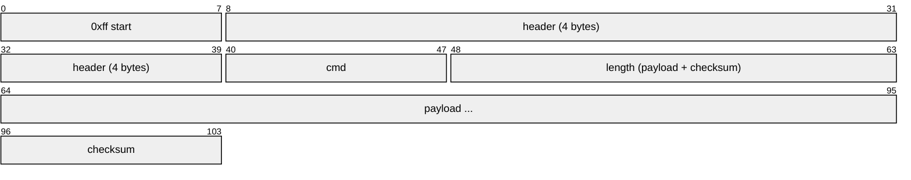

# HKMC Gen5 Wide family base: keepalive and shared layouts only

Variant `hkmc-gen5w`.

- [How to read this](#how-to-read-this)
- [Confidence](#confidence)
- [Headers](#headers)
- [Enums](#enums)
- [Messages from micom](#messages-from-micom)
- [Send (the control socket may send)](#send-the-control-socket-may-send)

## How to read this

Every frame on the serial link has this shape; the payload is what the message tables below describe, byte 0 first.

The 4 header bytes are `sender receiver type func`; a header and its reverse (`0d 8f ..` and `8f 0d ..`) are the two directions of one conversation.

How well each thing is known (per message, signal or header; the files do not grade single fields):

- 🟢 **captured**: seen on the wire or on the live unit.
- 🟡 **code**: read from stock code, not yet seen to match the car.
- 🟠 **inferred**: worked out from code or the frame rule.

A message is a header plus a cmd. Find the header, then the cmd under it; its field table says which payload byte holds what.

## Confidence

| Status | Messages |
| --- | --- |
| 🟡 code | 19 |

Not yet backed by a capture:

| Message | Header | Cmd | Status | Ref |
| --- | --- | --- | --- | --- |
| Variant code | `system_rx` | 0x17 | 🟡 code | micom firmware 0x0117 handler; 61 S5W_M micom builds in emulation (en/ko, country 01/00); EV6 V015.012 automotive-service SystemService.onVariantCode/sendVariantCodeSave, automotive VariantCoding tables |
| Module versions | `system_rx` | 0x74 | 🟡 code | EV6 V015.011 HKMC_EngineerMode VersionModule: registerCallback("MicomDataSVM", 0x8a), onEvent accepts func 0x8174 with 42+ bytes (parser needs 96), parsed by g([B); labels from res string ver_module_*; never captured |
| Version info | `system_rx` | 0x16 | 🟡 code | EV6 V015.011 automotive EngineeringModeVersion.checkVersion; EngineeringModeService.onVersion; SystemService func 0x8116 -> onVersion; HKMC_EngineerMode MicomVersionInfo (indices 1, 4, 5, 8); never captured |
| Part number | `system_rx` | 0x99 | 🟡 code | EV6 V015.011 SystemService\$MicomEventHandler SYS_PART_NUMBER_M_RESP: new String(data, US-ASCII) -> sys.product.partnumber |
| Vehicle trim | `system_rx` | 0x75 | 🟡 code | EV6 V015.011 SystemService func 0x8175 -> InitialCarInfo.setVehicleTrimInfo, USMService/BlackScreenService readers |
| Front/rear camera status | `system_rx` | 0x04 | 🟡 code | SYS_FRONT_REAR_CAMERA_STATUS_M 0x8104 -> onFRCameraStatus |
| Distance to empty | `system_rx` | 0x2a | 🟡 code | SYS_DISTANCE_TO_EMPTY_STATUS_M 0x812a -> onDTEInfoChanged(unit, bytesToInt(data, 1, 2)) |
| Ambient temperature (C) | `system_rx` | 0x2b | 🟡 code | SYS_AMBIENT_TEMP_C_STATUS_M 0x812b -> onAmbientCelciusTempChanged; scaling not read |
| Ambient temperature (F) | `system_rx` | 0x2c | 🟡 code | SYS_AMBIENT_TEMP_F_STATUS_M 0x812c -> onAmbientFahrenheitTempChanged; scaling not read |
| Vehicle warning | `system_rx` | 0x34 | 🟡 code | SYS_VEHICLE_WARNING_M 0x8134 -> onVehicleWarningStatus(b0, b1); meaning not read |
| IGN3 status | `system_rx` | 0x35 | 🟡 code | SYS_IGN3_STATUS_M 0x8135: 1 is on -> onIGNStatus |
| DCT warning | `system_rx` | 0x38 | 🟡 code | SYS_DCT_WARNING_M 0x8138 -> onDctWarning |
| HVAC type | `system_rx` | 0x3a | 🟡 code | SYS_HVAC_TYPE_M 0x813a: stock keeps it in persist.sys.hvactype |
| Fuel type | `system_rx` | 0x3b | 🟡 code | SYS_FUEL_TYPE_M 0x813b -> SystemService.getFuelType |
| FSOC check result | `system_rx` | 0x59 | 🟡 code | SYS_FSOC_M_RESP 0x8159 -> broadcast com.mobis.action.FSOC_CHECK_RESULT with extras FSOC_CHECK_RESULT and BSOC_CHECK_RESULT; answer to fsoc request 0x0159 |
| Eco coasting status | `system_rx` | 0x5c | 🟡 code | SYS_ECO_COASTING_STATUS_M_RESP 0x815c -> SystemService.getEcoCoastingStatus |
| Terrain mode | `system_rx` | 0x64 | 🟡 code | SYS_TERRAIN_MODE_M 0x8164 -> broadcast com.mobis.action.TERRAIN_MODE_STATUS (terrainMode, support: byte 1 > 0) |
| WPC status | `system_rx` | 0x70 | 🟡 code | SYS_WPCWARNING_M_RESP 0x8170 -> broadcast com.mobis.intent.action.WPC_STATUS_CHANGED (WPC_STATUS); answer to wpc request 0x0170 |
| Class status | `system_rx` | 0x98 | 🟡 code | SYS_CLASS_STA_M_RESP 0x8198 -> onClassStatus(byteToInt(b0)); answer to class request 0x0198 |

## Headers

| Name | Header | Direction | Status | Ref |
| --- | --- | --- | --- | --- |
| audio_tx | `85 02 01 02` | to_micom | 🟢 captured | stock micomd strace, source switch |
| system_rx | `01 8a 01 81` | from_micom | 🟢 captured | the CPU-alive request |
| system_tx | `8a 01 01 01` | to_micom | 🟢 captured | the CPU-alive reply |

## Enums

| Enum | Values | Used by |
| --- | --- | --- |
| adm | **0** off **1** on | Variant code: ADM |
| boot_mode | 19 values, below |  |
| camera | **0** r_cam **1** r_cam_old **2** lvs **3** avm | Variant code: Camera |
| camera_mode | **0** analog **1** digital | Variant code: Camera mode |
| camera_status | **0** cameraoff **1** front_camera_on **2** rear_camera_on | Front/rear camera status: Camera |
| country | 23 values, below | Variant code: Country; Version info: Micom region |
| dct_warning | **0** normal_display **1** clutch_off **2** none_eol **3** start_hold **255** none | DCT warning: Warning |
| distance_unit | **0** m **1** km **2** mi **3** ft **4** yd |  |
| dvd_region | **0** worldwide **1** us **2** eur **3** kor **4** c_s_america **5** rus **6** chn | Variant code: DVD region |
| external_amp | **0** actune **1** lexicon | Variant code: External amp |
| fuel_type | **0** none **1** gas **2** lpg **3** diesel **4** ffv | Fuel type: Type |
| hu_type | **0** daudio **1** daudio_plus | Variant code: HU type |
| hvac_type | **0** mtc **1** fatc **255** none | HVAC type: Type |
| maneuver | 40 values, below |  |
| radio_region | **0** khz_9_100 **1** khz_10_200 **2** khz_9_50 **3** khz_10_100 **4** khz_9_200 | Variant code: Radio region |
| reset_reason | 20 values, below |  |
| trip_unit | **1** km **2** mile | Distance to empty: Unit |
| vehicle | 118 values, below | Variant code: Vehicle; Version info: Micom vehicle |

### boot_mode

| Value | Name |
| --- | --- |
| 1 | boot_normal |
| 2 | door_unlock |
| 3 | balarm_status |
| 4 | panic |
| 5 | sms_message |
| 6 | cd_eject |
| 7 | door_open |
| 8 | charging |
| 9 | update_reservation |
| 10 | rrseatremand_alarm |
| 11 | wlight_on |
| 12 | bat_soc_alert |
| 13 | trunk_open |
| 14 | rmt_eng_run |
| 15 | batt_status_alarm |
| 16 | dvrs_rec_crash_prk_alarm |
| 17 | modem_96_168_end |
| 18 | reservation_download |
| 255 | rtc_wakeup |

### country

| Value | Name |
| --- | --- |
| 0 | korea |
| 1 | us |
| 2 | china |
| 3 | general |
| 4 | middleeast |
| 5 | europe |
| 6 | canada |
| 7 | russia |
| 8 | turkey |
| 9 | australia |
| 10 | guam |
| 11 | india |
| 12 | mexico |
| 13 | brazil |
| 14 | iran |
| 15 | ge |
| 16 | japan |
| 17 | indonesia |
| 18 | singapore |
| 19 | thailand |
| 20 | vietnam |
| 21 | philippines |
| 22 | malaysia |

### maneuver

| Value | Name |
| --- | --- |
| 0 | none |
| 1 | no_info |
| 2 | depart |
| 3 | dest_reached |
| 4 | near_dest |
| 5 | arrived_off_map |
| 6 | off_road |
| 7 | off_map |
| 8 | no_route_guide |
| 9 | calc_route |
| 10 | recalc_route |
| 32 | roundabout_exit_right |
| 33 | roundabout_exit_left |
| 64 | unknown |
| 65 | straight |
| 66 | slight_right |
| 67 | turn_right |
| 68 | sharp_right |
| 69 | sharp_left |
| 70 | turn_left |
| 71 | slight_left |
| 72 | uturn_left |
| 73 | uturn_right |
| 81 | off_ramp_right |
| 82 | off_ramp_left |
| 86 | off_ramp |
| 96 | roundabout_96 |
| 97 | roundabout_97 |
| 99 | roundabout_99 |
| 100 | roundabout_100 |
| 102 | roundabout_102 |
| 103 | roundabout_103 |
| 105 | roundabout_105 |
| 106 | roundabout_106 |
| 112 | destination |
| 115 | arrived |
| 172 | on_ramp |
| 173 | on_ramp_right |
| 174 | on_ramp_left |
| 176 | ferry |

### reset_reason

| Value | Name |
| --- | --- |
| 0 | normal |
| 1 | micom_watch_dog |
| 2 | reset_request_pin |
| 3 | reset_protocol |
| 4 | manual_reset |
| 5 | cpu_alive_not_recv |
| 6 | fram_init |
| 7 | self_diag |
| 8 | variant_save |
| 9 | reset_packet_log_dump |
| 10 | ket_reset |
| 11 | factory_reset |
| 12 | uart_dma_deactive |
| 13 | batt_4_5_off |
| 14 | micom_internal |
| 15 | cpu_only_reset |
| 16 | shutdown_reserve_update |
| 17 | dsp_init_error |
| 18 | stuck_cpu_boot_pin |
| 19 | stuck_cpu_boot_msg |

### vehicle

| Value | Name |
| --- | --- |
| 5 | neev23 |
| 54 | neev23se |
| 83 | sk3 |
| 84 | sk3ev |
| 87 | jsn |
| 88 | tlfl |
| 99 | on |
| 101 | adpe |
| 102 | lx2 |
| 103 | sq |
| 110 | dn8 |
| 114 | oshev |
| 115 | dn8hev |
| 116 | dn8phev |
| 122 | sp2i |
| 126 | aepeev |
| 127 | aepehev |
| 128 | aepephev |
| 130 | depehev |
| 131 | depephev |
| 133 | osev20 |
| 134 | ygpe |
| 135 | ygpehev |
| 136 | dl3 |
| 137 | dl3hev |
| 140 | qlcpe |
| 141 | bdc |
| 142 | bdcphev |
| 143 | igpe |
| 144 | igpehev |
| 147 | sqcev |
| 148 | adfl |
| 149 | hmpe2 |
| 150 | mq4 |
| 151 | mq4hev |
| 152 | adipe |
| 154 | tl20my |
| 155 | cn7 |
| 157 | cn7hev |
| 158 | bi3 |
| 159 | tam20 |
| 161 | jape |
| 162 | nx4 |
| 163 | nx4hev |
| 164 | ka4 |
| 165 | ybpe |
| 167 | ckpe |
| 168 | de20ev |
| 169 | csev |
| 170 | bdcev |
| 171 | pdenpe |
| 172 | gzfl |
| 173 | tmfl |
| 174 | tmhev |
| 175 | tmphev |
| 177 | ikfl |
| 178 | qx20my |
| 179 | csfl |
| 180 | nx4phev |
| 181 | mq4_p_22 |
| 182 | ospe |
| 183 | hm21 |
| 185 | qy |
| 186 | sk321 |
| 187 | sk3ev21 |
| 188 | us4 |
| 189 | neev |
| 190 | gl3 |
| 191 | gl3hev |
| 192 | osn_pe |
| 193 | su2b |
| 194 | ospeev |
| 195 | ospehev |
| 196 | cv |
| 197 | qx21 |
| 198 | sp2_21 |
| 199 | bdpe |
| 200 | de_e_22 |
| 201 | de_h_22 |
| 202 | de_p_22 |
| 203 | sg2_h |
| 204 | cvev |
| 205 | qx21my |
| 206 | nq5 |
| 207 | nq5_h |
| 208 | sg2_p |
| 209 | nq5_p |
| 210 | cn7n |
| 211 | ax1 |
| 214 | sp2_22 |
| 215 | nx4ob |
| 216 | sk3_22 |
| 217 | sk3_e_22 |
| 218 | ky1 |
| 219 | dn8_22 |
| 220 | dn8_h_22 |
| 221 | dl3_22 |
| 222 | dl3_h_22 |
| 223 | mq4_22 |
| 224 | mq4_h_22 |
| 225 | igpe_22 |
| 226 | igpe_h_22 |
| 227 | on_22 |
| 228 | gz_22 |
| 229 | sg2_e |
| 230 | hr_e_22 |
| 231 | pu_e |
| 232 | ce_e |
| 233 | lx2pe |
| 234 | tam_22 |
| 235 | jape_22 |
| 236 | igpe_21 |
| 237 | igpe_h_21 |
| 238 | ka4_22 |
| 239 | ckpe_22 |
| 240 | tm_22 |
| 241 | tm_h_22 |
| 242 | hmpe2_22 |

## Messages from micom

### system_rx

`01 8a 01 81`: the CPU-alive request

#### Variant code

cmd `0x17`, length ≥ 13 · 🟡 code

> micom firmware 0x0117 handler; 61 S5W_M micom builds in emulation (en/ko, country 01/00); EV6 V015.012 automotive-service SystemService.onVariantCode/sendVariantCodeSave, automotive VariantCoding tables

| Field | At | Type | Enum |
| --- | --- | --- | --- |
| Vehicle | byte 0 |  | vehicle |
| Country | byte 1 |  | country |
| Navigation | byte 2 bits 7 |  |  |
| Modem | byte 2 bits 6 |  |  |
| Internal amp | byte 2 bits 5 |  |  |
| Rear monitor | byte 2 bits 4 |  |  |
| Radio region | byte 2 bits 3:1 |  | radio_region |
| DMB | byte 2 bits 0 |  |  |
| RHD | byte 3 bits 7 |  |  |
| Limo | byte 3 bits 6 |  |  |
| External amp | byte 3 bits 5 |  | external_amp |
| Camera | byte 3 bits 4:3 |  | camera |
| Advanced cluster | byte 3 bits 2 |  |  |
| HUD | byte 3 bits 1 |  |  |
| Rear USB | byte 3 bits 0 |  |  |
| RRC | byte 4 bits 7 |  |  |
| CDC | byte 4 bits 6 |  |  |
| ISDB | byte 4 bits 5 |  |  |
| HD Radio | byte 4 bits 4 |  |  |
| CMMB | byte 4 bits 3 |  |  |
| Internal CDP | byte 4 bits 2 |  |  |
| External CDP | byte 4 bits 1 |  |  |
| Telematics | byte 4 bits 0 |  |  |
| Diranarom | byte 5 bits 7 |  |  |
| DAB | byte 5 bits 6 |  |  |
| HU type | byte 5 bits 5 |  | hu_type |
| Camera mode | byte 5 bits 4 |  | camera_mode |
| GPS | byte 5 bits 3 |  |  |
| Ext CDP feature | byte 5 bits 2 |  |  |
| Sub board | byte 5 bits 1 |  |  |
| RDS | byte 5 bits 0 |  |  |
| DVD region | byte 6 |  | dvd_region |
| Language | byte 7 | str |  |
| CPU variant 9 | byte 9 |  |  |
| CPU variant 10 | byte 10 |  |  |
| CPU variant 11 | byte 11 |  |  |
| ADM | byte 12 |  | adm |

#### Module versions

cmd `0x74`, length ≥ 96 · 🟡 code

> EV6 V015.011 HKMC_EngineerMode VersionModule: registerCallback("MicomDataSVM", 0x8a), onEvent accepts func 0x8174 with 42+ bytes (parser needs 96), parsed by g([B); labels from res string ver_module_*; never captured

| Field | At | Type |
| --- | --- | --- |
| HUD | byte 0 | str |
| Cluster | byte 7 | str |
| PSM | byte 14 | str |
| APSM | byte 17 | str |
| IBU | byte 20 | str |
| WPC | byte 23 | str |
| RWPC | byte 26 | str |
| IAU | byte 29 | str |
| DVRS | byte 32 | str |
| DATC a | byte 35 | str |
| RVM 0 | byte 38 |  |
| RVM 1 | byte 39 |  |
| AVM 0 | byte 40 |  |
| AVM 1 | byte 41 |  |
| SCM | byte 42 | str |
| VESS a 0 | byte 45 |  |
| VESS a 1 | byte 46 |  |
| ADP a 0 | byte 47 |  |
| ADP a 1 | byte 48 |  |
| ADP a 2 | byte 49 |  |
| ADP a 3 | byte 50 |  |
| ADP a 4 | byte 51 |  |
| MKBD 0 | byte 52 |  |
| MKBD 1 | byte 53 |  |
| MKBD 2 | byte 54 |  |
| AMP Binary 0 | byte 55 |  |
| AMP Binary 1 | byte 56 |  |
| AMP Binary 2 | byte 57 |  |
| VESS Binary 0 | byte 58 |  |
| VESS Binary 1 | byte 59 |  |
| ADP Binary 0 | byte 60 |  |
| ADP Binary 1 | byte 61 |  |
| ADP Binary 2 | byte 62 |  |
| FR_CMR 0 | byte 63 |  |
| FR_CMR 1 | byte 64 |  |
| ADAS_DRV 0 | byte 65 |  |
| ADAS_DRV 1 | byte 66 |  |
| HCU | byte 67 |  |
| ECS 0 | byte 68 |  |
| ECS 1 | byte 69 |  |
| TCU | byte 70 | str |
| SML 0 | byte 73 |  |
| SML 1 | byte 74 |  |
| Unused | byte 75 |  |
| VCU | byte 76 |  |
| AMP 0 | byte 77 |  |
| AMP 1 | byte 78 |  |
| AMP 2 | byte 79 |  |
| ADP b 0 | byte 80 |  |
| ADP b 1 | byte 81 |  |
| ADP b 2 | byte 82 |  |
| RRC 0 | byte 83 |  |
| RRC 1 | byte 84 |  |
| RDC | byte 85 | str |
| DATC b | byte 88 | str |
| VESS b 0 | byte 90 |  |
| VESS b 1 | byte 91 |  |
| VESS b 2 | byte 92 |  |
| VESS b 3 | byte 93 |  |
| VESS b 4 | byte 94 |  |
| VESS b 5 | byte 95 |  |

#### Version info

cmd `0x16`, length ≥ 86 · 🟡 code

> EV6 V015.011 automotive EngineeringModeVersion.checkVersion; EngineeringModeService.onVersion; SystemService func 0x8116 -> onVersion; HKMC_EngineerMode MicomVersionInfo (indices 1, 4, 5, 8); never captured

| Field | At | Type | Enum |
| --- | --- | --- | --- |
| Board HW | byte 0 |  |  |
| Board HW 1 | byte 1 |  |  |
| Board HW 2 | byte 2 |  |  |
| Micom vehicle | byte 3 |  | vehicle |
| Micom region | byte 4 |  | country |
| Micom number | byte 5 | u16 |  |
| Micom build date | byte 7 | str |  |
| MM CAN DB 0 | byte 18 |  |  |
| MM CAN DB 1 | byte 19 |  |  |
| MM CAN DB 2 | byte 20 |  |  |
| MM CAN DB 3 | byte 21 |  |  |
| Body CAN DB 0 | byte 22 |  |  |
| Body CAN DB 1 | byte 23 |  |  |
| Body CAN DB 2 | byte 24 |  |  |
| Body CAN DB 3 | byte 25 |  |  |
| External amp 0 | byte 26 |  |  |
| External amp 1 | byte 27 |  |  |
| External amp tuning 0 | byte 28 |  |  |
| External amp tuning 1 | byte 29 |  |  |
| External monitor 0 | byte 30 |  |  |
| External monitor 1 | byte 31 |  |  |
| External CD 0 | byte 32 |  |  |
| External CD 1 | byte 33 |  |  |
| Audio DSP tuning | byte 34 | str |  |
| Radio DSP tuning | byte 42 | str |  |
| HD module | byte 50 | str |  |

#### Part number

cmd `0x99`, length ≥ 1 · 🟡 code

> EV6 V015.011 SystemService\$MicomEventHandler SYS_PART_NUMBER_M_RESP: new String(data, US-ASCII) -> sys.product.partnumber

| Field | At | Type |
| --- | --- | --- |
| Part number | byte 0 | str |

#### Vehicle trim

cmd `0x75`, length ≥ 1 · 🟡 code

> EV6 V015.011 SystemService func 0x8175 -> InitialCarInfo.setVehicleTrimInfo, USMService/BlackScreenService readers

| Field | At |
| --- | --- |
| Trim | byte 0 |

#### Front/rear camera status

cmd `0x04`, length ≥ 1 · 🟡 code

> SYS_FRONT_REAR_CAMERA_STATUS_M 0x8104 -> onFRCameraStatus

| Field | At | Enum |
| --- | --- | --- |
| Camera | byte 0 | camera_status |

#### Distance to empty

cmd `0x2a`, length ≥ 3 · 🟡 code

> SYS_DISTANCE_TO_EMPTY_STATUS_M 0x812a -> onDTEInfoChanged(unit, bytesToInt(data, 1, 2))

| Field | At | Type | Enum |
| --- | --- | --- | --- |
| Unit | byte 0 |  | trip_unit |
| Distance | byte 1 | u16 |  |

#### Ambient temperature (C)

cmd `0x2b`, length ≥ 1 · 🟡 code

> SYS_AMBIENT_TEMP_C_STATUS_M 0x812b -> onAmbientCelciusTempChanged; scaling not read

| Field | At |
| --- | --- |
| Temperature | byte 0 |

#### Ambient temperature (F)

cmd `0x2c`, length ≥ 1 · 🟡 code

> SYS_AMBIENT_TEMP_F_STATUS_M 0x812c -> onAmbientFahrenheitTempChanged; scaling not read

| Field | At |
| --- | --- |
| Temperature | byte 0 |

#### Vehicle warning

cmd `0x34`, length ≥ 2 · 🟡 code

> SYS_VEHICLE_WARNING_M 0x8134 -> onVehicleWarningStatus(b0, b1); meaning not read

| Field | At |
| --- | --- |
| Warning 0 | byte 0 |
| Warning 1 | byte 1 |

#### IGN3 status

cmd `0x35`, length ≥ 1 · 🟡 code

> SYS_IGN3_STATUS_M 0x8135: 1 is on -> onIGNStatus

| Field | At | Type |
| --- | --- | --- |
| On | byte 0 | bool |

#### DCT warning

cmd `0x38`, length ≥ 1 · 🟡 code

> SYS_DCT_WARNING_M 0x8138 -> onDctWarning

| Field | At | Enum |
| --- | --- | --- |
| Warning | byte 0 | dct_warning |

#### HVAC type

cmd `0x3a`, length ≥ 1 · 🟡 code

> SYS_HVAC_TYPE_M 0x813a: stock keeps it in persist.sys.hvactype

| Field | At | Enum |
| --- | --- | --- |
| Type | byte 0 | hvac_type |

#### Fuel type

cmd `0x3b`, length ≥ 1 · 🟡 code

> SYS_FUEL_TYPE_M 0x813b -> SystemService.getFuelType

| Field | At | Enum |
| --- | --- | --- |
| Type | byte 0 | fuel_type |

#### FSOC check result

cmd `0x59`, length ≥ 2 · 🟡 code

> SYS_FSOC_M_RESP 0x8159 -> broadcast com.mobis.action.FSOC_CHECK_RESULT with extras FSOC_CHECK_RESULT and BSOC_CHECK_RESULT; answer to fsoc request 0x0159

| Field | At |
| --- | --- |
| FSOC result | byte 0 |
| BSOC result | byte 1 |

#### Eco coasting status

cmd `0x5c`, length ≥ 1 · 🟡 code

> SYS_ECO_COASTING_STATUS_M_RESP 0x815c -> SystemService.getEcoCoastingStatus

| Field | At |
| --- | --- |
| Status | byte 0 |

#### Terrain mode

cmd `0x64`, length ≥ 2 · 🟡 code

> SYS_TERRAIN_MODE_M 0x8164 -> broadcast com.mobis.action.TERRAIN_MODE_STATUS (terrainMode, support: byte 1 > 0)

| Field | At | Type |
| --- | --- | --- |
| Mode | byte 0 |  |
| Supported | byte 1 | bool |

#### WPC status

cmd `0x70`, length ≥ 1 · 🟡 code

> SYS_WPCWARNING_M_RESP 0x8170 -> broadcast com.mobis.intent.action.WPC_STATUS_CHANGED (WPC_STATUS); answer to wpc request 0x0170

| Field | At |
| --- | --- |
| Status | byte 0 |

#### Class status

cmd `0x98`, length ≥ 1 · 🟡 code

> SYS_CLASS_STA_M_RESP 0x8198 -> onClassStatus(byteToInt(b0)); answer to class request 0x0198

| Field | At |
| --- | --- |
| Class | byte 0 |

## Send (the control socket may send)

| Name | Frame | Pattern | Status | Ref |
| --- | --- | --- | --- | --- |
| sys-power-config |  | `ff 8a 01 01 01 02 00 02 [00-ff] ..` | 🟠 inferred | jadx SystemService; EV6 micom dispatcher cmd 0x02, firmware emulation |
| rear-camera-reset | `ff 8a 01 01 01 05 00 01 70` |  | 🟠 inferred | jadx SystemService |
| last-info-init | `ff 8a 01 01 01 07 00 01 72` |  | 🟠 inferred | jadx SystemService |
| variant-code-save |  | `ff 8a 01 01 01 18 00 02 [00-ff] ..` | 🟠 inferred | jadx SystemService |
| spi-sending-stop | `ff 8a 01 01 01 1e 00 01 6b` |  | 🟠 inferred | jadx SystemService |
| vbus-off-on | `ff 8a 01 01 01 28 00 01 5d` |  | 🟠 inferred | jadx SystemService |
| cpu-alive-start | `ff 8a 01 01 01 11 00 01 64` |  | 🟡 code | SystemService.requestCPUAliveTransStart: sendPacket(-118, 1, 0x111); EV6 micom firmware: dispatcher cmd 0x11 clears its alive-off flag, alive requests follow (firmware emulation) |
| cpu-alive-stop | `ff 8a 01 01 01 10 00 01 65` |  | 🟡 code | SystemService.requestCPUAliveTransStop: sendPacket(-118, 1, 0x110); EV6 micom firmware: dispatcher cmd 0x10 sets the flag again |
| module-version-request | `ff 8a 01 01 01 74 00 02 00 02` |  | 🟡 code | EV6 V015.011 HKMC_EngineerMode VersionModule.requestVersion; never captured |
| version-info-request | `ff 8a 01 01 01 16 00 01 63` |  | 🟡 code | EV6 V015.011 SystemService.requestVersion -> requestDeviceVersion; never captured |
| part-number-request | `ff 8a 01 01 01 99 00 01 ec` |  | 🟡 code | SystemService.requestPartNumber: sendPacket(-118, 1, 0x199); never captured |
| vehicle-trim-request | `ff 8a 01 01 01 75 00 01 00` |  | 🟡 code | SystemService.requestVehiceTrimInfo: sendPacket(-118, 1, 0x175); never captured |
| regulation-type-request | `ff 8a 01 01 01 89 00 01 fc` |  | 🟡 code | SystemService.requestRegulationTypeBStatus: sendPacket(-118, 1, 0x189); its 0x8189 answer is captured unprompted, the request itself is not |

