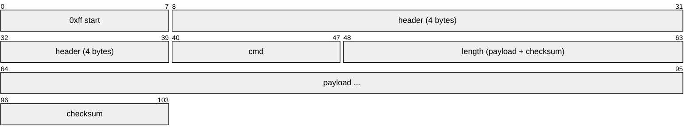
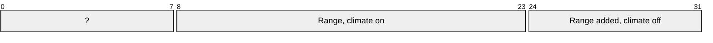
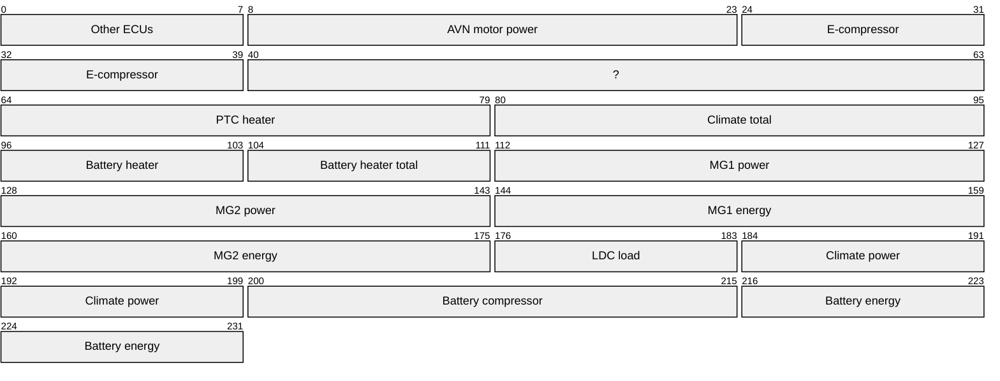
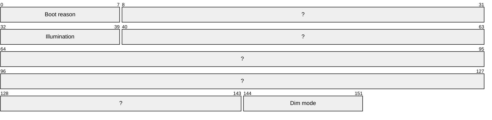
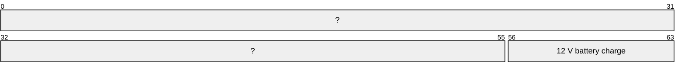

# Kia EV6 (CV), Mobis DAudio Plus Gen5 Wide

Variant `kia-ev6-gen5w`, extending `hkmc-gen5w-ev` (merged here).

- [How to read this](#how-to-read-this)
- [Confidence](#confidence)
- [Match](#match)
- [Headers](#headers)
- [Enums](#enums)
- [Messages from micom](#messages-from-micom)
- [Messages to micom](#messages-to-micom)
- [Signals](#signals)
- [Keys](#keys)
- [Profile (sent routinely)](#profile-sent-routinely)
- [Send (the control socket may send)](#send-the-control-socket-may-send)

## How to read this

Every frame on the serial link has this shape; the payload is what the message tables below describe, byte 0 first.



The 4 header bytes are `sender receiver type func`; a header and its reverse (`0d 8f ..` and `8f 0d ..`) are the two directions of one conversation.

How well each thing is known (per message, signal or header; the files do not grade single fields):

- 🟢 **captured**: seen on the wire or on the live unit.
- 🟡 **code**: read from stock code, not yet seen to match the car.
- 🟠 **inferred**: worked out from code or the frame rule.

A message is a header plus a cmd. Find the header, then the cmd under it; its field table says which payload byte holds what.

## Confidence

| Status | Messages |
| --- | --- |
| 🟢 captured | 13 |
| 🟡 code | 34 |
| 🟠 inferred | 3 |

Not yet backed by a capture:

| Message | Header | Cmd | Status | Ref |
| --- | --- | --- | --- | --- |
| Variant code | `system_rx` | 0x17 | 🟡 code | micom firmware 0x0117 handler; 61 S5W_M micom builds in emulation (en/ko, country 01/00); EV6 V015.012 automotive-service SystemService.onVariantCode/sendVariantCodeSave, automotive VariantCoding tables |
| Status flag | `0c 88 ?? 8c` | 0x02 | 🟡 code | HEVService status-flag setter; seen live as 57 00 NN |
| HEV status | `0c 88 ?? 8c` | 0x01 | 🟡 code | HEVService DATA_M_RESP (func 0x8c01, len >= 0x40) into flag ADDED_DIST_DATC_OFF |
| EV power block | `0c 88 ?? 8c` | 0x5c | 🟡 code | HEVService setHEVStatusValue calls |
| Departure timers | `0c 88 ?? 8c` | 0x55 | 🟡 code | HEVService; captured only at the default |
| Charger state | `0c 88 ?? 8c` | 0x4f | 🟡 code | HEVService |
| tbt-turn | `cluster_tx` | 0x04 | 🟡 code | stock ClusterService\$NaviCluster TBTInfo packer (byte 0 straight from the caller); GPM GpmNaviTBTManager.releaseGuidance; nemesis-report worked example "turn right, 0.3 km" |
| tbt-points | `cluster_tx` | 0x02 | 🟡 code | stock ClusterService\$NaviCluster TBTSubInfo2C packer |
| cluster-sub-info | `cluster_tx` | 0x03 | 🟡 code | stock ClusterService\$NaviCluster TBTSubInfo packer; the captured ack frame |
| nav-operation | `cluster_tx` | 0x11 | 🟡 code | stock ClusterService\$NaviCluster.sendOperationStatus (1 byte), Navigation\$Func OPERATION_STATUS 0x11; GPM claimCluster/onStatus; DiPO u.java claim and release |
| tbt-alive | `cluster_tx` | 0x0e | 🟡 code | stock ClusterService\$NaviCluster.sendAlive (mIsAlive 1/0), Navigation\$Func ALIVE 0x0e |
| cluster-day-night | `cluster_tx` | 0x0f | 🟡 code | stock ClusterService\$NaviCluster.sendDayNight (mIsNight 1/0), Navigation\$Func DAY_NIGHT_STATUS 0x0f |
| batt-cond-route-distance | `poll_tx` | 0x66 | 🟡 code | stock HEVService.setBattCondRouteDis: sendPacket(0x88, 0x0c, 0x0c66, [hi, lo]) |
| batt-cond-remain-time | `poll_tx` | 0x65 | 🟡 code | stock HEVService.setBattCondRemainTime: sendPacket(0x88, 0x0c, 0x0c65, [hi, lo]) |
| batt-cond-ev-station | `poll_tx` | 0x68 | 🟡 code | stock HEVService.setBattCondEvStation: sendPacket(0x88, 0x0c, 0x0c68, [flag & 0xf, type & 0xf]), then HEVService\$6 [7, 7] after 120 ms; github.com/paytondevs/gen5w-preconditioning PreconditioningProfile |
| Power state | `system_rx` | 0x08 | 🟡 code | micom firmware FUN_0006ee40; micom-run ACC off to state 0 |
| Power state (ACC on) | `system_rx` | 0x08 | 🟡 code | micom-run: ff 01 8a 01 81 08 00 03 01 05 fb on ACC on |
| ACC edge | `system_rx` | 0x33 | 🟡 code | micom-run: 0x8133 [01] on ACC off, [02] on ACC on |
| CAN rheostat flag | `system_rx` | 0x0a | 🟡 code | micom firmware FUN_00062f9c |
| CAN rheostat state | `system_rx` | 0x0b | 🟡 code | micom firmware, 0x810b sender |
| Flag 0x810c | `system_rx` | 0x0c | 🟡 code | micom firmware FUN_00073e46 |
| Illumination | `system_rx` | 0x0d | 🟡 code | stock SystemService/VideoSetupService SYS_ILLUMINATION_STATUS_M; micom firmware 0x810d sender; micom-run |
| Rheostat level | `system_rx` | 0x45 | 🟡 code | stock SYS_RHEOSTAT_M (func 0x8145) |
| System 0x819B | `system_rx` | 0x9b | 🟡 code | stock battSoc, func 0x819b byte 7 |
| sys-update-reservation | `system_tx` | 0x57 | 🟠 inferred | micom dispatcher cmd 0x57 -> event 0x125; micom-run console 2026-11-10 ('SYS_UPDATE_RESERVATION_C : 0x1, 0x20') |
| sys-download-reservation | `system_tx` | 0x8d | 🟠 inferred | micom dispatcher cmd 0x8d -> event 0x18a; micom-run console 2026-11-10 ('SYS_DOWNLOAD_RESERVATION_C : 0x1, 0xFA') |
| sys-sleep-boot-control | `system_tx` | 0x67 | 🟠 inferred | micom dispatcher cmd 0x67; name tentative (strings in the event consumers) |
| 12 V battery | `body` | 0x14 | 🟡 code | stock BODY Batt_SoC |
| Display 0x880C | `display_rx` | 0x0c | 🟡 code | micom-run: 0x080C [00] answered ff 08 8c 01 88 0c 00 02 02 fe |
| Rheostat | `display_rx` | 0x10 | 🟡 code | micom-run: 0x0810 [00] answered 14 |
| Display 0x8813 | `display_rx` | 0x13 | 🟡 code | micom-run: 0x0813 [00] answered 32 |
| Current brightness | `display_rx` | 0x1b | 🟡 code | stock current brightness request 0x081B and its reply; micom firmware 0x081B handler |
| backlight | `display_tx` | 0x02 | 🟡 code | micom-run: ff 8c 08 01 08 02 00 02 01 73 on, ... 00 72 off; eMIOS0 ch 6 PWM |
| shutdown-ack | `system_tx` | 0x09 | 🟡 code | micom-run: 0x0109 [01] ff 8a 01 01 01 09 00 02 01 7e, [02] ... 02 7d; status bits b8, b12 |
| backlight-dim-mode | `display_tx` | 0x01 | 🟡 code | stock MON_SET_DIMMING_MODE_C (0 auto, 1 daylight, 2 night, 3 manual); micom firmware 0x0801 handler; micom-run EEPROM trace |
| backlight-period-level | `display_tx` | 0x07 | 🟡 code | stock dimming brightness [period, level]; micom firmware 0x0807 handler; micom-run EEPROM trace |
| backlight-manual-level | `display_tx` | 0x1a | 🟡 code | stock user brightness; micom firmware 0x081A handler; micom-run EEPROM trace |

## Match

| Key | Value |
| --- | --- |
| vehicle_info | [204] |
| status | 🟢 captured |
| ref | stock /proc/cmdline, 2026-11-07 (ro.product.device=wp_daudioplus_cvev_us) |

## Headers

| Name | Header | Direction | Status | Ref |
| --- | --- | --- | --- | --- |
| audio_tx | `85 02 01 02` | to_micom | 🟢 captured | stock micomd strace, source switch |
| bms_rx | `40 c7 80 c0` | from_micom | 🟢 captured | the BMS's state of charge (cmd ad); ac, ae, a9 and aa barely change while charging |
| body | `44 c1 00 c4` | from_micom | 🟢 captured | doors; repeats seat heat and windows |
| camera | `01 c4 01 81` | from_micom | 🟢 captured |  |
| climate_panel | `43 c2 00 c3` | from_micom | 🟢 captured |  |
| clock_tx | `c2 43 00 43` | to_micom | 🟢 captured |  |
| cluster_rx | `0d 8f 01 8d` | from_micom | 🟢 captured | battery and cruise; cluster_tx's reverse |
| cluster_tx | `8f 0d 01 0d` | to_micom | 🟢 captured | the ack profile frame; stock ClusterService |
| display_rx | `08 8c 01 88` | from_micom | 🟡 code | EV6 micom firmware V002.208, micom-run |
| display_tx | `8c 08 01 08` | to_micom | 🟡 code | EV6 micom firmware V002.208, micom-run |
| gear_node | `50 c4 00 d0` | from_micom | 🟢 captured | micomd capture, 2026-11-10, P/D/N/R shifts |
| hev | `0c 88 01 8c` | from_micom | 🟢 captured | logcat MicomD 2026-10-16 |
| hev_tx | `88 0c 01 0c` | to_micom | 🟢 captured | the poll frame's; HEVService sendPacket(0x88, 0x0c, func) |
| keys | `07 84 01 87` | from_micom | 🟢 captured |  |
| poll_tx | `88 0c 01 0c` | to_micom | 🟢 captured |  |
| seat_node | `55 ca 00 d5` | from_micom | 🟢 captured | seat heat; the driver's door switches |
| status_tx | `c3 4d 00 4d` | to_micom | 🟢 captured |  |
| system_rx | `01 8a 01 81` | from_micom | 🟢 captured | the CPU-alive request |
| system_tx | `8a 01 01 01` | to_micom | 🟢 captured | the CPU-alive reply |

## Enums

| Enum | Values | Used by |
| --- | --- | --- |
| acc_edge | **1** off<br>**2** on | ACC edge: ACC |
| adm | **0** off<br>**1** on | Variant code: ADM |
| camera | **0** r_cam<br>**1** r_cam_old<br>**2** lvs<br>**3** avm | Variant code: Camera |
| camera_mode | **0** analog<br>**1** digital | Variant code: Camera mode |
| country | 9 values, below | Variant code: Country |
| cruise | **0** inactive<br>**2** active | Cruise control: Cruise control |
| day_night | **0** day<br>**1** night | cluster-day-night: mode |
| dim_mode | **0** auto<br>**1** day<br>**2** night<br>**3** manual | Boot record: Dim mode; backlight-dim-mode: mode |
| distance_unit | **0** m<br>**1** km<br>**2** mi<br>**3** ft<br>**4** yd | tbt-turn: unit; tbt-points: p1_unit; tbt-points: p2_unit; tbt-points: p3_unit; cluster-sub-info: remaining_unit |
| dvd_region | **0** worldwide<br>**1** us<br>**2** eur<br>**3** kor<br>**4** c_s_america<br>**5** rus<br>**6** chn | Variant code: DVD region |
| external_amp | **0** actune<br>**1** lexicon | Variant code: External amp |
| hu_type | **0** daudio<br>**1** daudio_plus | Variant code: HU type |
| illumination | **0** night<br>**1** day | Illumination: Illumination; Boot record: Illumination |
| maneuver | 40 values, below | tbt-turn: maneuver |
| operation | **0** released<br>**1** operating | nav-operation: status |
| period | **1** day<br>**2** night | backlight-period-level: period |
| power_state | **0** rail_off<br>**1** power_off_request<br>**3** bus_sleep<br>**4** acc_off_hold<br>**5** acc_on<br>**6** stop<br>**7** standby | Power state: Power state; Power state (ACC on): Power state |
| radio_region | **0** khz_9_100<br>**1** khz_10_200<br>**2** khz_9_50<br>**3** khz_10_100<br>**4** khz_9_200 | Variant code: Radio region |
| shutdown_ack | **1** power_off_request<br>**2** rail_off | shutdown-ack: stage |
| vehicle | **110** dn8<br>**189** neev<br>**204** cvev | Variant code: Vehicle |

### country

| Value | Name |
| --- | --- |
| 0 | korea |
| 1 | us |
| 2 | china |
| 3 | general |
| 4 | middleeast |
| 5 | europe |
| 6 | canada |
| 7 | russia |
| 22 | malaysia |

### maneuver

| Value | Name |
| --- | --- |
| 0 | none |
| 1 | no_info |
| 2 | depart |
| 3 | dest_reached |
| 4 | near_dest |
| 5 | arrived_off_map |
| 6 | off_road |
| 7 | off_map |
| 8 | no_route_guide |
| 9 | calc_route |
| 10 | recalc_route |
| 32 | roundabout_exit_right |
| 33 | roundabout_exit_left |
| 64 | unknown |
| 65 | straight |
| 66 | slight_right |
| 67 | turn_right |
| 68 | sharp_right |
| 69 | sharp_left |
| 70 | turn_left |
| 71 | slight_left |
| 72 | uturn_left |
| 73 | uturn_right |
| 81 | off_ramp_right |
| 82 | off_ramp_left |
| 86 | off_ramp |
| 96 | roundabout_96 |
| 97 | roundabout_97 |
| 99 | roundabout_99 |
| 100 | roundabout_100 |
| 102 | roundabout_102 |
| 103 | roundabout_103 |
| 105 | roundabout_105 |
| 106 | roundabout_106 |
| 112 | destination |
| 115 | arrived |
| 172 | on_ramp |
| 173 | on_ramp_right |
| 174 | on_ramp_left |
| 176 | ferry |

## Messages from micom

### system_rx

`01 8a 01 81`: the CPU-alive request

#### Variant code

cmd `0x17`, length ≥ 13 · 🟡 code

> micom firmware 0x0117 handler; 61 S5W_M micom builds in emulation (en/ko, country 01/00); EV6 V015.012 automotive-service SystemService.onVariantCode/sendVariantCodeSave, automotive VariantCoding tables

| Field | At | Type | Enum |
| --- | --- | --- | --- |
| Vehicle | byte 0 |  | vehicle |
| Country | byte 1 |  | country |
| Navigation | byte 2 bits 7 |  |  |
| Modem | byte 2 bits 6 |  |  |
| Internal amp | byte 2 bits 5 |  |  |
| Rear monitor | byte 2 bits 4 |  |  |
| Radio region | byte 2 bits 3:1 |  | radio_region |
| DMB | byte 2 bits 0 |  |  |
| RHD | byte 3 bits 7 |  |  |
| Limo | byte 3 bits 6 |  |  |
| External amp | byte 3 bits 5 |  | external_amp |
| Camera | byte 3 bits 4:3 |  | camera |
| Advanced cluster | byte 3 bits 2 |  |  |
| HUD | byte 3 bits 1 |  |  |
| Rear USB | byte 3 bits 0 |  |  |
| RRC | byte 4 bits 7 |  |  |
| CDC | byte 4 bits 6 |  |  |
| ISDB | byte 4 bits 5 |  |  |
| HD Radio | byte 4 bits 4 |  |  |
| CMMB | byte 4 bits 3 |  |  |
| Internal CDP | byte 4 bits 2 |  |  |
| External CDP | byte 4 bits 1 |  |  |
| Telematics | byte 4 bits 0 |  |  |
| Diranarom | byte 5 bits 7 |  |  |
| DAB | byte 5 bits 6 |  |  |
| HU type | byte 5 bits 5 |  | hu_type |
| Camera mode | byte 5 bits 4 |  | camera_mode |
| GPS | byte 5 bits 3 |  |  |
| Ext CDP feature | byte 5 bits 2 |  |  |
| Sub board | byte 5 bits 1 |  |  |
| RDS | byte 5 bits 0 |  |  |
| DVD region | byte 6 |  | dvd_region |
| Language | byte 7 | str |  |
| CPU variant 9 | byte 9 |  |  |
| CPU variant 10 | byte 10 |  |  |
| CPU variant 11 | byte 11 |  |  |
| ADM | byte 12 |  | adm |

### 0c 88 ?? 8c


#### Status flag

cmd `0x02`, length 3 · 🟡 code

> HEVService status-flag setter; seen live as 57 00 NN

| Field | At | Type | Unit |
| --- | --- | --- | --- |
| Climate power draw | byte 1 | u16 | W |


#### Range, climate

cmd `0x02`, length 4 · 🟢 captured

> HEVService flag ADDED_DIST_DATC_OFF (0x26); seen live as 2a 00 f3 08 beside cluster Range=243 km

| Field | At | Type | Unit |
| --- | --- | --- | --- |
| Range, climate on | byte 1 | u16 | km |
| Range added, climate off | byte 3 |  | km |



#### Range, climate (0x25)

cmd `0x02`, length 4 · 🟢 captured

> HEVService flag ADDED_DIST_DATC_OFF (0x26); seen live as 25 01 6b 07

| Field | At | Type | Unit |
| --- | --- | --- | --- |
| Range, climate on | byte 1 | u16 | km |
| Range added, climate off | byte 3 |  | km |


#### HEV status

cmd `0x01`, length ≥ 64 · 🟡 code

> HEVService DATA_M_RESP (func 0x8c01, len >= 0x40) into flag ADDED_DIST_DATC_OFF

| Field | At | Type | Unit |
| --- | --- | --- | --- |
| Range, climate on | byte 60 | u16 | km |
| Range added, climate off | byte 54 |  | km |

#### EV power block

cmd `0x5c`, length ≥ 29 · 🟡 code

> HEVService setHEVStatusValue calls

| Field | At | Type | Unit | Notes |
| --- | --- | --- | --- | --- |
| Other ECUs | byte 0 |  |  | invalid 255 |
| AVN motor power | byte 1 | u16 |  | invalid 65535 |
| E-compressor | byte 3 | u16 |  | invalid 65535 |
| PTC heater | byte 8 | u16 |  | invalid 65535 |
| Climate total | byte 10 | u16 | W | invalid 65535 |
| Battery heater | byte 12 |  | W | invalid 255 |
| Battery heater total | byte 13 |  | Wh | invalid 255 |
| MG1 power | byte 14 | u16 | kW | invalid 65535 |
| MG2 power | byte 16 | u16 | kW | invalid 65535 |
| MG1 energy | byte 18 | u16 | Wh | invalid 65535 |
| MG2 energy | byte 20 | u16 | Wh | invalid 65535 |
| LDC load | byte 22 |  |  | invalid 255 |
| Climate power | byte 23 | u16 | W | invalid 65535 |
| Battery compressor | byte 25 | u16 | W | invalid 65535 |
| Battery energy | byte 27 | u16 | Wh | invalid 65535 |



#### Departure timers

cmd `0x55`, length ≥ 5 · 🟡 code

> HEVService; captured only at the default

| Field | At |
| --- | --- |
| Departure 1 hour | byte 3 bits 4:0 |
| Departure 1 minute bits | byte 3 bits 7:5 |
| Departure 2 hour | byte 4 bits 4:0 |
| Departure 2 minute bits | byte 4 bits 7:5 |

#### Charger state

cmd `0x4f`, length ≥ 4 · 🟡 code

> HEVService

| Field | At |
| --- | --- |
| Charger ready bits | byte 3 bits 7:6 |

### system_rx

`01 8a 01 81`: the CPU-alive request

#### Power state

cmd `0x08`, length 3 · 🟡 code

> micom firmware FUN_0006ee40; micom-run ACC off to state 0

| Field | At | Enum |
| --- | --- | --- |
| Power state | byte 1 | power_state |


#### Power state (ACC on)

cmd `0x08`, length 2 · 🟡 code

> micom-run: ff 01 8a 01 81 08 00 03 01 05 fb on ACC on

| Field | At | Enum |
| --- | --- | --- |
| Power state | byte 1 | power_state |


#### ACC edge

cmd `0x33`, length 1 · 🟡 code

> micom-run: 0x8133 [01] on ACC off, [02] on ACC on

| Field | At | Enum |
| --- | --- | --- |
| ACC | byte 0 | acc_edge |


#### CAN rheostat flag

cmd `0x0a`, length 1 · 🟡 code

> micom firmware FUN_00062f9c

| Field | At |
| --- | --- |
| CAN rheostat selected | byte 0 |


#### CAN rheostat state

cmd `0x0b`, length 1 · 🟡 code

> micom firmware, 0x810b sender

| Field | At |
| --- | --- |
| CAN rheostat active | byte 0 |


#### Flag 0x810c

cmd `0x0c`, length 1 · 🟡 code

> micom firmware FUN_00073e46

| Field | At |
| --- | --- |
| Flag 0x810c | byte 0 |


#### Illumination

cmd `0x0d`, length 1 · 🟡 code

> stock SystemService/VideoSetupService SYS_ILLUMINATION_STATUS_M; micom firmware 0x810d sender; micom-run

| Field | At | Enum |
| --- | --- | --- |
| Illumination | byte 0 | illumination |


#### Boot record

cmd `0x01`, length ≥ 19 · 🟢 captured

> stock SystemService requestBootMode / InitialCarInfo; micom firmware 0x0101 handler (0x7767a: byte 4 at 0x77884, dim mode config 0xb7 at 0x77986); captured 2026-11-08 in reply to boot-mode-request

| Field | At | Enum |
| --- | --- | --- |
| Boot reason | byte 0 |  |
| Illumination | byte 4 | illumination |
| Dim mode | byte 18 | dim_mode |



#### Rheostat level

cmd `0x45`, length ≥ 1 · 🟡 code

> stock SYS_RHEOSTAT_M (func 0x8145)

| Field | At |
| --- | --- |
| Rheostat level | byte 0 |


#### System 0x819B

cmd `0x9b`, length ≥ 8 · 🟡 code

> stock battSoc, func 0x819b byte 7

| Field | At | Unit |
| --- | --- | --- |
| 12 V battery charge | byte 7 | % |



### body

`44 c1 00 c4`: doors; repeats seat heat and windows

#### 12 V battery

cmd `0x14`, length ≥ 1 · 🟡 code

> stock BODY Batt_SoC

| Field | At | Unit |
| --- | --- | --- |
| 12 V battery charge (body) | byte 0 | % |


### display_rx

`08 8c 01 88`: EV6 micom firmware V002.208, micom-run

#### Display 0x880C

cmd `0x0c`, length ≥ 1 · 🟡 code

> micom-run: 0x080C [00] answered ff 08 8c 01 88 0c 00 02 02 fe

| Field | At |
| --- | --- |
| Display 0x880C | byte 0 |


#### Rheostat

cmd `0x10`, length ≥ 1 · 🟡 code

> micom-run: 0x0810 [00] answered 14

| Field | At |
| --- | --- |
| Rheostat step | byte 0 |


#### Display 0x8813

cmd `0x13`, length ≥ 1 · 🟡 code

> micom-run: 0x0813 [00] answered 32

| Field | At |
| --- | --- |
| Display 0x8813 | byte 0 |


#### Current brightness

cmd `0x1b`, length ≥ 2 · 🟡 code

> stock current brightness request 0x081B and its reply; micom firmware 0x081B handler

| Field | At | Type |
| --- | --- | --- |
| Current brightness | byte 0 | u16 |


### body

`44 c1 00 c4`: doors; repeats seat heat and windows

#### Vehicle speed

cmd `0x20`, length ≥ 2 · 🟢 captured

> drive 2026-11, micomd snapshots against Car Scanner OBD2 speed (r >= 0.99)

| Field | At | Scale | Unit |
| --- | --- | --- | --- |
| Vehicle speed | byte 1 | 0.804672 | km/h |
| Vehicle speed (mph) | byte 1 | 0.5 | mph |

### cluster_rx

`0d 8f 01 8d`: battery and cruise; cluster_tx's reverse

#### Battery

cmd `0x47`, length ≥ 7 · 🟢 captured

> drive 2026-11, micomd snapshots against Car Scanner OBD2 displayed SoC, minimum battery temperature (r 0.998), remaining energy (r >= 0.99) and battery inlet temperature (fit 0.53*raw-44)

| Field | At | Type | Scale | Offset | Unit |
| --- | --- | --- | --- | --- | --- |
| State of charge | byte 0 |  | 0.5 |  | % |
| Battery minimum temperature | byte 1 | i8 |  |  | °C |
| Battery remaining energy | byte 2 | u16 | 0.002 |  | kWh |
| Battery inlet temperature | byte 6 |  | 0.5 | -40 | °C |

```mermaid
packet-beta
0-7: "State of charge"
8-15: "Battery minimum temperature"
16-31: "Battery remaining energy"
32-47: "?"
48-55: "Battery inlet temperature"
```

### body

`44 c1 00 c4`: doors; repeats seat heat and windows

#### Battery conditioning

cmd `0x53`, length 1 · 🟢 captured

> micom-precondition test 2026-11-09 00:16-00:18, parked READY, pack 18 °C

| Field | At | Type |
| --- | --- | --- |
| Battery conditioning | byte 0 | bool |

```mermaid
packet-beta
0-7: "Battery conditioning"
```

### cluster_rx

`0d 8f 01 8d`: battery and cruise; cluster_tx's reverse

#### Cruise control

cmd `0x46`, length ≥ 1 · 🟢 captured

> drive 2026-11, labelled cruise off/resume/off/set toggles

| Field | At | Enum |
| --- | --- | --- |
| Cruise control | byte 0 | cruise |

```mermaid
packet-beta
0-7: "Cruise control"
```

#### Range

cmd `0x43`, length ≥ 5 · 🟢 captured

> 02 00 75 00 bc against the cluster's 117 mi

| Field | At | Type | Unit |
| --- | --- | --- | --- |
| Range | byte 3 | u16 | km |
| Range (mi) | byte 1 | u16 | mi |

```mermaid
packet-beta
0-7: "?"
8-23: "Range (mi)"
24-39: "Range"
```

#### Speed limit

cmd `0x2d`, length ≥ 15 · 🟢 captured

> drive 2026-11, 41k frames: 50-75 mph in 5s, every one 2 * mph - 10 at byte 4

| Field | At | Unit |
| --- | --- | --- |
| Speed limit | byte 14 | mph |

```mermaid
packet-beta
0-111: "?"
112-119: "Speed limit"
```

### body

`44 c1 00 c4`: doors; repeats seat heat and windows

#### Odometer

cmd `0x22`, length ≥ 3 · 🟢 captured

> 06 c4 0c (44340.4 km) against the cluster's 27551 mi

| Field | At | Scale | Unit |
| --- | --- | --- | --- |
| Odometer | bit 7, 24 long | 0.1 | km |

### climate_panel

`43 c2 00 c3`

#### Outdoor temperature

cmd `0x02`, length ≥ 1 · 🟢 captured

> 5e against the cluster's 54 F

| Field | At | Scale | Offset | Unit |
| --- | --- | --- | --- | --- |
| Outdoor temperature | byte 0 | 0.5555555555555556 | -40 | C |
| Outdoor temperature (F) | byte 0 |  | -40 | F |

### system_rx

`01 8a 01 81`: the CPU-alive request

#### Vehicle speed (whole km/h)

cmd `0x31`, length 2 · 🟢 captured

> drive 2026-11-08 18:21-18:36 against Car Scanner OBD2 [HVAC] Real Vehicle Speed, and against ground speed from the phone's positions (579 10 s windows above 40 km/h) and the unit's gpsd

| Field | At | Type | Unit |
| --- | --- | --- | --- |
| Vehicle speed (whole km/h) | byte 0 | u16 | km/h |

```mermaid
packet-beta
0-15: "Vehicle speed (whole km/h)"
```

### bms_rx

`40 c7 80 c0`: the BMS's state of charge (cmd ad); ac, ae, a9 and aa barely change while charging

#### BMS state of charge

cmd `0xad`, length ≥ 3 · 🟢 captured

> drive 2026-11-08 against Car Scanner OBD2 [BMS] State of Charge BMS (r 0.997, change 0.83): fit 0.383*raw+2.1, 200 at 80 %

| Field | At | Scale | Unit |
| --- | --- | --- | --- |
| BMS state of charge | byte 2 | 0.4 | % |

```mermaid
packet-beta
0-15: "?"
16-23: "BMS state of charge"
```

## Messages to micom

### cluster_tx

`8f 0d 01 0d`: the ack profile frame; stock ClusterService

#### tbt-turn

cmd `0x04`, length 8 · 🟡 code

> stock ClusterService\$NaviCluster TBTInfo packer (byte 0 straight from the caller); GPM GpmNaviTBTManager.releaseGuidance; nemesis-report worked example "turn right, 0.3 km"

| Field | At | Type | Scale | Enum | Range | Notes |
| --- | --- | --- | --- | --- | --- | --- |
| maneuver | byte 0 |  |  | maneuver |  |  |
| side_street | byte 1 | u16 |  |  |  | invalid 65535 |
| direction | byte 3 |  | 7.5 |  | 0..360 |  |
| distance | byte 4 | u16 |  |  |  | invalid 65535 |
| unit | byte 6 bits 7:4 |  |  | distance_unit |  | invalid 15 |
| side_street_combi | byte 6 bits 3:0 |  |  |  |  |  |
| bar | byte 7 bits 7:4 |  | 10 |  | 0..100 | invalid 15 |
| distance_tenths | byte 7 bits 3:0 |  |  |  | ..9 | invalid 15 |

#### tbt-points

cmd `0x02`, length 9 · 🟡 code

> stock ClusterService\$NaviCluster TBTSubInfo2C packer

| Field | At | Type | Enum | Range | Notes |
| --- | --- | --- | --- | --- | --- |
| p1_unit | byte 0 bits 7:4 |  | distance_unit |  | invalid 15 |
| p1_tenths | byte 0 bits 3:0 |  |  | ..9 | invalid 15 |
| p1_distance | byte 1 | u16 |  |  | invalid 65535 |
| p2_unit | byte 3 bits 7:4 |  | distance_unit |  | invalid 15 |
| p2_tenths | byte 3 bits 3:0 |  |  | ..9 | invalid 15 |
| p2_distance | byte 4 | u16 |  |  | invalid 65535 |
| p3_unit | byte 6 bits 7:4 |  | distance_unit |  | invalid 15 |
| p3_tenths | byte 6 bits 3:0 |  |  | ..9 | invalid 15 |
| p3_distance | byte 7 | u16 |  |  | invalid 65535 |

#### cluster-sub-info

cmd `0x03`, length 9 · 🟡 code

> stock ClusterService\$NaviCluster TBTSubInfo packer; the captured ack frame

| Field | At | Type | Scale | Enum | Range | Notes |
| --- | --- | --- | --- | --- | --- | --- |
| remaining_unit | byte 0 bits 7:4 |  |  | distance_unit |  | invalid 15 |
| remaining_tenths | byte 0 bits 3:0 |  |  |  | ..9 | invalid 15 |
| eta_hour | byte 1 |  |  |  | ..23 | invalid 255 |
| eta_minute | byte 2 |  |  |  | ..59 | invalid 255 |
| compass | byte 3 |  | 7.5 |  | 0..360 | invalid 63 |
| time_type | byte 4 |  |  |  |  |  |
| remaining | byte 5 | u16 |  |  |  | invalid 65535 |
| time_format | byte 7 |  |  |  |  |  |
| est_point_type | byte 8 |  |  |  |  | invalid 255 |

#### nav-operation

cmd `0x11`, length 1 · 🟡 code

> stock ClusterService\$NaviCluster.sendOperationStatus (1 byte), Navigation\$Func OPERATION_STATUS 0x11; GPM claimCluster/onStatus; DiPO u.java claim and release

| Field | At | Enum |
| --- | --- | --- |
| status | byte 0 | operation |

```mermaid
packet-beta
0-7: "status"
```

#### tbt-alive

cmd `0x0e`, length 1 · 🟡 code

> stock ClusterService\$NaviCluster.sendAlive (mIsAlive 1/0), Navigation\$Func ALIVE 0x0e

| Field | At | Type |
| --- | --- | --- |
| alive | byte 0 | bool |

```mermaid
packet-beta
0-7: "alive"
```

#### cluster-day-night

cmd `0x0f`, length 1 · 🟡 code

> stock ClusterService\$NaviCluster.sendDayNight (mIsNight 1/0), Navigation\$Func DAY_NIGHT_STATUS 0x0f

| Field | At | Enum |
| --- | --- | --- |
| mode | byte 0 | day_night |

```mermaid
packet-beta
0-7: "mode"
```

### poll_tx

`88 0c 01 0c`

#### batt-cond-route-distance

cmd `0x66`, length 2 · 🟡 code

> stock HEVService.setBattCondRouteDis: sendPacket(0x88, 0x0c, 0x0c66, [hi, lo])

| Field | At | Type | Range |
| --- | --- | --- | --- |
| km | byte 0 | u16 | ..2047 |

```mermaid
packet-beta
0-15: "km"
```

#### batt-cond-remain-time

cmd `0x65`, length 2 · 🟡 code

> stock HEVService.setBattCondRemainTime: sendPacket(0x88, 0x0c, 0x0c65, [hi, lo])

| Field | At | Type | Range |
| --- | --- | --- | --- |
| minutes | byte 0 | u16 | ..1023 |

```mermaid
packet-beta
0-15: "minutes"
```

#### batt-cond-ev-station

cmd `0x68`, length 2 · 🟡 code

> stock HEVService.setBattCondEvStation: sendPacket(0x88, 0x0c, 0x0c68, [flag & 0xf, type & 0xf]), then HEVService\$6 [7, 7] after 120 ms; github.com/paytondevs/gen5w-preconditioning PreconditioningProfile

| Field | At | Range |
| --- | --- | --- |
| flag | byte 0 | ..15 |
| type | byte 1 | ..15 |

```mermaid
packet-beta
0-7: "flag"
8-15: "type"
```

### system_tx

`8a 01 01 01`: the CPU-alive reply

#### sys-update-reservation

cmd `0x57`, length 1 · 🟠 inferred

> micom dispatcher cmd 0x57 -> event 0x125; micom-run console 2026-11-10 ('SYS_UPDATE_RESERVATION_C : 0x1, 0x20')

| Field | At |
| --- | --- |
| value | byte 0 |

```mermaid
packet-beta
0-7: "value"
```

#### sys-download-reservation

cmd `0x8d`, length 1 · 🟠 inferred

> micom dispatcher cmd 0x8d -> event 0x18a; micom-run console 2026-11-10 ('SYS_DOWNLOAD_RESERVATION_C : 0x1, 0xFA')

| Field | At |
| --- | --- |
| value | byte 0 |

```mermaid
packet-beta
0-7: "value"
```

#### sys-sleep-boot-control

cmd `0x67`, length 2 · 🟠 inferred

> micom dispatcher cmd 0x67; name tentative (strings in the event consumers)

| Field | At |
| --- | --- |
| mode | byte 0 |
| flag | byte 1 |

```mermaid
packet-beta
0-7: "mode"
8-15: "flag"
```

### display_tx

`8c 08 01 08`: EV6 micom firmware V002.208, micom-run

#### backlight

cmd `0x02`, length 1 · 🟡 code

> micom-run: ff 8c 08 01 08 02 00 02 01 73 on, ... 00 72 off; eMIOS0 ch 6 PWM

| Field | At | Type |
| --- | --- | --- |
| on | byte 0 bits 0 | bool |

### system_tx

`8a 01 01 01`: the CPU-alive reply

#### shutdown-ack

cmd `0x09`, length 1 · 🟡 code

> micom-run: 0x0109 [01] ff 8a 01 01 01 09 00 02 01 7e, [02] ... 02 7d; status bits b8, b12

| Field | At | Enum |
| --- | --- | --- |
| stage | byte 0 | shutdown_ack |

```mermaid
packet-beta
0-7: "stage"
```

### display_tx

`8c 08 01 08`: EV6 micom firmware V002.208, micom-run

#### backlight-dim-mode

cmd `0x01`, length 1 · 🟡 code

> stock MON_SET_DIMMING_MODE_C (0 auto, 1 daylight, 2 night, 3 manual); micom firmware 0x0801 handler; micom-run EEPROM trace

| Field | At | Enum |
| --- | --- | --- |
| mode | byte 0 | dim_mode |

```mermaid
packet-beta
0-7: "mode"
```

#### backlight-period-level

cmd `0x07`, length 2 · 🟡 code

> stock dimming brightness [period, level]; micom firmware 0x0807 handler; micom-run EEPROM trace

| Field | At | Enum | Range |
| --- | --- | --- | --- |
| period | byte 0 | period |  |
| level | byte 1 |  | ..10 |

```mermaid
packet-beta
0-7: "period"
8-15: "level"
```

#### backlight-manual-level

cmd `0x1a`, length 2 · 🟡 code

> stock user brightness; micom firmware 0x081A handler; micom-run EEPROM trace

| Field | At | Type | Range |
| --- | --- | --- | --- |
| level | byte 0 | u16 | 10..1000 |

```mermaid
packet-beta
0-15: "level"
```

## Signals

| Name | Header | Cmd | Kind | Label | State |
| --- | --- | --- | --- | --- | --- |
| climate-burst | `43 c2 00 c3` (climate_panel) | 0x1b | burst lines |  |  |
| climate-driver-set | `43 c2 00 c3` (climate_panel) | 0x05, 0x07 | number values | Climate driver set point | driver_set_f |
| climate-passenger-set | `43 c2 00 c3` (climate_panel) | 0x09, 0x0b | values number | Climate passenger set point | passenger_set_f |
| climate-airflow | `43 c2 00 c3` (climate_panel) | 0x0d | enum | Climate airflow | airflow |
| climate-auto | `43 c2 00 c3` (climate_panel) | 0x0f | flag | Climate auto | auto |
| climate-ac | `43 c2 00 c3` (climate_panel) | 0x11 | flag | Climate A/C | ac |
| climate-fan | `43 c2 00 c3` (climate_panel) | 0x15 | fan | Climate fan | fan |
| climate-driver-only | `43 c2 00 c3` (climate_panel) | 0x19 | flag | Climate driver only | driver_only |
| climate-recirculation | `43 c2 00 c3` (climate_panel) | 0x1e, 0x43 | flag | Climate recirculation | recirculation |
| climate-zones | `43 c2 00 c3` (climate_panel) | 0x27 | flag | Climate zones | zones_synced |
| climate-heat | `43 c2 00 c3` (climate_panel) | 0x33 | flag | Climate heat |  |
| climate-auto-level | `43 c2 00 c3` (climate_panel) | 0x4f | number values | Climate auto level |  |
| climate-auto-level-inverse | `43 c2 00 c3` (climate_panel) | 0x50 | values number | Climate auto level (inverse) |  |
| seat-heat-driver | `55 ca 00 d5` (seat_node) | 0x20 | number values | Seat heat, driver | driver_seat_heat |
| seat-heat-passenger | `55 ca 00 d5` (seat_node) | 0x21 | number values | Seat heat, passenger | passenger_seat_heat |
| seat-heat-driver-repeat | `44 c1 00 c4` (body) | 0x19 | values number | Seat heat, driver (repeat) | driver_seat_heat |
| seat-heat-passenger-repeat | `44 c1 00 c4` (body) | 0x1b | number values | Seat heat, passenger (repeat) | passenger_seat_heat |
| window-driver-switch | `55 ca 00 d5` (seat_node) | 0x08 | enum | Window driver |  |
| window-passenger-switch | `55 ca 00 d5` (seat_node) | 0x0b | enum | Window passenger |  |
| window-driver-position | `55 ca 00 d5` (seat_node) | 0x06 | enum | Window driver |  |
| window-passenger-position | `55 ca 00 d5` (seat_node) | 0x09 | enum | Window passenger |  |
| window-driver-switch-repeat | `44 c1 00 c4` (body) | 0x26 | enum | Window driver |  |
| window-passenger-switch-repeat | `44 c1 00 c4` (body) | 0x27 | enum | Window passenger |  |
| window-driver-position-repeat | `44 c1 00 c4` (body) | 0x24 | enum | Window driver |  |
| window-passenger-position-repeat | `44 c1 00 c4` (body) | 0x25 | enum | Window passenger |  |
| door-front-right-lock | `44 c1 00 c4` (body) | 0x00 | enum | Door front right |  |
| door-front-right-open | `44 c1 00 c4` (body) | 0x01 | enum | Door front right |  |
| door-driver-lock | `44 c1 00 c4` (body) | 0x02 | enum | Door driver |  |
| door-driver-open | `44 c1 00 c4` (body) | 0x03 | enum | Door driver |  |
| door-rear-left-lock | `44 c1 00 c4` (body) | 0x04 | enum | Door rear left |  |
| door-rear-left-open | `44 c1 00 c4` (body) | 0x05 | enum | Door rear left |  |
| door-rear-right-lock | `44 c1 00 c4` (body) | 0x07 | enum | Door rear right |  |
| door-rear-right-open | `44 c1 00 c4` (body) | 0x08 | enum | Door rear right |  |
| trunk | `44 c1 00 c4` (body) | 0x06 | enum | Trunk |  |
| hood | `44 c1 00 c4` (body) | 0x11 | enum | Hood |  |
| open-doors | `01 8a 01 81` (system_rx) | 0x2f | bits | Open doors |  |
| gear | `50 c4 00 d0` (gear_node) | 0x4a | enum | Gear |  |
| out-of-park | `01 8a 01 81` (system_rx) | 0x03 | flag | Out of park |  |
| out-of-park-repeat-1 | `01 8a 01 81` (system_rx) | 0x26 | flag | Out of park |  |
| out-of-park-repeat-2 | `01 8a 01 81` (system_rx) | 0x9a | flag | Out of park |  |
| out-of-park-body | `44 c1 00 c4` (body) | 0x10 | flag | Out of park |  |
| reverse-active | `01 8a 01 81` (system_rx) | 0x1b | flag | Reverse |  |
| shift-settled | `01 8a 01 81` (system_rx) | 0x29 | enum | Flag 0x8129 |  |
| rear-camera | `01 c4 01 81` (camera) | 0x51 | enum | Rear camera |  |

## Keys

| Kind | Type | Code | Label | Key / up / down |
| --- | --- | --- | --- | --- |
| push | 0x00 | 0x01 | Volume knob | 113 |
| push | 0x00 | 0x02 | Seek < | 165 |
| push | 0x00 | 0x03 | Track > | 163 |
| push | 0x00 | 0x04 | Map | 187 |
| push | 0x00 | 0x05 | Nav | 102 |
| push | 0x01 | 0x01 | Tune knob | 28 |
| push | 0x01 | 0x02 | Radio | 188 |
| push | 0x01 | 0x03 | Media | 189 |
| push | 0x01 | 0x04 | Star | 190 |
| push | 0x01 | 0x05 | Setup | 192 |
| push | 0x02 | 0x02 | Wheel up | 163 |
| push | 0x02 | 0x03 | Wheel down | 165 |
| push | 0x02 | 0x04 | Wheel mode | 164 |
| push | 0x02 | 0x05 | Wheel volume push | 113 |
| push | 0x02 | 0x06 | Wheel volume up | 115 |
| push | 0x02 | 0x07 | Wheel volume down | 114 |
| push | 0x02 | 0x08 | Wheel voice | 183 |
| push | 0x02 | 0x0a | Wheel call | 184 |
| push | 0x02 | 0x0b | Wheel star | 191 |
| knob | 0x08 | 0x01 | Tune knob | 185 / 186 |
| knob | 0x09 | 0x01 | Volume knob | 115 / 114 |

## Profile (sent routinely)

| Name | Every | Frame | Template | Opt-in | Replaces | Status | Ref |
| --- | --- | --- | --- | --- | --- | --- | --- |
| poll | 1s | `ff 88 0c 01 0c 5c 00 01 2b` |  |  |  | 🟢 captured | logcat MicomD 2026-10-16; strace 2026-11-07 identical |
| ack | 600ms | `ff 8f 0d 01 0d 03 00 0a ff ff ff 0e 03 ff ff 03 ff 76` |  |  |  | 🟢 captured | logcat MicomD 2026-10-16 |
| tbt-sub-info | 600ms | `ff 8f 0d 01 0d 03 00 0a ff ff ff 3f 03 ff ff 03 ff 47` |  | code | ack | 🟡 code | stock GpmNaviTBTManager / ClusterService\$NaviCluster TBTSubInfo packer (hmg_nemesis projection-tbt, stock automotive-service smali) |
| status | 1s | `ff c3 4d 00 4d 17 00 09 08 d5 fc db 05 ff 81 2b 88` |  |  |  | 🟢 captured | logcat MicomD 2026-10-16 |
| clock-sec | 1s |  | ff 88 0c 01 0c 09 00 06 04 a0 {minute} {second} 80 .. | clock |  | 🟢 captured | logcat MicomD 2026-10-16 20:01:16-17; stock micomd strace 2026-11-07 |
| clock | 1s |  | ff c2 43 00 43 33 00 0c 02 02 {hour} {minute} {second} {month} 01 {year2} {day} 00 02 .. | clock |  | 🟢 captured | logcat MicomD 2026-10-16 20:01; strace 2026-11-07 matches the unit's clock |

## Send (the control socket may send)

| Name | Frame | Pattern | Status | Ref |
| --- | --- | --- | --- | --- |
| sys-power-config |  | `ff 8a 01 01 01 02 00 02 [00-ff] ..` | 🟠 inferred | jadx SystemService; EV6 micom dispatcher cmd 0x02, micom-run |
| rear-camera-reset | `ff 8a 01 01 01 05 00 01 70` |  | 🟠 inferred | jadx SystemService |
| last-info-init | `ff 8a 01 01 01 07 00 01 72` |  | 🟠 inferred | jadx SystemService |
| variant-code-save |  | `ff 8a 01 01 01 18 00 02 [00-ff] ..` | 🟠 inferred | jadx SystemService |
| spi-sending-stop | `ff 8a 01 01 01 1e 00 01 6b` |  | 🟠 inferred | jadx SystemService |
| vbus-off-on | `ff 8a 01 01 01 28 00 01 5d` |  | 🟠 inferred | jadx SystemService |
| hev-status-request | `ff 88 0c 01 0c 01 00 01 76` |  | 🟠 inferred | HEVService requestInitHevStatus: func 0x0c01, empty payload; answered by 0x8c01 |
| av-mute-set | `ff 85 02 01 02 0b 00 03 02 01 70` |  | 🟢 captured | stock micomd strace, source switch |
| mode-media | `ff 85 02 01 02 01 00 03 0e 00 77` |  | 🟢 captured | stock micomd strace, source switch |
| mode-radio | `ff 85 02 01 02 01 00 03 01 00 78` |  | 🟢 captured | stock micomd strace, source switch |
| av-mute-release | `ff 85 02 01 02 38 00 03 02 00 42` |  | 🟢 captured | stock micomd strace, source switch |
| main-volume |  | `ff 85 02 01 02 03 00 02 [00-23] ..` | 🟢 captured | stock micomd strace, source switch: levels 22-31 |
| boot-mode-request | `ff 8a 01 01 01 01 00 01 74` |  | 🟠 inferred | SystemService; the micom answers 0x8101 with its last mode, mute and volume |
| mode-09 | `ff 85 02 01 02 01 00 03 09 00 70` |  | 🟠 inferred | MicomAudioService audio mode USB |
| mode-12 | `ff 85 02 01 02 01 00 03 12 00 6b` |  | 🟠 inferred | MicomAudioService audio mode MUSIC |
| av-mute-release-0b | `ff 85 02 01 02 0b 00 03 02 00 71` |  | 🟠 inferred | 0x020B mute control: AV, RELEASE |
| amp-mute-release | `ff 85 02 01 02 0b 00 03 01 00 72` |  | 🟠 inferred | 0x020B mute control: AMP, RELEASE |
| amp-mute-set | `ff 85 02 01 02 0b 00 03 01 01 73` |  | 🟠 inferred | 0x020B mute control: AMP, SET |

