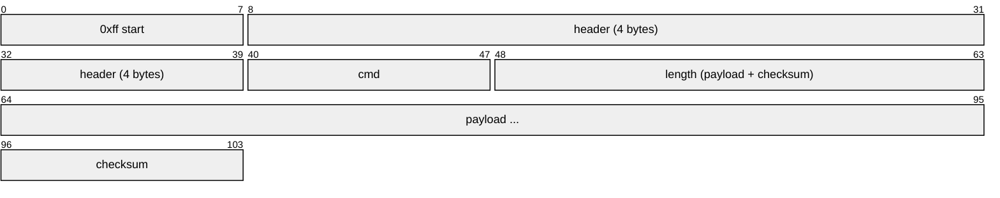
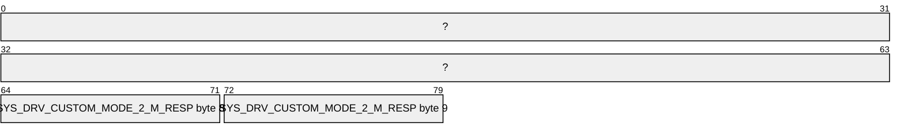

# Kia EV6 (CV), Mobis DAudio Plus Gen5 Wide

Variant `kia-ev6-gen5w`, extending `hkmc-gen5w-ev` (merged here).

- [How to read this](#how-to-read-this)
- [Confidence](#confidence)
- [Match](#match)
- [Headers](#headers)
- [Enums](#enums)
- [Messages from micom](#messages-from-micom)
- [Messages to micom](#messages-to-micom)
- [Signals](#signals)
- [Keys](#keys)
- [Profile (sent routinely)](#profile-sent-routinely)
- [Send (the control socket may send)](#send-the-control-socket-may-send)

## How to read this

Every frame on the serial link has this shape; the payload is what the message tables below describe, byte 0 first.



The 4 header bytes are `sender receiver type func`; a header and its reverse (`0d 8f ..` and `8f 0d ..`) are the two directions of one conversation.

How well each thing is known (per message, signal or header; the files do not grade single fields):

- 🟢 **captured**: seen on the wire or on the live unit.
- 🟡 **code**: read from stock code, not yet seen to match the car.
- 🟠 **inferred**: worked out from code or the frame rule.

A message is a header plus a cmd. Find the header, then the cmd under it; its field table says which payload byte holds what.

## Confidence

| Status | Messages |
| --- | --- |
| 🟢 captured | 20 |
| 🟡 code | 267 |
| 🟠 inferred | 3 |

Not yet backed by a capture:

| Message | Header | Cmd | Status | Ref |
| --- | --- | --- | --- | --- |
| Variant code | `system_rx` | 0x17 | 🟡 code | micom firmware 0x0117 handler; 61 S5W_M micom builds in emulation (en/ko, country 01/00); EV6 V015.012 automotive-service SystemService.onVariantCode/sendVariantCodeSave, automotive VariantCoding tables |
| Module versions | `system_rx` | 0x74 | 🟡 code | EV6 V015.011 HKMC_EngineerMode VersionModule: registerCallback("MicomDataSVM", 0x8a), onEvent accepts func 0x8174 with 42+ bytes (parser needs 96), parsed by g([B); labels from res string ver_module_*; never captured |
| Version info | `system_rx` | 0x16 | 🟡 code | EV6 V015.011 automotive EngineeringModeVersion.checkVersion; EngineeringModeService.onVersion; SystemService func 0x8116 -> onVersion; HKMC_EngineerMode MicomVersionInfo (indices 1, 4, 5, 8); never captured. Payload bytes 86-89 (after the HD module) are not a field: in 134 of 208 emulated builds the cmd 0x16 handler zeroes them (memset of 4), in the other 74 it never writes them, so they carry whatever the reused reply buffer held (0xffffffff, 0x14 or 0x15, differing between requests in one session); do not read them |
| Part number | `system_rx` | 0x99 | 🟡 code | EV6 V015.011 SystemService\$MicomEventHandler SYS_PART_NUMBER_M_RESP: new String(data, US-ASCII) -> sys.product.partnumber |
| Vehicle trim | `system_rx` | 0x75 | 🟡 code | EV6 V015.011 SystemService func 0x8175 -> InitialCarInfo.setVehicleTrimInfo, USMService/BlackScreenService readers |
| Front/rear camera status | `system_rx` | 0x04 | 🟡 code | SYS_FRONT_REAR_CAMERA_STATUS_M 0x8104 -> onFRCameraStatus |
| Distance to empty | `system_rx` | 0x2a | 🟡 code | SYS_DISTANCE_TO_EMPTY_STATUS_M 0x812a -> onDTEInfoChanged(unit, bytesToInt(data, 1, 2)) |
| Ambient temperature (C) | `system_rx` | 0x2b | 🟡 code | SYS_AMBIENT_TEMP_C_STATUS_M 0x812b -> onAmbientCelciusTempChanged; scaling not read |
| Ambient temperature (F) | `system_rx` | 0x2c | 🟡 code | SYS_AMBIENT_TEMP_F_STATUS_M 0x812c -> onAmbientFahrenheitTempChanged; scaling not read |
| Vehicle warning | `system_rx` | 0x34 | 🟡 code | SYS_VEHICLE_WARNING_M 0x8134 -> onVehicleWarningStatus(b0, b1); meaning not read |
| IGN3 status | `system_rx` | 0x35 | 🟡 code | SYS_IGN3_STATUS_M 0x8135: 1 is on -> onIGNStatus |
| DCT warning | `system_rx` | 0x38 | 🟡 code | SYS_DCT_WARNING_M 0x8138 -> onDctWarning |
| HVAC type | `system_rx` | 0x3a | 🟡 code | SYS_HVAC_TYPE_M 0x813a: stock keeps it in persist.sys.hvactype |
| Fuel type | `system_rx` | 0x3b | 🟡 code | SYS_FUEL_TYPE_M 0x813b -> SystemService.getFuelType |
| FSOC check result | `system_rx` | 0x59 | 🟡 code | SYS_FSOC_M_RESP 0x8159 -> broadcast com.mobis.action.FSOC_CHECK_RESULT with extras FSOC_CHECK_RESULT and BSOC_CHECK_RESULT; answer to fsoc request 0x0159 |
| Eco coasting status | `system_rx` | 0x5c | 🟡 code | SYS_ECO_COASTING_STATUS_M_RESP 0x815c -> SystemService.getEcoCoastingStatus |
| Terrain mode | `system_rx` | 0x64 | 🟡 code | SYS_TERRAIN_MODE_M 0x8164 -> broadcast com.mobis.action.TERRAIN_MODE_STATUS (terrainMode, support: byte 1 > 0) |
| WPC status | `system_rx` | 0x70 | 🟡 code | SYS_WPCWARNING_M_RESP 0x8170 -> broadcast com.mobis.intent.action.WPC_STATUS_CHANGED (WPC_STATUS); answer to wpc request 0x0170 |
| Class status | `system_rx` | 0x98 | 🟡 code | SYS_CLASS_STA_M_RESP 0x8198 -> onClassStatus(byteToInt(b0)); answer to class request 0x0198 |
| SYS_DRV_CUSTOM_MODE_2_M_RESP | `01 8a ?? 81` | 0x87 | 🟡 code | stock SystemService constant SYS_DRV_CUSTOM_MODE_2_M_RESP; the EV6 firmware sends it in emulation when its CAN input changes |
| SYS_IGN_AUTO_OFF_WARN_STATUS_M | `01 8a ?? 81` | 0x88 | 🟡 code | stock SystemService constant SYS_IGN_AUTO_OFF_WARN_STATUS_M; the EV6 firmware sends it in emulation when its CAN input changes |
| SYS_DRV_NEW_MY_DRV_MODE_M_RESP | `01 8a ?? 81` | 0x8a | 🟡 code | stock SystemService constant SYS_DRV_NEW_MY_DRV_MODE_M_RESP; the EV6 firmware sends it in emulation when its CAN input changes |
| HANDSHAKING_RX_SIG | `0d 8f ?? 8d` | 0x2e | 🟡 code | stock Navigation constant HANDSHAKING_RX_SIG; the EV6 firmware sends it in emulation when its CAN input changes |
| NSCC_C_REQ | `0d 8f ?? 8d` | 0x41 | 🟡 code | stock Navigation constant NSCC_C_REQ; the EV6 firmware sends it in emulation when its CAN input changes |
| DAW_WRN_C_REQ | `0d 8f ?? 8d` | 0x44 | 🟡 code | stock Navigation constant DAW_WRN_C_REQ; the EV6 firmware sends it in emulation when its CAN input changes |
| HDA_LINE_NUM_VAL_C_REQ | `0d 8f ?? 8d` | 0x45 | 🟡 code | stock Navigation constant HDA_LINE_NUM_VAL_C_REQ; the EV6 firmware sends it in emulation when its CAN input changes |
| USM_UserProfile_Rx_NFC_0_Short_M PHONEPAIRINGRVALUE | `11 92 ?? 91` | 0x16 | 🟡 code | stock USM_UserProfile_Rx_NFC_0_Short_M, item 1 PHONEPAIRINGRVALUE (USM\$NFC0_SHORT); the EV6 firmware sends it in emulation when CAN 0x434 byte 1 bits 0..1 changes |
| USM_UserProfile_Rx_NFC_0_Short_M NFC_SUPPORT_RESULT | `11 92 ?? 91` | 0x16 | 🟡 code | stock USM_UserProfile_Rx_NFC_0_Short_M, item 4 NFC_SUPPORT_RESULT (USM\$NFC0_SHORT); the EV6 firmware sends it in emulation when CAN 0x434 byte 0 bits 0..1 changes |
| USM_UserProfile_Rx_NFC_0_Short_M OWNER_PHONERVALUE | `11 92 ?? 91` | 0x16 | 🟡 code | stock USM_UserProfile_Rx_NFC_0_Short_M, item 7 OWNER_PHONERVALUE (USM\$NFC0_SHORT); the EV6 firmware sends it in emulation when CAN 0x434 byte 3 bits 2..3 changes |
| USM_UserProfile_Rx_NFC_0_Short_M DIGITALKEYENABLERVALUE | `11 92 ?? 91` | 0x16 | 🟡 code | stock USM_UserProfile_Rx_NFC_0_Short_M, item 8 DIGITALKEYENABLERVALUE (USM\$NFC0_SHORT); the EV6 firmware sends it in emulation when CAN 0x434 byte 3 bits 0..1 changes |
| USM_UserProfile_Rx_NFC_1_Short_M IDRVALUE | `11 92 ?? 91` | 0x18 | 🟡 code | stock USM_UserProfile_Rx_NFC_1_Short_M, item 2 IDRVALUE (USM\$NFC1_SHORT); the EV6 firmware sends it in emulation when CAN 0x434 byte 1 bits 2..5 changes |
| USM_UserProfile_Rx_NFC_1_Short_M DIGITALKEYGUIDE | `11 92 ?? 91` | 0x18 | 🟡 code | stock USM_UserProfile_Rx_NFC_1_Short_M, item 4 DIGITALKEYGUIDE (USM\$NFC1_SHORT); the EV6 firmware sends it in emulation when CAN 0x434 byte 2 bits 0..3 changes |
| USM_HUD_SET_Disp_Ctrl_M_RESP | `11 92 ?? 91` | 0x02 | 🟡 code | stock USM\$ table HUDDisplayControl; the EV6 firmware answers its request (0x1102) in emulation with 4 bytes |
| USM_HUD_SET_Content_Selection_M_RESP | `11 92 ?? 91` | 0x03 | 🟡 code | stock USM\$ table HUDContentSelection; the EV6 firmware answers its request (0x1103) in emulation with 8 bytes |
| USM_HUD_SET_Speed_Odometer_M_RESP | `11 92 ?? 91` | 0x04 | 🟡 code | stock USM\$ table HUDSpeedOdometer; the EV6 firmware answers its request (0x1104) in emulation with 3 bytes |
| USM_Driver_Assi_SET_DrAssi_M_RESP | `11 92 ?? 91` | 0x06 | 🟡 code | stock USM\$ table DriverAssist; the EV6 firmware answers its request (0x1106) in emulation with 15 bytes |
| USM_Driver_Assi_SET_Warn_M_RESP | `11 92 ?? 91` | 0x07 | 🟡 code | stock USM\$ table Warning; the EV6 firmware answers its request (0x1107) in emulation with 15 bytes |
| USM_Driver_Assi_SET_Safety_M_RESP | `11 92 ?? 91` | 0x08 | 🟡 code | stock USM\$ table Safety; the EV6 firmware answers its request (0x1108) in emulation with 35 bytes |
| USM_DrTk_SET_M_RESP | `11 92 ?? 91` | 0x09 | 🟡 code | stock USM\$ table Door; the EV6 firmware answers its request (0x1109) in emulation with 22 bytes |
| USM_Cluster_SET_Service_M_RESP | `11 92 ?? 91` | 0x0a | 🟡 code | stock USM\$ table ClusterService; the EV6 firmware answers its request (0x110a) in emulation with 12 bytes |
| USM_Cluster_SET_Content_Vol_M_RESP | `11 92 ?? 91` | 0x0c | 🟡 code | stock USM\$ table ClusterContent; the EV6 firmware answers its request (0x110c) in emulation with 12 bytes |
| USM_Light_SET_Lamp_M_RESP | `11 92 ?? 91` | 0x0d | 🟡 code | stock USM\$ table Lights; the EV6 firmware answers its request (0x110d) in emulation with 15 bytes |
| USM_Convenience_SET_ETC_M_RESP | `11 92 ?? 91` | 0x0f | 🟡 code | stock USM\$ table ConvenienceEtc; the EV6 firmware answers its request (0x110f) in emulation with 18 bytes |
| USM_Pwr_Folding_M_RESP | `11 92 ?? 91` | 0x1a | 🟡 code | stock USM\$ table PowerFoldingSeat; the EV6 firmware answers its request (0x111a) in emulation with 23 bytes |
| USM_Eco_Vehicle_M_RESP | `11 92 ?? 91` | 0x1b | 🟡 code | stock USM\$ table EcoVehicle; the EV6 firmware answers its request (0x111b) in emulation with 20 bytes |
| USM_RearSeat_H_M_RESP | `11 92 ?? 91` | 0x1c | 🟡 code | stock USM\$ table RearSeatHeat; the EV6 firmware answers its request (0x111c) in emulation with 7 bytes |
| USM_HealthCare_M_RESP | `11 92 ?? 91` | 0x20 | 🟡 code | stock USM\$ table HealthCare; the EV6 firmware answers its request (0x1120) in emulation with 4 bytes |
| USM_SmartIMS20_M_RESP | `11 92 ?? 91` | 0x21 | 🟡 code | stock USM\$ table SmartIMS20; the EV6 firmware answers its request (0x1121) in emulation with 7 bytes |
| USM_Seat_ETC_M_RESP | `11 92 ?? 91` | 0x22 | 🟡 code | stock USM\$ table SeatETC; the EV6 firmware answers its request (0x1122) in emulation with 3 bytes |
| USM_HUD_SET_ETC_M_RESP | `11 92 ?? 91` | 0x23 | 🟡 code | stock USM\$ table HUDEtc; the EV6 firmware answers its request (0x1123) in emulation with 7 bytes |
| USM_CLU_SET_ETC_M_RESP | `11 92 ?? 91` | 0x24 | 🟡 code | stock USM\$ table ClusterETC; the EV6 firmware answers its request (0x1124) in emulation with 6 bytes |
| USM_DrTk_SET_ETC_M_RESP | `11 92 ?? 91` | 0x25 | 🟡 code | stock USM\$ table DoorETC; the EV6 firmware answers its request (0x1125) in emulation with 3 bytes |
| USM_SWRC_SET_M_RESP | `11 92 ?? 91` | 0x27 | 🟡 code | stock USM\$ table SWRC; the EV6 firmware answers its request (0x1127) in emulation with 5 bytes |
| USM_Front_Seat_Heat_SET_M_RESP | `11 92 ?? 91` | 0x28 | 🟡 code | stock USM\$ table FrontSeatHeat; the EV6 firmware answers its request (0x1128) in emulation with 5 bytes |
| USM_All_Seat_Moving_SET_M_RESP | `11 92 ?? 91` | 0x29 | 🟡 code | stock USM\$ table AllSeatMoving; the EV6 firmware answers its request (0x1129) in emulation with 14 bytes |
| USM_CMS_SET_M_RESP | `11 92 ?? 91` | 0x2a | 🟡 code | stock USM\$ table CameraMonitorSystem; the EV6 firmware answers its request (0x112a) in emulation with 8 bytes |
| USM_Convenience_SET_ETC_ADD_M_RESP | `11 92 ?? 91` | 0x2b | 🟡 code | stock USM\$ table ConvenienceEtcAdd; the EV6 firmware answers its request (0x112b) in emulation with 5 bytes |
| USM_Clu_Right_Gauge_M_RESP | `11 92 ?? 91` | 0x2c | 🟡 code | stock USM\$ table ClusterRightGauge; the EV6 firmware answers its request (0x112c) in emulation with 14 bytes |
| USM_Body_Type_M_RESP | `11 92 ?? 91` | 0x2d | 🟡 code | stock USM\$ table BodyType; the EV6 firmware answers its request (0x112d) in emulation with 2 bytes |
| USM_ERGO_M_RESP | `11 92 ?? 91` | 0x2e | 🟡 code | stock USM\$ table Ergo; the EV6 firmware answers its request (0x112e) in emulation with 9 bytes |
| USM_Seat_2nd_Reg_L_M_RESP | `11 92 ?? 91` | 0x2f | 🟡 code | stock USM\$ table SEATBACKRECLINE_RLPSU; the EV6 firmware answers its request (0x112f) in emulation with 10 bytes |
| USM_Seat_2nd_Reg_R_M_RESP | `11 92 ?? 91` | 0x30 | 🟡 code | stock USM\$ table SEATBACKRECLINE_RRPSU; the EV6 firmware answers its request (0x1130) in emulation with 10 bytes |
| USM_Eco_Vehicle_ETC_M_RESP | `11 92 ?? 91` | 0x31 | 🟡 code | stock USM\$ table EcoVehicleETC; the EV6 firmware answers its request (0x1131) in emulation with 3 bytes |
| USM_TOWMODE_M_RESP | `11 92 ?? 91` | 0x33 | 🟡 code | stock USM\$ table TOWMODE; the EV6 firmware answers its request (0x1133) in emulation with 2 bytes |
| USM_Convenience_SET_Ventilated_M_RESP | `11 92 ?? 91` | 0x0e | 🟡 code | stock USM\$ table ConvenienceVentilate; the EV6 firmware answers its request (0x110e) in emulation with 10 bytes; ids 2 and 3 only, not 1..N, and the reply is longer than max id + 1 |
| USM_Driver_Assi_SET_ETC_M_RESP (with item 17) | `11 92 ?? 91` | 0x26 | 🟡 code | stock USMService.onEvent (0x9126) reads item n at byte n through 17; a firmware that sends the 18th byte carries BLINDSPOTSAFETYWARNINGSOUND |
| USM_Driver_Assi_SET_ETC_M_RESP | `11 92 ?? 91` | 0x26 | 🟡 code | stock USM\$ table DriverAssistETC; the EV6 firmware answers its request (0x1126) in emulation with 17 bytes; ids 1-4 and 6-17 (no 5); this firmware stops at byte 16, so id 17 BLINDSPOTSAFETYWARNINGSOUND is only in the 18-byte form above |
| USM_DIGITALKEY_2nd_M_RESP | `11 92 ?? 91` | 0x34 | 🟡 code | stock USM\$ table DigitalKeyInfo2; the EV6 firmware answers its request (0x1134) in emulation with 10 bytes; item 6 NFCCARD1_SERIAL is a string, probably bytes 6-9, unread |
| USM_Dual_Light_SET_LAMP_M_RESP | `11 92 ?? 91` | 0x35 | 🟡 code | stock USMService.onEvent (0x9135): no item byte, three big-endian u16 colours then four bytes, the same layout whether byte 0 is 0xfa or not; the set (0x1135) is 9 bytes, type then three u16 with 0x0200 meaning unchanged, type 0xfa all; the EV6 firmware answers request 0x1135 in emulation with 10 bytes, the colours 0x0200 (unchanged) |
| USM_HUD_SET_ON_OFF_M_RESP | `11 92 ?? 91` | 0x01 | 🟡 code | no stock table; the EV6 firmware answers its request (0x1101) in emulation with 3 bytes |
| USM_Driver_Assi_SET_SCC_M_RESP | `11 92 ?? 91` | 0x05 | 🟡 code | no stock table; the EV6 firmware answers its request (0x1105) in emulation with 1 bytes; 0xfa when unset |
| USM_Cluster_SET_ENG_Reset_M_RESP | `11 92 ?? 91` | 0x0b | 🟡 code | no stock table; the EV6 firmware answers its request (0x110b) in emulation with 2 bytes |
| USM_Reset_USM_SETTING_M_RESP | `11 92 ?? 91` | 0x10 | 🟡 code | no stock table; the EV6 firmware answers its request (0x1110) in emulation with 1 bytes |
| USM_UserProfile_ALL_NFC_0_M_RESP | `11 92 ?? 91` | 0x13 | 🟡 code | stock USMService.onEvent, byte-to-field pairing from the odex iput-quick field offsets, resolved against USMService's field layout; bytes 4-9 are the NFC BD address as hex; the EV6 firmware answers request 0x1113 in emulation with 14 bytes; stock name is USM_UserProfile_ALL_NFC_0_M_REQ although it is micom to SoC |
| USM_UserProfile_ALL_NFC_1_M_RESP | `11 92 ?? 91` | 0x14 | 🟡 code | stock USMService.onEvent, byte-to-field pairing from the odex iput-quick field offsets, resolved against USMService's field layout; bytes 2-7 (strUserProfile_PhoneNumberOnWPC) are a number the SoC formats as hex (%06X of bytes 2-4, %X of bytes 5-7, each little-endian), shown as two halves; the EV6 firmware answers request 0x1114 in emulation with 10 bytes; stock name is USM_UserProfile_ALL_NFC_1_M_REQ although it is micom to SoC |
| USM_DigitalKey_Info_M_RESP | `11 92 ?? 91` | 0x1e | 🟡 code | stock USMService.onEvent: Item 1-6 (or 0xfa for all) says which of Manufacturer (byte 1), VendorCode (bytes 2-4), Serial (bytes 5-8), Year, Month, Date the reply carries, each big-endian at its own offset; the string fields are the stock hex of those bytes; the field per offset is from the odex iput-quick offsets resolved against USMService's field layout (VendorCode precedes Serial); the EV6 firmware answers request 0x111e in emulation with 14 bytes |
| USM_UserProfile_Rx_NFC_2_M_RESP | `11 92 ?? 91` | 0x1f | 🟡 code | stock USMService.onEvent: all 8 bytes are UserProfile PhoneNumber, little-endian, which the SoC formats as hex (%08X of bytes 0-3, then %X of bytes 4-7), shown as two halves; the stock's %X drops leading zeros, these halves keep them; the EV6 firmware answers request 0x111f in emulation with 8 bytes |
| Status flag | `0c 88 ?? 8c` | 0x02 | 🟡 code | HEVService status-flag setter; seen live as 57 00 NN |
| Charge time estimate, DC | `0c 88 ?? 8c` | 0x02 | 🟡 code | HEVService item 0x0e QC_REM_TIME: a DC fast charge's time to full, while not charging; 10-41 seen |
| Charge time estimate, AC | `0c 88 ?? 8c` | 0x02 | 🟡 code | HEVService item 0x13 SC_REM_TIME_EVSE_PHEV, an EV's NOT_CHAR_EVSE_REM_TIME (CAN DB generation > 0): a wallbox's time to full, while not charging; 20-220 seen, rising as the charge fell |
| Charge time estimate, DC custom | `0c 88 ?? 8c` | 0x02 | 🟡 code | HEVService item 0x61 VCRM_QCHCHRGRMNTIMEVALCUSTOM: DC time to full at the custom charge power |
| Charge limit, AC | `0c 88 ?? 8c` | 0x02 | 🟡 code | HEVService item 0x21 SOC_SC_CHG (TARGET_SOC_SLOW): x0.5 % from the set side's pct / 0.5; never seen |
| Charge limit, DC | `0c 88 ?? 8c` | 0x02 | 🟡 code | HEVService item 0x22 SOC_QC_CHG (TARGET_SOC_QUICK): x0.5 % from the set side's pct / 0.5; never seen |
| Battery conditioning mode | `0c 88 ?? 8c` | 0x02 | 🟡 code | HEVService item 0x63 EV_BATTERYCONDITIONING (HEVFlag 0x5e); never seen |
| Battery conditioning failure | `0c 88 ?? 8c` | 0x02 | 🟡 code | HEVService item 0x79 BMS_BATTCONDFAILPOPUP (HEVFlag 0x73); never seen |
| VCU ready | `0c 88 ?? 8c` | 0x02 | 🟡 code | HEVService item 0x2c VCU_RDY (HEVFlag 45); never seen; stock under QEMU with micom-fake: the range appears once it is 1 |
| Winter mode | `0c 88 ?? 8c` | 0x02 | 🟡 code | HEVService item 0x44 XEV_WINTERMODESTA; never seen |
| AC charging current | `0c 88 ?? 8c` | 0x02 | 🟡 code | HEVService item 0x51 OBC_CHGINCURRMODSTA, getInCurrModeValue(v, true); never seen |
| V2L discharge limit | `0c 88 ?? 8c` | 0x02 | 🟡 code | HEVService item 0x50 CHRG_V2XDISCHRGLIMSOCVAL_SYNC; never seen |
| Range at charge limit, AC | `0c 88 ?? 8c` | 0x02 | 🟡 code | HEVService item 0x1f SOC_DTE_SC_CHG (DTE_SLOW_CHARGER_SOC); 406-414 seen |
| Range at charge limit, DC | `0c 88 ?? 8c` | 0x02 | 🟡 code | HEVService item 0x20 SOC_DTE_QC_CHG (DTE_QUICK_CHARGER_SOC) |
| Trip energy | `0c 88 ?? 8c` | 0x02 | 🟡 code | HEVService item 0x5e XEV_BATPWRSUM_KWH: the battery energy used; x0.1 kWh is a fit (20 -> 360 while the pack's energy fell 33 kWh), medium confidence |
| Average efficiency | `0c 88 ?? 8c` | 0x02 | 🟡 code | HEVService item 0x06 CLU_AVGFCL (AVG_FCI): 0-0x3ff; x0.1, per kWh in the unit item 0x05 gives (km or mi), is a guess, medium confidence; 31-41 seen |
| HEV status (full) | `0c 88 ?? 8c` | 0x01 | 🟡 code | HEVService DATA_M_RESP as below, and [0x8d] into EV_BATTERYCONDITIONING (len >= 0x8e), [0xb6] into BMS_BATTCONDFAILPOPUP |
| EV power block | `0c 88 ?? 8c` | 0x5c | 🟡 code | HEVService setHEVStatusValue calls |
| Departure timers | `0c 88 ?? 8c` | 0x55 | 🟡 code | HEVService G3CAN_VCU_04_1_M (func 0x8c55, gen > 0); 0 in all 43k frames of a 2026-11 capture (nothing set) |
| CR_CLU_TOTALDTEDISP | `0c 88 ?? 8c` | 0x02 | 🟡 code | HEVService item 0x02 CR_CLU_TOTALDTEDISP (HEV\$SignalID); the EV6 firmware sends it in emulation when CAN 0x226 byte 4 bits 0..7; CAN 0x226 byte 5 bits 0..3 changes |
| CLU_TRIPUNIT | `0c 88 ?? 8c` | 0x02 | 🟡 code | HEVService item 0x03 CLU_TRIPUNIT (HEV\$SignalID); the EV6 firmware sends it in emulation when CAN 0x226 byte 5 bits 4..5 changes |
| CLU_AVGFCU | `0c 88 ?? 8c` | 0x02 | 🟡 code | HEVService item 0x05 CLU_AVGFCU (HEV\$SignalID); the EV6 firmware sends it in emulation when CAN 0x226 byte 7 bits 0..1 changes |
| CLU_TERMAVGSYNC | `0c 88 ?? 8c` | 0x02 | 🟡 code | HEVService item 0x07 CLU_TERMAVGSYNC (HEV\$SignalID); the EV6 firmware sends it in emulation when CAN 0x2FF byte 4 bits 6..7 changes |
| CLU_TERMAVGFCI | `0c 88 ?? 8c` | 0x02 | 🟡 code | HEVService item 0x08 CLU_TERMAVGFCI (HEV\$SignalID); the EV6 firmware sends it in emulation when CAN 0x2FF byte 5 bits 2..7; CAN 0x2FF byte 6 bits 2..3 changes |
| MM_CR_CLU_SOC_SEG | `0c 88 ?? 8c` | 0x02 | 🟡 code | HEVService item 0x0c MM_CR_CLU_SOC_SEG (HEV\$SignalID); the EV6 firmware sends it in emulation when CAN 0x474 byte 7 bits 1..5 changes |
| DATC_EV_SCNDISP | `0c 88 ?? 8c` | 0x02 | 🟡 code | HEVService item 0x0d DATC_EV_SCNDISP (HEV\$SignalID); the EV6 firmware sends it in emulation when CAN 0x384 byte 4 bits 2..2 changes |
| SC_REM_TIME_120V | `0c 88 ?? 8c` | 0x02 | 🟡 code | HEVService item 0x0f SC_REM_TIME_120V (HEV\$SignalID); the EV6 firmware sends it in emulation when CAN 0x1F7 byte 2 bits 0..7; CAN 0x1F7 byte 3 bits 0..7 changes |
| AVG_FCL_DR_INFO_RESET | `0c 88 ?? 8c` | 0x02 | 🟡 code | HEVService item 0x15 AVG_FCL_DR_INFO_RESET (HEV\$SignalID); the EV6 firmware sends it in emulation when CAN 0x2FF byte 3 bits 0..1 changes |
| AVG_FCL_DR_INFO | `0c 88 ?? 8c` | 0x02 | 🟡 code | HEVService item 0x16 AVG_FCL_DR_INFO (HEV\$SignalID); the EV6 firmware sends it in emulation when CAN 0x2FF byte 3 bits 4..7; CAN 0x2FF byte 4 bits 4..5 changes |
| DISPLAY_SOC | `0c 88 ?? 8c` | 0x02 | 🟡 code | HEVService item 0x18 DISPLAY_SOC (HEV\$SignalID); the EV6 firmware sends it in emulation when CAN 0x2FC byte 7 bits 0..7 changes |
| STD_CHA_120V | `0c 88 ?? 8c` | 0x02 | 🟡 code | HEVService item 0x1a STD_CHA_120V (HEV\$SignalID); the EV6 firmware sends it in emulation when CAN 0x326 byte 3 bits 0..1 changes |
| CHG_STS | `0c 88 ?? 8c` | 0x02 | 🟡 code | HEVService item 0x1c CHG_STS (HEV\$SignalID); the EV6 firmware sends it in emulation when CAN 0x326 byte 4 bits 0..1 changes |
| BMS_FST_CHA | `0c 88 ?? 8c` | 0x02 | 🟡 code | HEVService item 0x27 BMS_FST_CHA (HEV\$SignalID); the EV6 firmware sends it in emulation when CAN 0x25C byte 0 bits 4..5 changes |
| FST_EVSE_FIT_ALARM | `0c 88 ?? 8c` | 0x02 | 🟡 code | HEVService item 0x28 FST_EVSE_FIT_ALARM (HEV\$SignalID); the EV6 firmware sends it in emulation when CAN 0x25C byte 0 bits 2..3 changes |
| EV_RDY | `0c 88 ?? 8c` | 0x02 | 🟡 code | HEVService item 0x2b EV_RDY (HEV\$SignalID); the EV6 firmware sends it in emulation when CAN 0x36 byte 3 bits 4..5 changes |
| AVG_FCI_DIGIT | `0c 88 ?? 8c` | 0x02 | 🟡 code | HEVService item 0x2e AVG_FCI_DIGIT (HEV\$SignalID); the EV6 firmware sends it in emulation when CAN 0x2FF byte 5 bits 0..1 changes |
| DRIVE_INFO_DIGIT | `0c 88 ?? 8c` | 0x02 | 🟡 code | HEVService item 0x2f DRIVE_INFO_DIGIT (HEV\$SignalID); the EV6 firmware sends it in emulation when CAN 0x2FF byte 3 bits 2..3 changes |
| ENERGYMAP_1000MS | `0c 88 ?? 8c` | 0x02 | 🟡 code | HEVService item 0x30 ENERGYMAP_1000MS (HEV\$SignalID); the EV6 firmware sends it in emulation when CAN 0x25C byte 4 bits 0..7; CAN 0x25C byte 5 bits 0..7 changes |
| BMS_EVENERGYCAPA | `0c 88 ?? 8c` | 0x02 | 🟡 code | HEVService item 0x34 BMS_EVENERGYCAPA (HEV\$SignalID); the EV6 firmware sends it in emulation when CAN 0x331 byte 6 bits 0..7; CAN 0x331 byte 7 bits 0..7 changes |
| CF_LDC_12VCharge | `0c 88 ?? 8c` | 0x02 | 🟡 code | HEVService item 0x3a CF_LDC_12VCharge (HEV\$SignalID); the EV6 firmware sends it in emulation when CAN 0x256 byte 3 bits 4..5 changes |
| VCMS_RDY | `0c 88 ?? 8c` | 0x02 | 🟡 code | HEVService item 0x3b VCMS_RDY (HEV\$SignalID); the EV6 firmware sends it in emulation when CAN 0x30B byte 4 bits 2..3 changes |
| VCMS_CHGSTOPALARM | `0c 88 ?? 8c` | 0x02 | 🟡 code | HEVService item 0x3c VCMS_CHGSTOPALARM (HEV\$SignalID); the EV6 firmware sends it in emulation when CAN 0x30B byte 7 bits 6..7 changes |
| VCMS_CHGINCURRMODSTA | `0c 88 ?? 8c` | 0x02 | 🟡 code | HEVService item 0x3d VCMS_CHGINCURRMODSTA (HEV\$SignalID); the EV6 firmware sends it in emulation when CAN 0x30E byte 4 bits 0..1 changes |
| VCMS_CHGALARM_STA | `0c 88 ?? 8c` | 0x02 | 🟡 code | HEVService item 0x3e VCMS_CHGALARM_STA (HEV\$SignalID); the EV6 firmware sends it in emulation when CAN 0x30D byte 7 bits 0..3 changes |
| VCMS_CHGALARM_SUBCODE | `0c 88 ?? 8c` | 0x02 | 🟡 code | HEVService item 0x3f VCMS_CHGALARM_SUBCODE (HEV\$SignalID); the EV6 firmware sends it in emulation when CAN 0x30D byte 7 bits 4..7 changes |
| OBC_SYSRDY_STA | `0c 88 ?? 8c` | 0x02 | 🟡 code | HEVService item 0x40 OBC_SYSRDY_STA (HEV\$SignalID); the EV6 firmware sends it in emulation when CAN 0x2E6 byte 3 bits 0..1 changes |
| VCU_AVNDTEONCALCSTA | `0c 88 ?? 8c` | 0x02 | 🟡 code | HEVService item 0x41 VCU_AVNDTEONCALCSTA (HEV\$SignalID); the EV6 firmware sends it in emulation when CAN 0x2B7 byte 1 bits 3..4 changes |
| VCU_DTEOFFDISPSTA | `0c 88 ?? 8c` | 0x02 | 🟡 code | HEVService item 0x42 VCU_DTEOFFDISPSTA (HEV\$SignalID); the EV6 firmware sends it in emulation when CAN 0x2B6 byte 4 bits 0..1 changes |
| VCU_LOWSOCALERTSTA | `0c 88 ?? 8c` | 0x02 | 🟡 code | HEVService item 0x43 VCU_LOWSOCALERTSTA (HEV\$SignalID); the EV6 firmware sends it in emulation when CAN 0x2B6 byte 4 bits 2..4 changes |
| VCMS_V2LMODE | `0c 88 ?? 8c` | 0x02 | 🟡 code | HEVService item 0x4e VCMS_V2LMODE (HEV\$SignalID); the EV6 firmware sends it in emulation when CAN 0x30E byte 4 bits 5..7 changes |
| VCMS_V2GMODE | `0c 88 ?? 8c` | 0x02 | 🟡 code | HEVService item 0x4f VCMS_V2GMODE (HEV\$SignalID); the EV6 firmware sends it in emulation when CAN 0x30E byte 4 bits 2..4 changes |
| VCU_DTENAVIROUTEVAL | `0c 88 ?? 8c` | 0x02 | 🟡 code | HEVService item 0x53 VCU_DTENAVIROUTEVAL (HEV\$SignalID); the EV6 firmware sends it in emulation when CAN 0x2B7 byte 2 bits 0..7; CAN 0x2B7 byte 3 bits 0..1 changes |
| VCU_FATCPWRUSEVAL | `0c 88 ?? 8c` | 0x02 | 🟡 code | HEVService item 0x54 VCU_FATCPWRUSEVAL (HEV\$SignalID); the EV6 firmware sends it in emulation when CAN 0x37 byte 0 bits 0..7 changes |
| VCMS_CHRGINLETTYP | `0c 88 ?? 8c` | 0x02 | 🟡 code | HEVService item 0x56 VCMS_CHRGINLETTYP (HEV\$SignalID); the EV6 firmware sends it in emulation when CAN 0x30E byte 3 bits 0..7 changes |
| VCU_UTILMODUSMSTA | `0c 88 ?? 8c` | 0x02 | 🟡 code | HEVService item 0x58 VCU_UTILMODUSMSTA (HEV\$SignalID); the EV6 firmware sends it in emulation when CAN 0x2AE byte 4 bits 0..1 changes |
| VCU_UTILMODWRNMSGSTA | `0c 88 ?? 8c` | 0x02 | 🟡 code | HEVService item 0x59 VCU_UTILMODWRNMSGSTA (HEV\$SignalID); the EV6 firmware sends it in emulation when CAN 0x2AE byte 4 bits 4..5 changes |
| MCU_MG1INVTCTRLRDYSTA | `0c 88 ?? 8c` | 0x02 | 🟡 code | HEVService item 0x5c MCU_MG1INVTCTRLRDYSTA (HEV\$SignalID); the EV6 firmware sends it in emulation when CAN 0x10B byte 7 bits 0..1 changes |
| MCU_MG2INVTRDYSTA | `0c 88 ?? 8c` | 0x02 | 🟡 code | HEVService item 0x5d MCU_MG2INVTRDYSTA (HEV\$SignalID); the EV6 firmware sends it in emulation when CAN 0x121 byte 7 bits 0..1 changes |
| MCU_MG1GENPOWER_WH | `0c 88 ?? 8c` | 0x02 | 🟡 code | HEVService item 0x5f MCU_MG1GENPOWER_WH (HEV\$SignalID); the EV6 firmware sends it in emulation when CAN 0x397 byte 4 bits 0..7; CAN 0x397 byte 5 bits 0..7 changes |
| MCU_MG2GENPOWER_WH | `0c 88 ?? 8c` | 0x02 | 🟡 code | HEVService item 0x60 MCU_MG2GENPOWER_WH (HEV\$SignalID); the EV6 firmware sends it in emulation when CAN 0x2EC byte 4 bits 0..7; CAN 0x2EC byte 5 bits 0..7 changes |
| VCU_MXPWR_MDSTA | `0c 88 ?? 8c` | 0x02 | 🟡 code | HEVService item 0x68 VCU_MXPWR_MDSTA (HEV\$SignalID); the EV6 firmware sends it in emulation when CAN 0x2C2 byte 6 bits 0..1 changes |
| VCU_MXPWR_MDSEGVAL | `0c 88 ?? 8c` | 0x02 | 🟡 code | HEVService item 0x69 VCU_MXPWR_MDSEGVAL (HEV\$SignalID); the EV6 firmware sends it in emulation when CAN 0x2C2 byte 6 bits 2..6 changes |
| VCU_MXPWR_MDOSD | `0c 88 ?? 8c` | 0x02 | 🟡 code | HEVService item 0x6a VCU_MXPWR_MDOSD (HEV\$SignalID); the EV6 firmware sends it in emulation when CAN 0x2C2 byte 6 bits 7..7 changes |
| VCRM_QCKCHRGPWR_CUSTOM | `0c 88 ?? 8c` | 0x02 | 🟡 code | HEVService item 0x6b VCRM_QCKCHRGPWR_CUSTOM (HEV\$SignalID); the EV6 firmware sends it in emulation when CAN 0x1F9 byte 4 bits 2..7 changes |
| MCU_MG1MOTMXPWR_SPEC | `0c 88 ?? 8c` | 0x02 | 🟡 code | HEVService item 0x6c MCU_MG1MOTMXPWR_SPEC (HEV\$SignalID); the EV6 firmware sends it in emulation when CAN 0x253 byte 6 bits 2..7 changes |
| BMS_HV_BATT_AUTO_DCH_OP_STA | `0c 88 ?? 8c` | 0x02 | 🟡 code | HEVService item 0x74 BMS_HV_BATT_AUTO_DCH_OP_STA (HEV\$SignalID); the EV6 firmware sends it in emulation when CAN 0x237 byte 4 bits 4..5 changes |
| ODOMETER | `0c 88 ?? 8c` | 0x02 | 🟡 code | HEVService item 0x1e ODOMETER (HEV\$SignalID): id, then a 24-bit value; the EV6 firmware sends it in emulation when CAN 0x227 byte 1 bits 0..7; CAN 0x227 byte 2 bits 0..7; CAN 0x227 byte 3 bits 0..7 changes |
| CCM_CERT_PCID1 | `0c 88 ?? 8c` | 0x02 | 🟡 code | HEVService item 0x64 CCM_CERT_PCID1 (HEV\$SignalID): id, then a 24-bit value; the EV6 firmware sends it in emulation when CAN 0x357 byte 5 bits 0..7; CAN 0x357 byte 6 bits 0..7; CAN 0x357 byte 7 bits 0..7 changes |
| tbt-turn | `cluster_tx` | 0x04 | 🟡 code | stock ClusterService\$NaviCluster TBTInfo packer (byte 0 straight from the caller); GPM GpmNaviTBTManager.releaseGuidance; nemesis-report worked example "turn right, 0.3 km" |
| tbt-points | `cluster_tx` | 0x02 | 🟡 code | stock ClusterService\$NaviCluster TBTSubInfo2C packer |
| cluster-sub-info | `cluster_tx` | 0x03 | 🟡 code | stock ClusterService\$NaviCluster TBTSubInfo packer; the captured ack frame |
| nav-operation | `cluster_tx` | 0x11 | 🟡 code | stock ClusterService\$NaviCluster.sendOperationStatus (1 byte), Navigation\$Func OPERATION_STATUS 0x11; GPM claimCluster/onStatus; DiPO u.java claim and release |
| tbt-alive | `cluster_tx` | 0x0e | 🟡 code | stock ClusterService\$NaviCluster.sendAlive (mIsAlive 1/0), Navigation\$Func ALIVE 0x0e |
| cluster-day-night | `cluster_tx` | 0x0f | 🟡 code | stock ClusterService\$NaviCluster.sendDayNight (mIsNight 1/0), Navigation\$Func DAY_NIGHT_STATUS 0x0f |
| cluster-position | `status_tx` | 0x17 | 🟡 code | stock ClusterLocationManager.sendLocationInfo / ClusterService.updatePositionInfo (IL HU_CurPosition), every 1 s with IGN on; the captured frames decode to the unit's position then |
| batt-cond-route-distance | `poll_tx` | 0x66 | 🟡 code | stock HEVService.setBattCondRouteDis: sendPacket(0x88, 0x0c, 0x0c66, [hi, lo]) |
| batt-cond-remain-time | `poll_tx` | 0x65 | 🟡 code | stock HEVService.setBattCondRemainTime: sendPacket(0x88, 0x0c, 0x0c65, [hi, lo]) |
| batt-cond-ev-station | `poll_tx` | 0x68 | 🟡 code | stock HEVService.setBattCondEvStation: sendPacket(0x88, 0x0c, 0x0c68, [flag & 0xf, type & 0xf]), then HEVService\$6 [7, 7] after 120 ms; github.com/paytondevs/gen5w-preconditioning PreconditioningProfile |
| batt-cond-mode | `poll_tx` | 0x62 | 🟡 code | stock HEVManager.setBatteryConditioning -> HEVService: sendPacket(0x88, 0x0c, 0x0c62, [mode]), then HEVService\$5 [0] after 120 ms |
| Schedule settings | `0c 88 ?? 8c` | 0x53 | 🟡 code | HEVService G3CAN_VCU_04_2_M (func 0x8c53); seen 8 times as 00 14 10 02 00 40 00 50 (20:00-16:00, mode 0, climate off) |
| Scheduled charge window | `0c 88 ?? 8c` | 0x54 | 🟡 code | HEVService G3CAN_VCU_04_3_M (func 0x8c54); seen 13 times as 00 01 00 40 ff ff ff 0f (no window) |
| ev-off-peak | `poll_tx` | 0x05 | 🟡 code | stock HEVService.setEconomicChargeTime, mCanDBGenerationInfo >= 2: sendPacket(0x88, 0x0c, 0x0c05, 5 bytes) |
| ev-departures | `poll_tx` | 0x06 | 🟡 code | stock HEVService.setDepartTimeNClimateSet, mCanDBGenerationInfo >= 2: sendPacket(0x88, 0x0c, 0x0c06, 7 bytes); readback G3CAN_VCU_04_1/2/3_M |
| ev-charge-limits | `poll_tx` | 0x18 | 🟡 code | stock HEVService.setTargetSOCext, mCanDBGenerationInfo >= 2: sendPacket(0x88, 0x0c, 0x0c18, 7 bytes), from TAppEV3 one limit per frame; readback items 0x21/0x22/0x44; stock under QEMU (micom-fake, 2026-11-12) sends exactly these frames, not seen from a car |
| ev-charging-current | `poll_tx` | 0x5b | 🟡 code | stock HEVService.setOBCCurrent (flag 82 = 1): sendPacket(0x88, 0x0c, 0x0c5b, getInCurrModeValue(iccb, false)), 0 after 120 ms; stock under QEMU (micom-fake, 2026-11-12) sends exactly these frames, not seen from a car |
| ev-v2l-limit | `poll_tx` | 0x5a | 🟡 code | stock HEVService: sendPacket(0x88, 0x0c, 0x0c5a, limSoc), 0xff after 120 ms |
| Power state | `system_rx` | 0x08 | 🟡 code | micom firmware FUN_0006ee40; firmware emulation, ACC off to state 0 |
| Power state (ACC on) | `system_rx` | 0x08 | 🟡 code | firmware emulation: ff 01 8a 01 81 08 00 03 01 05 fb on ACC on |
| ACC edge | `system_rx` | 0x33 | 🟡 code | firmware emulation: 0x8133 [01] on ACC off, [02] on ACC on |
| Vehicle ready | `system_rx` | 0x0b | 🟡 code | stock SYS_ALTERNATE_STATUS_M (0x810b, ALT-L); micom firmware, 0x810b sender (a CAN value, debounced 0.5 s) |
| Charge warning | `system_rx` | 0x0c | 🟡 code | stock SYS_FUELWARNING_STATUS_M (0x810c); micom firmware FUN_00073e46 |
| Illumination | `system_rx` | 0x0d | 🟡 code | stock SystemService/VideoSetupService SYS_ILLUMINATION_STATUS_M; micom firmware 0x810d sender; firmware emulation |
| Boot record (full) | `system_rx` | 0x01 | 🟡 code | stock SystemService InitialCarInfo; 149 bytes, byte 120 = 02 and byte 7 = ca in 2026-11 captures |
| Rheostat level | `system_rx` | 0x45 | 🟡 code | stock SYS_RHEOSTAT_M (func 0x8145) |
| System 0x819B | `system_rx` | 0x9b | 🟡 code | stock battSoc, func 0x819b byte 7 |
| hu-day-night | `system_tx` | 0x90 | 🟡 code | stock SystemService.sendHUDayNightState (sendPacket 0x8a, 1, func 0x0190); micom firmware dispatcher 0x774a2 case 0x90 -> FUN_000d4a3a; stock under QEMU (micom-fake, 2026-11-12): 01 day, 02 night |
| hu-theme | `system_tx` | 0x8f | 🟡 code | stock SystemService.sendGuiThemeType (sendPacket 0x8a, 1, func 0x018f) from VideoSetupService.sendThemeType (USE_ECOGUI_COMMON: uiMode night 4, else 3); micom firmware dispatcher 0x774a2 case 0x8f -> FUN_000d6568; stock under QEMU (micom-fake, 2026-11-12): 04 at micom ready, 03 and 04 as the UI mode went day and night |
| sys-update-reservation | `system_tx` | 0x57 | 🟠 inferred | micom dispatcher cmd 0x57 -> event 0x125; emulated firmware console 2026-11-10 ('SYS_UPDATE_RESERVATION_C : 0x1, 0x20') |
| sys-download-reservation | `system_tx` | 0x8d | 🟠 inferred | micom dispatcher cmd 0x8d -> event 0x18a; emulated firmware console 2026-11-10 ('SYS_DOWNLOAD_RESERVATION_C : 0x1, 0xFA') |
| sys-sleep-boot-control | `system_tx` | 0x67 | 🟠 inferred | micom dispatcher cmd 0x67; name tentative (strings in the event consumers) |
| 12 V battery | `body` | 0x14 | 🟡 code | stock BODY Batt_SoC |
| Display 0x880C | `display_rx` | 0x0c | 🟡 code | firmware emulation: 0x080C [00] answered ff 08 8c 01 88 0c 00 02 02 fe |
| Rheostat | `display_rx` | 0x10 | 🟡 code | firmware emulation: 0x0810 [00] answered 14 |
| Display 0x8813 | `display_rx` | 0x13 | 🟡 code | firmware emulation: 0x0813 [00] answered 32 |
| Current brightness | `display_rx` | 0x1b | 🟡 code | stock current brightness request 0x081B and its reply; micom firmware 0x081B handler |
| Climate snapshot | `climate_panel` | 0x00 | 🟡 code | stock DATCService All_Datc_Resp; never captured (nothing sent All_Datc_Req) |
| B-CAN validity | `tele_rx` | 0xc7 | 🟡 code | stock BCMService BCAN_VALID (0x8bc7) |
| Body snapshot | `body` | 0x0c | 🟡 code | stock BCMService ALL_BCM_Resp (0xc40c); never captured |
| Units (USM) | `usm_rx` | 0x11 | 🟡 code | stock USMService Unit_SET (0x9111) |
| backlight | `display_tx` | 0x02 | 🟡 code | firmware emulation: ff 8c 08 01 08 02 00 02 01 73 on, ... 00 72 off; eMIOS0 ch 6 PWM |
| shutdown-ack | `system_tx` | 0x09 | 🟡 code | firmware emulation: 0x0109 [01] ff 8a 01 01 01 09 00 02 01 7e, [02] ... 02 7d; status bits b8, b12 |
| backlight-dim-mode | `display_tx` | 0x01 | 🟡 code | stock MON_SET_DIMMING_MODE_C (0 auto, 1 daylight, 2 night, 3 manual); micom firmware 0x0801 handler; EEPROM trace under emulation |
| backlight-period-level | `display_tx` | 0x07 | 🟡 code | stock dimming brightness [period, level]; micom firmware 0x0807 handler; EEPROM trace under emulation |
| backlight-manual-level | `display_tx` | 0x1a | 🟡 code | stock user brightness; micom firmware 0x081A handler; EEPROM trace under emulation |
| DATC_TempUnit | `climate_panel` | 0x0e | 🟡 code | stock UNIDatcProtocol TE_RX_IL ordinal 14 (func 0xc30e); the EV6 firmware sends it in emulation when CAN 0x382 byte 5 bits 0..1 changes |
| CF_DATC_Option2 | `climate_panel` | 0x31 | 🟡 code | stock UNIDatcProtocol TE_RX_IL ordinal 49 (func 0xc331); the EV6 firmware sends it in emulation when CAN 0x3B2 byte 6 bits 0..3 changes |
| DATC_WshFldUSMSta | `climate_panel` | 0x3c | 🟡 code | stock UNIDatcProtocol TE_RX_IL ordinal 60 (func 0xc33c); the EV6 firmware sends it in emulation when CAN 0x427 byte 4 bits 6..7 changes |
| DATC_FrontBlwAutoDisp | `climate_panel` | 0x3f | 🟡 code | stock UNIDatcProtocol TE_RX_IL ordinal 63 (func 0xc33f); the EV6 firmware sends it in emulation when CAN 0x384 byte 4 bits 6..7 changes |
| CF_DATC_Option4 | `climate_panel` | 0x44 | 🟡 code | stock UNIDatcProtocol TE_RX_IL ordinal 68 (func 0xc344); the EV6 firmware sends it in emulation when CAN 0x3B2 byte 6 bits 4..7 changes |
| DATC_ArClnSmblTyp | `climate_panel` | 0x45 | 🟡 code | stock UNIDatcProtocol TE_RX_IL ordinal 69 (func 0xc345); the EV6 firmware sends it in emulation when CAN 0x3B1 byte 6 bits 0..2 changes |
| DATC_ArClnStepClr | `climate_panel` | 0x46 | 🟡 code | stock UNIDatcProtocol TE_RX_IL ordinal 70 (func 0xc346); the EV6 firmware sends it in emulation when CAN 0x3B1 byte 5 bits 4..7 changes |
| DATC_ArClnSysOSD | `climate_panel` | 0x47 | 🟡 code | stock UNIDatcProtocol TE_RX_IL ordinal 71 (func 0xc347); the EV6 firmware sends it in emulation when CAN 0x3B1 byte 5 bits 0..3 changes |
| DATC_Opt5Typ | `climate_panel` | 0x4b | 🟡 code | stock UNIDatcProtocol TE_RX_IL ordinal 75 (func 0xc34b); the EV6 firmware sends it in emulation when CAN 0x42A byte 5 bits 4..7 changes |
| DATC_AfterBlowUSMSta | `climate_panel` | 0x4c | 🟡 code | stock UNIDatcProtocol TE_RX_IL ordinal 76 (func 0xc34c); the EV6 firmware sends it in emulation when CAN 0x3B1 byte 6 bits 4..5 changes |
| DATC_ArClnIND | `climate_panel` | 0x53 | 🟡 code | stock UNIDatcProtocol TE_RX_IL ordinal 83 (func 0xc353); the EV6 firmware sends it in emulation when CAN 0x383 byte 6 bits 6..7 changes |
| DATC_Type2_NEW | `climate_panel` | 0x55 | 🟡 code | stock UNIDatcProtocol TE_RX_IL ordinal 85 (func 0xc355); the EV6 firmware sends it in emulation when CAN 0x34B bytes 6..7 change (payload byte 0 is CAN byte 7) |
| C_SMKTeleEngineRunning | `body` | 0x09 | 🟡 code | stock BODY TE_RX_IL ordinal 9 (func 0xc409); the EV6 firmware sends it in emulation when CAN 0x444 byte 7 bits 0..1 changes; stock HKMC_TAppService treats 1 as a remote (smart key or telematics) engine start running, and uses it with the ignition on and the key not in ACC; other values are not running (it starts at -1, unset) |
| C_BAlarmState | `body` | 0x0a | 🟡 code | stock BODY TE_RX_IL ordinal 10 (func 0xc40a); the EV6 firmware sends it in emulation when CAN 0x3E0 byte 2 bits 0..3 changes |
| C_PanicState | `body` | 0x0b | 🟡 code | stock BODY TE_RX_IL ordinal 11 (func 0xc40b); the EV6 firmware sends it in emulation when CAN 0x3E0 byte 2 bits 6..7 changes |
| C_RrSeatRemindAlarm | `body` | 0x12 | 🟡 code | stock BODY TE_RX_IL ordinal 18 (func 0xc412); the EV6 firmware sends it in emulation when CAN 0x3C0 byte 4 bits 5..6 changes |
| C_DrvSeatHeatOption | `body` | 0x18 | 🟡 code | stock BODY TE_RX_IL ordinal 24 (func 0xc418); the EV6 firmware sends it in emulation when CAN 0x496 byte 0 bits 0..2 changes |
| C_AstSeatHeatOption | `body` | 0x1a | 🟡 code | stock BODY TE_RX_IL ordinal 26 (func 0xc41a); the EV6 firmware sends it in emulation when CAN 0x475 byte 0 bits 0..2 changes |
| C_RLSeatHeatOption | `body` | 0x1c | 🟡 code | stock BODY TE_RX_IL ordinal 28 (func 0xc41c); the EV6 firmware sends it in emulation when CAN 0x438 byte 0 bits 0..2 changes |
| C_RRSeatHeatOption | `body` | 0x1e | 🟡 code | stock BODY TE_RX_IL ordinal 30 (func 0xc41e); the EV6 firmware sends it in emulation when CAN 0x453 byte 0 bits 0..2 changes |
| C_SafetyWDWOpt | `body` | 0x2c | 🟡 code | stock BODY TE_RX_IL ordinal 44 (func 0xc42c); the EV6 firmware sends it in emulation when CAN 0x442 byte 3 bits 6..7 changes |
| C_IMSOption | `body` | 0x2d | 🟡 code | stock BODY TE_RX_IL ordinal 45 (func 0xc42d); the EV6 firmware sends it in emulation when CAN 0x386 byte 1 bits 0..0 changes |
| C_FOBBatteryStatusInfo | `body` | 0x2f | 🟡 code | stock BODY TE_RX_IL ordinal 47 (func 0xc42f); the EV6 firmware sends it in emulation when CAN 0x445 byte 3 bits 0..1 changes; stock HKMC_TAppService reports smartKeyBatteryWarning true for 1, nothing for 3 and false otherwise, so 1 is the fob battery low and 3 not available |
| C_BrakeFluidSw | `body` | 0x30 | 🟡 code | stock BODY TE_RX_IL ordinal 48 (func 0xc430); the EV6 firmware sends it in emulation when CAN 0x411 byte 4 bits 6..7 changes; stock HKMC_TAppService reads it with the same rule as the fob battery: 1 is the warning (breakOilStatus), 3 not available |
| C_DrvWindowOpenState | `body` | 0x31 | 🟡 code | stock BODY TE_RX_IL ordinal 49 (func 0xc431); the EV6 firmware sends it in emulation when CAN 0x442 byte 4 bits 0..1 changes |
| C_AstWindowOpenState | `body` | 0x32 | 🟡 code | stock BODY TE_RX_IL ordinal 50 (func 0xc432); the EV6 firmware sends it in emulation when CAN 0x442 byte 4 bits 2..3 changes |
| C_RLWindowOpenState | `body` | 0x33 | 🟡 code | stock BODY TE_RX_IL ordinal 51 (func 0xc433); the EV6 firmware sends it in emulation when CAN 0x442 byte 4 bits 4..5 changes |
| C_RRWindowOpenState | `body` | 0x34 | 🟡 code | stock BODY TE_RX_IL ordinal 52 (func 0xc434); the EV6 firmware sends it in emulation when CAN 0x442 byte 4 bits 6..7 changes |
| C_StrgWhlHeatingOpt | `body` | 0x3b | 🟡 code | stock BODY TE_RX_IL ordinal 59 (func 0xc43b); the EV6 firmware sends it in emulation when CAN 0x48F byte 4 bits 0..0 changes |
| CCM_Evse_ID1 | `body` | 0x46 | 🟡 code | stock BODY TE_RX_IL ordinal 70 (func 0xc446); the EV6 firmware sends it in emulation when CAN 0x356 bytes 3..7 change (payload byte i is CAN byte 7-i, so little-endian hex reads in CAN order) |
| CCM_Evse_ID2 | `body` | 0x47 | 🟡 code | stock BODY TE_RX_IL ordinal 71 (func 0xc447); the EV6 firmware sends it in emulation when CAN 0x357 bytes 0..4 change (payload byte i is CAN byte 4-i, so little-endian hex reads in CAN order) |
| CDM_HS_OptTyp | `body` | 0x48 | 🟡 code | stock BODY TE_RX_IL ordinal 72 (func 0xc448); the EV6 firmware sends it in emulation when CAN 0x3AA byte 4 bits 6..7 changes |
| CDM_HS_WarnMsg | `body` | 0x4a | 🟡 code | stock BODY TE_RX_IL ordinal 74 (func 0xc44a); the EV6 firmware sends it in emulation when CAN 0x3AA byte 4 bits 4..5 changes |
| ICU_BattAutoCutPreWrng | `body` | 0x4b | 🟡 code | stock BODY TE_RX_IL ordinal 75 (func 0xc44b); the EV6 firmware sends it in emulation when CAN 0x48F byte 4 bits 4..5 changes |
| ICU_BattMngAlert | `body` | 0x4c | 🟡 code | stock BODY TE_RX_IL ordinal 76 (func 0xc44c); the EV6 firmware sends it in emulation when CAN 0x405 byte 6 bits 0..7 changes |
| ROA_RrStRmndAlrm | `body` | 0x4d | 🟡 code | stock BODY TE_RX_IL ordinal 77 (func 0xc44d); the EV6 firmware sends it in emulation when CAN 0x3C0 byte 3 bits 0..2 changes |
| IBU_RrStRmndAlrmSta | `body` | 0x4e | 🟡 code | stock BODY TE_RX_IL ordinal 78 (func 0xc44e); the EV6 firmware sends it in emulation when CAN 0x3E2 byte 5 bits 6..7 changes |
| Warn_ROA_RrStRmndSysSta | `body` | 0x4f | 🟡 code | stock BODY TE_RX_IL ordinal 79 (func 0xc44f); the EV6 firmware sends it in emulation when CAN 0x3C0 byte 3 bits 6..7 changes |
| C_SafetyWDWOpt2 | `body` | 0x55 | 🟡 code | stock BODY TE_RX_IL ordinal 85 (func 0xc455); the EV6 firmware sends it in emulation when CAN 0xFF byte 6 bits 1..3 changes |
| VCMS_ChgPwrDerating | `body` | 0x5a | 🟡 code | stock BODY TE_RX_IL ordinal 90 (func 0xc45a); the EV6 firmware sends it in emulation when CAN 0x30C byte 0 bits 0..1 changes |
| AVM_Option | `gear_node` | 0x07 | 🟡 code | stock UNICameraProtocol TE_RX_IL ordinal 7 (func 0xd007); the EV6 firmware sends it in emulation when CAN 0x477 byte 4 bits 0..3 changes |
| AVM_Btn_Show | `gear_node` | 0x0c | 🟡 code | stock UNICameraProtocol TE_RX_IL ordinal 12 (func 0xd00c); the EV6 firmware sends it in emulation when CAN 0x477 byte 4 bits 4..5 changes |
| Lamp_RrTrnSigLmpLftOpnSta | `gear_node` | 0x12 | 🟡 code | stock UNICameraProtocol TE_RX_IL ordinal 18 (func 0xd012); the EV6 firmware sends it in emulation when CAN 0x416 byte 6 bits 2..3 changes |
| Lamp_RrTrnSigLmpRtOpnSta | `gear_node` | 0x13 | 🟡 code | stock UNICameraProtocol TE_RX_IL ordinal 19 (func 0xd013); the EV6 firmware sends it in emulation when CAN 0x416 byte 6 bits 4..5 changes |
| Lamp_FrTrnSigLmpLftOpnSta | `gear_node` | 0x14 | 🟡 code | stock UNICameraProtocol TE_RX_IL ordinal 20 (func 0xd014); the EV6 firmware sends it in emulation when CAN 0x416 byte 6 bits 6..7 changes |
| Lamp_FrTrnSigLmpRtOpnSta | `gear_node` | 0x15 | 🟡 code | stock UNICameraProtocol TE_RX_IL ordinal 21 (func 0xd015); the EV6 firmware sends it in emulation when CAN 0x416 byte 7 bits 0..1 changes |
| SVM_CaptureModeState | `gear_node` | 0x16 | 🟡 code | stock UNICameraProtocol TE_RX_IL ordinal 22 (func 0xd016); the EV6 firmware sends it in emulation when CAN 0x409 byte 0 bits 6..7 changes |
| SVM_CaptureModeViewState | `gear_node` | 0x17 | 🟡 code | stock UNICameraProtocol TE_RX_IL ordinal 23 (func 0xd017); the EV6 firmware sends it in emulation when CAN 0x409 byte 7 bits 0..2 changes |
| SVM_Typ | `gear_node` | 0x18 | 🟡 code | stock UNICameraProtocol TE_RX_IL ordinal 24 (func 0xd018); the EV6 firmware sends it in emulation when CAN 0x409 byte 0 bits 0..3 changes |
| SVM_Typ2 | `gear_node` | 0x19 | 🟡 code | stock UNICameraProtocol TE_RX_IL ordinal 25 (func 0xd019); the EV6 firmware sends it in emulation when CAN 0x409 byte 7 bits 3..6 changes |
| SVM_PhoneLimitFR_YawLft | `gear_node` | 0x26 | 🟡 code | stock UNICameraProtocol TE_RX_IL ordinal 38 (func 0xd026); the EV6 firmware sends it in emulation when CAN 0x3A8 byte 0 bits 0..5 changes |
| SVM_PhoneLimitFR_YawRt | `gear_node` | 0x27 | 🟡 code | stock UNICameraProtocol TE_RX_IL ordinal 39 (func 0xd027); the EV6 firmware sends it in emulation when CAN 0x3A8 byte 0 bits 6..7 changes |
| SVM_PhoneLimitFR_TiltUp | `gear_node` | 0x28 | 🟡 code | stock UNICameraProtocol TE_RX_IL ordinal 40 (func 0xd028); the EV6 firmware sends it in emulation when CAN 0x3A8 byte 1 bits 4..7 changes |
| SVM_PhoneLimitFR_TiltDnCtr | `gear_node` | 0x29 | 🟡 code | stock UNICameraProtocol TE_RX_IL ordinal 41 (func 0xd029); the EV6 firmware sends it in emulation when CAN 0x3A8 byte 2 bits 2..7 changes |
| SVM_PhoneLimitFR_TiltDnLft | `gear_node` | 0x2a | 🟡 code | stock UNICameraProtocol TE_RX_IL ordinal 42 (func 0xd02a); the EV6 firmware sends it in emulation when CAN 0x3A8 byte 3 bits 0..5 changes |
| SVM_PhoneLimitFR_TiltDnRt | `gear_node` | 0x2b | 🟡 code | stock UNICameraProtocol TE_RX_IL ordinal 43 (func 0xd02b); the EV6 firmware sends it in emulation when CAN 0x3A8 byte 3 bits 6..7 changes |
| SVM_PhoneLimitRR_YawLft | `gear_node` | 0x2c | 🟡 code | stock UNICameraProtocol TE_RX_IL ordinal 44 (func 0xd02c); the EV6 firmware sends it in emulation when CAN 0x3A9 byte 0 bits 0..5 changes |
| SVM_PhoneLimitRR_YawRt | `gear_node` | 0x2d | 🟡 code | stock UNICameraProtocol TE_RX_IL ordinal 45 (func 0xd02d); the EV6 firmware sends it in emulation when CAN 0x3A9 byte 0 bits 6..7 changes |
| SVM_PhoneLimitRR_TiltUp | `gear_node` | 0x2e | 🟡 code | stock UNICameraProtocol TE_RX_IL ordinal 46 (func 0xd02e); the EV6 firmware sends it in emulation when CAN 0x3A9 byte 1 bits 4..7 changes |
| SVM_PhoneLimitRR_TiltDnCtr | `gear_node` | 0x2f | 🟡 code | stock UNICameraProtocol TE_RX_IL ordinal 47 (func 0xd02f); the EV6 firmware sends it in emulation when CAN 0x3A9 byte 2 bits 2..7 changes |
| SVM_PhoneLimitRR_TiltDnLft | `gear_node` | 0x30 | 🟡 code | stock UNICameraProtocol TE_RX_IL ordinal 48 (func 0xd030); the EV6 firmware sends it in emulation when CAN 0x3A9 byte 3 bits 0..5 changes |
| SVM_PhoneLimitRR_TiltDnRt | `gear_node` | 0x31 | 🟡 code | stock UNICameraProtocol TE_RX_IL ordinal 49 (func 0xd031); the EV6 firmware sends it in emulation when CAN 0x3A9 byte 3 bits 6..7 changes |
| SVM_PhoneLimitLH_YawLft | `gear_node` | 0x32 | 🟡 code | stock UNICameraProtocol TE_RX_IL ordinal 50 (func 0xd032); the EV6 firmware sends it in emulation when CAN 0x3AC byte 0 bits 0..5 changes |
| SVM_PhoneLimitLH_YawRt | `gear_node` | 0x33 | 🟡 code | stock UNICameraProtocol TE_RX_IL ordinal 51 (func 0xd033); the EV6 firmware sends it in emulation when CAN 0x3AC byte 0 bits 6..7 changes |
| SVM_PhoneLimitLH_TiltUp | `gear_node` | 0x34 | 🟡 code | stock UNICameraProtocol TE_RX_IL ordinal 52 (func 0xd034); the EV6 firmware sends it in emulation when CAN 0x3AC byte 1 bits 4..7 changes |
| SVM_PhoneLimitLH_TiltDnCtr | `gear_node` | 0x35 | 🟡 code | stock UNICameraProtocol TE_RX_IL ordinal 53 (func 0xd035); the EV6 firmware sends it in emulation when CAN 0x3AC byte 2 bits 2..7 changes |
| SVM_PhoneLimitLH_TiltDnLft | `gear_node` | 0x36 | 🟡 code | stock UNICameraProtocol TE_RX_IL ordinal 54 (func 0xd036); the EV6 firmware sends it in emulation when CAN 0x3AC byte 3 bits 0..5 changes |
| SVM_PhoneLimitLH_TiltDnRt | `gear_node` | 0x37 | 🟡 code | stock UNICameraProtocol TE_RX_IL ordinal 55 (func 0xd037); the EV6 firmware sends it in emulation when CAN 0x3AC byte 3 bits 6..7 changes |
| SVM_PhoneLimitRH_YawLft | `gear_node` | 0x38 | 🟡 code | stock UNICameraProtocol TE_RX_IL ordinal 56 (func 0xd038); the EV6 firmware sends it in emulation when CAN 0x3AD byte 0 bits 0..5 changes |
| SVM_PhoneLimitRH_YawRt | `gear_node` | 0x39 | 🟡 code | stock UNICameraProtocol TE_RX_IL ordinal 57 (func 0xd039); the EV6 firmware sends it in emulation when CAN 0x3AD byte 0 bits 6..7 changes |
| SVM_PhoneLimitRH_TiltUp | `gear_node` | 0x3a | 🟡 code | stock UNICameraProtocol TE_RX_IL ordinal 58 (func 0xd03a); the EV6 firmware sends it in emulation when CAN 0x3AD byte 1 bits 4..7 changes |
| SVM_PhoneLimitRH_TiltDnCtr | `gear_node` | 0x3b | 🟡 code | stock UNICameraProtocol TE_RX_IL ordinal 59 (func 0xd03b); the EV6 firmware sends it in emulation when CAN 0x3AD byte 2 bits 2..7 changes |
| SVM_PhoneLimitRH_TiltDnLft | `gear_node` | 0x3c | 🟡 code | stock UNICameraProtocol TE_RX_IL ordinal 60 (func 0xd03c); the EV6 firmware sends it in emulation when CAN 0x3AD byte 3 bits 0..5 changes |
| SVM_PhoneLimitRH_TiltDnRt | `gear_node` | 0x3d | 🟡 code | stock UNICameraProtocol TE_RX_IL ordinal 61 (func 0xd03d); the EV6 firmware sends it in emulation when CAN 0x3AD byte 3 bits 6..7 changes |
| AVM_ZoomBtn_State | `gear_node` | 0x3e | 🟡 code | stock UNICameraProtocol TE_RX_IL ordinal 62 (func 0xd03e); the EV6 firmware sends it in emulation when CAN 0x409 byte 0 bits 4..5 changes |
| Mirror_OSMirFldOpt | `gear_node` | 0x3f | 🟡 code | stock UNICameraProtocol TE_RX_IL ordinal 63 (func 0xd03f); the EV6 firmware sends it in emulation when CAN 0x401 byte 2 bits 0..1 changes |
| SVM_FrViewBtn_Sta | `gear_node` | 0x42 | 🟡 code | stock UNICameraProtocol TE_RX_IL ordinal 66 (func 0xd042); the EV6 firmware sends it in emulation when CAN 0x476 byte 2 bits 0..2 changes |
| SVM_RrViewBtn_Sta | `gear_node` | 0x43 | 🟡 code | stock UNICameraProtocol TE_RX_IL ordinal 67 (func 0xd043); the EV6 firmware sends it in emulation when CAN 0x476 byte 2 bits 3..5 changes |
| SVM_DRVViewBtn_Sta | `gear_node` | 0x44 | 🟡 code | stock UNICameraProtocol TE_RX_IL ordinal 68 (func 0xd044); the EV6 firmware sends it in emulation when CAN 0x476 byte 2 bits 6..7 changes |

## Match

| Key | Value |
| --- | --- |
| vehicle_info | [204] |
| status | 🟢 captured |
| ref | stock /proc/cmdline, 2026-11-07 (ro.product.device=wp_daudioplus_cvev_us) |

## Headers

| Name | Header | Direction | Status | Ref |
| --- | --- | --- | --- | --- |
| audio_tx | `85 02 01 02` | to_micom | 🟢 captured | stock micomd strace, source switch |
| body | `44 c1 00 c4` | from_micom | 🟢 captured | doors; repeats seat heat and windows |
| body_tx | `c1 44 00 44` | to_micom | 🟡 code | stock BCMService sendPacket(0xc1, 0x44, 0, 0x44, ordinal) |
| camera | `01 c4 01 81` | from_micom | 🟢 captured |  |
| climate_panel | `43 c2 00 c3` | from_micom | 🟢 captured |  |
| clock_tx | `c2 43 00 43` | to_micom | 🟢 captured |  |
| cluster_rx | `0d 8f 01 8d` | from_micom | 🟢 captured | battery and cruise; cluster_tx's reverse |
| cluster_tx | `8f 0d 01 0d` | to_micom | 🟢 captured | the ack profile frame; stock ClusterService |
| diag_relay | `40 c7 80 c0` | from_micom | 🟢 captured | stock HscanMicomService (rcvId 0xc7); seen only in logs taken while Car Scanner polled over OBD |
| display_rx | `08 8c 01 88` | from_micom | 🟡 code | EV6 micom firmware V002.208, firmware emulation |
| display_tx | `8c 08 01 08` | to_micom | 🟡 code | EV6 micom firmware V002.208, firmware emulation |
| gear_node | `50 c4 00 d0` | from_micom | 🟢 captured | micomd capture, 2026-11-10, P/D/N/R shifts |
| hev | `0c 88 01 8c` | from_micom | 🟢 captured | logcat MicomD 2026-10-16 |
| hev_tx | `88 0c 01 0c` | to_micom | 🟢 captured | the poll frame's; HEVService sendPacket(0x88, 0x0c, func) |
| keys | `07 84 01 87` | from_micom | 🟢 captured |  |
| monitor_tx | `8c 08 01 08` | to_micom | 🟡 code | stock lights.tcc803x.so set_backlight_state; MicomHeader\$DeviceId MID_MONITOR = 8 |
| poll_tx | `88 0c 01 0c` | to_micom | 🟢 captured |  |
| seat_node | `55 ca 00 d5` | from_micom | 🟢 captured | seat heat; the driver's door switches |
| status_tx | `c3 4d 00 4d` | to_micom | 🟢 captured |  |
| system_rx | `01 8a 01 81` | from_micom | 🟢 captured | the CPU-alive request |
| system_tx | `8a 01 01 01` | to_micom | 🟢 captured | the CPU-alive reply |
| tele_rx | `0b 8e 01 8b` | from_micom | 🟢 captured | stock BCMService 0x8bc3/0x8bc7; 0x8bc3 seen unasked |
| tele_tx | `8e 0b 01 0b` | to_micom | 🟡 code | stock BCMService CAN validity requests (sendPacket(0x8e, 0x0b, func 0x0bxx)) |
| usm_rx | `11 92 01 91` | from_micom | 🟢 captured | stock USMService; deltas seen at IGN on |
| usm_tx | `92 11 01 11` | to_micom | 🟡 code | stock USMService sendPacket(0x92, 0x11, func 0x11xx) |

## Enums

| Enum | Values | Used by |
| --- | --- | --- |
| ac_current | **0** default<br>**1** maximum<br>**2** reduced<br>**3** minimum | AC charging current: AC charging current; ev-charging-current: current |
| acc_edge | **1** off<br>**2** on | ACC edge: ACC |
| adm | **0** off<br>**1** on | Variant code: ADM |
| batt_cond_failure | **1** range<br>**2** temperature_optimal<br>**3** heat_management | Battery conditioning failure: Battery conditioning failure; HEV status (full): Battery conditioning failure |
| batt_cond_mode | **0** default<br>**1** off<br>**2** on | Battery conditioning mode: Battery conditioning mode; HEV status (full): Battery conditioning mode; batt-cond-mode: mode |
| boot_mode | 19 values, below | Boot record (full): Boot mode; Boot record: Boot mode |
| camera | **0** r_cam<br>**1** r_cam_old<br>**2** lvs<br>**3** avm | Variant code: Camera |
| camera_mode | **0** analog<br>**1** digital | Variant code: Camera mode |
| camera_status | **0** cameraoff<br>**1** front_camera_on<br>**2** rear_camera_on | Front/rear camera status: Camera |
| country | 23 values, below | Variant code: Country; Version info: Micom region |
| cruise | **0** inactive<br>**2** active | Cruise control: Cruise control |
| day_night | **0** day<br>**1** night | cluster-day-night: mode |
| dct_warning | **0** normal_display<br>**1** clutch_off<br>**2** none_eol<br>**3** start_hold<br>**255** none | DCT warning: Warning |
| dim_mode | **0** auto<br>**1** day<br>**2** night<br>**3** manual | Boot record (full): Dim mode; Boot record: Dim mode; backlight-dim-mode: mode |
| distance_unit | **0** m<br>**1** km<br>**2** mi<br>**3** ft<br>**4** yd | tbt-turn: unit; tbt-points: p1_unit; tbt-points: p2_unit; tbt-points: p3_unit; cluster-sub-info: remaining_unit |
| dvd_region | **0** worldwide<br>**1** us<br>**2** eur<br>**3** kor<br>**4** c_s_america<br>**5** rus<br>**6** chn | Variant code: DVD region |
| external_amp | **0** actune<br>**1** lexicon | Variant code: External amp |
| fuel_type | **0** none<br>**1** gas<br>**2** lpg<br>**3** diesel<br>**4** ffv | Fuel type: Type |
| gui_theme | **0** default<br>**1** hyundai<br>**2** kia<br>**3** white<br>**4** black<br>**5** genesis | hu-theme: theme |
| hu_type | **0** daudio<br>**1** daudio_plus | Variant code: HU type |
| hvac_type | **0** mtc<br>**1** fatc<br>**255** none | HVAC type: Type |
| illumination | **0** night<br>**1** day | Illumination: Illumination; Boot record (full): Illumination; Boot record: Illumination |
| maneuver | 40 values, below | tbt-turn: maneuver |
| operation | **0** released<br>**1** operating | nav-operation: status |
| period | **1** day<br>**2** night | backlight-period-level: period |
| power_state | **0** rail_off<br>**1** power_off_request<br>**3** bus_sleep<br>**4** acc_off_hold<br>**5** acc_on<br>**6** stop<br>**7** standby | Power state: Power state; Power state (ACC on): Power state |
| radio_region | **0** khz_9_100<br>**1** khz_10_200<br>**2** khz_9_50<br>**3** khz_10_100<br>**4** khz_9_200 | Variant code: Radio region |
| reset_reason | 20 values, below | Boot record (full): Reset reason; Boot record: Reset reason |
| sched_charge_mode | **0** off<br>**2** prioritize_off_peak<br>**3** off_peak_only | Schedule settings: Scheduled charging mode; ev-off-peak: mode |
| shutdown_ack | **1** power_off_request<br>**2** rail_off | shutdown-ack: stage |
| smk_engine | **1** running | C_SMKTeleEngineRunning: C_SMKTeleEngineRunning |
| trip_unit | **1** km<br>**2** mile | Distance to empty: Unit |
| vehicle | 128 values, below | Variant code: Vehicle; Version info: Micom vehicle |
| warning_flag | **1** warning | C_FOBBatteryStatusInfo: C_FOBBatteryStatusInfo; C_BrakeFluidSw: C_BrakeFluidSw |

### boot_mode

| Value | Name |
| --- | --- |
| 1 | boot_normal |
| 2 | door_unlock |
| 3 | balarm_status |
| 4 | panic |
| 5 | sms_message |
| 6 | cd_eject |
| 7 | door_open |
| 8 | charging |
| 9 | update_reservation |
| 10 | rrseatremand_alarm |
| 11 | wlight_on |
| 12 | bat_soc_alert |
| 13 | trunk_open |
| 14 | rmt_eng_run |
| 15 | batt_status_alarm |
| 16 | dvrs_rec_crash_prk_alarm |
| 17 | modem_96_168_end |
| 18 | reservation_download |
| 255 | rtc_wakeup |

### country

| Value | Name |
| --- | --- |
| 0 | korea |
| 1 | us |
| 2 | china |
| 3 | general |
| 4 | middleeast |
| 5 | europe |
| 6 | canada |
| 7 | russia |
| 8 | turkey |
| 9 | australia |
| 10 | guam |
| 11 | india |
| 12 | mexico |
| 13 | brazil |
| 14 | iran |
| 15 | ge |
| 16 | japan |
| 17 | indonesia |
| 18 | singapore |
| 19 | thailand |
| 20 | vietnam |
| 21 | philippines |
| 22 | malaysia |

### maneuver

| Value | Name |
| --- | --- |
| 0 | none |
| 1 | no_info |
| 2 | depart |
| 3 | dest_reached |
| 4 | near_dest |
| 5 | arrived_off_map |
| 6 | off_road |
| 7 | off_map |
| 8 | no_route_guide |
| 9 | calc_route |
| 10 | recalc_route |
| 32 | roundabout_exit_right |
| 33 | roundabout_exit_left |
| 64 | unknown |
| 65 | straight |
| 66 | slight_right |
| 67 | turn_right |
| 68 | sharp_right |
| 69 | sharp_left |
| 70 | turn_left |
| 71 | slight_left |
| 72 | uturn_left |
| 73 | uturn_right |
| 81 | off_ramp_right |
| 82 | off_ramp_left |
| 86 | off_ramp |
| 96 | roundabout_96 |
| 97 | roundabout_97 |
| 99 | roundabout_99 |
| 100 | roundabout_100 |
| 102 | roundabout_102 |
| 103 | roundabout_103 |
| 105 | roundabout_105 |
| 106 | roundabout_106 |
| 112 | destination |
| 115 | arrived |
| 172 | on_ramp |
| 173 | on_ramp_right |
| 174 | on_ramp_left |
| 176 | ferry |

### reset_reason

| Value | Name |
| --- | --- |
| 0 | normal |
| 1 | micom_watch_dog |
| 2 | reset_request_pin |
| 3 | reset_protocol |
| 4 | manual_reset |
| 5 | cpu_alive_not_recv |
| 6 | fram_init |
| 7 | self_diag |
| 8 | variant_save |
| 9 | reset_packet_log_dump |
| 10 | ket_reset |
| 11 | factory_reset |
| 12 | uart_dma_deactive |
| 13 | batt_4_5_off |
| 14 | micom_internal |
| 15 | cpu_only_reset |
| 16 | shutdown_reserve_update |
| 17 | dsp_init_error |
| 18 | stuck_cpu_boot_pin |
| 19 | stuck_cpu_boot_msg |

### vehicle

| Value | Name |
| --- | --- |
| 0 | ckpe23 |
| 2 | dn823 |
| 4 | dn823hev |
| 5 | neev23 |
| 10 | ospe23 |
| 13 | tm23 |
| 15 | tmhev23 |
| 16 | tmphev23 |
| 20 | cn723 |
| 21 | cn7hev23 |
| 54 | neev23se |
| 83 | sk3 |
| 84 | sk3ev |
| 87 | jsn |
| 88 | tlfl |
| 99 | on |
| 101 | adpe |
| 102 | lx2 |
| 103 | sq |
| 110 | dn8 |
| 114 | oshev |
| 115 | dn8hev |
| 116 | dn8phev |
| 122 | sp2i |
| 126 | aepeev |
| 127 | aepehev |
| 128 | aepephev |
| 130 | depehev |
| 131 | depephev |
| 133 | osev20 |
| 134 | ygpe |
| 135 | ygpehev |
| 136 | dl3 |
| 137 | dl3hev |
| 140 | qlcpe |
| 141 | bdc |
| 142 | bdcphev |
| 143 | igpe |
| 144 | igpehev |
| 147 | sqcev |
| 148 | adfl |
| 149 | hmpe2 |
| 150 | mq4 |
| 151 | mq4hev |
| 152 | adipe |
| 154 | tl20my |
| 155 | cn7 |
| 157 | cn7hev |
| 158 | bi3 |
| 159 | tam20 |
| 161 | jape |
| 162 | nx4 |
| 163 | nx4hev |
| 164 | ka4 |
| 165 | ybpe |
| 167 | ckpe |
| 168 | de20ev |
| 169 | csev |
| 170 | bdcev |
| 171 | pdenpe |
| 172 | gzfl |
| 173 | tmfl |
| 174 | tmhev |
| 175 | tmphev |
| 177 | ikfl |
| 178 | qx20my |
| 179 | csfl |
| 180 | nx4phev |
| 181 | mq4_p_22 |
| 182 | ospe |
| 183 | hm21 |
| 185 | qy |
| 186 | sk321 |
| 187 | sk3ev21 |
| 188 | us4 |
| 189 | neev |
| 190 | gl3 |
| 191 | gl3hev |
| 192 | osn_pe |
| 193 | su2b |
| 194 | ospeev |
| 195 | ospehev |
| 196 | cv |
| 197 | qx21 |
| 198 | sp2_21 |
| 199 | bdpe |
| 200 | de_e_22 |
| 201 | de_h_22 |
| 202 | de_p_22 |
| 203 | sg2_h |
| 204 | cvev |
| 205 | qx21my |
| 206 | nq5 |
| 207 | nq5_h |
| 208 | sg2_p |
| 209 | nq5_p |
| 210 | cn7n |
| 211 | ax1 |
| 214 | sp2_22 |
| 215 | nx4ob |
| 216 | sk3_22 |
| 217 | sk3_e_22 |
| 218 | ky1 |
| 219 | dn8_22 |
| 220 | dn8_h_22 |
| 221 | dl3_22 |
| 222 | dl3_h_22 |
| 223 | mq4_22 |
| 224 | mq4_h_22 |
| 225 | igpe_22 |
| 226 | igpe_h_22 |
| 227 | on_22 |
| 228 | gz_22 |
| 229 | sg2_e |
| 230 | hr_e_22 |
| 231 | pu_e |
| 232 | ce_e |
| 233 | lx2pe |
| 234 | tam_22 |
| 235 | jape_22 |
| 236 | igpe_21 |
| 237 | igpe_h_21 |
| 238 | ka4_22 |
| 239 | ckpe_22 |
| 240 | tm_22 |
| 241 | tm_h_22 |
| 242 | hmpe2_22 |
| 250 | deevpbv |

## Messages from micom

### system_rx

`01 8a 01 81`: the CPU-alive request

#### Variant code

cmd `0x17`, length ≥ 13 · 🟡 code

> micom firmware 0x0117 handler; 61 S5W_M micom builds in emulation (en/ko, country 01/00); EV6 V015.012 automotive-service SystemService.onVariantCode/sendVariantCodeSave, automotive VariantCoding tables

| Field | At | Type | Enum |
| --- | --- | --- | --- |
| Vehicle | byte 0 |  | vehicle |
| Country | byte 1 |  | country |
| Navigation | byte 2 bits 7 |  |  |
| Modem | byte 2 bits 6 |  |  |
| Internal amp | byte 2 bits 5 |  |  |
| Rear monitor | byte 2 bits 4 |  |  |
| Radio region | byte 2 bits 3:1 |  | radio_region |
| DMB | byte 2 bits 0 |  |  |
| RHD | byte 3 bits 7 |  |  |
| Limo | byte 3 bits 6 |  |  |
| External amp | byte 3 bits 5 |  | external_amp |
| Camera | byte 3 bits 4:3 |  | camera |
| Advanced cluster | byte 3 bits 2 |  |  |
| HUD | byte 3 bits 1 |  |  |
| Rear USB | byte 3 bits 0 |  |  |
| RRC | byte 4 bits 7 |  |  |
| CDC | byte 4 bits 6 |  |  |
| ISDB | byte 4 bits 5 |  |  |
| HD Radio | byte 4 bits 4 |  |  |
| CMMB | byte 4 bits 3 |  |  |
| Internal CDP | byte 4 bits 2 |  |  |
| External CDP | byte 4 bits 1 |  |  |
| Telematics | byte 4 bits 0 |  |  |
| Diranarom | byte 5 bits 7 |  |  |
| DAB | byte 5 bits 6 |  |  |
| HU type | byte 5 bits 5 |  | hu_type |
| Camera mode | byte 5 bits 4 |  | camera_mode |
| GPS | byte 5 bits 3 |  |  |
| Ext CDP feature | byte 5 bits 2 |  |  |
| Sub board | byte 5 bits 1 |  |  |
| RDS | byte 5 bits 0 |  |  |
| DVD region | byte 6 |  | dvd_region |
| Language | byte 7 | str |  |
| CPU variant 9 | byte 9 |  |  |
| CPU variant 10 | byte 10 |  |  |
| CPU variant 11 | byte 11 |  |  |
| ADM | byte 12 |  | adm |

#### Module versions

cmd `0x74`, length ≥ 96 · 🟡 code

> EV6 V015.011 HKMC_EngineerMode VersionModule: registerCallback("MicomDataSVM", 0x8a), onEvent accepts func 0x8174 with 42+ bytes (parser needs 96), parsed by g([B); labels from res string ver_module_*; never captured

| Field | At | Type |
| --- | --- | --- |
| HUD | byte 0 | str |
| Cluster | byte 7 | str |
| PSM | byte 14 | str |
| APSM | byte 17 | str |
| IBU | byte 20 | str |
| WPC | byte 23 | str |
| RWPC | byte 26 | str |
| IAU | byte 29 | str |
| DVRS | byte 32 | str |
| DATC a | byte 35 | str |
| RVM 0 | byte 38 |  |
| RVM 1 | byte 39 |  |
| AVM 0 | byte 40 |  |
| AVM 1 | byte 41 |  |
| SCM | byte 42 | str |
| VESS a 0 | byte 45 |  |
| VESS a 1 | byte 46 |  |
| ADP a 0 | byte 47 |  |
| ADP a 1 | byte 48 |  |
| ADP a 2 | byte 49 |  |
| ADP a 3 | byte 50 |  |
| ADP a 4 | byte 51 |  |
| MKBD 0 | byte 52 |  |
| MKBD 1 | byte 53 |  |
| MKBD 2 | byte 54 |  |
| AMP Binary 0 | byte 55 |  |
| AMP Binary 1 | byte 56 |  |
| AMP Binary 2 | byte 57 |  |
| VESS Binary 0 | byte 58 |  |
| VESS Binary 1 | byte 59 |  |
| ADP Binary 0 | byte 60 |  |
| ADP Binary 1 | byte 61 |  |
| ADP Binary 2 | byte 62 |  |
| FR_CMR 0 | byte 63 |  |
| FR_CMR 1 | byte 64 |  |
| ADAS_DRV 0 | byte 65 |  |
| ADAS_DRV 1 | byte 66 |  |
| HCU | byte 67 |  |
| ECS 0 | byte 68 |  |
| ECS 1 | byte 69 |  |
| TCU | byte 70 | str |
| SML 0 | byte 73 |  |
| SML 1 | byte 74 |  |
| Unused | byte 75 |  |
| VCU | byte 76 |  |
| AMP 0 | byte 77 |  |
| AMP 1 | byte 78 |  |
| AMP 2 | byte 79 |  |
| ADP b 0 | byte 80 |  |
| ADP b 1 | byte 81 |  |
| ADP b 2 | byte 82 |  |
| RRC 0 | byte 83 |  |
| RRC 1 | byte 84 |  |
| RDC | byte 85 | str |
| DATC b | byte 88 | str |
| VESS b 0 | byte 90 |  |
| VESS b 1 | byte 91 |  |
| VESS b 2 | byte 92 |  |
| VESS b 3 | byte 93 |  |
| VESS b 4 | byte 94 |  |
| VESS b 5 | byte 95 |  |

#### Version info

cmd `0x16`, length ≥ 86 · 🟡 code

> EV6 V015.011 automotive EngineeringModeVersion.checkVersion; EngineeringModeService.onVersion; SystemService func 0x8116 -> onVersion; HKMC_EngineerMode MicomVersionInfo (indices 1, 4, 5, 8); never captured. Payload bytes 86-89 (after the HD module) are not a field: in 134 of 208 emulated builds the cmd 0x16 handler zeroes them (memset of 4), in the other 74 it never writes them, so they carry whatever the reused reply buffer held (0xffffffff, 0x14 or 0x15, differing between requests in one session); do not read them

| Field | At | Type | Enum |
| --- | --- | --- | --- |
| Board HW | byte 0 |  |  |
| Board HW 1 | byte 1 |  |  |
| Board HW 2 | byte 2 |  |  |
| Micom vehicle | byte 3 |  | vehicle |
| Micom region | byte 4 |  | country |
| Micom number | byte 5 | u16 |  |
| Micom build date | byte 7 | str |  |
| MM CAN DB 0 | byte 18 |  |  |
| MM CAN DB 1 | byte 19 |  |  |
| MM CAN DB 2 | byte 20 |  |  |
| MM CAN DB 3 | byte 21 |  |  |
| Body CAN DB 0 | byte 22 |  |  |
| Body CAN DB 1 | byte 23 |  |  |
| Body CAN DB 2 | byte 24 |  |  |
| Body CAN DB 3 | byte 25 |  |  |
| External amp 0 | byte 26 |  |  |
| External amp 1 | byte 27 |  |  |
| External amp tuning 0 | byte 28 |  |  |
| External amp tuning 1 | byte 29 |  |  |
| External monitor 0 | byte 30 |  |  |
| External monitor 1 | byte 31 |  |  |
| External CD 0 | byte 32 |  |  |
| External CD 1 | byte 33 |  |  |
| Audio DSP tuning | byte 34 | str |  |
| Radio DSP tuning | byte 42 | str |  |
| HD module | byte 50 | str |  |

#### Part number

cmd `0x99`, length ≥ 1 · 🟡 code

> EV6 V015.011 SystemService\$MicomEventHandler SYS_PART_NUMBER_M_RESP: new String(data, US-ASCII) -> sys.product.partnumber

| Field | At | Type |
| --- | --- | --- |
| Part number | byte 0 | str |


#### Vehicle trim

cmd `0x75`, length ≥ 1 · 🟡 code

> EV6 V015.011 SystemService func 0x8175 -> InitialCarInfo.setVehicleTrimInfo, USMService/BlackScreenService readers

| Field | At |
| --- | --- |
| Trim | byte 0 |


#### Front/rear camera status

cmd `0x04`, length ≥ 1 · 🟡 code

> SYS_FRONT_REAR_CAMERA_STATUS_M 0x8104 -> onFRCameraStatus

| Field | At | Enum |
| --- | --- | --- |
| Camera | byte 0 | camera_status |


#### Distance to empty

cmd `0x2a`, length ≥ 3 · 🟡 code

> SYS_DISTANCE_TO_EMPTY_STATUS_M 0x812a -> onDTEInfoChanged(unit, bytesToInt(data, 1, 2))

| Field | At | Type | Enum |
| --- | --- | --- | --- |
| Unit | byte 0 |  | trip_unit |
| Distance | byte 1 | u16 |  |


#### Ambient temperature (C)

cmd `0x2b`, length ≥ 1 · 🟡 code

> SYS_AMBIENT_TEMP_C_STATUS_M 0x812b -> onAmbientCelciusTempChanged; scaling not read

| Field | At |
| --- | --- |
| Temperature | byte 0 |


#### Ambient temperature (F)

cmd `0x2c`, length ≥ 1 · 🟡 code

> SYS_AMBIENT_TEMP_F_STATUS_M 0x812c -> onAmbientFahrenheitTempChanged; scaling not read

| Field | At |
| --- | --- |
| Temperature | byte 0 |


#### Vehicle warning

cmd `0x34`, length ≥ 2 · 🟡 code

> SYS_VEHICLE_WARNING_M 0x8134 -> onVehicleWarningStatus(b0, b1); meaning not read

| Field | At |
| --- | --- |
| Warning 0 | byte 0 |
| Warning 1 | byte 1 |


#### IGN3 status

cmd `0x35`, length ≥ 1 · 🟡 code

> SYS_IGN3_STATUS_M 0x8135: 1 is on -> onIGNStatus

| Field | At | Type |
| --- | --- | --- |
| On | byte 0 | bool |


#### DCT warning

cmd `0x38`, length ≥ 1 · 🟡 code

> SYS_DCT_WARNING_M 0x8138 -> onDctWarning

| Field | At | Enum |
| --- | --- | --- |
| Warning | byte 0 | dct_warning |


#### HVAC type

cmd `0x3a`, length ≥ 1 · 🟡 code

> SYS_HVAC_TYPE_M 0x813a: stock keeps it in persist.sys.hvactype

| Field | At | Enum |
| --- | --- | --- |
| Type | byte 0 | hvac_type |


#### Fuel type

cmd `0x3b`, length ≥ 1 · 🟡 code

> SYS_FUEL_TYPE_M 0x813b -> SystemService.getFuelType

| Field | At | Enum |
| --- | --- | --- |
| Type | byte 0 | fuel_type |


#### FSOC check result

cmd `0x59`, length ≥ 2 · 🟡 code

> SYS_FSOC_M_RESP 0x8159 -> broadcast com.mobis.action.FSOC_CHECK_RESULT with extras FSOC_CHECK_RESULT and BSOC_CHECK_RESULT; answer to fsoc request 0x0159

| Field | At |
| --- | --- |
| FSOC result | byte 0 |
| BSOC result | byte 1 |


#### Eco coasting status

cmd `0x5c`, length ≥ 1 · 🟡 code

> SYS_ECO_COASTING_STATUS_M_RESP 0x815c -> SystemService.getEcoCoastingStatus

| Field | At |
| --- | --- |
| Status | byte 0 |


#### Terrain mode

cmd `0x64`, length ≥ 2 · 🟡 code

> SYS_TERRAIN_MODE_M 0x8164 -> broadcast com.mobis.action.TERRAIN_MODE_STATUS (terrainMode, support: byte 1 > 0)

| Field | At | Type |
| --- | --- | --- |
| Mode | byte 0 |  |
| Supported | byte 1 | bool |


#### WPC status

cmd `0x70`, length ≥ 1 · 🟡 code

> SYS_WPCWARNING_M_RESP 0x8170 -> broadcast com.mobis.intent.action.WPC_STATUS_CHANGED (WPC_STATUS); answer to wpc request 0x0170

| Field | At |
| --- | --- |
| Status | byte 0 |


#### Class status

cmd `0x98`, length ≥ 1 · 🟡 code

> SYS_CLASS_STA_M_RESP 0x8198 -> onClassStatus(byteToInt(b0)); answer to class request 0x0198

| Field | At |
| --- | --- |
| Class | byte 0 |


### 01 8a ?? 81


#### SYS_DRV_CUSTOM_MODE_2_M_RESP

cmd `0x87`, length ≥ 14 · 🟡 code

> stock SystemService constant SYS_DRV_CUSTOM_MODE_2_M_RESP; the EV6 firmware sends it in emulation when its CAN input changes

| Field | At |
| --- | --- |
| SYS_DRV_CUSTOM_MODE_2_M_RESP byte 8 | byte 8 |
| SYS_DRV_CUSTOM_MODE_2_M_RESP byte 9 | byte 9 |



#### SYS_IGN_AUTO_OFF_WARN_STATUS_M

cmd `0x88`, length ≥ 1 · 🟡 code

> stock SystemService constant SYS_IGN_AUTO_OFF_WARN_STATUS_M; the EV6 firmware sends it in emulation when its CAN input changes

| Field | At |
| --- | --- |
| SYS_IGN_AUTO_OFF_WARN_STATUS_M | byte 0 |


#### SYS_DRV_NEW_MY_DRV_MODE_M_RESP

cmd `0x8a`, length ≥ 6 · 🟡 code

> stock SystemService constant SYS_DRV_NEW_MY_DRV_MODE_M_RESP; the EV6 firmware sends it in emulation when its CAN input changes

| Field | At |
| --- | --- |
| SYS_DRV_NEW_MY_DRV_MODE_M_RESP byte 0 | byte 0 |
| SYS_DRV_NEW_MY_DRV_MODE_M_RESP byte 1 | byte 1 |
| SYS_DRV_NEW_MY_DRV_MODE_M_RESP byte 2 | byte 2 |


### 0d 8f ?? 8d


#### HANDSHAKING_RX_SIG

cmd `0x2e`, length ≥ 16 · 🟡 code

> stock Navigation constant HANDSHAKING_RX_SIG; the EV6 firmware sends it in emulation when its CAN input changes

| Field | At |
| --- | --- |
| HANDSHAKING_RX_SIG | byte 0 |

```mermaid
packet-beta
0-7: "HANDSHAKING_RX_SIG"
```

#### NSCC_C_REQ

cmd `0x41`, length ≥ 1 · 🟡 code

> stock Navigation constant NSCC_C_REQ; the EV6 firmware sends it in emulation when its CAN input changes

| Field | At |
| --- | --- |
| NSCC_C_REQ | byte 0 |

```mermaid
packet-beta
0-7: "NSCC_C_REQ"
```

#### DAW_WRN_C_REQ

cmd `0x44`, length ≥ 1 · 🟡 code

> stock Navigation constant DAW_WRN_C_REQ; the EV6 firmware sends it in emulation when its CAN input changes

| Field | At |
| --- | --- |
| DAW_WRN_C_REQ | byte 0 |

```mermaid
packet-beta
0-7: "DAW_WRN_C_REQ"
```

#### HDA_LINE_NUM_VAL_C_REQ

cmd `0x45`, length ≥ 2 · 🟡 code

> stock Navigation constant HDA_LINE_NUM_VAL_C_REQ; the EV6 firmware sends it in emulation when its CAN input changes

| Field | At |
| --- | --- |
| HDA_LINE_NUM_VAL_C_REQ | byte 0 |

```mermaid
packet-beta
0-7: "HDA_LINE_NUM_VAL_C_REQ"
```

### 11 92 ?? 91


#### USM_UserProfile_Rx_NFC_0_Short_M PHONEPAIRINGRVALUE

cmd `0x16`, length ≥ 2 · 🟡 code

> stock USM_UserProfile_Rx_NFC_0_Short_M, item 1 PHONEPAIRINGRVALUE (USM\$NFC0_SHORT); the EV6 firmware sends it in emulation when CAN 0x434 byte 1 bits 0..1 changes

| Field | At |
| --- | --- |
| PHONEPAIRINGRVALUE | byte 1 |

```mermaid
packet-beta
0-7: "?"
8-15: "PHONEPAIRINGRVALUE"
```

#### USM_UserProfile_Rx_NFC_0_Short_M NFC_SUPPORT_RESULT

cmd `0x16`, length ≥ 2 · 🟡 code

> stock USM_UserProfile_Rx_NFC_0_Short_M, item 4 NFC_SUPPORT_RESULT (USM\$NFC0_SHORT); the EV6 firmware sends it in emulation when CAN 0x434 byte 0 bits 0..1 changes

| Field | At |
| --- | --- |
| NFC_SUPPORT_RESULT | byte 1 |

```mermaid
packet-beta
0-7: "?"
8-15: "NFC_SUPPORT_RESULT"
```

#### USM_UserProfile_Rx_NFC_0_Short_M OWNER_PHONERVALUE

cmd `0x16`, length ≥ 2 · 🟡 code

> stock USM_UserProfile_Rx_NFC_0_Short_M, item 7 OWNER_PHONERVALUE (USM\$NFC0_SHORT); the EV6 firmware sends it in emulation when CAN 0x434 byte 3 bits 2..3 changes

| Field | At |
| --- | --- |
| OWNER_PHONERVALUE | byte 1 |

```mermaid
packet-beta
0-7: "?"
8-15: "OWNER_PHONERVALUE"
```

#### USM_UserProfile_Rx_NFC_0_Short_M DIGITALKEYENABLERVALUE

cmd `0x16`, length ≥ 2 · 🟡 code

> stock USM_UserProfile_Rx_NFC_0_Short_M, item 8 DIGITALKEYENABLERVALUE (USM\$NFC0_SHORT); the EV6 firmware sends it in emulation when CAN 0x434 byte 3 bits 0..1 changes

| Field | At |
| --- | --- |
| DIGITALKEYENABLERVALUE | byte 1 |

```mermaid
packet-beta
0-7: "?"
8-15: "DIGITALKEYENABLERVALUE"
```

#### USM_UserProfile_Rx_NFC_1_Short_M IDRVALUE

cmd `0x18`, length ≥ 2 · 🟡 code

> stock USM_UserProfile_Rx_NFC_1_Short_M, item 2 IDRVALUE (USM\$NFC1_SHORT); the EV6 firmware sends it in emulation when CAN 0x434 byte 1 bits 2..5 changes

| Field | At |
| --- | --- |
| IDRVALUE | byte 1 |

```mermaid
packet-beta
0-7: "?"
8-15: "IDRVALUE"
```

#### USM_UserProfile_Rx_NFC_1_Short_M DIGITALKEYGUIDE

cmd `0x18`, length ≥ 2 · 🟡 code

> stock USM_UserProfile_Rx_NFC_1_Short_M, item 4 DIGITALKEYGUIDE (USM\$NFC1_SHORT); the EV6 firmware sends it in emulation when CAN 0x434 byte 2 bits 0..3 changes

| Field | At |
| --- | --- |
| DIGITALKEYGUIDE | byte 1 |

```mermaid
packet-beta
0-7: "?"
8-15: "DIGITALKEYGUIDE"
```

#### USM_HUD_SET_Disp_Ctrl_M_RESP

cmd `0x02`, length ≥ 4 · 🟡 code

> stock USM\$ table HUDDisplayControl; the EV6 firmware answers its request (0x1102) in emulation with 4 bytes

| Field | At | Notes |
| --- | --- | --- |
| Item | byte 0 |  |
| HEIGHT | byte 1 | invalid 250 |
| ROTATION | byte 2 | invalid 250 |
| BRIGHTNESS | byte 3 | invalid 250 |

```mermaid
packet-beta
0-7: "Item"
8-15: "HEIGHT"
16-23: "ROTATION"
24-31: "BRIGHTNESS"
```

#### USM_HUD_SET_Content_Selection_M_RESP

cmd `0x03`, length ≥ 8 · 🟡 code

> stock USM\$ table HUDContentSelection; the EV6 firmware answers its request (0x1103) in emulation with 8 bytes

| Field | At | Notes |
| --- | --- | --- |
| Item | byte 0 |  |
| TURNBYTURN | byte 1 | invalid 250 |
| TRAFFICINFO | byte 2 | invalid 250 |
| DRIVINGASSISTINFO | byte 3 | invalid 250 |
| LANESAFETYINFO | byte 4 | invalid 250 |
| BLINDSPOTSAFETYINFO | byte 6 | invalid 250 |
| AVINFO | byte 7 | invalid 250 |

```mermaid
packet-beta
0-7: "Item"
8-15: "TURNBYTURN"
16-23: "TRAFFICINFO"
24-31: "DRIVINGASSISTINFO"
32-39: "LANESAFETYINFO"
40-47: "?"
48-55: "BLINDSPOTSAFETYINFO"
56-63: "AVINFO"
```

#### USM_HUD_SET_Speed_Odometer_M_RESP

cmd `0x04`, length ≥ 3 · 🟡 code

> stock USM\$ table HUDSpeedOdometer; the EV6 firmware answers its request (0x1104) in emulation with 3 bytes

| Field | At | Notes |
| --- | --- | --- |
| Item | byte 0 |  |
| SPEEDNUMBERSIZE | byte 1 | invalid 250 |
| SPEEDCOLOR | byte 2 | invalid 250 |

```mermaid
packet-beta
0-7: "Item"
8-15: "SPEEDNUMBERSIZE"
16-23: "SPEEDCOLOR"
```

#### USM_Driver_Assi_SET_DrAssi_M_RESP

cmd `0x06`, length ≥ 15 · 🟡 code

> stock USM\$ table DriverAssist; the EV6 firmware answers its request (0x1106) in emulation with 15 bytes

| Field | At | Notes |
| --- | --- | --- |
| Item | byte 0 |  |
| LEADINGVEHICLEDEPARTURENOTICE | byte 1 | invalid 250 |
| LANEFOLLOWING | byte 2 | invalid 250 |
| HIGHWAYDRIVING | byte 3 | invalid 250 |
| HIGHWAYAUTOSPEEDZONESLOWDOWN | byte 4 | invalid 250 |
| HIGHWAYAUTOCURVEZONESLOWDOWN | byte 5 | invalid 250 |
| SPEEDLIMITDISPLAY | byte 6 | invalid 250 |
| SPEEDLIMITOFFSET | byte 7 | invalid 250 |
| SPEEDLIMITAUTOSPEEDCHANGE | byte 8 | invalid 250 |
| SPEEDLIMITSTATUS | byte 9 | invalid 250 |
| SPEEDLIMITOFFSETUS | byte 10 | invalid 250 |
| SPEEDLIMITCNTRYCURRENT | byte 11 | invalid 250 |
| SPEEDLIMITCNTRYPREVIOUS | byte 12 | invalid 250 |
| SPEEDLIMITCNTRYVERTYP | byte 13 | invalid 250 |
| SPEEDLIMITSTATUS2 | byte 14 | invalid 250 |

```mermaid
packet-beta
0-7: "Item"
8-15: "LEADINGVEHICLEDEPARTURENOTICE"
16-23: "LANEFOLLOWING"
24-31: "HIGHWAYDRIVING"
32-39: "HIGHWAYAUTOSPEEDZONESLOWDOWN"
40-47: "HIGHWAYAUTOCURVEZONESLOWDOWN"
48-55: "SPEEDLIMITDISPLAY"
56-63: "SPEEDLIMITOFFSET"
64-71: "SPEEDLIMITAUTOSPEEDCHANGE"
72-79: "SPEEDLIMITSTATUS"
80-87: "SPEEDLIMITOFFSETUS"
88-95: "SPEEDLIMITCNTRYCURRENT"
96-103: "SPEEDLIMITCNTRYPREVIOUS"
104-111: "SPEEDLIMITCNTRYVERTYP"
112-119: "SPEEDLIMITSTATUS2"
```

#### USM_Driver_Assi_SET_Warn_M_RESP

cmd `0x07`, length ≥ 15 · 🟡 code

> stock USM\$ table Warning; the EV6 firmware answers its request (0x1107) in emulation with 15 bytes

| Field | At | Notes |
| --- | --- | --- |
| Item | byte 0 |  |
| DRIVERATTENTIONWARNING | byte 1 | invalid 250 |
| WARNINGTIMING | byte 2 | invalid 250 |
| WARNINGVOLUME | byte 3 | invalid 250 |
| HAPTICWARNING | byte 4 | invalid 250 |
| ICUHAPTICOPTION | byte 5 | invalid 250 |
| SCMHAPTICOPTION | byte 6 | invalid 250 |
| HAPTICWARNINGICU | byte 7 | invalid 250 |
| HAPTICWARNINGSCM | byte 8 | invalid 250 |
| HAPTICWARNINGICUPOPUP | byte 9 | invalid 250 |
| HAPTICWARNINGSCMPOPUP | byte 10 | invalid 250 |
| HAPTICWARNINGPOPUP | byte 11 | invalid 250 |
| FORWARDATTENTIONWARN | byte 12 | invalid 250 |
| LKAWARNINGOFF | byte 13 | invalid 250 |
| LKAWARNINGBEEP | byte 14 | invalid 250 |

```mermaid
packet-beta
0-7: "Item"
8-15: "DRIVERATTENTIONWARNING"
16-23: "WARNINGTIMING"
24-31: "WARNINGVOLUME"
32-39: "HAPTICWARNING"
40-47: "ICUHAPTICOPTION"
48-55: "SCMHAPTICOPTION"
56-63: "HAPTICWARNINGICU"
64-71: "HAPTICWARNINGSCM"
72-79: "HAPTICWARNINGICUPOPUP"
80-87: "HAPTICWARNINGSCMPOPUP"
88-95: "HAPTICWARNINGPOPUP"
96-103: "FORWARDATTENTIONWARN"
104-111: "LKAWARNINGOFF"
112-119: "LKAWARNINGBEEP"
```

#### USM_Driver_Assi_SET_Safety_M_RESP

cmd `0x08`, length ≥ 35 · 🟡 code

> stock USM\$ table Safety; the EV6 firmware answers its request (0x1108) in emulation with 35 bytes

| Field | At | Notes |
| --- | --- | --- |
| Item | byte 0 |  |
| FORWARDSAFETYWARNING | byte 1 | invalid 250 |
| LANESAFETY | byte 2 | invalid 250 |
| BLINDSPOTSAFETYVIEW | byte 3 | invalid 250 |
| BLINDSPOTSAFETYSAFEEXITASSIST | byte 4 | invalid 250 |
| BLINDSPOTSAFETYREARCROSSTRAFFIC | byte 5 | invalid 250 |
| BLINDSPOTSAFETYWARNING | byte 6 | invalid 250 |
| BLINDSPOTSAFETYONOFF | byte 7 | invalid 250 |
| PARKINGDISTANCEWARNING | byte 8 | invalid 250 |
| PARKINGSAFETY | byte 9 | invalid 250 |
| ADASMENU_SHORTCUT | byte 10 | invalid 250 |
| SVMAUTOONOFF | byte 11 | invalid 250 |
| DRIVERATTENTIONWARNINGONOFF | byte 12 | invalid 250 |
| LEADINGVEHICLEDEPARTUREALERT | byte 13 | invalid 250 |
| PARKINGDISTANCEWARNINGRVALUE | byte 14 | invalid 250 |
| LANESAFETYTYPE | byte 15 | invalid 250 |
| LANESAFETYTYPENEW | byte 16 | invalid 250 |
| HIGHWAYAUTOSPEEDZONESLOWDOWNHCU | byte 17 | invalid 250 |
| FORWARDSAFETYONOFFINNMODE | byte 18 | invalid 250 |
| BLINDSPOTSAFETYREARCROSSTRAFFICNEW | byte 19 | invalid 250 |
| HIGHWAYAUTOSPEEDCHANGE | byte 20 | invalid 250 |
| BLINDSPOTSAFETYREARCROSSTRAFFICRCCA | byte 21 | invalid 250 |
| BLINDSPOTSAFETYSAFEEXITASSISTNEW | byte 22 | invalid 250 |
| BLINDSPOTSAFETYSAFEEXITWARNING | byte 23 | invalid 250 |
| FORWARDCROSSASSISTANCE | byte 24 | invalid 250 |
| BLINDSPOTCROSSASSISTANCE | byte 25 | invalid 250 |
| ADASINHIBIT | byte 26 | invalid 250 |
| BLINDSPOTSAFETYONOFFNEW | byte 27 | invalid 250 |
| FORWARDSAFETYWARNINGTIME | byte 28 | invalid 250 |
| FORWARDCROSSTRAFFICSAFETYNEW | byte 29 | invalid 250 |
| FORWARDSIDESAFETYNEW | byte 30 | invalid 250 |
| LANESAFETYTYPENEW2 | byte 31 | invalid 250 |
| BLINDSAFETYEXITNEW2 | byte 32 | invalid 250 |
| BLINDSAFETYWARNINGNEW2 | byte 33 | invalid 250 |
| PEDALMISAPPLICATIONSAFETYASSIST | byte 34 | invalid 250 |

```mermaid
packet-beta
0-7: "Item"
8-15: "FORWARDSAFETYWARNING"
16-23: "LANESAFETY"
24-31: "BLINDSPOTSAFETYVIEW"
32-39: "BLINDSPOTSAFETYSAFEEXITASSIST"
40-47: "BLINDSPOTSAFETYREARCROSSTRAFFIC"
48-55: "BLINDSPOTSAFETYWARNING"
56-63: "BLINDSPOTSAFETYONOFF"
64-71: "PARKINGDISTANCEWARNING"
72-79: "PARKINGSAFETY"
80-87: "ADASMENU_SHORTCUT"
88-95: "SVMAUTOONOFF"
96-103: "DRIVERATTENTIONWARNINGONOFF"
104-111: "LEADINGVEHICLEDEPARTUREALERT"
112-119: "PARKINGDISTANCEWARNINGRVALUE"
120-127: "LANESAFETYTYPE"
128-135: "LANESAFETYTYPENEW"
136-143: "HIGHWAYAUTOSPEEDZONESLOWDOWNHCU"
144-151: "FORWARDSAFETYONOFFINNMODE"
152-159: "BLINDSPOTSAFETYREARCROSSTRAFFICNEW"
160-167: "HIGHWAYAUTOSPEEDCHANGE"
168-175: "BLINDSPOTSAFETYREARCROSSTRAFFICRCCA"
176-183: "BLINDSPOTSAFETYSAFEEXITASSISTNEW"
184-191: "BLINDSPOTSAFETYSAFEEXITWARNING"
192-199: "FORWARDCROSSASSISTANCE"
200-207: "BLINDSPOTCROSSASSISTANCE"
208-215: "ADASINHIBIT"
216-223: "BLINDSPOTSAFETYONOFFNEW"
224-231: "FORWARDSAFETYWARNINGTIME"
232-239: "FORWARDCROSSTRAFFICSAFETYNEW"
240-247: "FORWARDSIDESAFETYNEW"
248-255: "LANESAFETYTYPENEW2"
256-263: "BLINDSAFETYEXITNEW2"
264-271: "BLINDSAFETYWARNINGNEW2"
272-279: "PEDALMISAPPLICATIONSAFETYASSIST"
```

#### USM_DrTk_SET_M_RESP

cmd `0x09`, length ≥ 22 · 🟡 code

> stock USM\$ table Door; the EV6 firmware answers its request (0x1109) in emulation with 22 bytes

| Field | At | Notes |
| --- | --- | --- |
| Item | byte 0 |  |
| AUTOLOCK | byte 1 | invalid 250 |
| AUTOUNLOCK | byte 2 | invalid 250 |
| POWERTRUNK | byte 3 | invalid 250 |
| SMARTTRUNK | byte 4 | invalid 250 |
| POWERTRUNKSPEED | byte 5 | invalid 250 |
| TWOPRESSUNLOCK | byte 6 | invalid 250 |
| WALKAWAYLOCK | byte 7 | invalid 250 |
| APPROACHUNLOCK | byte 8 | invalid 250 |
| HORNFEEDBACK | byte 9 | invalid 250 |
| TRUNKOPENINGHEIGHT | byte 10 | invalid 250 |
| TRUNKOPENINGSPEEDWARNING | byte 11 | invalid 250 |
| AUTODOORLOCKOPTIONINFO | byte 12 | invalid 250 |
| TRUNKOPENINGHEIGHTWARNING | byte 13 | invalid 250 |
| TRUNKOPTION | byte 14 | invalid 250 |
| TRUNKAWAYCLOSE | byte 15 | invalid 250 |
| SMARTSLIDINGDOOR | byte 16 | invalid 250 |
| AUTOLOCKIBU | byte 17 | invalid 250 |
| AUTOUNLOCKIBU | byte 18 | invalid 250 |
| TWOPRESSUNLOCKIBU | byte 19 | invalid 250 |
| AUTODOORLOCKOPTIONINFOIBU | byte 20 | invalid 250 |
| AUTOLOCK2 | byte 21 | invalid 250 |

```mermaid
packet-beta
0-7: "Item"
8-15: "AUTOLOCK"
16-23: "AUTOUNLOCK"
24-31: "POWERTRUNK"
32-39: "SMARTTRUNK"
40-47: "POWERTRUNKSPEED"
48-55: "TWOPRESSUNLOCK"
56-63: "WALKAWAYLOCK"
64-71: "APPROACHUNLOCK"
72-79: "HORNFEEDBACK"
80-87: "TRUNKOPENINGHEIGHT"
88-95: "TRUNKOPENINGSPEEDWARNING"
96-103: "AUTODOORLOCKOPTIONINFO"
104-111: "TRUNKOPENINGHEIGHTWARNING"
112-119: "TRUNKOPTION"
120-127: "TRUNKAWAYCLOSE"
128-135: "SMARTSLIDINGDOOR"
136-143: "AUTOLOCKIBU"
144-151: "AUTOUNLOCKIBU"
152-159: "TWOPRESSUNLOCKIBU"
160-167: "AUTODOORLOCKOPTIONINFOIBU"
168-175: "AUTOLOCK2"
```

#### USM_Cluster_SET_Service_M_RESP

cmd `0x0a`, length ≥ 12 · 🟡 code

> stock USM\$ table ClusterService; the EV6 firmware answers its request (0x110a) in emulation with 12 bytes

| Field | At | Notes |
| --- | --- | --- |
| Item | byte 0 |  |
| SERVICEREMINDERMODE | byte 1 | invalid 250 |
| ENABLESERVICEINTERNAL | byte 2 | invalid 250 |
| DISTANCETYPE | byte 4 | invalid 250 |
| DISTANCE | byte 5 | invalid 250 |
| DURATIONTYPE | byte 8 | invalid 250 |
| DURATION | byte 9 | invalid 250 |
| SERVICEREMINDERUNIT | byte 11 | invalid 250 |

```mermaid
packet-beta
0-7: "Item"
8-15: "SERVICEREMINDERMODE"
16-23: "ENABLESERVICEINTERNAL"
24-31: "?"
32-39: "DISTANCETYPE"
40-47: "DISTANCE"
48-63: "?"
64-71: "DURATIONTYPE"
72-79: "DURATION"
80-87: "?"
88-95: "SERVICEREMINDERUNIT"
```

#### USM_Cluster_SET_Content_Vol_M_RESP

cmd `0x0c`, length ≥ 12 · 🟡 code

> stock USM\$ table ClusterContent; the EV6 firmware answers its request (0x110c) in emulation with 12 bytes

| Field | At | Notes |
| --- | --- | --- |
| Item | byte 0 |  |
| GEARPOSITIONPOPUP | byte 1 | invalid 250 |
| WIPERLIGHTSDISPLAY | byte 2 | invalid 250 |
| TRAFFICINFO | byte 3 | invalid 250 |
| ICYROADWARNING | byte 4 | invalid 250 |
| VOICEGUIDANCEVOLUME | byte 5 | invalid 250 |
| WELCOMESOUND | byte 6 | invalid 250 |
| SPEEDODOMETERSUBSCALE | byte 7 | invalid 250 |
| THEMESTATUS | byte 8 | invalid 250 |
| THEMECOUNT | byte 9 | invalid 250 |
| THEMEAUTOSETSTATUS | byte 10 | invalid 250 |
| AUTOSTOPTIMERRESETSTATUS | byte 11 | invalid 250 |

```mermaid
packet-beta
0-7: "Item"
8-15: "GEARPOSITIONPOPUP"
16-23: "WIPERLIGHTSDISPLAY"
24-31: "TRAFFICINFO"
32-39: "ICYROADWARNING"
40-47: "VOICEGUIDANCEVOLUME"
48-55: "WELCOMESOUND"
56-63: "SPEEDODOMETERSUBSCALE"
64-71: "THEMESTATUS"
72-79: "THEMECOUNT"
80-87: "THEMEAUTOSETSTATUS"
88-95: "AUTOSTOPTIMERRESETSTATUS"
```

#### USM_Light_SET_Lamp_M_RESP

cmd `0x0d`, length ≥ 15 · 🟡 code

> stock USM\$ table Lights; the EV6 firmware answers its request (0x110d) in emulation with 15 bytes

| Field | At | Notes |
| --- | --- | --- |
| Item | byte 0 |  |
| ONETOUCHTURNSIGNAL | byte 1 | invalid 250 |
| SEQUENTIALTURNLAMP | byte 2 | invalid 250 |
| HEADLIGHTDELAY | byte 3 | invalid 250 |
| TRAVELMODE | byte 4 | invalid 250 |
| PROXIMITYSENSOR | byte 5 | invalid 250 |
| HIGHBEAMASSIST | byte 6 | invalid 250 |
| AMBIENTLIGHTDIMMED | byte 7 | invalid 250 |
| AMBIENTLIGHTDRIVEMODE | byte 8 | invalid 250 |
| LHINTELLIGENTFRONTLIGHTINGSYSTEM | byte 9 | invalid 250 |
| RHINTELLIGENTFRONTLIGHTINGSYSTEM | byte 10 | invalid 250 |
| AMBIENTLIGHTBRIGHTONLY | byte 11 | invalid 250 |
| AMBIENTFADEINOUT | byte 12 | invalid 250 |
| AMBIENTAIVOICE | byte 13 | invalid 250 |
| AMBIENTILLUMISTA | byte 14 | invalid 250 |

```mermaid
packet-beta
0-7: "Item"
8-15: "ONETOUCHTURNSIGNAL"
16-23: "SEQUENTIALTURNLAMP"
24-31: "HEADLIGHTDELAY"
32-39: "TRAVELMODE"
40-47: "PROXIMITYSENSOR"
48-55: "HIGHBEAMASSIST"
56-63: "AMBIENTLIGHTDIMMED"
64-71: "AMBIENTLIGHTDRIVEMODE"
72-79: "LHINTELLIGENTFRONTLIGHTINGSYSTEM"
80-87: "RHINTELLIGENTFRONTLIGHTINGSYSTEM"
88-95: "AMBIENTLIGHTBRIGHTONLY"
96-103: "AMBIENTFADEINOUT"
104-111: "AMBIENTAIVOICE"
112-119: "AMBIENTILLUMISTA"
```

#### USM_Convenience_SET_ETC_M_RESP

cmd `0x0f`, length ≥ 18 · 🟡 code

> stock USM\$ table ConvenienceEtc; the EV6 firmware answers its request (0x110f) in emulation with 18 bytes

| Field | At | Notes |
| --- | --- | --- |
| Item | byte 0 |  |
| STEERINGEASYACCESS | byte 1 | invalid 250 |
| SEATEASYACCESS | byte 2 | invalid 250 |
| REAROCCUPANTALERT | byte 3 | invalid 250 |
| ENABLEONDOORUNLOCK | byte 4 | invalid 250 |
| ENABLEONDRIVERAPPROACH | byte 5 | invalid 250 |
| WIRELESSCHARGINGSYSTEMFRONT | byte 6 | invalid 250 |
| WIRELESSCHARGINGSYSTEMREAR | byte 7 | invalid 250 |
| AUTOMATICCONTROLBEFORETUNNEL | byte 8 | invalid 250 |
| TUNNELINDICATE | byte 9 | invalid 250 |
| DATCTUNFUNCOFFADS | byte 10 | invalid 250 |
| WELCOMEMIRRORLIGHTTITLE | byte 11 | invalid 250 |
| AUTOREARWIPER | byte 12 | invalid 250 |
| SEATEASYACCESSUPDOWN | byte 13 | invalid 250 |
| SECONDARYBATTERYSAVER | byte 14 | invalid 250 |
| POWERAUTOOFFTIME | byte 15 | invalid 250 |
| ADVANCEDANTITHEFT | byte 16 | invalid 250 |
| ENABLEONDOORDRIVER | byte 17 | invalid 250 |

```mermaid
packet-beta
0-7: "Item"
8-15: "STEERINGEASYACCESS"
16-23: "SEATEASYACCESS"
24-31: "REAROCCUPANTALERT"
32-39: "ENABLEONDOORUNLOCK"
40-47: "ENABLEONDRIVERAPPROACH"
48-55: "WIRELESSCHARGINGSYSTEMFRONT"
56-63: "WIRELESSCHARGINGSYSTEMREAR"
64-71: "AUTOMATICCONTROLBEFORETUNNEL"
72-79: "TUNNELINDICATE"
80-87: "DATCTUNFUNCOFFADS"
88-95: "WELCOMEMIRRORLIGHTTITLE"
96-103: "AUTOREARWIPER"
104-111: "SEATEASYACCESSUPDOWN"
112-119: "SECONDARYBATTERYSAVER"
120-127: "POWERAUTOOFFTIME"
128-135: "ADVANCEDANTITHEFT"
136-143: "ENABLEONDOORDRIVER"
```

#### USM_Pwr_Folding_M_RESP

cmd `0x1a`, length ≥ 23 · 🟡 code

> stock USM\$ table PowerFoldingSeat; the EV6 firmware answers its request (0x111a) in emulation with 23 bytes

| Field | At | Notes |
| --- | --- | --- |
| Item | byte 0 |  |
| LH_FOLDING_POSITION | byte 5 | invalid 250 |
| LH_FOLDING_STATE_POPUP | byte 6 | invalid 250 |
| RH_FOLDING_POSITION | byte 7 | invalid 250 |
| RH_FOLDING_STATE_POPUP | byte 8 | invalid 250 |
| RLPSU_PWRSEATOPT | byte 13 | invalid 250 |
| RRPSU_PWRSEATOPT | byte 14 | invalid 250 |
| RLPSU_PWRSEATPOS | byte 15 | invalid 250 |
| RRPSU_PWRSEATPOS | byte 16 | invalid 250 |
| RLPSU_RCLFWDDIS | byte 17 | invalid 250 |
| RRPSU_RCLFWDDIS | byte 18 | invalid 250 |
| RLPSU_RCLBWDDIS | byte 19 | invalid 250 |
| RRPSU_RCLBWDDIS | byte 20 | invalid 250 |
| RLPSU_RECLINING_STATE_POPUP | byte 21 | invalid 250 |
| RRPSU_RECLINING_STATE_POPUP | byte 22 | invalid 250 |

```mermaid
packet-beta
0-7: "Item"
8-39: "?"
40-47: "LH_FOLDING_POSITION"
48-55: "LH_FOLDING_STATE_POPUP"
56-63: "RH_FOLDING_POSITION"
64-71: "RH_FOLDING_STATE_POPUP"
72-103: "?"
104-111: "RLPSU_PWRSEATOPT"
112-119: "RRPSU_PWRSEATOPT"
120-127: "RLPSU_PWRSEATPOS"
128-135: "RRPSU_PWRSEATPOS"
136-143: "RLPSU_RCLFWDDIS"
144-151: "RRPSU_RCLFWDDIS"
152-159: "RLPSU_RCLBWDDIS"
160-167: "RRPSU_RCLBWDDIS"
168-175: "RLPSU_RECLINING_STATE_POPUP"
176-183: "RRPSU_RECLINING_STATE_POPUP"
```

#### USM_Eco_Vehicle_M_RESP

cmd `0x1b`, length ≥ 20 · 🟡 code

> stock USM\$ table EcoVehicle; the EV6 firmware answers its request (0x111b) in emulation with 20 bytes

| Field | At | Notes |
| --- | --- | --- |
| Item | byte 0 |  |
| COASTINGGUIDE | byte 1 | invalid 250 |
| COASTINGGUIDESOUND | byte 2 | invalid 250 |
| STARTCOASTING | byte 3 | invalid 250 |
| SMARTREGENERATION | byte 4 | invalid 250 |
| CHARGINGCONNECTORLOCKINGMODE | byte 5 | invalid 250 |
| VESSCONTROL | byte 6 | invalid 250 |
| GREENZONEDRIVE | byte 7 | invalid 250 |
| CHARGINGCONNECTORLOCKINGMODETYPE | byte 8 | invalid 250 |
| CHARGINGCONNECTORLOCKINGMODEVCMSTYPE | byte 9 | invalid 250 |
| CHARGINGCONNECTORLOCKINGMODEVCMS | byte 10 | invalid 250 |
| VESSGUIDEMODESTATE | byte 11 | invalid 250 |
| VESSGUIDEMODELEVELSTATE | byte 12 | invalid 250 |
| VESSSMARTCONTROL | byte 13 | invalid 250 |
| IPEDAL | byte 14 | invalid 250 |
| TOWWEIGHT | byte 15 | invalid 250 |
| OILCHANGEREMINDER_ENABLE | byte 16 | invalid 250 |
| OILCHANGEREMINDER_RATIO | byte 17 | invalid 250 |
| HEVOILCHANGEREMINDER_ENABLE | byte 18 | invalid 250 |
| HEVOILCHANGEREMINDER_RATIO | byte 19 | invalid 250 |

```mermaid
packet-beta
0-7: "Item"
8-15: "COASTINGGUIDE"
16-23: "COASTINGGUIDESOUND"
24-31: "STARTCOASTING"
32-39: "SMARTREGENERATION"
40-47: "CHARGINGCONNECTORLOCKINGMODE"
48-55: "VESSCONTROL"
56-63: "GREENZONEDRIVE"
64-71: "CHARGINGCONNECTORLOCKINGMODETYPE"
72-79: "CHARGINGCONNECTORLOCKINGMODEVCMSTYPE"
80-87: "CHARGINGCONNECTORLOCKINGMODEVCMS"
88-95: "VESSGUIDEMODESTATE"
96-103: "VESSGUIDEMODELEVELSTATE"
104-111: "VESSSMARTCONTROL"
112-119: "IPEDAL"
120-127: "TOWWEIGHT"
128-135: "OILCHANGEREMINDER_ENABLE"
136-143: "OILCHANGEREMINDER_RATIO"
144-151: "HEVOILCHANGEREMINDER_ENABLE"
152-159: "HEVOILCHANGEREMINDER_RATIO"
```

#### USM_RearSeat_H_M_RESP

cmd `0x1c`, length ≥ 7 · 🟡 code

> stock USM\$ table RearSeatHeat; the EV6 firmware answers its request (0x111c) in emulation with 7 bytes

| Field | At | Notes |
| --- | --- | --- |
| Item | byte 0 |  |
| REARSEATHEATLEFTOPTION | byte 3 | invalid 250 |
| REARSEATHEATRIGHTOPTION | byte 4 | invalid 250 |
| REARSEATHEATLEFTSTATE | byte 5 | invalid 250 |
| REARSEATHEATRIGHTSTATE | byte 6 | invalid 250 |

```mermaid
packet-beta
0-7: "Item"
8-23: "?"
24-31: "REARSEATHEATLEFTOPTION"
32-39: "REARSEATHEATRIGHTOPTION"
40-47: "REARSEATHEATLEFTSTATE"
48-55: "REARSEATHEATRIGHTSTATE"
```

#### USM_HealthCare_M_RESP

cmd `0x20`, length ≥ 4 · 🟡 code

> stock USM\$ table HealthCare; the EV6 firmware answers its request (0x1120) in emulation with 4 bytes

| Field | At | Notes |
| --- | --- | --- |
| Item | byte 0 |  |
| HEALTHCARE_SET_STATE | byte 1 | invalid 250 |
| HEALTHCARE_SOS_STATE | byte 2 | invalid 250 |
| HEALTHCARE_SOS_REQUEST | byte 3 | invalid 250 |

```mermaid
packet-beta
0-7: "Item"
8-15: "HEALTHCARE_SET_STATE"
16-23: "HEALTHCARE_SOS_STATE"
24-31: "HEALTHCARE_SOS_REQUEST"
```

#### USM_SmartIMS20_M_RESP

cmd `0x21`, length ≥ 7 · 🟡 code

> stock USM\$ table SmartIMS20; the EV6 firmware answers its request (0x1121) in emulation with 7 bytes

| Field | At | Notes |
| --- | --- | --- |
| Item | byte 0 |  |
| SMARTIMS20_ONOFF | byte 1 | invalid 250 |
| SMARTIMS20_STATUS | byte 2 | invalid 250 |
| SMARTIMS20_1H | byte 3 | invalid 250 |
| SMARTIMS20_2H | byte 4 | invalid 250 |
| SMARTIMS20_ONETOUCHSTRETCH | byte 5 | invalid 250 |
| SMARTIMS20_LUMBARSTABILIZATION | byte 6 | invalid 250 |

```mermaid
packet-beta
0-7: "Item"
8-15: "SMARTIMS20_ONOFF"
16-23: "SMARTIMS20_STATUS"
24-31: "SMARTIMS20_1H"
32-39: "SMARTIMS20_2H"
40-47: "SMARTIMS20_ONETOUCHSTRETCH"
48-55: "SMARTIMS20_LUMBARSTABILIZATION"
```

#### USM_Seat_ETC_M_RESP

cmd `0x22`, length ≥ 3 · 🟡 code

> stock USM\$ table SeatETC; the EV6 firmware answers its request (0x1122) in emulation with 3 bytes

| Field | At | Notes |
| --- | --- | --- |
| Item | byte 0 |  |
| LATERAL_SEAT_SUPPORT | byte 1 | invalid 250 |
| CLIMATE_CONTROL_ECO_MODE | byte 2 | invalid 250 |

```mermaid
packet-beta
0-7: "Item"
8-15: "LATERAL_SEAT_SUPPORT"
16-23: "CLIMATE_CONTROL_ECO_MODE"
```

#### USM_HUD_SET_ETC_M_RESP

cmd `0x23`, length ≥ 7 · 🟡 code

> stock USM\$ table HUDEtc; the EV6 firmware answers its request (0x1123) in emulation with 7 bytes

| Field | At | Notes |
| --- | --- | --- |
| Item | byte 0 |  |
| INSPORTMODE | byte 1 | invalid 250 |
| SPEED | byte 2 | invalid 250 |
| ARLEFTRIGHT | byte 3 | invalid 250 |
| ARVIEW | byte 4 | invalid 250 |
| INSPORTMODE2 | byte 5 | invalid 250 |
| IMSAUTOSAVESTATUS | byte 6 | invalid 250 |

```mermaid
packet-beta
0-7: "Item"
8-15: "INSPORTMODE"
16-23: "SPEED"
24-31: "ARLEFTRIGHT"
32-39: "ARVIEW"
40-47: "INSPORTMODE2"
48-55: "IMSAUTOSAVESTATUS"
```

#### USM_CLU_SET_ETC_M_RESP

cmd `0x24`, length ≥ 6 · 🟡 code

> stock USM\$ table ClusterETC; the EV6 firmware answers its request (0x1124) in emulation with 6 bytes

| Field | At | Notes |
| --- | --- | --- |
| Item | byte 0 |  |
| CLUSTER_3D_STATUS | byte 1 | invalid 250 |
| THEMESTATUSNEW | byte 2 | invalid 250 |
| CLUSTER_DISPLAY_TYPE | byte 3 | invalid 250 |
| CLUSTER_THEME_OPT | byte 4 | invalid 250 |
| CLUSTER_ISGTEXT_OPT | byte 5 | invalid 250 |

```mermaid
packet-beta
0-7: "Item"
8-15: "CLUSTER_3D_STATUS"
16-23: "THEMESTATUSNEW"
24-31: "CLUSTER_DISPLAY_TYPE"
32-39: "CLUSTER_THEME_OPT"
40-47: "CLUSTER_ISGTEXT_OPT"
```

#### USM_DrTk_SET_ETC_M_RESP

cmd `0x25`, length ≥ 3 · 🟡 code

> stock USM\$ table DoorETC; the EV6 firmware answers its request (0x1125) in emulation with 3 bytes

| Field | At | Notes |
| --- | --- | --- |
| Item | byte 0 |  |
| ALLPOWERDOOROPEN | byte 1 | invalid 250 |
| REMOTEWINDOW | byte 2 | invalid 250 |

```mermaid
packet-beta
0-7: "Item"
8-15: "ALLPOWERDOOROPEN"
16-23: "REMOTEWINDOW"
```

#### USM_SWRC_SET_M_RESP

cmd `0x27`, length ≥ 5 · 🟡 code

> stock USM\$ table SWRC; the EV6 firmware answers its request (0x1127) in emulation with 5 bytes

| Field | At | Notes |
| --- | --- | --- |
| Item | byte 0 |  |
| STEERINGWHEELHEATINGOPT | byte 1 | invalid 250 |
| STEERINGWHEELHEATINGSWINF | byte 2 | invalid 250 |
| STEERINGWHEELHEATINDSTEP1 | byte 3 | invalid 250 |
| STEERINGWHEELHEATINDSTEP2 | byte 4 | invalid 250 |

```mermaid
packet-beta
0-7: "Item"
8-15: "STEERINGWHEELHEATINGOPT"
16-23: "STEERINGWHEELHEATINGSWINF"
24-31: "STEERINGWHEELHEATINDSTEP1"
32-39: "STEERINGWHEELHEATINDSTEP2"
```

#### USM_Front_Seat_Heat_SET_M_RESP

cmd `0x28`, length ≥ 5 · 🟡 code

> stock USM\$ table FrontSeatHeat; the EV6 firmware answers its request (0x1128) in emulation with 5 bytes

| Field | At | Notes |
| --- | --- | --- |
| Item | byte 0 |  |
| FRONTSEATHEATDRVOPTION | byte 1 | invalid 250 |
| FRONTSEATHEATASTOPTION | byte 2 | invalid 250 |
| FRONTSEATHEATDRVSTATE | byte 3 | invalid 250 |
| FRONTSEATHEATASTSTATE | byte 4 | invalid 250 |

```mermaid
packet-beta
0-7: "Item"
8-15: "FRONTSEATHEATDRVOPTION"
16-23: "FRONTSEATHEATASTOPTION"
24-31: "FRONTSEATHEATDRVSTATE"
32-39: "FRONTSEATHEATASTSTATE"
```

#### USM_All_Seat_Moving_SET_M_RESP

cmd `0x29`, length ≥ 14 · 🟡 code

> stock USM\$ table AllSeatMoving; the EV6 firmware answers its request (0x1129) in emulation with 14 bytes

| Field | At | Notes |
| --- | --- | --- |
| Item | byte 0 |  |
| ALLSEATMOVING_PSMOPTION | byte 1 | invalid 250 |
| ALLSEATMOVING_SEATPOSITIONMEMORY | byte 2 | invalid 250 |
| ALLSEATMOVING_PSMWARNING | byte 3 | invalid 250 |
| ALLSEATMOVING_PSMSEATPOSITION | byte 4 | invalid 250 |
| ALLSEATMOVING_SEATPOSPLYBCK | byte 5 | invalid 250 |
| ALLSEATMOVING_PSMSEATPOSSLDLMT | byte 6 | invalid 250 |
| ALLSEATMOVING_PSMSEATPOSRCLNLMT | byte 7 | invalid 250 |
| ALLSEATMOVING_APSMSEATPOSSLDLMT | byte 8 | invalid 250 |
| ALLSEATMOVING_APSMSEATPOSRCLNLMT | byte 9 | invalid 250 |
| ALLSEATMOVING_RRPSMSEATPOSSLDLMT | byte 10 | invalid 250 |
| ALLSEATMOVING_RLPSMSEATPOSSLDLMT | byte 11 | invalid 250 |
| ALLSEATMOVING_RLPSMSEATPOSSTA | byte 12 | invalid 250 |
| ALLSEATMOVING_RLPSM_ENABLE_STA | byte 13 | invalid 250 |

```mermaid
packet-beta
0-7: "Item"
8-15: "ALLSEATMOVING_PSMOPTION"
16-23: "ALLSEATMOVING_SEATPOSITIONMEMORY"
24-31: "ALLSEATMOVING_PSMWARNING"
32-39: "ALLSEATMOVING_PSMSEATPOSITION"
40-47: "ALLSEATMOVING_SEATPOSPLYBCK"
48-55: "ALLSEATMOVING_PSMSEATPOSSLDLMT"
56-63: "ALLSEATMOVING_PSMSEATPOSRCLNLMT"
64-71: "ALLSEATMOVING_APSMSEATPOSSLDLMT"
72-79: "ALLSEATMOVING_APSMSEATPOSRCLNLMT"
80-87: "ALLSEATMOVING_RRPSMSEATPOSSLDLMT"
88-95: "ALLSEATMOVING_RLPSMSEATPOSSLDLMT"
96-103: "ALLSEATMOVING_RLPSMSEATPOSSTA"
104-111: "ALLSEATMOVING_RLPSM_ENABLE_STA"
```

#### USM_CMS_SET_M_RESP

cmd `0x2a`, length ≥ 8 · 🟡 code

> stock USM\$ table CameraMonitorSystem; the EV6 firmware answers its request (0x112a) in emulation with 8 bytes

| Field | At | Notes |
| --- | --- | --- |
| Item | byte 0 |  |
| AUTOREVERSE | byte 1 | invalid 250 |
| VISIONMIRRORLANECHANGEASSISTANT | byte 2 | invalid 250 |
| USERHEOSTATLEVEL | byte 3 | invalid 250 |
| DAYBRIGHTLEVELLHSTATUS | byte 4 | invalid 250 |
| NIGHTBRIGHTLEVELLHSTATUS | byte 5 | invalid 250 |
| DAYBRIGHTLEVELRHSTATUS | byte 6 | invalid 250 |
| NIGHTBRIGHTLEVELRHSTATUS | byte 7 | invalid 250 |

```mermaid
packet-beta
0-7: "Item"
8-15: "AUTOREVERSE"
16-23: "VISIONMIRRORLANECHANGEASSISTANT"
24-31: "USERHEOSTATLEVEL"
32-39: "DAYBRIGHTLEVELLHSTATUS"
40-47: "NIGHTBRIGHTLEVELLHSTATUS"
48-55: "DAYBRIGHTLEVELRHSTATUS"
56-63: "NIGHTBRIGHTLEVELRHSTATUS"
```

#### USM_Convenience_SET_ETC_ADD_M_RESP

cmd `0x2b`, length ≥ 5 · 🟡 code

> stock USM\$ table ConvenienceEtcAdd; the EV6 firmware answers its request (0x112b) in emulation with 5 bytes

| Field | At | Notes |
| --- | --- | --- |
| Item | byte 0 |  |
| REAROCCUPANTALERTNEW | byte 1 | invalid 250 |
| REAROCCUPANTALERTNEWSENSOR | byte 2 | invalid 250 |
| CABINVENTILATIONALERT | byte 3 | invalid 250 |
| PASSENGERAIRBAG | byte 4 | invalid 250 |

```mermaid
packet-beta
0-7: "Item"
8-15: "REAROCCUPANTALERTNEW"
16-23: "REAROCCUPANTALERTNEWSENSOR"
24-31: "CABINVENTILATIONALERT"
32-39: "PASSENGERAIRBAG"
```

#### USM_Clu_Right_Gauge_M_RESP

cmd `0x2c`, length ≥ 14 · 🟡 code

> stock USM\$ table ClusterRightGauge; the EV6 firmware answers its request (0x112c) in emulation with 14 bytes

| Field | At | Notes |
| --- | --- | --- |
| Item | byte 0 |  |
| COMFORT | byte 1 | invalid 250 |
| NORMAL | byte 2 | invalid 250 |
| ECO | byte 3 | invalid 250 |
| SPORT | byte 4 | invalid 250 |
| SPORTPLUS | byte 5 | invalid 250 |
| SMART | byte 6 | invalid 250 |
| CUSTOM | byte 7 | invalid 250 |
| AUTOTERRAIN | byte 8 | invalid 250 |
| SNOW | byte 9 | invalid 250 |
| MUD | byte 10 | invalid 250 |
| SAND | byte 11 | invalid 250 |
| COMFORTREAR | byte 12 | invalid 250 |
| MYDRIVEMODE | byte 13 | invalid 250 |

```mermaid
packet-beta
0-7: "Item"
8-15: "COMFORT"
16-23: "NORMAL"
24-31: "ECO"
32-39: "SPORT"
40-47: "SPORTPLUS"
48-55: "SMART"
56-63: "CUSTOM"
64-71: "AUTOTERRAIN"
72-79: "SNOW"
80-87: "MUD"
88-95: "SAND"
96-103: "COMFORTREAR"
104-111: "MYDRIVEMODE"
```

#### USM_Body_Type_M_RESP

cmd `0x2d`, length ≥ 2 · 🟡 code

> stock USM\$ table BodyType; the EV6 firmware answers its request (0x112d) in emulation with 2 bytes

| Field | At | Notes |
| --- | --- | --- |
| Item | byte 0 |  |
| BodyTypeOption | byte 1 | invalid 250 |

```mermaid
packet-beta
0-7: "Item"
8-15: "BodyTypeOption"
```

#### USM_ERGO_M_RESP

cmd `0x2e`, length ≥ 9 · 🟡 code

> stock USM\$ table Ergo; the EV6 firmware answers its request (0x112e) in emulation with 9 bytes

| Field | At | Notes |
| --- | --- | --- |
| Item | byte 0 |  |
| COMFORTABLESTRETCH | byte 1 | invalid 250 |
| COMFORTABLESTRETCHTIME | byte 2 | invalid 250 |
| ALERTNESSASSIST | byte 3 | invalid 250 |
| ALERTNESSASSISTTIME | byte 4 | invalid 250 |
| POSTUREASSIST | byte 5 | invalid 250 |
| SMARTSUPPORT | byte 6 | invalid 250 |
| ACTIVEDIS | byte 7 | invalid 250 |
| SEATAIRSUPPORTINGSPORTMODE | byte 8 | invalid 250 |

```mermaid
packet-beta
0-7: "Item"
8-15: "COMFORTABLESTRETCH"
16-23: "COMFORTABLESTRETCHTIME"
24-31: "ALERTNESSASSIST"
32-39: "ALERTNESSASSISTTIME"
40-47: "POSTUREASSIST"
48-55: "SMARTSUPPORT"
56-63: "ACTIVEDIS"
64-71: "SEATAIRSUPPORTINGSPORTMODE"
```

#### USM_Seat_2nd_Reg_L_M_RESP

cmd `0x2f`, length ≥ 10 · 🟡 code

> stock USM\$ table SEATBACKRECLINE_RLPSU; the EV6 firmware answers its request (0x112f) in emulation with 10 bytes

| Field | At | Notes |
| --- | --- | --- |
| Item | byte 0 |  |
| RLSLIDPOS | byte 1 | invalid 250 |
| RLRCLPOS | byte 2 | invalid 250 |
| RLTILTPOS | byte 3 | invalid 250 |
| RLLEGEXTPOS | byte 4 | invalid 250 |
| RLLEGSUPPOS | byte 5 | invalid 250 |
| RLHRESTSLIDPOS | byte 6 | invalid 250 |
| RLHRESTHEIGHTPOS | byte 7 | invalid 250 |
| REARMODESTATE | byte 8 | invalid 250 |
| FAILSTATE_POPUP | byte 9 | invalid 250 |

```mermaid
packet-beta
0-7: "Item"
8-15: "RLSLIDPOS"
16-23: "RLRCLPOS"
24-31: "RLTILTPOS"
32-39: "RLLEGEXTPOS"
40-47: "RLLEGSUPPOS"
48-55: "RLHRESTSLIDPOS"
56-63: "RLHRESTHEIGHTPOS"
64-71: "REARMODESTATE"
72-79: "FAILSTATE_POPUP"
```

#### USM_Seat_2nd_Reg_R_M_RESP

cmd `0x30`, length ≥ 10 · 🟡 code

> stock USM\$ table SEATBACKRECLINE_RRPSU; the EV6 firmware answers its request (0x1130) in emulation with 10 bytes

| Field | At | Notes |
| --- | --- | --- |
| Item | byte 0 |  |
| RLSLIDPOS | byte 1 | invalid 250 |
| RLRCLPOS | byte 2 | invalid 250 |
| RLTILTPOS | byte 3 | invalid 250 |
| RLLEGEXTPOS | byte 4 | invalid 250 |
| RLLEGSUPPOS | byte 5 | invalid 250 |
| RLHRESTSLIDPOS | byte 6 | invalid 250 |
| RLHRESTHEIGHTPOS | byte 7 | invalid 250 |
| REARMODESTATE | byte 8 | invalid 250 |
| FAILSTATE_POPUP | byte 9 | invalid 250 |

```mermaid
packet-beta
0-7: "Item"
8-15: "RLSLIDPOS"
16-23: "RLRCLPOS"
24-31: "RLTILTPOS"
32-39: "RLLEGEXTPOS"
40-47: "RLLEGSUPPOS"
48-55: "RLHRESTSLIDPOS"
56-63: "RLHRESTHEIGHTPOS"
64-71: "REARMODESTATE"
72-79: "FAILSTATE_POPUP"
```

#### USM_Eco_Vehicle_ETC_M_RESP

cmd `0x31`, length ≥ 3 · 🟡 code

> stock USM\$ table EcoVehicleETC; the EV6 firmware answers its request (0x1131) in emulation with 3 bytes

| Field | At | Notes |
| --- | --- | --- |
| Item | byte 0 |  |
| DECELERATION | byte 1 | invalid 250 |
| LINKTONAVIGATIONROUTE | byte 2 | invalid 250 |

```mermaid
packet-beta
0-7: "Item"
8-15: "DECELERATION"
16-23: "LINKTONAVIGATIONROUTE"
```

#### USM_TOWMODE_M_RESP

cmd `0x33`, length ≥ 2 · 🟡 code

> stock USM\$ table TOWMODE; the EV6 firmware answers its request (0x1133) in emulation with 2 bytes

| Field | At | Notes |
| --- | --- | --- |
| Item | byte 0 |  |
| TOWWEIGHT | byte 1 | invalid 250 |

```mermaid
packet-beta
0-7: "Item"
8-15: "TOWWEIGHT"
```

#### USM_Convenience_SET_Ventilated_M_RESP

cmd `0x0e`, length ≥ 10 · 🟡 code

> stock USM\$ table ConvenienceVentilate; the EV6 firmware answers its request (0x110e) in emulation with 10 bytes; ids 2 and 3 only, not 1..N, and the reply is longer than max id + 1

| Field | At | Notes |
| --- | --- | --- |
| Item | byte 0 |  |
| SEATWARMER | byte 2 | invalid 250 |
| DRIVERSTEERINGWHEEL | byte 3 | invalid 250 |

```mermaid
packet-beta
0-7: "Item"
8-15: "?"
16-23: "SEATWARMER"
24-31: "DRIVERSTEERINGWHEEL"
```

#### USM_Driver_Assi_SET_ETC_M_RESP (with item 17)

cmd `0x26`, length ≥ 18 · 🟡 code

> stock USMService.onEvent (0x9126) reads item n at byte n through 17; a firmware that sends the 18th byte carries BLINDSPOTSAFETYWARNINGSOUND

| Field | At | Notes |
| --- | --- | --- |
| Item | byte 0 |  |
| SMARTCRUISECONTROL | byte 1 | invalid 250 |
| SMARTCRUISECONTROL_ACCELERATION | byte 2 | invalid 250 |
| SMARTCRUISECONTROL_DISTANCE | byte 3 | invalid 250 |
| SMARTCRUISECONTROL_REACTIONSPEED | byte 4 | invalid 250 |
| FORWARDCROSSTRAFFICSAFETY | byte 6 | invalid 250 |
| HIGHWAYLANECHANGEASSIST | byte 7 | invalid 250 |
| DRIVINGSAFETYAUTOOFFINNDRIVEMODE | byte 8 | invalid 250 |
| PARKINGSAFETYONOFF | byte 9 | invalid 250 |
| AUTONMODSTA | byte 10 | invalid 250 |
| FORWARDSIDESAFETY | byte 11 | invalid 250 |
| SCC_ML_OnOffEquipSta | byte 12 | invalid 250 |
| SCC_Char1Sta | byte 13 | invalid 250 |
| SCC_Char2Sta | byte 14 | invalid 250 |
| SCC_Char3Sta | byte 15 | invalid 250 |
| LANESAFETYTYPENEW2_LDW | byte 16 | invalid 250 |
| BLINDSPOTSAFETYWARNINGSOUND | byte 17 | invalid 250 |

```mermaid
packet-beta
0-7: "Item"
8-15: "SMARTCRUISECONTROL"
16-23: "SMARTCRUISECONTROL_ACCELERATION"
24-31: "SMARTCRUISECONTROL_DISTANCE"
32-39: "SMARTCRUISECONTROL_REACTIONSPEED"
40-47: "?"
48-55: "FORWARDCROSSTRAFFICSAFETY"
56-63: "HIGHWAYLANECHANGEASSIST"
64-71: "DRIVINGSAFETYAUTOOFFINNDRIVEMODE"
72-79: "PARKINGSAFETYONOFF"
80-87: "AUTONMODSTA"
88-95: "FORWARDSIDESAFETY"
96-103: "SCC_ML_OnOffEquipSta"
104-111: "SCC_Char1Sta"
112-119: "SCC_Char2Sta"
120-127: "SCC_Char3Sta"
128-135: "LANESAFETYTYPENEW2_LDW"
136-143: "BLINDSPOTSAFETYWARNINGSOUND"
```

#### USM_Driver_Assi_SET_ETC_M_RESP

cmd `0x26`, length ≥ 17 · 🟡 code

> stock USM\$ table DriverAssistETC; the EV6 firmware answers its request (0x1126) in emulation with 17 bytes; ids 1-4 and 6-17 (no 5); this firmware stops at byte 16, so id 17 BLINDSPOTSAFETYWARNINGSOUND is only in the 18-byte form above

| Field | At | Notes |
| --- | --- | --- |
| Item | byte 0 |  |
| SMARTCRUISECONTROL | byte 1 | invalid 250 |
| SMARTCRUISECONTROL_ACCELERATION | byte 2 | invalid 250 |
| SMARTCRUISECONTROL_DISTANCE | byte 3 | invalid 250 |
| SMARTCRUISECONTROL_REACTIONSPEED | byte 4 | invalid 250 |
| FORWARDCROSSTRAFFICSAFETY | byte 6 | invalid 250 |
| HIGHWAYLANECHANGEASSIST | byte 7 | invalid 250 |
| DRIVINGSAFETYAUTOOFFINNDRIVEMODE | byte 8 | invalid 250 |
| PARKINGSAFETYONOFF | byte 9 | invalid 250 |
| AUTONMODSTA | byte 10 | invalid 250 |
| FORWARDSIDESAFETY | byte 11 | invalid 250 |
| SCC_ML_OnOffEquipSta | byte 12 | invalid 250 |
| SCC_Char1Sta | byte 13 | invalid 250 |
| SCC_Char2Sta | byte 14 | invalid 250 |
| SCC_Char3Sta | byte 15 | invalid 250 |
| LANESAFETYTYPENEW2_LDW | byte 16 | invalid 250 |

```mermaid
packet-beta
0-7: "Item"
8-15: "SMARTCRUISECONTROL"
16-23: "SMARTCRUISECONTROL_ACCELERATION"
24-31: "SMARTCRUISECONTROL_DISTANCE"
32-39: "SMARTCRUISECONTROL_REACTIONSPEED"
40-47: "?"
48-55: "FORWARDCROSSTRAFFICSAFETY"
56-63: "HIGHWAYLANECHANGEASSIST"
64-71: "DRIVINGSAFETYAUTOOFFINNDRIVEMODE"
72-79: "PARKINGSAFETYONOFF"
80-87: "AUTONMODSTA"
88-95: "FORWARDSIDESAFETY"
96-103: "SCC_ML_OnOffEquipSta"
104-111: "SCC_Char1Sta"
112-119: "SCC_Char2Sta"
120-127: "SCC_Char3Sta"
128-135: "LANESAFETYTYPENEW2_LDW"
```

#### USM_DIGITALKEY_2nd_M_RESP

cmd `0x34`, length ≥ 10 · 🟡 code

> stock USM\$ table DigitalKeyInfo2; the EV6 firmware answers its request (0x1134) in emulation with 10 bytes; item 6 NFCCARD1_SERIAL is a string, probably bytes 6-9, unread

| Field | At | Notes |
| --- | --- | --- |
| Item | byte 0 |  |
| DIGITALKEYINFO2OPT | byte 1 | invalid 250 |
| SHAREDPHNREGSTAT | byte 2 | invalid 250 |
| DIGITALKEYPROFILERVAL | byte 3 | invalid 250 |
| CARDKEYENBLRVAL | byte 4 | invalid 250 |
| VALETDIGITALKEY | byte 5 | invalid 250 |

```mermaid
packet-beta
0-7: "Item"
8-15: "DIGITALKEYINFO2OPT"
16-23: "SHAREDPHNREGSTAT"
24-31: "DIGITALKEYPROFILERVAL"
32-39: "CARDKEYENBLRVAL"
40-47: "VALETDIGITALKEY"
```

#### USM_Dual_Light_SET_LAMP_M_RESP

cmd `0x35`, length ≥ 10 · 🟡 code

> stock USMService.onEvent (0x9135): no item byte, three big-endian u16 colours then four bytes, the same layout whether byte 0 is 0xfa or not; the set (0x1135) is 9 bytes, type then three u16 with 0x0200 meaning unchanged, type 0xfa all; the EV6 firmware answers request 0x1135 in emulation with 10 bytes, the colours 0x0200 (unchanged)

| Field | At | Type |
| --- | --- | --- |
| MLMBOTTOMRED | byte 0 | u16 |
| MLMBOTTOMGREEN | byte 2 | u16 |
| MLMBOTTOMBLUE | byte 4 | u16 |
| MLMSPEEDN | byte 6 |  |
| MLMCOLORN | byte 7 |  |
| MLMMODE | byte 8 |  |
| MLMRECOMMEND | byte 9 |  |

```mermaid
packet-beta
0-15: "MLMBOTTOMRED"
16-31: "MLMBOTTOMGREEN"
32-47: "MLMBOTTOMBLUE"
48-55: "MLMSPEEDN"
56-63: "MLMCOLORN"
64-71: "MLMMODE"
72-79: "MLMRECOMMEND"
```

#### USM_HUD_SET_ON_OFF_M_RESP

cmd `0x01`, length ≥ 3 · 🟡 code

> no stock table; the EV6 firmware answers its request (0x1101) in emulation with 3 bytes

| Field | At |
| --- | --- |
| Byte0 | byte 0 |

```mermaid
packet-beta
0-7: "Byte0"
```

#### USM_Driver_Assi_SET_SCC_M_RESP

cmd `0x05`, length ≥ 1 · 🟡 code

> no stock table; the EV6 firmware answers its request (0x1105) in emulation with 1 bytes; 0xfa when unset

| Field | At |
| --- | --- |
| Item | byte 0 |

```mermaid
packet-beta
0-7: "Item"
```

#### USM_Cluster_SET_ENG_Reset_M_RESP

cmd `0x0b`, length ≥ 2 · 🟡 code

> no stock table; the EV6 firmware answers its request (0x110b) in emulation with 2 bytes

| Field | At |
| --- | --- |
| Byte0 | byte 0 |

```mermaid
packet-beta
0-7: "Byte0"
```

#### USM_Reset_USM_SETTING_M_RESP

cmd `0x10`, length ≥ 1 · 🟡 code

> no stock table; the EV6 firmware answers its request (0x1110) in emulation with 1 bytes

| Field | At |
| --- | --- |
| Byte0 | byte 0 |

```mermaid
packet-beta
0-7: "Byte0"
```

#### USM_UserProfile_ALL_NFC_0_M_RESP

cmd `0x13`, length ≥ 14 · 🟡 code

> stock USMService.onEvent, byte-to-field pairing from the odex iput-quick field offsets, resolved against USMService's field layout; bytes 4-9 are the NFC BD address as hex; the EV6 firmware answers request 0x1113 in emulation with 14 bytes; stock name is USM_UserProfile_ALL_NFC_0_M_REQ although it is micom to SoC

| Field | At | Type | Notes |
| --- | --- | --- | --- |
| PhonePairingRValue | byte 0 |  | invalid 250 |
| IMSPairingErr | byte 1 |  | invalid 250 |
| NFC_BD_Addr_exist_result | byte 2 |  | invalid 250 |
| NFC_Support_result | byte 3 |  | invalid 250 |
| NFC_BD_Address_result | byte 4 | str |  |
| NFCCard1RValue | byte 10 |  | invalid 250 |
| NFCCard2RValue | byte 11 |  | invalid 250 |
| Owner_PhoneRValue | byte 12 |  | invalid 250 |
| DigitalKeyEnableRValue | byte 13 |  | invalid 250 |

```mermaid
packet-beta
0-7: "PhonePairingRValue"
8-15: "IMSPairingErr"
16-23: "NFC_BD_Addr_exist_result"
24-31: "NFC_Support_result"
32-79: "NFC_BD_Address_result"
80-87: "NFCCard1RValue"
88-95: "NFCCard2RValue"
96-103: "Owner_PhoneRValue"
104-111: "DigitalKeyEnableRValue"
```

#### USM_UserProfile_ALL_NFC_1_M_RESP

cmd `0x14`, length ≥ 10 · 🟡 code

> stock USMService.onEvent, byte-to-field pairing from the odex iput-quick field offsets, resolved against USMService's field layout; bytes 2-7 (strUserProfile_PhoneNumberOnWPC) are a number the SoC formats as hex (%06X of bytes 2-4, %X of bytes 5-7, each little-endian), shown as two halves; the EV6 firmware answers request 0x1114 in emulation with 10 bytes; stock name is USM_UserProfile_ALL_NFC_1_M_REQ although it is micom to SoC

| Field | At | Type | Notes |
| --- | --- | --- | --- |
| IMSRValue | byte 0 |  | invalid 250 |
| IDRValue | byte 1 |  | invalid 250 |
| PhoneNumberOnWPC low | byte 2 | str little |  |
| PhoneNumberOnWPC high | byte 5 | str little |  |
| DigitalKeyExit | byte 8 |  | invalid 250 |
| DigitalKeyGuide | byte 9 |  | invalid 250 |

```mermaid
packet-beta
0-7: "IMSRValue"
8-15: "IDRValue"
16-39: "PhoneNumberOnWPC low"
40-63: "PhoneNumberOnWPC high"
64-71: "DigitalKeyExit"
72-79: "DigitalKeyGuide"
```

#### USM_DigitalKey_Info_M_RESP

cmd `0x1e`, length ≥ 14 · 🟡 code

> stock USMService.onEvent: Item 1-6 (or 0xfa for all) says which of Manufacturer (byte 1), VendorCode (bytes 2-4), Serial (bytes 5-8), Year, Month, Date the reply carries, each big-endian at its own offset; the string fields are the stock hex of those bytes; the field per offset is from the odex iput-quick offsets resolved against USMService's field layout (VendorCode precedes Serial); the EV6 firmware answers request 0x111e in emulation with 14 bytes

| Field | At | Type |
| --- | --- | --- |
| Item | byte 0 |  |
| Manufacturer | byte 1 |  |
| VendorCode | byte 2 | str |
| Serial | byte 5 | str |
| Year | byte 9 | u16 |
| Month | byte 11 |  |
| Date | byte 12 | u16 |

```mermaid
packet-beta
0-7: "Item"
8-15: "Manufacturer"
16-39: "VendorCode"
40-71: "Serial"
72-87: "Year"
88-95: "Month"
96-111: "Date"
```

#### USM_UserProfile_Rx_NFC_2_M_RESP

cmd `0x1f`, length ≥ 8 · 🟡 code

> stock USMService.onEvent: all 8 bytes are UserProfile PhoneNumber, little-endian, which the SoC formats as hex (%08X of bytes 0-3, then %X of bytes 4-7), shown as two halves; the stock's %X drops leading zeros, these halves keep them; the EV6 firmware answers request 0x111f in emulation with 8 bytes

| Field | At | Type |
| --- | --- | --- |
| PhoneNumber low | byte 0 | str little |
| PhoneNumber high | byte 4 | str little |

```mermaid
packet-beta
0-31: "PhoneNumber low"
32-63: "PhoneNumber high"
```

### 0c 88 ?? 8c


#### Status flag

cmd `0x02`, length 3 · 🟡 code

> HEVService status-flag setter; seen live as 57 00 NN

| Field | At | Type | Unit |
| --- | --- | --- | --- |
| Climate power draw | byte 1 | u16 | W |

```mermaid
packet-beta
0-7: "?"
8-23: "Climate power draw"
```

#### Range, climate

cmd `0x02`, length 4 · 🟢 captured

> HEVService flag ADDED_DIST_DATC_OFF (0x26); seen live as 2a 00 f3 08 beside cluster Range=243 km

| Field | At | Type | Unit |
| --- | --- | --- | --- |
| Range, climate on | byte 1 | u16 | km |
| Range added, climate off | byte 3 |  | km |

```mermaid
packet-beta
0-7: "?"
8-23: "Range, climate on"
24-31: "Range added, climate off"
```

#### Range, climate (0x25)

cmd `0x02`, length 4 · 🟢 captured

> HEVService flag ADDED_DIST_DATC_OFF (0x26); seen live as 25 01 6b 07

| Field | At | Type | Unit |
| --- | --- | --- | --- |
| Range, climate on | byte 1 | u16 | km |
| Range added, climate off | byte 3 |  | km |

```mermaid
packet-beta
0-7: "?"
8-23: "Range, climate on"
24-31: "Range added, climate off"
```

#### Charge time to full

cmd `0x02`, length 3 · 🟢 captured

> HEVService item 0x14 REAL_SC_REM_TIME (HEVFlag CHARGING_INTEGRATED_REM_TIME): the time left while charging; seen live falling 1 a minute to 0 at the end; on the EV6 at 7.2 kW, sent on change in 10-minute steps (640, 630, 620), so no re-request is needed while charging

| Field | At | Type | Unit |
| --- | --- | --- | --- |
| Charge time to full | byte 1 | u16 | min |

```mermaid
packet-beta
0-7: "?"
8-23: "Charge time to full"
```

#### Charge time estimate, DC

cmd `0x02`, length 3 · 🟡 code

> HEVService item 0x0e QC_REM_TIME: a DC fast charge's time to full, while not charging; 10-41 seen

| Field | At | Type | Unit |
| --- | --- | --- | --- |
| Charge time estimate, DC | byte 1 | u16 | min |

```mermaid
packet-beta
0-7: "?"
8-23: "Charge time estimate, DC"
```

#### Charge time estimate, AC

cmd `0x02`, length 3 · 🟡 code

> HEVService item 0x13 SC_REM_TIME_EVSE_PHEV, an EV's NOT_CHAR_EVSE_REM_TIME (CAN DB generation > 0): a wallbox's time to full, while not charging; 20-220 seen, rising as the charge fell

| Field | At | Type | Unit |
| --- | --- | --- | --- |
| Charge time estimate, AC | byte 1 | u16 | min |

```mermaid
packet-beta
0-7: "?"
8-23: "Charge time estimate, AC"
```

#### Charge time estimate, DC custom

cmd `0x02`, length 3 · 🟡 code

> HEVService item 0x61 VCRM_QCHCHRGRMNTIMEVALCUSTOM: DC time to full at the custom charge power

| Field | At | Type | Unit |
| --- | --- | --- | --- |
| Charge time estimate, DC custom | byte 1 | u16 | min |

```mermaid
packet-beta
0-7: "?"
8-23: "Charge time estimate, DC custom"
```

#### Charge limit, AC

cmd `0x02`, length 3 · 🟡 code

> HEVService item 0x21 SOC_SC_CHG (TARGET_SOC_SLOW): x0.5 % from the set side's pct / 0.5; never seen

| Field | At | Scale | Unit |
| --- | --- | --- | --- |
| Charge limit, AC | byte 2 | 0.5 | % |

```mermaid
packet-beta
0-15: "?"
16-23: "Charge limit, AC"
```

#### Charge limit, DC

cmd `0x02`, length 3 · 🟡 code

> HEVService item 0x22 SOC_QC_CHG (TARGET_SOC_QUICK): x0.5 % from the set side's pct / 0.5; never seen

| Field | At | Scale | Unit |
| --- | --- | --- | --- |
| Charge limit, DC | byte 2 | 0.5 | % |

```mermaid
packet-beta
0-15: "?"
16-23: "Charge limit, DC"
```

#### Battery conditioning mode

cmd `0x02`, length 3 · 🟡 code

> HEVService item 0x63 EV_BATTERYCONDITIONING (HEVFlag 0x5e); never seen

| Field | At | Enum |
| --- | --- | --- |
| Battery conditioning mode | byte 2 | batt_cond_mode |

```mermaid
packet-beta
0-15: "?"
16-23: "Battery conditioning mode"
```

#### Battery conditioning failure

cmd `0x02`, length 3 · 🟡 code

> HEVService item 0x79 BMS_BATTCONDFAILPOPUP (HEVFlag 0x73); never seen

| Field | At | Enum |
| --- | --- | --- |
| Battery conditioning failure | byte 2 | batt_cond_failure |

```mermaid
packet-beta
0-15: "?"
16-23: "Battery conditioning failure"
```

#### VCU ready

cmd `0x02`, length 3 · 🟡 code

> HEVService item 0x2c VCU_RDY (HEVFlag 45); never seen; stock under QEMU with micom-fake: the range appears once it is 1

| Field | At | Type |
| --- | --- | --- |
| VCU ready | byte 2 | bool |

```mermaid
packet-beta
0-15: "?"
16-23: "VCU ready"
```

#### Winter mode

cmd `0x02`, length 3 · 🟡 code

> HEVService item 0x44 XEV_WINTERMODESTA; never seen

| Field | At |
| --- | --- |
| Winter mode | byte 2 |

```mermaid
packet-beta
0-15: "?"
16-23: "Winter mode"
```

#### AC charging current

cmd `0x02`, length 3 · 🟡 code

> HEVService item 0x51 OBC_CHGINCURRMODSTA, getInCurrModeValue(v, true); never seen

| Field | At | Enum |
| --- | --- | --- |
| AC charging current | byte 2 | ac_current |

```mermaid
packet-beta
0-15: "?"
16-23: "AC charging current"
```

#### V2L discharge limit

cmd `0x02`, length 3 · 🟡 code

> HEVService item 0x50 CHRG_V2XDISCHRGLIMSOCVAL_SYNC; never seen

| Field | At |
| --- | --- |
| V2L discharge limit | byte 2 |

```mermaid
packet-beta
0-15: "?"
16-23: "V2L discharge limit"
```

#### Range at charge limit, AC

cmd `0x02`, length 3 · 🟡 code

> HEVService item 0x1f SOC_DTE_SC_CHG (DTE_SLOW_CHARGER_SOC); 406-414 seen

| Field | At | Type | Unit |
| --- | --- | --- | --- |
| Range at charge limit, AC | byte 1 | u16 | km |

```mermaid
packet-beta
0-7: "?"
8-23: "Range at charge limit, AC"
```

#### Range at charge limit, DC

cmd `0x02`, length 3 · 🟡 code

> HEVService item 0x20 SOC_DTE_QC_CHG (DTE_QUICK_CHARGER_SOC)

| Field | At | Type | Unit |
| --- | --- | --- | --- |
| Range at charge limit, DC | byte 1 | u16 | km |

```mermaid
packet-beta
0-7: "?"
8-23: "Range at charge limit, DC"
```

#### Trip energy

cmd `0x02`, length 3 · 🟡 code

> HEVService item 0x5e XEV_BATPWRSUM_KWH: the battery energy used; x0.1 kWh is a fit (20 -> 360 while the pack's energy fell 33 kWh), medium confidence

| Field | At | Type | Scale | Unit |
| --- | --- | --- | --- | --- |
| Trip energy | byte 1 | u16 | 0.1 | kWh |

```mermaid
packet-beta
0-7: "?"
8-23: "Trip energy"
```

#### Average efficiency

cmd `0x02`, length 3 · 🟡 code

> HEVService item 0x06 CLU_AVGFCL (AVG_FCI): 0-0x3ff; x0.1, per kWh in the unit item 0x05 gives (km or mi), is a guess, medium confidence; 31-41 seen

| Field | At | Type | Scale |
| --- | --- | --- | --- |
| Average efficiency | byte 1 | u16 | 0.1 |

```mermaid
packet-beta
0-7: "?"
8-23: "Average efficiency"
```

#### HEV status (full)

cmd `0x01`, length ≥ 183 · 🟡 code

> HEVService DATA_M_RESP as below, and [0x8d] into EV_BATTERYCONDITIONING (len >= 0x8e), [0xb6] into BMS_BATTCONDFAILPOPUP

| Field | At | Type | Scale | Unit | Enum |
| --- | --- | --- | --- | --- | --- |
| Range, climate on | byte 60 | u16 |  | km |  |
| Range added, climate off | byte 54 |  |  | km |  |
| Average efficiency | byte 9 | u16 | 0.1 |  |  |
| Charge time estimate, DC | byte 19 | u16 |  | min |  |
| Charge time estimate, AC | byte 29 | u16 |  | min |  |
| Charge time to full | byte 31 | u16 |  | min |  |
| Range at charge limit, AC | byte 46 | u16 |  | km |  |
| Range at charge limit, DC | byte 48 | u16 |  | km |  |
| Charge limit, AC | byte 50 |  | 0.5 | % |  |
| Charge limit, DC | byte 51 |  | 0.5 | % |  |
| Battery conditioning mode | byte 141 |  |  |  | batt_cond_mode |
| Battery conditioning failure | byte 182 |  |  |  | batt_cond_failure |

#### HEV status

cmd `0x01`, length ≥ 130 · 🟢 captured

> HEVService DATA_M_RESP (hkmc-gen5w-ev); byte 129 from six 182-byte replies, 2026-11-11/12, one while charging

| Field | At | Type | Scale | Unit |
| --- | --- | --- | --- | --- |
| Range, climate on | byte 60 | u16 |  | km |
| Range added, climate off | byte 54 |  |  | km |
| Average efficiency | byte 9 | u16 | 0.1 |  |
| Charge time estimate, DC | byte 19 | u16 |  | min |
| Charge time estimate, AC | byte 29 | u16 |  | min |
| Charge time to full | byte 31 | u16 |  | min |
| Range at charge limit, AC | byte 46 | u16 |  | km |
| Range at charge limit, DC | byte 48 | u16 |  | km |
| Charge limit, AC | byte 50 |  | 0.5 | % |
| Charge limit, DC | byte 51 |  | 0.5 | % |
| Charging power | byte 129 |  | 0.1 | kW |

#### EV power block

cmd `0x5c`, length ≥ 29 · 🟡 code

> HEVService setHEVStatusValue calls

| Field | At | Type | Unit | Notes |
| --- | --- | --- | --- | --- |
| Other ECUs | byte 0 |  |  | invalid 255 |
| AVN motor power | byte 1 | u16 |  | invalid 65535 |
| E-compressor | byte 3 | u16 |  | invalid 65535 |
| PTC heater | byte 8 | u16 |  | invalid 65535 |
| Climate total | byte 10 | u16 | W | invalid 65535 |
| Battery heater | byte 12 |  | W | invalid 255 |
| Battery heater total | byte 13 |  | Wh | invalid 255 |
| MG1 power | byte 14 | u16 | kW | invalid 65535 |
| MG2 power | byte 16 | u16 | kW | invalid 65535 |
| MG1 energy | byte 18 | u16 | Wh | invalid 65535 |
| MG2 energy | byte 20 | u16 | Wh | invalid 65535 |
| LDC load | byte 22 |  |  | invalid 255 |
| Climate power | byte 23 | u16 | W | invalid 65535 |
| Battery compressor | byte 25 | u16 | W | invalid 65535 |
| Battery energy | byte 27 | u16 | Wh | invalid 65535 |

```mermaid
packet-beta
0-7: "Other ECUs"
8-23: "AVN motor power"
24-39: "E-compressor"
40-63: "?"
64-79: "PTC heater"
80-95: "Climate total"
96-103: "Battery heater"
104-111: "Battery heater total"
112-127: "MG1 power"
128-143: "MG2 power"
144-159: "MG1 energy"
160-175: "MG2 energy"
176-183: "LDC load"
184-199: "Climate power"
200-215: "Battery compressor"
216-231: "Battery energy"
```

#### Departure timers

cmd `0x55`, length ≥ 8 · 🟡 code

> HEVService G3CAN_VCU_04_1_M (func 0x8c55, gen > 0); 0 in all 43k frames of a 2026-11 capture (nothing set)

| Field | At |
| --- | --- |
| Departure 1 hour | byte 3 bits 4:0 |
| Departure 1 minute bits | byte 3 bits 7:5 |
| Departure 2 hour | byte 4 bits 4:0 |
| Departure 2 minute bits | byte 4 bits 7:5 |
| Departure 1 Monday | byte 5 bits 1:0 |
| Departure 1 Tuesday | byte 5 bits 3:2 |
| Departure 1 Wednesday | byte 5 bits 5:4 |
| Departure 1 Thursday | byte 5 bits 7:6 |
| Departure 1 enabled | byte 6 bits 1:0 |
| Departure 1 Friday | byte 6 bits 3:2 |
| Departure 1 Saturday | byte 6 bits 5:4 |
| Departure 1 Sunday | byte 6 bits 7:6 |
| Departure 2 Monday | byte 7 bits 1:0 |
| Departure 2 Tuesday | byte 7 bits 3:2 |
| Departure 2 Wednesday | byte 7 bits 5:4 |
| Departure 2 Thursday | byte 7 bits 7:6 |

#### Charger state

cmd `0x4f`, length ≥ 4 · 🟢 captured

> HEVService OBC ready (CAN DB generation >= 2); boot record byte 120 = 02; 0x8c4f byte 3 01 unplugged in every 2026-11 capture, 51 for the whole of an AC charge on 2026-11-12 (12 8e 51 51 00 00 00 00 live)

| Field | At |
| --- | --- |
| Charger ready | byte 3 bits 1:0 |
| On-board charger charging | byte 3 bits 6:6 |

#### CR_CLU_TOTALDTEDISP

cmd `0x02`, length 3 · 🟡 code

> HEVService item 0x02 CR_CLU_TOTALDTEDISP (HEV\$SignalID); the EV6 firmware sends it in emulation when CAN 0x226 byte 4 bits 0..7; CAN 0x226 byte 5 bits 0..3 changes

| Field | At | Type |
| --- | --- | --- |
| CR_CLU_TOTALDTEDISP | byte 1 | u16 |

```mermaid
packet-beta
0-7: "?"
8-23: "CR_CLU_TOTALDTEDISP"
```

#### CLU_TRIPUNIT

cmd `0x02`, length 3 · 🟡 code

> HEVService item 0x03 CLU_TRIPUNIT (HEV\$SignalID); the EV6 firmware sends it in emulation when CAN 0x226 byte 5 bits 4..5 changes

| Field | At |
| --- | --- |
| CLU_TRIPUNIT | byte 2 |

```mermaid
packet-beta
0-15: "?"
16-23: "CLU_TRIPUNIT"
```

#### CLU_AVGFCU

cmd `0x02`, length 3 · 🟡 code

> HEVService item 0x05 CLU_AVGFCU (HEV\$SignalID); the EV6 firmware sends it in emulation when CAN 0x226 byte 7 bits 0..1 changes

| Field | At |
| --- | --- |
| CLU_AVGFCU | byte 2 |

```mermaid
packet-beta
0-15: "?"
16-23: "CLU_AVGFCU"
```

#### CLU_TERMAVGSYNC

cmd `0x02`, length 3 · 🟡 code

> HEVService item 0x07 CLU_TERMAVGSYNC (HEV\$SignalID); the EV6 firmware sends it in emulation when CAN 0x2FF byte 4 bits 6..7 changes

| Field | At |
| --- | --- |
| CLU_TERMAVGSYNC | byte 2 |

```mermaid
packet-beta
0-15: "?"
16-23: "CLU_TERMAVGSYNC"
```

#### CLU_TERMAVGFCI

cmd `0x02`, length 3 · 🟡 code

> HEVService item 0x08 CLU_TERMAVGFCI (HEV\$SignalID); the EV6 firmware sends it in emulation when CAN 0x2FF byte 5 bits 2..7; CAN 0x2FF byte 6 bits 2..3 changes

| Field | At | Type |
| --- | --- | --- |
| CLU_TERMAVGFCI | byte 1 | u16 |

```mermaid
packet-beta
0-7: "?"
8-23: "CLU_TERMAVGFCI"
```

#### MM_CR_CLU_SOC_SEG

cmd `0x02`, length 3 · 🟡 code

> HEVService item 0x0c MM_CR_CLU_SOC_SEG (HEV\$SignalID); the EV6 firmware sends it in emulation when CAN 0x474 byte 7 bits 1..5 changes

| Field | At |
| --- | --- |
| MM_CR_CLU_SOC_SEG | byte 2 |

```mermaid
packet-beta
0-15: "?"
16-23: "MM_CR_CLU_SOC_SEG"
```

#### DATC_EV_SCNDISP

cmd `0x02`, length 3 · 🟡 code

> HEVService item 0x0d DATC_EV_SCNDISP (HEV\$SignalID); the EV6 firmware sends it in emulation when CAN 0x384 byte 4 bits 2..2 changes

| Field | At |
| --- | --- |
| DATC_EV_SCNDISP | byte 2 |

```mermaid
packet-beta
0-15: "?"
16-23: "DATC_EV_SCNDISP"
```

#### SC_REM_TIME_120V

cmd `0x02`, length 3 · 🟡 code

> HEVService item 0x0f SC_REM_TIME_120V (HEV\$SignalID); the EV6 firmware sends it in emulation when CAN 0x1F7 byte 2 bits 0..7; CAN 0x1F7 byte 3 bits 0..7 changes

| Field | At | Type |
| --- | --- | --- |
| SC_REM_TIME_120V | byte 1 | u16 |

```mermaid
packet-beta
0-7: "?"
8-23: "SC_REM_TIME_120V"
```

#### AVG_FCL_DR_INFO_RESET

cmd `0x02`, length 3 · 🟡 code

> HEVService item 0x15 AVG_FCL_DR_INFO_RESET (HEV\$SignalID); the EV6 firmware sends it in emulation when CAN 0x2FF byte 3 bits 0..1 changes

| Field | At |
| --- | --- |
| AVG_FCL_DR_INFO_RESET | byte 2 |

```mermaid
packet-beta
0-15: "?"
16-23: "AVG_FCL_DR_INFO_RESET"
```

#### AVG_FCL_DR_INFO

cmd `0x02`, length 3 · 🟡 code

> HEVService item 0x16 AVG_FCL_DR_INFO (HEV\$SignalID); the EV6 firmware sends it in emulation when CAN 0x2FF byte 3 bits 4..7; CAN 0x2FF byte 4 bits 4..5 changes

| Field | At | Type |
| --- | --- | --- |
| AVG_FCL_DR_INFO | byte 1 | u16 |

```mermaid
packet-beta
0-7: "?"
8-23: "AVG_FCL_DR_INFO"
```

#### DISPLAY_SOC

cmd `0x02`, length 3 · 🟡 code

> HEVService item 0x18 DISPLAY_SOC (HEV\$SignalID); the EV6 firmware sends it in emulation when CAN 0x2FC byte 7 bits 0..7 changes

| Field | At |
| --- | --- |
| DISPLAY_SOC | byte 2 |

```mermaid
packet-beta
0-15: "?"
16-23: "DISPLAY_SOC"
```

#### STD_CHA_120V

cmd `0x02`, length 3 · 🟡 code

> HEVService item 0x1a STD_CHA_120V (HEV\$SignalID); the EV6 firmware sends it in emulation when CAN 0x326 byte 3 bits 0..1 changes

| Field | At |
| --- | --- |
| STD_CHA_120V | byte 2 |

```mermaid
packet-beta
0-15: "?"
16-23: "STD_CHA_120V"
```

#### CHG_STS

cmd `0x02`, length 3 · 🟡 code

> HEVService item 0x1c CHG_STS (HEV\$SignalID); the EV6 firmware sends it in emulation when CAN 0x326 byte 4 bits 0..1 changes

| Field | At |
| --- | --- |
| CHG_STS | byte 2 |

```mermaid
packet-beta
0-15: "?"
16-23: "CHG_STS"
```

#### BMS_FST_CHA

cmd `0x02`, length 3 · 🟡 code

> HEVService item 0x27 BMS_FST_CHA (HEV\$SignalID); the EV6 firmware sends it in emulation when CAN 0x25C byte 0 bits 4..5 changes

| Field | At |
| --- | --- |
| BMS_FST_CHA | byte 2 |

```mermaid
packet-beta
0-15: "?"
16-23: "BMS_FST_CHA"
```

#### FST_EVSE_FIT_ALARM

cmd `0x02`, length 3 · 🟡 code

> HEVService item 0x28 FST_EVSE_FIT_ALARM (HEV\$SignalID); the EV6 firmware sends it in emulation when CAN 0x25C byte 0 bits 2..3 changes

| Field | At |
| --- | --- |
| FST_EVSE_FIT_ALARM | byte 2 |

```mermaid
packet-beta
0-15: "?"
16-23: "FST_EVSE_FIT_ALARM"
```

#### EV_RDY

cmd `0x02`, length 3 · 🟡 code

> HEVService item 0x2b EV_RDY (HEV\$SignalID); the EV6 firmware sends it in emulation when CAN 0x36 byte 3 bits 4..5 changes

| Field | At |
| --- | --- |
| EV_RDY | byte 2 |

```mermaid
packet-beta
0-15: "?"
16-23: "EV_RDY"
```

#### AVG_FCI_DIGIT

cmd `0x02`, length 3 · 🟡 code

> HEVService item 0x2e AVG_FCI_DIGIT (HEV\$SignalID); the EV6 firmware sends it in emulation when CAN 0x2FF byte 5 bits 0..1 changes

| Field | At |
| --- | --- |
| AVG_FCI_DIGIT | byte 2 |

```mermaid
packet-beta
0-15: "?"
16-23: "AVG_FCI_DIGIT"
```

#### DRIVE_INFO_DIGIT

cmd `0x02`, length 3 · 🟡 code

> HEVService item 0x2f DRIVE_INFO_DIGIT (HEV\$SignalID); the EV6 firmware sends it in emulation when CAN 0x2FF byte 3 bits 2..3 changes

| Field | At |
| --- | --- |
| DRIVE_INFO_DIGIT | byte 2 |

```mermaid
packet-beta
0-15: "?"
16-23: "DRIVE_INFO_DIGIT"
```

#### ENERGYMAP_1000MS

cmd `0x02`, length 3 · 🟡 code

> HEVService item 0x30 ENERGYMAP_1000MS (HEV\$SignalID); the EV6 firmware sends it in emulation when CAN 0x25C byte 4 bits 0..7; CAN 0x25C byte 5 bits 0..7 changes

| Field | At | Type |
| --- | --- | --- |
| ENERGYMAP_1000MS | byte 1 | u16 |

```mermaid
packet-beta
0-7: "?"
8-23: "ENERGYMAP_1000MS"
```

#### BMS_EVENERGYCAPA

cmd `0x02`, length 3 · 🟡 code

> HEVService item 0x34 BMS_EVENERGYCAPA (HEV\$SignalID); the EV6 firmware sends it in emulation when CAN 0x331 byte 6 bits 0..7; CAN 0x331 byte 7 bits 0..7 changes

| Field | At | Type |
| --- | --- | --- |
| BMS_EVENERGYCAPA | byte 1 | u16 |

```mermaid
packet-beta
0-7: "?"
8-23: "BMS_EVENERGYCAPA"
```

#### CF_LDC_12VCharge

cmd `0x02`, length 3 · 🟡 code

> HEVService item 0x3a CF_LDC_12VCharge (HEV\$SignalID); the EV6 firmware sends it in emulation when CAN 0x256 byte 3 bits 4..5 changes

| Field | At |
| --- | --- |
| CF_LDC_12VCharge | byte 2 |

```mermaid
packet-beta
0-15: "?"
16-23: "CF_LDC_12VCharge"
```

#### VCMS_RDY

cmd `0x02`, length 3 · 🟡 code

> HEVService item 0x3b VCMS_RDY (HEV\$SignalID); the EV6 firmware sends it in emulation when CAN 0x30B byte 4 bits 2..3 changes

| Field | At |
| --- | --- |
| VCMS_RDY | byte 2 |

```mermaid
packet-beta
0-15: "?"
16-23: "VCMS_RDY"
```

#### VCMS_CHGSTOPALARM

cmd `0x02`, length 3 · 🟡 code

> HEVService item 0x3c VCMS_CHGSTOPALARM (HEV\$SignalID); the EV6 firmware sends it in emulation when CAN 0x30B byte 7 bits 6..7 changes

| Field | At |
| --- | --- |
| VCMS_CHGSTOPALARM | byte 2 |

```mermaid
packet-beta
0-15: "?"
16-23: "VCMS_CHGSTOPALARM"
```

#### VCMS_CHGINCURRMODSTA

cmd `0x02`, length 3 · 🟡 code

> HEVService item 0x3d VCMS_CHGINCURRMODSTA (HEV\$SignalID); the EV6 firmware sends it in emulation when CAN 0x30E byte 4 bits 0..1 changes

| Field | At |
| --- | --- |
| VCMS_CHGINCURRMODSTA | byte 2 |

```mermaid
packet-beta
0-15: "?"
16-23: "VCMS_CHGINCURRMODSTA"
```

#### VCMS_CHGALARM_STA

cmd `0x02`, length 3 · 🟡 code

> HEVService item 0x3e VCMS_CHGALARM_STA (HEV\$SignalID); the EV6 firmware sends it in emulation when CAN 0x30D byte 7 bits 0..3 changes

| Field | At |
| --- | --- |
| VCMS_CHGALARM_STA | byte 2 |

```mermaid
packet-beta
0-15: "?"
16-23: "VCMS_CHGALARM_STA"
```

#### VCMS_CHGALARM_SUBCODE

cmd `0x02`, length 3 · 🟡 code

> HEVService item 0x3f VCMS_CHGALARM_SUBCODE (HEV\$SignalID); the EV6 firmware sends it in emulation when CAN 0x30D byte 7 bits 4..7 changes

| Field | At |
| --- | --- |
| VCMS_CHGALARM_SUBCODE | byte 2 |

```mermaid
packet-beta
0-15: "?"
16-23: "VCMS_CHGALARM_SUBCODE"
```

#### OBC_SYSRDY_STA

cmd `0x02`, length 3 · 🟡 code

> HEVService item 0x40 OBC_SYSRDY_STA (HEV\$SignalID); the EV6 firmware sends it in emulation when CAN 0x2E6 byte 3 bits 0..1 changes

| Field | At |
| --- | --- |
| OBC_SYSRDY_STA | byte 2 |

```mermaid
packet-beta
0-15: "?"
16-23: "OBC_SYSRDY_STA"
```

#### VCU_AVNDTEONCALCSTA

cmd `0x02`, length 3 · 🟡 code

> HEVService item 0x41 VCU_AVNDTEONCALCSTA (HEV\$SignalID); the EV6 firmware sends it in emulation when CAN 0x2B7 byte 1 bits 3..4 changes

| Field | At |
| --- | --- |
| VCU_AVNDTEONCALCSTA | byte 2 |

```mermaid
packet-beta
0-15: "?"
16-23: "VCU_AVNDTEONCALCSTA"
```

#### VCU_DTEOFFDISPSTA

cmd `0x02`, length 3 · 🟡 code

> HEVService item 0x42 VCU_DTEOFFDISPSTA (HEV\$SignalID); the EV6 firmware sends it in emulation when CAN 0x2B6 byte 4 bits 0..1 changes

| Field | At |
| --- | --- |
| VCU_DTEOFFDISPSTA | byte 2 |

```mermaid
packet-beta
0-15: "?"
16-23: "VCU_DTEOFFDISPSTA"
```

#### VCU_LOWSOCALERTSTA

cmd `0x02`, length 3 · 🟡 code

> HEVService item 0x43 VCU_LOWSOCALERTSTA (HEV\$SignalID); the EV6 firmware sends it in emulation when CAN 0x2B6 byte 4 bits 2..4 changes

| Field | At |
| --- | --- |
| VCU_LOWSOCALERTSTA | byte 2 |

```mermaid
packet-beta
0-15: "?"
16-23: "VCU_LOWSOCALERTSTA"
```

#### VCMS_V2LMODE

cmd `0x02`, length 3 · 🟡 code

> HEVService item 0x4e VCMS_V2LMODE (HEV\$SignalID); the EV6 firmware sends it in emulation when CAN 0x30E byte 4 bits 5..7 changes

| Field | At |
| --- | --- |
| VCMS_V2LMODE | byte 2 |

```mermaid
packet-beta
0-15: "?"
16-23: "VCMS_V2LMODE"
```

#### VCMS_V2GMODE

cmd `0x02`, length 3 · 🟡 code

> HEVService item 0x4f VCMS_V2GMODE (HEV\$SignalID); the EV6 firmware sends it in emulation when CAN 0x30E byte 4 bits 2..4 changes

| Field | At |
| --- | --- |
| VCMS_V2GMODE | byte 2 |

```mermaid
packet-beta
0-15: "?"
16-23: "VCMS_V2GMODE"
```

#### VCU_DTENAVIROUTEVAL

cmd `0x02`, length 3 · 🟡 code

> HEVService item 0x53 VCU_DTENAVIROUTEVAL (HEV\$SignalID); the EV6 firmware sends it in emulation when CAN 0x2B7 byte 2 bits 0..7; CAN 0x2B7 byte 3 bits 0..1 changes

| Field | At | Type |
| --- | --- | --- |
| VCU_DTENAVIROUTEVAL | byte 1 | u16 |

```mermaid
packet-beta
0-7: "?"
8-23: "VCU_DTENAVIROUTEVAL"
```

#### VCU_FATCPWRUSEVAL

cmd `0x02`, length 3 · 🟡 code

> HEVService item 0x54 VCU_FATCPWRUSEVAL (HEV\$SignalID); the EV6 firmware sends it in emulation when CAN 0x37 byte 0 bits 0..7 changes

| Field | At |
| --- | --- |
| VCU_FATCPWRUSEVAL | byte 2 |

```mermaid
packet-beta
0-15: "?"
16-23: "VCU_FATCPWRUSEVAL"
```

#### VCMS_CHRGINLETTYP

cmd `0x02`, length 3 · 🟡 code

> HEVService item 0x56 VCMS_CHRGINLETTYP (HEV\$SignalID); the EV6 firmware sends it in emulation when CAN 0x30E byte 3 bits 0..7 changes

| Field | At |
| --- | --- |
| VCMS_CHRGINLETTYP | byte 2 |

```mermaid
packet-beta
0-15: "?"
16-23: "VCMS_CHRGINLETTYP"
```

#### VCU_UTILMODUSMSTA

cmd `0x02`, length 3 · 🟡 code

> HEVService item 0x58 VCU_UTILMODUSMSTA (HEV\$SignalID); the EV6 firmware sends it in emulation when CAN 0x2AE byte 4 bits 0..1 changes

| Field | At |
| --- | --- |
| VCU_UTILMODUSMSTA | byte 2 |

```mermaid
packet-beta
0-15: "?"
16-23: "VCU_UTILMODUSMSTA"
```

#### VCU_UTILMODWRNMSGSTA

cmd `0x02`, length 3 · 🟡 code

> HEVService item 0x59 VCU_UTILMODWRNMSGSTA (HEV\$SignalID); the EV6 firmware sends it in emulation when CAN 0x2AE byte 4 bits 4..5 changes

| Field | At |
| --- | --- |
| VCU_UTILMODWRNMSGSTA | byte 2 |

```mermaid
packet-beta
0-15: "?"
16-23: "VCU_UTILMODWRNMSGSTA"
```

#### MCU_MG1INVTCTRLRDYSTA

cmd `0x02`, length 3 · 🟡 code

> HEVService item 0x5c MCU_MG1INVTCTRLRDYSTA (HEV\$SignalID); the EV6 firmware sends it in emulation when CAN 0x10B byte 7 bits 0..1 changes

| Field | At |
| --- | --- |
| MCU_MG1INVTCTRLRDYSTA | byte 2 |

```mermaid
packet-beta
0-15: "?"
16-23: "MCU_MG1INVTCTRLRDYSTA"
```

#### MCU_MG2INVTRDYSTA

cmd `0x02`, length 3 · 🟡 code

> HEVService item 0x5d MCU_MG2INVTRDYSTA (HEV\$SignalID); the EV6 firmware sends it in emulation when CAN 0x121 byte 7 bits 0..1 changes

| Field | At |
| --- | --- |
| MCU_MG2INVTRDYSTA | byte 2 |

```mermaid
packet-beta
0-15: "?"
16-23: "MCU_MG2INVTRDYSTA"
```

#### MCU_MG1GENPOWER_WH

cmd `0x02`, length 3 · 🟡 code

> HEVService item 0x5f MCU_MG1GENPOWER_WH (HEV\$SignalID); the EV6 firmware sends it in emulation when CAN 0x397 byte 4 bits 0..7; CAN 0x397 byte 5 bits 0..7 changes

| Field | At | Type |
| --- | --- | --- |
| MCU_MG1GENPOWER_WH | byte 1 | u16 |

```mermaid
packet-beta
0-7: "?"
8-23: "MCU_MG1GENPOWER_WH"
```

#### MCU_MG2GENPOWER_WH

cmd `0x02`, length 3 · 🟡 code

> HEVService item 0x60 MCU_MG2GENPOWER_WH (HEV\$SignalID); the EV6 firmware sends it in emulation when CAN 0x2EC byte 4 bits 0..7; CAN 0x2EC byte 5 bits 0..7 changes

| Field | At | Type |
| --- | --- | --- |
| MCU_MG2GENPOWER_WH | byte 1 | u16 |

```mermaid
packet-beta
0-7: "?"
8-23: "MCU_MG2GENPOWER_WH"
```

#### VCU_MXPWR_MDSTA

cmd `0x02`, length 3 · 🟡 code

> HEVService item 0x68 VCU_MXPWR_MDSTA (HEV\$SignalID); the EV6 firmware sends it in emulation when CAN 0x2C2 byte 6 bits 0..1 changes

| Field | At |
| --- | --- |
| VCU_MXPWR_MDSTA | byte 2 |

```mermaid
packet-beta
0-15: "?"
16-23: "VCU_MXPWR_MDSTA"
```

#### VCU_MXPWR_MDSEGVAL

cmd `0x02`, length 3 · 🟡 code

> HEVService item 0x69 VCU_MXPWR_MDSEGVAL (HEV\$SignalID); the EV6 firmware sends it in emulation when CAN 0x2C2 byte 6 bits 2..6 changes

| Field | At |
| --- | --- |
| VCU_MXPWR_MDSEGVAL | byte 2 |

```mermaid
packet-beta
0-15: "?"
16-23: "VCU_MXPWR_MDSEGVAL"
```

#### VCU_MXPWR_MDOSD

cmd `0x02`, length 3 · 🟡 code

> HEVService item 0x6a VCU_MXPWR_MDOSD (HEV\$SignalID); the EV6 firmware sends it in emulation when CAN 0x2C2 byte 6 bits 7..7 changes

| Field | At |
| --- | --- |
| VCU_MXPWR_MDOSD | byte 2 |

```mermaid
packet-beta
0-15: "?"
16-23: "VCU_MXPWR_MDOSD"
```

#### VCRM_QCKCHRGPWR_CUSTOM

cmd `0x02`, length 3 · 🟡 code

> HEVService item 0x6b VCRM_QCKCHRGPWR_CUSTOM (HEV\$SignalID); the EV6 firmware sends it in emulation when CAN 0x1F9 byte 4 bits 2..7 changes

| Field | At |
| --- | --- |
| VCRM_QCKCHRGPWR_CUSTOM | byte 2 |

```mermaid
packet-beta
0-15: "?"
16-23: "VCRM_QCKCHRGPWR_CUSTOM"
```

#### MCU_MG1MOTMXPWR_SPEC

cmd `0x02`, length 3 · 🟡 code

> HEVService item 0x6c MCU_MG1MOTMXPWR_SPEC (HEV\$SignalID); the EV6 firmware sends it in emulation when CAN 0x253 byte 6 bits 2..7 changes

| Field | At |
| --- | --- |
| MCU_MG1MOTMXPWR_SPEC | byte 2 |

```mermaid
packet-beta
0-15: "?"
16-23: "MCU_MG1MOTMXPWR_SPEC"
```

#### BMS_HV_BATT_AUTO_DCH_OP_STA

cmd `0x02`, length 3 · 🟡 code

> HEVService item 0x74 BMS_HV_BATT_AUTO_DCH_OP_STA (HEV\$SignalID); the EV6 firmware sends it in emulation when CAN 0x237 byte 4 bits 4..5 changes

| Field | At |
| --- | --- |
| BMS_HV_BATT_AUTO_DCH_OP_STA | byte 2 |

```mermaid
packet-beta
0-15: "?"
16-23: "BMS_HV_BATT_AUTO_DCH_OP_STA"
```

#### ODOMETER

cmd `0x02`, length 4 · 🟡 code

> HEVService item 0x1e ODOMETER (HEV\$SignalID): id, then a 24-bit value; the EV6 firmware sends it in emulation when CAN 0x227 byte 1 bits 0..7; CAN 0x227 byte 2 bits 0..7; CAN 0x227 byte 3 bits 0..7 changes

| Field | At | Type |
| --- | --- | --- |
| ODOMETER | byte 1 | u24 little |

```mermaid
packet-beta
0-7: "?"
8-31: "ODOMETER"
```

#### CCM_CERT_PCID1

cmd `0x02`, length 4 · 🟡 code

> HEVService item 0x64 CCM_CERT_PCID1 (HEV\$SignalID): id, then a 24-bit value; the EV6 firmware sends it in emulation when CAN 0x357 byte 5 bits 0..7; CAN 0x357 byte 6 bits 0..7; CAN 0x357 byte 7 bits 0..7 changes

| Field | At | Type |
| --- | --- | --- |
| CCM_CERT_PCID1 | byte 1 | u24 little |

```mermaid
packet-beta
0-7: "?"
8-31: "CCM_CERT_PCID1"
```

#### Schedule settings

cmd `0x53`, length ≥ 8 · 🟡 code

> HEVService G3CAN_VCU_04_2_M (func 0x8c53); seen 8 times as 00 14 10 02 00 40 00 50 (20:00-16:00, mode 0, climate off)

| Field | At | Enum |
| --- | --- | --- |
| Departure 2 enabled | byte 0 bits 1:0 |  |
| Departure 2 Friday | byte 0 bits 3:2 |  |
| Departure 2 Saturday | byte 0 bits 5:4 |  |
| Departure 2 Sunday | byte 0 bits 7:6 |  |
| Off-peak start hour | byte 1 bits 4:0 |  |
| Off-peak start minute bits | byte 1 bits 7:5 |  |
| Off-peak end hour | byte 2 bits 4:0 |  |
| Off-peak end minute bits | byte 2 bits 7:5 |  |
| Scheduled charging mode | byte 5 bits 1:0 | sched_charge_mode |
| Scheduled climate | byte 7 bits 1:0 |  |
| Scheduled climate temperature | byte 7 bits 7:2 |  |

#### Scheduled charge window

cmd `0x54`, length ≥ 8 · 🟡 code

> HEVService G3CAN_VCU_04_3_M (func 0x8c54); seen 13 times as 00 01 00 40 ff ff ff 0f (no window)

| Field | At |
| --- | --- |
| Scheduled climate defrost | byte 0 bits 1:0 |
| Temperature unit | byte 3 bits 7:6 |
| Scheduled charge start day | byte 4 bits 2:0 |
| Scheduled charge start hour | byte 4 bits 7:3 |
| Scheduled charge start minute | byte 5 bits 5:0 |
| Scheduled charge end hour | byte 6 bits 5:1 |

### system_rx

`01 8a 01 81`: the CPU-alive request

#### Power state

cmd `0x08`, length 3 · 🟡 code

> micom firmware FUN_0006ee40; firmware emulation, ACC off to state 0

| Field | At | Enum |
| --- | --- | --- |
| Power state | byte 1 | power_state |

```mermaid
packet-beta
0-7: "?"
8-15: "Power state"
```

#### Power state (ACC on)

cmd `0x08`, length 2 · 🟡 code

> firmware emulation: ff 01 8a 01 81 08 00 03 01 05 fb on ACC on

| Field | At | Enum |
| --- | --- | --- |
| Power state | byte 1 | power_state |

```mermaid
packet-beta
0-7: "?"
8-15: "Power state"
```

#### ACC edge

cmd `0x33`, length 1 · 🟡 code

> firmware emulation: 0x8133 [01] on ACC off, [02] on ACC on

| Field | At | Enum |
| --- | --- | --- |
| ACC | byte 0 | acc_edge |

```mermaid
packet-beta
0-7: "ACC"
```

#### IGN1

cmd `0x0a`, length 1 · 🟢 captured

> stock SYS_IGN_STATUS_M (0x810a); 00 at ACC off, 01 at ACC on, 2026-11 captures; micom firmware FUN_00062f9c

| Field | At | Type |
| --- | --- | --- |
| IGN1 | byte 0 | bool |

```mermaid
packet-beta
0-7: "IGN1"
```

#### Vehicle ready

cmd `0x0b`, length 1 · 🟡 code

> stock SYS_ALTERNATE_STATUS_M (0x810b, ALT-L); micom firmware, 0x810b sender (a CAN value, debounced 0.5 s)

| Field | At | Type |
| --- | --- | --- |
| Vehicle ready | byte 0 | bool |

```mermaid
packet-beta
0-7: "Vehicle ready"
```

#### Charge warning

cmd `0x0c`, length 1 · 🟡 code

> stock SYS_FUELWARNING_STATUS_M (0x810c); micom firmware FUN_00073e46

| Field | At | Type |
| --- | --- | --- |
| Charge warning | byte 0 | bool |

```mermaid
packet-beta
0-7: "Charge warning"
```

#### Illumination

cmd `0x0d`, length 1 · 🟡 code

> stock SystemService/VideoSetupService SYS_ILLUMINATION_STATUS_M; micom firmware 0x810d sender; firmware emulation

| Field | At | Enum |
| --- | --- | --- |
| Illumination | byte 0 | illumination |

```mermaid
packet-beta
0-7: "Illumination"
```

#### Boot record (full)

cmd `0x01`, length ≥ 149 · 🟡 code

> stock SystemService InitialCarInfo; 149 bytes, byte 120 = 02 and byte 7 = ca in 2026-11 captures

| Field | At | Type | Enum |
| --- | --- | --- | --- |
| Boot mode | byte 0 |  | boot_mode |
| Reset reason | byte 1 |  | reset_reason |
| Driving regulation | byte 2 | bool |  |
| Illumination | byte 4 |  | illumination |
| ACC | byte 7 bits 7 | bool |  |
| IGN1 | byte 7 bits 6 | bool |  |
| Vehicle ready | byte 7 bits 5 | bool |  |
| IGN3 | byte 7 bits 1 | bool |  |
| Reverse | byte 8 bits 6 | bool |  |
| Parking brake | byte 8 bits 1 | bool |  |
| Dim mode | byte 18 |  | dim_mode |
| CAN DB generation | byte 120 |  |  |
| Light sensor fitted | byte 130 | bool |  |
| Driving regulation B | byte 148 | bool |  |

#### Regulation inputs

cmd `0x89`, length ≥ 3 · 🟢 captured

> stock SYS_SPEED_REG_TYPE_B_M_RESP (0x8189) -> onGearPStatus / onParkingBrakeStatus / onEPBStatus; 3 frames, 2026-11

| Field | At | Type |
| --- | --- | --- |
| In P | byte 0 | bool |
| Parking brake lever | byte 1 | bool |
| EPB state | byte 2 |  |

```mermaid
packet-beta
0-7: "In P"
8-15: "Parking brake lever"
16-23: "EPB state"
```

#### Boot record

cmd `0x01`, length ≥ 19 · 🟢 captured

> stock SystemService requestBootMode / InitialCarInfo; micom firmware 0x0101 handler (0x7767a: byte 4 at 0x77884, dim mode config 0xb7 at 0x77986); captured 2026-11-08 in reply to boot-mode-request

| Field | At | Enum |
| --- | --- | --- |
| Boot mode | byte 0 | boot_mode |
| Reset reason | byte 1 | reset_reason |
| Illumination | byte 4 | illumination |
| Dim mode | byte 18 | dim_mode |

```mermaid
packet-beta
0-7: "Boot mode"
8-15: "Reset reason"
16-31: "?"
32-39: "Illumination"
40-143: "?"
144-151: "Dim mode"
```

#### Rheostat level

cmd `0x45`, length ≥ 1 · 🟡 code

> stock SYS_RHEOSTAT_M (func 0x8145)

| Field | At |
| --- | --- |
| Rheostat level | byte 0 |

```mermaid
packet-beta
0-7: "Rheostat level"
```

#### System 0x819B

cmd `0x9b`, length ≥ 8 · 🟡 code

> stock battSoc, func 0x819b byte 7

| Field | At | Unit |
| --- | --- | --- |
| 12 V battery charge | byte 7 | % |

```mermaid
packet-beta
0-55: "?"
56-63: "12 V battery charge"
```

### body

`44 c1 00 c4`: doors; repeats seat heat and windows

#### 12 V battery

cmd `0x14`, length ≥ 1 · 🟡 code

> stock BODY Batt_SoC

| Field | At | Unit |
| --- | --- | --- |
| 12 V battery charge (body) | byte 0 | % |

```mermaid
packet-beta
0-7: "12 V battery charge (body)"
```

### display_rx

`08 8c 01 88`: EV6 micom firmware V002.208, firmware emulation

#### Display 0x880C

cmd `0x0c`, length ≥ 1 · 🟡 code

> firmware emulation: 0x080C [00] answered ff 08 8c 01 88 0c 00 02 02 fe

| Field | At |
| --- | --- |
| Display 0x880C | byte 0 |

```mermaid
packet-beta
0-7: "Display 0x880C"
```

#### Rheostat

cmd `0x10`, length ≥ 1 · 🟡 code

> firmware emulation: 0x0810 [00] answered 14

| Field | At |
| --- | --- |
| Rheostat step | byte 0 |

```mermaid
packet-beta
0-7: "Rheostat step"
```

#### Display 0x8813

cmd `0x13`, length ≥ 1 · 🟡 code

> firmware emulation: 0x0813 [00] answered 32

| Field | At |
| --- | --- |
| Display 0x8813 | byte 0 |

```mermaid
packet-beta
0-7: "Display 0x8813"
```

#### Current brightness

cmd `0x1b`, length ≥ 2 · 🟡 code

> stock current brightness request 0x081B and its reply; micom firmware 0x081B handler

| Field | At | Type |
| --- | --- | --- |
| Current brightness | byte 0 | u16 |

```mermaid
packet-beta
0-15: "Current brightness"
```

### body

`44 c1 00 c4`: doors; repeats seat heat and windows

#### Vehicle speed

cmd `0x20`, length ≥ 2 · 🟢 captured

> drive 2026-11, micomd snapshots against Car Scanner OBD2 speed (r >= 0.99)

| Field | At | Scale | Unit |
| --- | --- | --- | --- |
| Vehicle speed | byte 1 | 0.804672 | km/h |
| Vehicle speed (mph) | byte 1 | 0.5 | mph |

### cluster_rx

`0d 8f 01 8d`: battery and cruise; cluster_tx's reverse

#### Battery

cmd `0x47`, length ≥ 7 · 🟢 captured

> drive 2026-11, micomd snapshots against Car Scanner OBD2 displayed SoC, minimum battery temperature (r 0.998), remaining energy (r >= 0.99) and battery inlet temperature (fit 0.53*raw-44)

| Field | At | Type | Scale | Offset | Unit |
| --- | --- | --- | --- | --- | --- |
| State of charge | byte 0 |  | 0.5 |  | % |
| Battery minimum temperature | byte 1 | i8 |  |  | °C |
| Battery remaining energy | byte 2 | u16 | 0.002 |  | kWh |
| Battery inlet temperature | byte 6 |  | 0.5 | -40 | °C |

```mermaid
packet-beta
0-7: "State of charge"
8-15: "Battery minimum temperature"
16-31: "Battery remaining energy"
32-47: "?"
48-55: "Battery inlet temperature"
```

### body

`44 c1 00 c4`: doors; repeats seat heat and windows

#### Battery conditioning

cmd `0x53`, length 1 · 🟢 captured

> micom-precondition test 2026-11-09 00:16-00:18, parked READY, pack 18 °C

| Field | At | Type |
| --- | --- | --- |
| Battery conditioning | byte 0 | bool |

```mermaid
packet-beta
0-7: "Battery conditioning"
```

### cluster_rx

`0d 8f 01 8d`: battery and cruise; cluster_tx's reverse

#### Cruise control

cmd `0x46`, length ≥ 1 · 🟢 captured

> drive 2026-11, labelled cruise off/resume/off/set toggles

| Field | At | Enum |
| --- | --- | --- |
| Cruise control | byte 0 | cruise |

```mermaid
packet-beta
0-7: "Cruise control"
```

#### Range

cmd `0x43`, length ≥ 5 · 🟢 captured

> 02 00 75 00 bc against the cluster's 117 mi

| Field | At | Type | Unit |
| --- | --- | --- | --- |
| Range | byte 3 | u16 | km |
| Range (mi) | byte 1 | u16 | mi |

```mermaid
packet-beta
0-7: "?"
8-23: "Range (mi)"
24-39: "Range"
```

#### Speed limit

cmd `0x2d`, length ≥ 15 · 🟢 captured

> drive 2026-11, 41k frames: 50-75 mph in 5s, every one 2 * mph - 10 at byte 4

| Field | At | Unit |
| --- | --- | --- |
| Speed limit | byte 14 | mph |

```mermaid
packet-beta
0-111: "?"
112-119: "Speed limit"
```

### body

`44 c1 00 c4`: doors; repeats seat heat and windows

#### Odometer

cmd `0x22`, length ≥ 3 · 🟢 captured

> 06 c4 0c (44340.4 km) against the cluster's 27551 mi

| Field | At | Scale | Unit |
| --- | --- | --- | --- |
| Odometer | bit 7, 24 long | 0.1 | km |

### climate_panel

`43 c2 00 c3`

#### Outdoor temperature

cmd `0x02`, length ≥ 1 · 🟢 captured

> 5e against the cluster's 54 F

| Field | At | Scale | Offset | Unit |
| --- | --- | --- | --- | --- |
| Outdoor temperature | byte 0 | 0.5555555555555556 | -40 | C |
| Outdoor temperature (F) | byte 0 |  | -40 | F |

### system_rx

`01 8a 01 81`: the CPU-alive request

#### Vehicle speed (whole km/h)

cmd `0x31`, length 2 · 🟢 captured

> drive 2026-11-08 18:21-18:36 against Car Scanner OBD2 [HVAC] Real Vehicle Speed, and against ground speed from the phone's positions (579 10 s windows above 40 km/h) and the unit's gpsd

| Field | At | Type | Unit |
| --- | --- | --- | --- |
| Vehicle speed (whole km/h) | byte 0 | u16 | km/h |

```mermaid
packet-beta
0-15: "Vehicle speed (whole km/h)"
```

### diag_relay

`40 c7 80 c0`: stock HscanMicomService (rcvId 0xc7); seen only in logs taken while Car Scanner polled over OBD

#### OBD pack remaining (PID 0x5b)

cmd `0xad`, length 3 · 🟢 captured

> drive 2026-11-08 against Car Scanner OBD2 [BMS] State of Charge BMS (r 0.997, change 0.83): fit 0.383*raw+2.1; payloads 41 5b xx

| Field | At | Scale | Unit |
| --- | --- | --- | --- |
| OBD pack remaining | byte 2 | 0.39215686274509803 | % |

```mermaid
packet-beta
0-15: "?"
16-23: "OBD pack remaining"
```

### 0c 88 ?? 8c


#### Charging power

cmd `0x02`, length 3 · 🟢 captured

> AC charge 2026-11-12: 5b 00 48 against the pack's remaining energy (+1.51 kWh in 16 min) and a 30 A wallbox

| Field | At | Type | Scale | Unit |
| --- | --- | --- | --- | --- |
| Charging power | byte 1 | u16 | 0.1 | kW |

```mermaid
packet-beta
0-7: "?"
8-23: "Charging power"
```

#### Charging cable

cmd `0x02`, length 3 · 🟢 captured

> AC charge 2026-11-12: 1b 00 01 at plug-in; with it, not decoded: 0x3e (02 at plug-in, then 0d; 08 once charging), 0x3f, 0x1c, 0x3a (01 by the time it charged)

| Field | At |
| --- | --- |
| Charging cable connected | byte 2 |

```mermaid
packet-beta
0-15: "?"
16-23: "Charging cable connected"
```

### climate_panel

`43 c2 00 c3`

#### Climate snapshot

cmd `0x00`, length ≥ 59 · 🟡 code

> stock DATCService All_Datc_Resp; never captured (nothing sent All_Datc_Req)

| Field | At |
| --- | --- |
| Snapshot climate on (OpSts) | byte 15 |
| Snapshot driver set point (C raw) | byte 2 |
| Snapshot fan (raw) | byte 18 |

```mermaid
packet-beta
0-15: "?"
16-23: "Snapshot driver set point (C raw)"
24-119: "?"
120-127: "Snapshot climate on (OpSts)"
128-143: "?"
144-151: "Snapshot fan (raw)"
```

### tele_rx

`0b 8e 01 8b`: stock BCMService 0x8bc3/0x8bc7; 0x8bc3 seen unasked

#### B-CAN validity

cmd `0xc7`, length ≥ 3 · 🟡 code

> stock BCMService BCAN_VALID (0x8bc7)

| Field | At | Type |
| --- | --- | --- |
| B-CAN valid | byte 1 | bool |
| MM-CAN | byte 2 | bool |

```mermaid
packet-beta
0-7: "?"
8-15: "B-CAN valid"
16-23: "MM-CAN"
```

### body

`44 c1 00 c4`: doors; repeats seat heat and windows

#### Body snapshot

cmd `0x0c`, length ≥ 37 · 🟡 code

> stock BCMService ALL_BCM_Resp (0xc40c); never captured

| Field | At | Unit |
| --- | --- | --- |
| Snapshot driver door open | byte 3 |  |
| Snapshot driver door lock | byte 2 |  |
| Snapshot 12 V charge | byte 19 | % |

```mermaid
packet-beta
0-15: "?"
16-23: "Snapshot driver door lock"
24-31: "Snapshot driver door open"
32-151: "?"
152-159: "Snapshot 12 V charge"
```

### usm_rx

`11 92 01 91`: stock USMService; deltas seen at IGN on

#### Units (USM)

cmd `0x11`, length ≥ 8 · 🟡 code

> stock USMService Unit_SET (0x9111)

| Field | At |
| --- | --- |
| Distance unit code | byte 1 |
| Temperature unit code | byte 2 |
| Efficiency unit code (km) | byte 3 |
| Efficiency unit code (mi) | byte 4 |
| Tire pressure unit code | byte 5 |

```mermaid
packet-beta
0-7: "?"
8-15: "Distance unit code"
16-23: "Temperature unit code"
24-31: "Efficiency unit code (km)"
32-39: "Efficiency unit code (mi)"
40-47: "Tire pressure unit code"
```

### climate_panel

`43 c2 00 c3`

#### DATC_TempUnit

cmd `0x0e`, length 1 · 🟡 code

> stock UNIDatcProtocol TE_RX_IL ordinal 14 (func 0xc30e); the EV6 firmware sends it in emulation when CAN 0x382 byte 5 bits 0..1 changes

| Field | At |
| --- | --- |
| DATC_TempUnit | byte 0 |

```mermaid
packet-beta
0-7: "DATC_TempUnit"
```

#### CF_DATC_Option2

cmd `0x31`, length 1 · 🟡 code

> stock UNIDatcProtocol TE_RX_IL ordinal 49 (func 0xc331); the EV6 firmware sends it in emulation when CAN 0x3B2 byte 6 bits 0..3 changes

| Field | At |
| --- | --- |
| CF_DATC_Option2 | byte 0 |

```mermaid
packet-beta
0-7: "CF_DATC_Option2"
```

#### DATC_WshFldUSMSta

cmd `0x3c`, length 1 · 🟡 code

> stock UNIDatcProtocol TE_RX_IL ordinal 60 (func 0xc33c); the EV6 firmware sends it in emulation when CAN 0x427 byte 4 bits 6..7 changes

| Field | At |
| --- | --- |
| DATC_WshFldUSMSta | byte 0 |

```mermaid
packet-beta
0-7: "DATC_WshFldUSMSta"
```

#### DATC_FrontBlwAutoDisp

cmd `0x3f`, length 1 · 🟡 code

> stock UNIDatcProtocol TE_RX_IL ordinal 63 (func 0xc33f); the EV6 firmware sends it in emulation when CAN 0x384 byte 4 bits 6..7 changes

| Field | At |
| --- | --- |
| DATC_FrontBlwAutoDisp | byte 0 |

```mermaid
packet-beta
0-7: "DATC_FrontBlwAutoDisp"
```

#### CF_DATC_Option4

cmd `0x44`, length 1 · 🟡 code

> stock UNIDatcProtocol TE_RX_IL ordinal 68 (func 0xc344); the EV6 firmware sends it in emulation when CAN 0x3B2 byte 6 bits 4..7 changes

| Field | At |
| --- | --- |
| CF_DATC_Option4 | byte 0 |

```mermaid
packet-beta
0-7: "CF_DATC_Option4"
```

#### DATC_ArClnSmblTyp

cmd `0x45`, length 1 · 🟡 code

> stock UNIDatcProtocol TE_RX_IL ordinal 69 (func 0xc345); the EV6 firmware sends it in emulation when CAN 0x3B1 byte 6 bits 0..2 changes

| Field | At |
| --- | --- |
| DATC_ArClnSmblTyp | byte 0 |

```mermaid
packet-beta
0-7: "DATC_ArClnSmblTyp"
```

#### DATC_ArClnStepClr

cmd `0x46`, length 1 · 🟡 code

> stock UNIDatcProtocol TE_RX_IL ordinal 70 (func 0xc346); the EV6 firmware sends it in emulation when CAN 0x3B1 byte 5 bits 4..7 changes

| Field | At |
| --- | --- |
| DATC_ArClnStepClr | byte 0 |

```mermaid
packet-beta
0-7: "DATC_ArClnStepClr"
```

#### DATC_ArClnSysOSD

cmd `0x47`, length 1 · 🟡 code

> stock UNIDatcProtocol TE_RX_IL ordinal 71 (func 0xc347); the EV6 firmware sends it in emulation when CAN 0x3B1 byte 5 bits 0..3 changes

| Field | At |
| --- | --- |
| DATC_ArClnSysOSD | byte 0 |

```mermaid
packet-beta
0-7: "DATC_ArClnSysOSD"
```

#### DATC_Opt5Typ

cmd `0x4b`, length 1 · 🟡 code

> stock UNIDatcProtocol TE_RX_IL ordinal 75 (func 0xc34b); the EV6 firmware sends it in emulation when CAN 0x42A byte 5 bits 4..7 changes

| Field | At |
| --- | --- |
| DATC_Opt5Typ | byte 0 |

```mermaid
packet-beta
0-7: "DATC_Opt5Typ"
```

#### DATC_AfterBlowUSMSta

cmd `0x4c`, length 1 · 🟡 code

> stock UNIDatcProtocol TE_RX_IL ordinal 76 (func 0xc34c); the EV6 firmware sends it in emulation when CAN 0x3B1 byte 6 bits 4..5 changes

| Field | At |
| --- | --- |
| DATC_AfterBlowUSMSta | byte 0 |

```mermaid
packet-beta
0-7: "DATC_AfterBlowUSMSta"
```

#### DATC_ArClnIND

cmd `0x53`, length 1 · 🟡 code

> stock UNIDatcProtocol TE_RX_IL ordinal 83 (func 0xc353); the EV6 firmware sends it in emulation when CAN 0x383 byte 6 bits 6..7 changes

| Field | At |
| --- | --- |
| DATC_ArClnIND | byte 0 |

```mermaid
packet-beta
0-7: "DATC_ArClnIND"
```

#### DATC_Type2_NEW

cmd `0x55`, length 2 · 🟡 code

> stock UNIDatcProtocol TE_RX_IL ordinal 85 (func 0xc355); the EV6 firmware sends it in emulation when CAN 0x34B bytes 6..7 change (payload byte 0 is CAN byte 7)

| Field | At | Type |
| --- | --- | --- |
| DATC_Type2_NEW | byte 0 | u16 little |

```mermaid
packet-beta
0-15: "DATC_Type2_NEW"
```

### body

`44 c1 00 c4`: doors; repeats seat heat and windows

#### C_SMKTeleEngineRunning

cmd `0x09`, length 1 · 🟡 code

> stock BODY TE_RX_IL ordinal 9 (func 0xc409); the EV6 firmware sends it in emulation when CAN 0x444 byte 7 bits 0..1 changes; stock HKMC_TAppService treats 1 as a remote (smart key or telematics) engine start running, and uses it with the ignition on and the key not in ACC; other values are not running (it starts at -1, unset)

| Field | At | Enum |
| --- | --- | --- |
| C_SMKTeleEngineRunning | byte 0 | smk_engine |

```mermaid
packet-beta
0-7: "C_SMKTeleEngineRunning"
```

#### C_BAlarmState

cmd `0x0a`, length 1 · 🟡 code

> stock BODY TE_RX_IL ordinal 10 (func 0xc40a); the EV6 firmware sends it in emulation when CAN 0x3E0 byte 2 bits 0..3 changes

| Field | At |
| --- | --- |
| C_BAlarmState | byte 0 |

```mermaid
packet-beta
0-7: "C_BAlarmState"
```

#### C_PanicState

cmd `0x0b`, length 1 · 🟡 code

> stock BODY TE_RX_IL ordinal 11 (func 0xc40b); the EV6 firmware sends it in emulation when CAN 0x3E0 byte 2 bits 6..7 changes

| Field | At |
| --- | --- |
| C_PanicState | byte 0 |

```mermaid
packet-beta
0-7: "C_PanicState"
```

#### C_RrSeatRemindAlarm

cmd `0x12`, length 1 · 🟡 code

> stock BODY TE_RX_IL ordinal 18 (func 0xc412); the EV6 firmware sends it in emulation when CAN 0x3C0 byte 4 bits 5..6 changes

| Field | At |
| --- | --- |
| C_RrSeatRemindAlarm | byte 0 |

```mermaid
packet-beta
0-7: "C_RrSeatRemindAlarm"
```

#### C_DrvSeatHeatOption

cmd `0x18`, length 1 · 🟡 code

> stock BODY TE_RX_IL ordinal 24 (func 0xc418); the EV6 firmware sends it in emulation when CAN 0x496 byte 0 bits 0..2 changes

| Field | At |
| --- | --- |
| C_DrvSeatHeatOption | byte 0 |

```mermaid
packet-beta
0-7: "C_DrvSeatHeatOption"
```

#### C_AstSeatHeatOption

cmd `0x1a`, length 1 · 🟡 code

> stock BODY TE_RX_IL ordinal 26 (func 0xc41a); the EV6 firmware sends it in emulation when CAN 0x475 byte 0 bits 0..2 changes

| Field | At |
| --- | --- |
| C_AstSeatHeatOption | byte 0 |

```mermaid
packet-beta
0-7: "C_AstSeatHeatOption"
```

#### C_RLSeatHeatOption

cmd `0x1c`, length 1 · 🟡 code

> stock BODY TE_RX_IL ordinal 28 (func 0xc41c); the EV6 firmware sends it in emulation when CAN 0x438 byte 0 bits 0..2 changes

| Field | At |
| --- | --- |
| C_RLSeatHeatOption | byte 0 |

```mermaid
packet-beta
0-7: "C_RLSeatHeatOption"
```

#### C_RRSeatHeatOption

cmd `0x1e`, length 1 · 🟡 code

> stock BODY TE_RX_IL ordinal 30 (func 0xc41e); the EV6 firmware sends it in emulation when CAN 0x453 byte 0 bits 0..2 changes

| Field | At |
| --- | --- |
| C_RRSeatHeatOption | byte 0 |

```mermaid
packet-beta
0-7: "C_RRSeatHeatOption"
```

#### C_SafetyWDWOpt

cmd `0x2c`, length 1 · 🟡 code

> stock BODY TE_RX_IL ordinal 44 (func 0xc42c); the EV6 firmware sends it in emulation when CAN 0x442 byte 3 bits 6..7 changes

| Field | At |
| --- | --- |
| C_SafetyWDWOpt | byte 0 |

```mermaid
packet-beta
0-7: "C_SafetyWDWOpt"
```

#### C_IMSOption

cmd `0x2d`, length 1 · 🟡 code

> stock BODY TE_RX_IL ordinal 45 (func 0xc42d); the EV6 firmware sends it in emulation when CAN 0x386 byte 1 bits 0..0 changes

| Field | At |
| --- | --- |
| C_IMSOption | byte 0 |

```mermaid
packet-beta
0-7: "C_IMSOption"
```

#### C_FOBBatteryStatusInfo

cmd `0x2f`, length 1 · 🟡 code

> stock BODY TE_RX_IL ordinal 47 (func 0xc42f); the EV6 firmware sends it in emulation when CAN 0x445 byte 3 bits 0..1 changes; stock HKMC_TAppService reports smartKeyBatteryWarning true for 1, nothing for 3 and false otherwise, so 1 is the fob battery low and 3 not available

| Field | At | Enum | Notes |
| --- | --- | --- | --- |
| C_FOBBatteryStatusInfo | byte 0 | warning_flag | invalid 3 |

```mermaid
packet-beta
0-7: "C_FOBBatteryStatusInfo"
```

#### C_BrakeFluidSw

cmd `0x30`, length 1 · 🟡 code

> stock BODY TE_RX_IL ordinal 48 (func 0xc430); the EV6 firmware sends it in emulation when CAN 0x411 byte 4 bits 6..7 changes; stock HKMC_TAppService reads it with the same rule as the fob battery: 1 is the warning (breakOilStatus), 3 not available

| Field | At | Enum | Notes |
| --- | --- | --- | --- |
| C_BrakeFluidSw | byte 0 | warning_flag | invalid 3 |

```mermaid
packet-beta
0-7: "C_BrakeFluidSw"
```

#### C_DrvWindowOpenState

cmd `0x31`, length 1 · 🟡 code

> stock BODY TE_RX_IL ordinal 49 (func 0xc431); the EV6 firmware sends it in emulation when CAN 0x442 byte 4 bits 0..1 changes

| Field | At |
| --- | --- |
| C_DrvWindowOpenState | byte 0 |

```mermaid
packet-beta
0-7: "C_DrvWindowOpenState"
```

#### C_AstWindowOpenState

cmd `0x32`, length 1 · 🟡 code

> stock BODY TE_RX_IL ordinal 50 (func 0xc432); the EV6 firmware sends it in emulation when CAN 0x442 byte 4 bits 2..3 changes

| Field | At |
| --- | --- |
| C_AstWindowOpenState | byte 0 |

```mermaid
packet-beta
0-7: "C_AstWindowOpenState"
```

#### C_RLWindowOpenState

cmd `0x33`, length 1 · 🟡 code

> stock BODY TE_RX_IL ordinal 51 (func 0xc433); the EV6 firmware sends it in emulation when CAN 0x442 byte 4 bits 4..5 changes

| Field | At |
| --- | --- |
| C_RLWindowOpenState | byte 0 |

```mermaid
packet-beta
0-7: "C_RLWindowOpenState"
```

#### C_RRWindowOpenState

cmd `0x34`, length 1 · 🟡 code

> stock BODY TE_RX_IL ordinal 52 (func 0xc434); the EV6 firmware sends it in emulation when CAN 0x442 byte 4 bits 6..7 changes

| Field | At |
| --- | --- |
| C_RRWindowOpenState | byte 0 |

```mermaid
packet-beta
0-7: "C_RRWindowOpenState"
```

#### C_StrgWhlHeatingOpt

cmd `0x3b`, length 1 · 🟡 code

> stock BODY TE_RX_IL ordinal 59 (func 0xc43b); the EV6 firmware sends it in emulation when CAN 0x48F byte 4 bits 0..0 changes

| Field | At |
| --- | --- |
| C_StrgWhlHeatingOpt | byte 0 |

```mermaid
packet-beta
0-7: "C_StrgWhlHeatingOpt"
```

#### CCM_Evse_ID1

cmd `0x46`, length 5 · 🟡 code

> stock BODY TE_RX_IL ordinal 70 (func 0xc446); the EV6 firmware sends it in emulation when CAN 0x356 bytes 3..7 change (payload byte i is CAN byte 7-i, so little-endian hex reads in CAN order)

| Field | At | Type |
| --- | --- | --- |
| CCM_Evse_ID1 | byte 0 | str little |

```mermaid
packet-beta
0-39: "CCM_Evse_ID1"
```

#### CCM_Evse_ID2

cmd `0x47`, length 5 · 🟡 code

> stock BODY TE_RX_IL ordinal 71 (func 0xc447); the EV6 firmware sends it in emulation when CAN 0x357 bytes 0..4 change (payload byte i is CAN byte 4-i, so little-endian hex reads in CAN order)

| Field | At | Type |
| --- | --- | --- |
| CCM_Evse_ID2 | byte 0 | str little |

```mermaid
packet-beta
0-39: "CCM_Evse_ID2"
```

#### CDM_HS_OptTyp

cmd `0x48`, length 1 · 🟡 code

> stock BODY TE_RX_IL ordinal 72 (func 0xc448); the EV6 firmware sends it in emulation when CAN 0x3AA byte 4 bits 6..7 changes

| Field | At |
| --- | --- |
| CDM_HS_OptTyp | byte 0 |

```mermaid
packet-beta
0-7: "CDM_HS_OptTyp"
```

#### CDM_HS_WarnMsg

cmd `0x4a`, length 1 · 🟡 code

> stock BODY TE_RX_IL ordinal 74 (func 0xc44a); the EV6 firmware sends it in emulation when CAN 0x3AA byte 4 bits 4..5 changes

| Field | At |
| --- | --- |
| CDM_HS_WarnMsg | byte 0 |

```mermaid
packet-beta
0-7: "CDM_HS_WarnMsg"
```

#### ICU_BattAutoCutPreWrng

cmd `0x4b`, length 1 · 🟡 code

> stock BODY TE_RX_IL ordinal 75 (func 0xc44b); the EV6 firmware sends it in emulation when CAN 0x48F byte 4 bits 4..5 changes

| Field | At |
| --- | --- |
| ICU_BattAutoCutPreWrng | byte 0 |

```mermaid
packet-beta
0-7: "ICU_BattAutoCutPreWrng"
```

#### ICU_BattMngAlert

cmd `0x4c`, length 1 · 🟡 code

> stock BODY TE_RX_IL ordinal 76 (func 0xc44c); the EV6 firmware sends it in emulation when CAN 0x405 byte 6 bits 0..7 changes

| Field | At |
| --- | --- |
| ICU_BattMngAlert | byte 0 |

```mermaid
packet-beta
0-7: "ICU_BattMngAlert"
```

#### ROA_RrStRmndAlrm

cmd `0x4d`, length 1 · 🟡 code

> stock BODY TE_RX_IL ordinal 77 (func 0xc44d); the EV6 firmware sends it in emulation when CAN 0x3C0 byte 3 bits 0..2 changes

| Field | At |
| --- | --- |
| ROA_RrStRmndAlrm | byte 0 |

```mermaid
packet-beta
0-7: "ROA_RrStRmndAlrm"
```

#### IBU_RrStRmndAlrmSta

cmd `0x4e`, length 1 · 🟡 code

> stock BODY TE_RX_IL ordinal 78 (func 0xc44e); the EV6 firmware sends it in emulation when CAN 0x3E2 byte 5 bits 6..7 changes

| Field | At |
| --- | --- |
| IBU_RrStRmndAlrmSta | byte 0 |

```mermaid
packet-beta
0-7: "IBU_RrStRmndAlrmSta"
```

#### Warn_ROA_RrStRmndSysSta

cmd `0x4f`, length 1 · 🟡 code

> stock BODY TE_RX_IL ordinal 79 (func 0xc44f); the EV6 firmware sends it in emulation when CAN 0x3C0 byte 3 bits 6..7 changes

| Field | At |
| --- | --- |
| Warn_ROA_RrStRmndSysSta | byte 0 |

```mermaid
packet-beta
0-7: "Warn_ROA_RrStRmndSysSta"
```

#### C_SafetyWDWOpt2

cmd `0x55`, length 1 · 🟡 code

> stock BODY TE_RX_IL ordinal 85 (func 0xc455); the EV6 firmware sends it in emulation when CAN 0xFF byte 6 bits 1..3 changes

| Field | At |
| --- | --- |
| C_SafetyWDWOpt2 | byte 0 |

```mermaid
packet-beta
0-7: "C_SafetyWDWOpt2"
```

#### VCMS_ChgPwrDerating

cmd `0x5a`, length 1 · 🟡 code

> stock BODY TE_RX_IL ordinal 90 (func 0xc45a); the EV6 firmware sends it in emulation when CAN 0x30C byte 0 bits 0..1 changes

| Field | At |
| --- | --- |
| VCMS_ChgPwrDerating | byte 0 |

```mermaid
packet-beta
0-7: "VCMS_ChgPwrDerating"
```

### gear_node

`50 c4 00 d0`: micomd capture, 2026-11-10, P/D/N/R shifts

#### AVM_Option

cmd `0x07`, length 1 · 🟡 code

> stock UNICameraProtocol TE_RX_IL ordinal 7 (func 0xd007); the EV6 firmware sends it in emulation when CAN 0x477 byte 4 bits 0..3 changes

| Field | At |
| --- | --- |
| AVM_Option | byte 0 |

```mermaid
packet-beta
0-7: "AVM_Option"
```

#### AVM_Btn_Show

cmd `0x0c`, length 1 · 🟡 code

> stock UNICameraProtocol TE_RX_IL ordinal 12 (func 0xd00c); the EV6 firmware sends it in emulation when CAN 0x477 byte 4 bits 4..5 changes

| Field | At |
| --- | --- |
| AVM_Btn_Show | byte 0 |

```mermaid
packet-beta
0-7: "AVM_Btn_Show"
```

#### Lamp_RrTrnSigLmpLftOpnSta

cmd `0x12`, length 1 · 🟡 code

> stock UNICameraProtocol TE_RX_IL ordinal 18 (func 0xd012); the EV6 firmware sends it in emulation when CAN 0x416 byte 6 bits 2..3 changes

| Field | At |
| --- | --- |
| Lamp_RrTrnSigLmpLftOpnSta | byte 0 |

```mermaid
packet-beta
0-7: "Lamp_RrTrnSigLmpLftOpnSta"
```

#### Lamp_RrTrnSigLmpRtOpnSta

cmd `0x13`, length 1 · 🟡 code

> stock UNICameraProtocol TE_RX_IL ordinal 19 (func 0xd013); the EV6 firmware sends it in emulation when CAN 0x416 byte 6 bits 4..5 changes

| Field | At |
| --- | --- |
| Lamp_RrTrnSigLmpRtOpnSta | byte 0 |

```mermaid
packet-beta
0-7: "Lamp_RrTrnSigLmpRtOpnSta"
```

#### Lamp_FrTrnSigLmpLftOpnSta

cmd `0x14`, length 1 · 🟡 code

> stock UNICameraProtocol TE_RX_IL ordinal 20 (func 0xd014); the EV6 firmware sends it in emulation when CAN 0x416 byte 6 bits 6..7 changes

| Field | At |
| --- | --- |
| Lamp_FrTrnSigLmpLftOpnSta | byte 0 |

```mermaid
packet-beta
0-7: "Lamp_FrTrnSigLmpLftOpnSta"
```

#### Lamp_FrTrnSigLmpRtOpnSta

cmd `0x15`, length 1 · 🟡 code

> stock UNICameraProtocol TE_RX_IL ordinal 21 (func 0xd015); the EV6 firmware sends it in emulation when CAN 0x416 byte 7 bits 0..1 changes

| Field | At |
| --- | --- |
| Lamp_FrTrnSigLmpRtOpnSta | byte 0 |

```mermaid
packet-beta
0-7: "Lamp_FrTrnSigLmpRtOpnSta"
```

#### SVM_CaptureModeState

cmd `0x16`, length 1 · 🟡 code

> stock UNICameraProtocol TE_RX_IL ordinal 22 (func 0xd016); the EV6 firmware sends it in emulation when CAN 0x409 byte 0 bits 6..7 changes

| Field | At |
| --- | --- |
| SVM_CaptureModeState | byte 0 |

```mermaid
packet-beta
0-7: "SVM_CaptureModeState"
```

#### SVM_CaptureModeViewState

cmd `0x17`, length 1 · 🟡 code

> stock UNICameraProtocol TE_RX_IL ordinal 23 (func 0xd017); the EV6 firmware sends it in emulation when CAN 0x409 byte 7 bits 0..2 changes

| Field | At |
| --- | --- |
| SVM_CaptureModeViewState | byte 0 |

```mermaid
packet-beta
0-7: "SVM_CaptureModeViewState"
```

#### SVM_Typ

cmd `0x18`, length 1 · 🟡 code

> stock UNICameraProtocol TE_RX_IL ordinal 24 (func 0xd018); the EV6 firmware sends it in emulation when CAN 0x409 byte 0 bits 0..3 changes

| Field | At |
| --- | --- |
| SVM_Typ | byte 0 |

```mermaid
packet-beta
0-7: "SVM_Typ"
```

#### SVM_Typ2

cmd `0x19`, length 1 · 🟡 code

> stock UNICameraProtocol TE_RX_IL ordinal 25 (func 0xd019); the EV6 firmware sends it in emulation when CAN 0x409 byte 7 bits 3..6 changes

| Field | At |
| --- | --- |
| SVM_Typ2 | byte 0 |

```mermaid
packet-beta
0-7: "SVM_Typ2"
```

#### SVM_PhoneLimitFR_YawLft

cmd `0x26`, length 1 · 🟡 code

> stock UNICameraProtocol TE_RX_IL ordinal 38 (func 0xd026); the EV6 firmware sends it in emulation when CAN 0x3A8 byte 0 bits 0..5 changes

| Field | At |
| --- | --- |
| SVM_PhoneLimitFR_YawLft | byte 0 |

```mermaid
packet-beta
0-7: "SVM_PhoneLimitFR_YawLft"
```

#### SVM_PhoneLimitFR_YawRt

cmd `0x27`, length 1 · 🟡 code

> stock UNICameraProtocol TE_RX_IL ordinal 39 (func 0xd027); the EV6 firmware sends it in emulation when CAN 0x3A8 byte 0 bits 6..7 changes

| Field | At |
| --- | --- |
| SVM_PhoneLimitFR_YawRt | byte 0 |

```mermaid
packet-beta
0-7: "SVM_PhoneLimitFR_YawRt"
```

#### SVM_PhoneLimitFR_TiltUp

cmd `0x28`, length 1 · 🟡 code

> stock UNICameraProtocol TE_RX_IL ordinal 40 (func 0xd028); the EV6 firmware sends it in emulation when CAN 0x3A8 byte 1 bits 4..7 changes

| Field | At |
| --- | --- |
| SVM_PhoneLimitFR_TiltUp | byte 0 |

```mermaid
packet-beta
0-7: "SVM_PhoneLimitFR_TiltUp"
```

#### SVM_PhoneLimitFR_TiltDnCtr

cmd `0x29`, length 1 · 🟡 code

> stock UNICameraProtocol TE_RX_IL ordinal 41 (func 0xd029); the EV6 firmware sends it in emulation when CAN 0x3A8 byte 2 bits 2..7 changes

| Field | At |
| --- | --- |
| SVM_PhoneLimitFR_TiltDnCtr | byte 0 |

```mermaid
packet-beta
0-7: "SVM_PhoneLimitFR_TiltDnCtr"
```

#### SVM_PhoneLimitFR_TiltDnLft

cmd `0x2a`, length 1 · 🟡 code

> stock UNICameraProtocol TE_RX_IL ordinal 42 (func 0xd02a); the EV6 firmware sends it in emulation when CAN 0x3A8 byte 3 bits 0..5 changes

| Field | At |
| --- | --- |
| SVM_PhoneLimitFR_TiltDnLft | byte 0 |

```mermaid
packet-beta
0-7: "SVM_PhoneLimitFR_TiltDnLft"
```

#### SVM_PhoneLimitFR_TiltDnRt

cmd `0x2b`, length 1 · 🟡 code

> stock UNICameraProtocol TE_RX_IL ordinal 43 (func 0xd02b); the EV6 firmware sends it in emulation when CAN 0x3A8 byte 3 bits 6..7 changes

| Field | At |
| --- | --- |
| SVM_PhoneLimitFR_TiltDnRt | byte 0 |

```mermaid
packet-beta
0-7: "SVM_PhoneLimitFR_TiltDnRt"
```

#### SVM_PhoneLimitRR_YawLft

cmd `0x2c`, length 1 · 🟡 code

> stock UNICameraProtocol TE_RX_IL ordinal 44 (func 0xd02c); the EV6 firmware sends it in emulation when CAN 0x3A9 byte 0 bits 0..5 changes

| Field | At |
| --- | --- |
| SVM_PhoneLimitRR_YawLft | byte 0 |

```mermaid
packet-beta
0-7: "SVM_PhoneLimitRR_YawLft"
```

#### SVM_PhoneLimitRR_YawRt

cmd `0x2d`, length 1 · 🟡 code

> stock UNICameraProtocol TE_RX_IL ordinal 45 (func 0xd02d); the EV6 firmware sends it in emulation when CAN 0x3A9 byte 0 bits 6..7 changes

| Field | At |
| --- | --- |
| SVM_PhoneLimitRR_YawRt | byte 0 |

```mermaid
packet-beta
0-7: "SVM_PhoneLimitRR_YawRt"
```

#### SVM_PhoneLimitRR_TiltUp

cmd `0x2e`, length 1 · 🟡 code

> stock UNICameraProtocol TE_RX_IL ordinal 46 (func 0xd02e); the EV6 firmware sends it in emulation when CAN 0x3A9 byte 1 bits 4..7 changes

| Field | At |
| --- | --- |
| SVM_PhoneLimitRR_TiltUp | byte 0 |

```mermaid
packet-beta
0-7: "SVM_PhoneLimitRR_TiltUp"
```

#### SVM_PhoneLimitRR_TiltDnCtr

cmd `0x2f`, length 1 · 🟡 code

> stock UNICameraProtocol TE_RX_IL ordinal 47 (func 0xd02f); the EV6 firmware sends it in emulation when CAN 0x3A9 byte 2 bits 2..7 changes

| Field | At |
| --- | --- |
| SVM_PhoneLimitRR_TiltDnCtr | byte 0 |

```mermaid
packet-beta
0-7: "SVM_PhoneLimitRR_TiltDnCtr"
```

#### SVM_PhoneLimitRR_TiltDnLft

cmd `0x30`, length 1 · 🟡 code

> stock UNICameraProtocol TE_RX_IL ordinal 48 (func 0xd030); the EV6 firmware sends it in emulation when CAN 0x3A9 byte 3 bits 0..5 changes

| Field | At |
| --- | --- |
| SVM_PhoneLimitRR_TiltDnLft | byte 0 |

```mermaid
packet-beta
0-7: "SVM_PhoneLimitRR_TiltDnLft"
```

#### SVM_PhoneLimitRR_TiltDnRt

cmd `0x31`, length 1 · 🟡 code

> stock UNICameraProtocol TE_RX_IL ordinal 49 (func 0xd031); the EV6 firmware sends it in emulation when CAN 0x3A9 byte 3 bits 6..7 changes

| Field | At |
| --- | --- |
| SVM_PhoneLimitRR_TiltDnRt | byte 0 |

```mermaid
packet-beta
0-7: "SVM_PhoneLimitRR_TiltDnRt"
```

#### SVM_PhoneLimitLH_YawLft

cmd `0x32`, length 1 · 🟡 code

> stock UNICameraProtocol TE_RX_IL ordinal 50 (func 0xd032); the EV6 firmware sends it in emulation when CAN 0x3AC byte 0 bits 0..5 changes

| Field | At |
| --- | --- |
| SVM_PhoneLimitLH_YawLft | byte 0 |

```mermaid
packet-beta
0-7: "SVM_PhoneLimitLH_YawLft"
```

#### SVM_PhoneLimitLH_YawRt

cmd `0x33`, length 1 · 🟡 code

> stock UNICameraProtocol TE_RX_IL ordinal 51 (func 0xd033); the EV6 firmware sends it in emulation when CAN 0x3AC byte 0 bits 6..7 changes

| Field | At |
| --- | --- |
| SVM_PhoneLimitLH_YawRt | byte 0 |

```mermaid
packet-beta
0-7: "SVM_PhoneLimitLH_YawRt"
```

#### SVM_PhoneLimitLH_TiltUp

cmd `0x34`, length 1 · 🟡 code

> stock UNICameraProtocol TE_RX_IL ordinal 52 (func 0xd034); the EV6 firmware sends it in emulation when CAN 0x3AC byte 1 bits 4..7 changes

| Field | At |
| --- | --- |
| SVM_PhoneLimitLH_TiltUp | byte 0 |

```mermaid
packet-beta
0-7: "SVM_PhoneLimitLH_TiltUp"
```

#### SVM_PhoneLimitLH_TiltDnCtr

cmd `0x35`, length 1 · 🟡 code

> stock UNICameraProtocol TE_RX_IL ordinal 53 (func 0xd035); the EV6 firmware sends it in emulation when CAN 0x3AC byte 2 bits 2..7 changes

| Field | At |
| --- | --- |
| SVM_PhoneLimitLH_TiltDnCtr | byte 0 |

```mermaid
packet-beta
0-7: "SVM_PhoneLimitLH_TiltDnCtr"
```

#### SVM_PhoneLimitLH_TiltDnLft

cmd `0x36`, length 1 · 🟡 code

> stock UNICameraProtocol TE_RX_IL ordinal 54 (func 0xd036); the EV6 firmware sends it in emulation when CAN 0x3AC byte 3 bits 0..5 changes

| Field | At |
| --- | --- |
| SVM_PhoneLimitLH_TiltDnLft | byte 0 |

```mermaid
packet-beta
0-7: "SVM_PhoneLimitLH_TiltDnLft"
```

#### SVM_PhoneLimitLH_TiltDnRt

cmd `0x37`, length 1 · 🟡 code

> stock UNICameraProtocol TE_RX_IL ordinal 55 (func 0xd037); the EV6 firmware sends it in emulation when CAN 0x3AC byte 3 bits 6..7 changes

| Field | At |
| --- | --- |
| SVM_PhoneLimitLH_TiltDnRt | byte 0 |

```mermaid
packet-beta
0-7: "SVM_PhoneLimitLH_TiltDnRt"
```

#### SVM_PhoneLimitRH_YawLft

cmd `0x38`, length 1 · 🟡 code

> stock UNICameraProtocol TE_RX_IL ordinal 56 (func 0xd038); the EV6 firmware sends it in emulation when CAN 0x3AD byte 0 bits 0..5 changes

| Field | At |
| --- | --- |
| SVM_PhoneLimitRH_YawLft | byte 0 |

```mermaid
packet-beta
0-7: "SVM_PhoneLimitRH_YawLft"
```

#### SVM_PhoneLimitRH_YawRt

cmd `0x39`, length 1 · 🟡 code

> stock UNICameraProtocol TE_RX_IL ordinal 57 (func 0xd039); the EV6 firmware sends it in emulation when CAN 0x3AD byte 0 bits 6..7 changes

| Field | At |
| --- | --- |
| SVM_PhoneLimitRH_YawRt | byte 0 |

```mermaid
packet-beta
0-7: "SVM_PhoneLimitRH_YawRt"
```

#### SVM_PhoneLimitRH_TiltUp

cmd `0x3a`, length 1 · 🟡 code

> stock UNICameraProtocol TE_RX_IL ordinal 58 (func 0xd03a); the EV6 firmware sends it in emulation when CAN 0x3AD byte 1 bits 4..7 changes

| Field | At |
| --- | --- |
| SVM_PhoneLimitRH_TiltUp | byte 0 |

```mermaid
packet-beta
0-7: "SVM_PhoneLimitRH_TiltUp"
```

#### SVM_PhoneLimitRH_TiltDnCtr

cmd `0x3b`, length 1 · 🟡 code

> stock UNICameraProtocol TE_RX_IL ordinal 59 (func 0xd03b); the EV6 firmware sends it in emulation when CAN 0x3AD byte 2 bits 2..7 changes

| Field | At |
| --- | --- |
| SVM_PhoneLimitRH_TiltDnCtr | byte 0 |

```mermaid
packet-beta
0-7: "SVM_PhoneLimitRH_TiltDnCtr"
```

#### SVM_PhoneLimitRH_TiltDnLft

cmd `0x3c`, length 1 · 🟡 code

> stock UNICameraProtocol TE_RX_IL ordinal 60 (func 0xd03c); the EV6 firmware sends it in emulation when CAN 0x3AD byte 3 bits 0..5 changes

| Field | At |
| --- | --- |
| SVM_PhoneLimitRH_TiltDnLft | byte 0 |

```mermaid
packet-beta
0-7: "SVM_PhoneLimitRH_TiltDnLft"
```

#### SVM_PhoneLimitRH_TiltDnRt

cmd `0x3d`, length 1 · 🟡 code

> stock UNICameraProtocol TE_RX_IL ordinal 61 (func 0xd03d); the EV6 firmware sends it in emulation when CAN 0x3AD byte 3 bits 6..7 changes

| Field | At |
| --- | --- |
| SVM_PhoneLimitRH_TiltDnRt | byte 0 |

```mermaid
packet-beta
0-7: "SVM_PhoneLimitRH_TiltDnRt"
```

#### AVM_ZoomBtn_State

cmd `0x3e`, length 1 · 🟡 code

> stock UNICameraProtocol TE_RX_IL ordinal 62 (func 0xd03e); the EV6 firmware sends it in emulation when CAN 0x409 byte 0 bits 4..5 changes

| Field | At |
| --- | --- |
| AVM_ZoomBtn_State | byte 0 |

```mermaid
packet-beta
0-7: "AVM_ZoomBtn_State"
```

#### Mirror_OSMirFldOpt

cmd `0x3f`, length 1 · 🟡 code

> stock UNICameraProtocol TE_RX_IL ordinal 63 (func 0xd03f); the EV6 firmware sends it in emulation when CAN 0x401 byte 2 bits 0..1 changes

| Field | At |
| --- | --- |
| Mirror_OSMirFldOpt | byte 0 |

```mermaid
packet-beta
0-7: "Mirror_OSMirFldOpt"
```

#### SVM_FrViewBtn_Sta

cmd `0x42`, length 1 · 🟡 code

> stock UNICameraProtocol TE_RX_IL ordinal 66 (func 0xd042); the EV6 firmware sends it in emulation when CAN 0x476 byte 2 bits 0..2 changes

| Field | At |
| --- | --- |
| SVM_FrViewBtn_Sta | byte 0 |

```mermaid
packet-beta
0-7: "SVM_FrViewBtn_Sta"
```

#### SVM_RrViewBtn_Sta

cmd `0x43`, length 1 · 🟡 code

> stock UNICameraProtocol TE_RX_IL ordinal 67 (func 0xd043); the EV6 firmware sends it in emulation when CAN 0x476 byte 2 bits 3..5 changes

| Field | At |
| --- | --- |
| SVM_RrViewBtn_Sta | byte 0 |

```mermaid
packet-beta
0-7: "SVM_RrViewBtn_Sta"
```

#### SVM_DRVViewBtn_Sta

cmd `0x44`, length 1 · 🟡 code

> stock UNICameraProtocol TE_RX_IL ordinal 68 (func 0xd044); the EV6 firmware sends it in emulation when CAN 0x476 byte 2 bits 6..7 changes

| Field | At |
| --- | --- |
| SVM_DRVViewBtn_Sta | byte 0 |

```mermaid
packet-beta
0-7: "SVM_DRVViewBtn_Sta"
```

## Messages to micom

### cluster_tx

`8f 0d 01 0d`: the ack profile frame; stock ClusterService

#### tbt-turn

cmd `0x04`, length 8 · 🟡 code

> stock ClusterService\$NaviCluster TBTInfo packer (byte 0 straight from the caller); GPM GpmNaviTBTManager.releaseGuidance; nemesis-report worked example "turn right, 0.3 km"

| Field | At | Type | Scale | Enum | Range | Notes |
| --- | --- | --- | --- | --- | --- | --- |
| maneuver | byte 0 |  |  | maneuver |  |  |
| side_street | byte 1 | u16 |  |  |  | invalid 65535 |
| direction | byte 3 |  | 7.5 |  | 0..360 |  |
| distance | byte 4 | u16 |  |  |  | invalid 65535 |
| unit | byte 6 bits 7:4 |  |  | distance_unit |  | invalid 15 |
| side_street_combi | byte 6 bits 3:0 |  |  |  |  |  |
| bar | byte 7 bits 7:4 |  | 10 |  | 0..100 | invalid 15 |
| distance_tenths | byte 7 bits 3:0 |  |  |  | ..9 | invalid 15 |

#### tbt-points

cmd `0x02`, length 9 · 🟡 code

> stock ClusterService\$NaviCluster TBTSubInfo2C packer

| Field | At | Type | Enum | Range | Notes |
| --- | --- | --- | --- | --- | --- |
| p1_unit | byte 0 bits 7:4 |  | distance_unit |  | invalid 15 |
| p1_tenths | byte 0 bits 3:0 |  |  | ..9 | invalid 15 |
| p1_distance | byte 1 | u16 |  |  | invalid 65535 |
| p2_unit | byte 3 bits 7:4 |  | distance_unit |  | invalid 15 |
| p2_tenths | byte 3 bits 3:0 |  |  | ..9 | invalid 15 |
| p2_distance | byte 4 | u16 |  |  | invalid 65535 |
| p3_unit | byte 6 bits 7:4 |  | distance_unit |  | invalid 15 |
| p3_tenths | byte 6 bits 3:0 |  |  | ..9 | invalid 15 |
| p3_distance | byte 7 | u16 |  |  | invalid 65535 |

#### cluster-sub-info

cmd `0x03`, length 9 · 🟡 code

> stock ClusterService\$NaviCluster TBTSubInfo packer; the captured ack frame

| Field | At | Type | Scale | Enum | Range | Notes |
| --- | --- | --- | --- | --- | --- | --- |
| remaining_unit | byte 0 bits 7:4 |  |  | distance_unit |  | invalid 15 |
| remaining_tenths | byte 0 bits 3:0 |  |  |  | ..9 | invalid 15 |
| eta_hour | byte 1 |  |  |  | ..23 | invalid 255 |
| eta_minute | byte 2 |  |  |  | ..59 | invalid 255 |
| compass | byte 3 |  | 7.5 |  | 0..360 | invalid 63 |
| time_type | byte 4 |  |  |  |  |  |
| remaining | byte 5 | u16 |  |  |  | invalid 65535 |
| time_format | byte 7 |  |  |  |  |  |
| est_point_type | byte 8 |  |  |  |  | invalid 255 |

#### nav-operation

cmd `0x11`, length 1 · 🟡 code

> stock ClusterService\$NaviCluster.sendOperationStatus (1 byte), Navigation\$Func OPERATION_STATUS 0x11; GPM claimCluster/onStatus; DiPO u.java claim and release

| Field | At | Enum |
| --- | --- | --- |
| status | byte 0 | operation |

```mermaid
packet-beta
0-7: "status"
```

#### tbt-alive

cmd `0x0e`, length 1 · 🟡 code

> stock ClusterService\$NaviCluster.sendAlive (mIsAlive 1/0), Navigation\$Func ALIVE 0x0e

| Field | At | Type |
| --- | --- | --- |
| alive | byte 0 | bool |

```mermaid
packet-beta
0-7: "alive"
```

#### cluster-day-night

cmd `0x0f`, length 1 · 🟡 code

> stock ClusterService\$NaviCluster.sendDayNight (mIsNight 1/0), Navigation\$Func DAY_NIGHT_STATUS 0x0f

| Field | At | Enum |
| --- | --- | --- |
| mode | byte 0 | day_night |

```mermaid
packet-beta
0-7: "mode"
```

### status_tx

`c3 4d 00 4d`

#### cluster-position

cmd `0x17`, length 8 · 🟡 code

> stock ClusterLocationManager.sendLocationInfo / ClusterService.updatePositionInfo (IL HU_CurPosition), every 1 s with IGN on; the captured frames decode to the unit's position then

| Field | At | Type | Scale | Offset | Range |
| --- | --- | --- | --- | --- | --- |
| lat_arcsec | byte 0 | u32 | 0.01 | -1.34217727e+06 | -324000..324000 |
| lon_arcsec | byte 4 | u32 | 0.01 | -1.34217727e+06 | -648000..648000 |

```mermaid
packet-beta
0-31: "lat_arcsec"
32-63: "lon_arcsec"
```

### poll_tx

`88 0c 01 0c`

#### batt-cond-route-distance

cmd `0x66`, length 2 · 🟡 code

> stock HEVService.setBattCondRouteDis: sendPacket(0x88, 0x0c, 0x0c66, [hi, lo])

| Field | At | Type | Range |
| --- | --- | --- | --- |
| km | byte 0 | u16 | ..2047 |

```mermaid
packet-beta
0-15: "km"
```

#### batt-cond-remain-time

cmd `0x65`, length 2 · 🟡 code

> stock HEVService.setBattCondRemainTime: sendPacket(0x88, 0x0c, 0x0c65, [hi, lo])

| Field | At | Type | Range |
| --- | --- | --- | --- |
| minutes | byte 0 | u16 | ..1023 |

```mermaid
packet-beta
0-15: "minutes"
```

#### batt-cond-ev-station

cmd `0x68`, length 2 · 🟡 code

> stock HEVService.setBattCondEvStation: sendPacket(0x88, 0x0c, 0x0c68, [flag & 0xf, type & 0xf]), then HEVService\$6 [7, 7] after 120 ms; github.com/paytondevs/gen5w-preconditioning PreconditioningProfile

| Field | At | Range |
| --- | --- | --- |
| flag | byte 0 | ..15 |
| type | byte 1 | ..15 |

```mermaid
packet-beta
0-7: "flag"
8-15: "type"
```

#### batt-cond-mode

cmd `0x62`, length 1 · 🟡 code

> stock HEVManager.setBatteryConditioning -> HEVService: sendPacket(0x88, 0x0c, 0x0c62, [mode]), then HEVService\$5 [0] after 120 ms

| Field | At | Enum |
| --- | --- | --- |
| mode | byte 0 | batt_cond_mode |

```mermaid
packet-beta
0-7: "mode"
```

#### ev-off-peak

cmd `0x05`, length 5 · 🟡 code

> stock HEVService.setEconomicChargeTime, mCanDBGenerationInfo >= 2: sendPacket(0x88, 0x0c, 0x0c05, 5 bytes)

| Field | At | Enum | Range |
| --- | --- | --- | --- |
| start_hour | byte 0 bits 7:3 |  | ..23 |
| start_min_bits | byte 0 bits 2:0 |  |  |
| end_hour | byte 1 bits 7:3 |  | ..23 |
| end_min_bits | byte 1 bits 2:0 |  |  |
| weekend_start_hour_low | byte 2 bits 7:5 |  |  |
| weekend_start_min_bits | byte 2 bits 2:0 |  |  |
| weekend_end_hour_low | byte 3 bits 7:5 |  |  |
| weekend_end_min_bits | byte 3 bits 2:0 |  |  |
| mode | byte 4 bits 7:6 | sched_charge_mode |  |

#### ev-departures

cmd `0x06`, length 7 · 🟡 code

> stock HEVService.setDepartTimeNClimateSet, mCanDBGenerationInfo >= 2: sendPacket(0x88, 0x0c, 0x0c06, 7 bytes); readback G3CAN_VCU_04_1/2/3_M

| Field | At | Range | Notes |
| --- | --- | --- | --- |
| d1_hour | byte 0 bits 7:3 | ..23 |  |
| d1_min_bits | byte 0 bits 2:0 |  |  |
| d1_mon | byte 1 bits 7 |  |  |
| d1_tue | byte 1 bits 6 |  |  |
| d1_wed | byte 1 bits 5 |  |  |
| d1_thu | byte 1 bits 4 |  |  |
| d1_fri | byte 1 bits 3 |  |  |
| d1_sat | byte 1 bits 2 |  |  |
| d1_sun | byte 1 bits 1 |  |  |
| d1_on | byte 1 bits 0 |  |  |
| d2_hour | byte 2 bits 7:3 | ..23 |  |
| d2_min_bits | byte 2 bits 2:0 |  |  |
| d2_mon | byte 3 bits 7 |  |  |
| d2_tue | byte 3 bits 6 |  |  |
| d2_wed | byte 3 bits 5 |  |  |
| d2_thu | byte 3 bits 4 |  |  |
| d2_fri | byte 3 bits 3 |  |  |
| d2_sat | byte 3 bits 2 |  |  |
| d2_sun | byte 3 bits 1 |  |  |
| d2_on | byte 3 bits 0 |  |  |
| d1_climate | byte 4 bits 7 |  |  |
| d1_temp | byte 4 bits 6:1 |  |  |
| d1_temp_unit | byte 4 bits 0 |  |  |
| d1_defrost | byte 5 bits 7 |  |  |
| d2_climate | byte 5 bits 6 |  |  |
| d2_temp | byte 5 bits 5:0 |  | from "Scheduled climate temperature" |
| d2_temp_unit | byte 6 bits 7 |  | from "Temperature unit" |
| d2_defrost | byte 6 bits 6 |  |  |

#### ev-charge-limits

cmd `0x18`, length 7 · 🟡 code

> stock HEVService.setTargetSOCext, mCanDBGenerationInfo >= 2: sendPacket(0x88, 0x0c, 0x0c18, 7 bytes), from TAppEV3 one limit per frame; readback items 0x21/0x22/0x44; stock under QEMU (micom-fake, 2026-11-12) sends exactly these frames, not seen from a car

| Field | At | Scale | Unit | Range | Notes |
| --- | --- | --- | --- | --- | --- |
| winter_mode | byte 2 bits 7:6 |  |  |  | invalid 3 |
| ac_limit | byte 4 | 0.5 | % | 50..100 | invalid 255 |
| dc_limit | byte 5 | 0.5 | % | 50..100 | invalid 255 |
| route_limit | byte 6 | 0.5 | % |  | invalid 255 |

#### ev-charging-current

cmd `0x5b`, length 1 · 🟡 code

> stock HEVService.setOBCCurrent (flag 82 = 1): sendPacket(0x88, 0x0c, 0x0c5b, getInCurrModeValue(iccb, false)), 0 after 120 ms; stock under QEMU (micom-fake, 2026-11-12) sends exactly these frames, not seen from a car

| Field | At | Enum |
| --- | --- | --- |
| current | byte 0 | ac_current |

```mermaid
packet-beta
0-7: "current"
```

#### ev-v2l-limit

cmd `0x5a`, length 1 · 🟡 code

> stock HEVService: sendPacket(0x88, 0x0c, 0x0c5a, limSoc), 0xff after 120 ms

| Field | At | Notes |
| --- | --- | --- |
| limit | byte 0 | invalid 255 |

```mermaid
packet-beta
0-7: "limit"
```

### system_tx

`8a 01 01 01`: the CPU-alive reply

#### hu-day-night

cmd `0x90`, length 1 · 🟡 code

> stock SystemService.sendHUDayNightState (sendPacket 0x8a, 1, func 0x0190); micom firmware dispatcher 0x774a2 case 0x90 -> FUN_000d4a3a; stock under QEMU (micom-fake, 2026-11-12): 01 day, 02 night

| Field | At | Range |
| --- | --- | --- |
| state | byte 0 | ..3 |

```mermaid
packet-beta
0-7: "state"
```

#### hu-theme

cmd `0x8f`, length 1 · 🟡 code

> stock SystemService.sendGuiThemeType (sendPacket 0x8a, 1, func 0x018f) from VideoSetupService.sendThemeType (USE_ECOGUI_COMMON: uiMode night 4, else 3); micom firmware dispatcher 0x774a2 case 0x8f -> FUN_000d6568; stock under QEMU (micom-fake, 2026-11-12): 04 at micom ready, 03 and 04 as the UI mode went day and night

| Field | At | Enum |
| --- | --- | --- |
| theme | byte 0 | gui_theme |

```mermaid
packet-beta
0-7: "theme"
```

#### sys-update-reservation

cmd `0x57`, length 1 · 🟠 inferred

> micom dispatcher cmd 0x57 -> event 0x125; emulated firmware console 2026-11-10 ('SYS_UPDATE_RESERVATION_C : 0x1, 0x20')

| Field | At |
| --- | --- |
| value | byte 0 |

```mermaid
packet-beta
0-7: "value"
```

#### sys-download-reservation

cmd `0x8d`, length 1 · 🟠 inferred

> micom dispatcher cmd 0x8d -> event 0x18a; emulated firmware console 2026-11-10 ('SYS_DOWNLOAD_RESERVATION_C : 0x1, 0xFA')

| Field | At |
| --- | --- |
| value | byte 0 |

```mermaid
packet-beta
0-7: "value"
```

#### sys-sleep-boot-control

cmd `0x67`, length 2 · 🟠 inferred

> micom dispatcher cmd 0x67; name tentative (strings in the event consumers)

| Field | At |
| --- | --- |
| mode | byte 0 |
| flag | byte 1 |

```mermaid
packet-beta
0-7: "mode"
8-15: "flag"
```

### display_tx

`8c 08 01 08`: EV6 micom firmware V002.208, firmware emulation

#### backlight

cmd `0x02`, length 1 · 🟡 code

> firmware emulation: ff 8c 08 01 08 02 00 02 01 73 on, ... 00 72 off; eMIOS0 ch 6 PWM

| Field | At | Type |
| --- | --- | --- |
| on | byte 0 bits 0 | bool |

### system_tx

`8a 01 01 01`: the CPU-alive reply

#### shutdown-ack

cmd `0x09`, length 1 · 🟡 code

> firmware emulation: 0x0109 [01] ff 8a 01 01 01 09 00 02 01 7e, [02] ... 02 7d; status bits b8, b12

| Field | At | Enum |
| --- | --- | --- |
| stage | byte 0 | shutdown_ack |

```mermaid
packet-beta
0-7: "stage"
```

### display_tx

`8c 08 01 08`: EV6 micom firmware V002.208, firmware emulation

#### backlight-dim-mode

cmd `0x01`, length 1 · 🟡 code

> stock MON_SET_DIMMING_MODE_C (0 auto, 1 daylight, 2 night, 3 manual); micom firmware 0x0801 handler; EEPROM trace under emulation

| Field | At | Enum |
| --- | --- | --- |
| mode | byte 0 | dim_mode |

```mermaid
packet-beta
0-7: "mode"
```

#### backlight-period-level

cmd `0x07`, length 2 · 🟡 code

> stock dimming brightness [period, level]; micom firmware 0x0807 handler; EEPROM trace under emulation

| Field | At | Enum | Range |
| --- | --- | --- | --- |
| period | byte 0 | period |  |
| level | byte 1 |  | ..10 |

```mermaid
packet-beta
0-7: "period"
8-15: "level"
```

#### backlight-manual-level

cmd `0x1a`, length 2 · 🟡 code

> stock user brightness; micom firmware 0x081A handler; EEPROM trace under emulation

| Field | At | Type | Range |
| --- | --- | --- | --- |
| level | byte 0 | u16 | 10..1000 |

```mermaid
packet-beta
0-15: "level"
```

## Signals

| Name | Header | Cmd | Kind | Label | State | Status | Ref |
| --- | --- | --- | --- | --- | --- | --- | --- |
| climate-burst | `43 c2 00 c3` (climate_panel) | 0x1b | burst lines |  |  |  |  |
| climate-driver-set-c | `43 c2 00 c3` (climate_panel) | 0x05 | number values | Climate driver set point | driver_set_half_c |  | DATCService DrTempDispC / PsTempDispC (C = raw * 0.5 + 14; 1 LO, 254 HI) |
| climate-driver-set | `43 c2 00 c3` (climate_panel) | 0x07 | number values | Climate driver set point | driver_set_f |  |  |
| climate-passenger-set-c | `43 c2 00 c3` (climate_panel) | 0x09 | number values | Climate passenger set point | passenger_set_half_c |  |  |
| climate-passenger-set | `43 c2 00 c3` (climate_panel) | 0x0b | number values | Climate passenger set point | passenger_set_f |  |  |
| climate-airflow | `43 c2 00 c3` (climate_panel) | 0x0d | enum | Climate airflow | airflow |  |  |
| climate-auto | `43 c2 00 c3` (climate_panel) | 0x0f | flag | Climate auto | auto |  |  |
| climate-ac | `43 c2 00 c3` (climate_panel) | 0x11 | flag | Climate A/C | ac |  |  |
| climate-fan | `43 c2 00 c3` (climate_panel) | 0x15 | fan | Climate fan | fan |  |  |
| climate-driver-only | `43 c2 00 c3` (climate_panel) | 0x19 | flag | Climate driver only | driver_only |  |  |
| climate-recirculation | `43 c2 00 c3` (climate_panel) | 0x1e, 0x43 | flag | Climate recirculation | recirculation |  |  |
| climate-zones | `43 c2 00 c3` (climate_panel) | 0x27 | flag | Climate zones | zones_synced |  |  |
| climate-heat | `43 c2 00 c3` (climate_panel) | 0x33 | flag | Climate heat |  |  |  |
| climate-on | `43 c2 00 c3` (climate_panel) | 0x12 | flag | Climate | on |  | stock DATCService DATC_OpSts; 00 and 01 seen |
| climate-key | `43 c2 00 c3` (climate_panel) | 0x16 | flag | Climate key |  | 🟡 code | stock DATCService DATC_ClimateScnDisp -> the climate screen |
| climate-auto-level | `43 c2 00 c3` (climate_panel) | 0x4f | number values | Climate auto level |  |  |  |
| climate-auto-level-inverse | `43 c2 00 c3` (climate_panel) | 0x50 | number values | Climate auto level (inverse) |  |  |  |
| seat-heat-driver | `55 ca 00 d5` (seat_node) | 0x20 | number values | Seat heat, driver | driver_seat_heat |  |  |
| seat-heat-passenger | `55 ca 00 d5` (seat_node) | 0x21 | number values | Seat heat, passenger | passenger_seat_heat |  |  |
| seat-heat-driver-repeat | `44 c1 00 c4` (body) | 0x19 | number values | Seat heat, driver (repeat) | driver_seat_heat |  |  |
| seat-heat-passenger-repeat | `44 c1 00 c4` (body) | 0x1b | number values | Seat heat, passenger (repeat) | passenger_seat_heat |  |  |
| seat-heat-rear-left | `44 c1 00 c4` (body) | 0x1d | number values | Seat heat, rear left |  | 🟡 code | stock BODY C_RLSeatHeatState |
| seat-heat-rear-right | `44 c1 00 c4` (body) | 0x1f | number values | Seat heat, rear right |  | 🟡 code | stock BODY C_RRSeatHeatState |
| steering-wheel-heat | `44 c1 00 c4` (body) | 0x0d | number | Steering wheel heat |  | 🟡 code | stock BODY C_StrgWhlHeatedState |
| rear-defrost | `44 c1 00 c4` (body) | 0x0e | flag | Rear defrost | rear_defrost | 🟡 code | stock BODY C_DefoggerRly |
| window-driver-switch | `55 ca 00 d5` (seat_node) | 0x08 | enum | Window driver |  |  |  |
| window-passenger-switch | `55 ca 00 d5` (seat_node) | 0x0b | enum | Window passenger |  |  |  |
| window-driver-position | `55 ca 00 d5` (seat_node) | 0x06 | enum | Window driver |  |  |  |
| window-passenger-position | `55 ca 00 d5` (seat_node) | 0x09 | enum | Window passenger |  |  |  |
| window-driver-switch-repeat | `44 c1 00 c4` (body) | 0x26 | enum | Window driver |  |  |  |
| window-passenger-switch-repeat | `44 c1 00 c4` (body) | 0x27 | enum | Window passenger |  |  |  |
| window-driver-position-repeat | `44 c1 00 c4` (body) | 0x24 | enum | Window driver |  |  |  |
| window-passenger-position-repeat | `44 c1 00 c4` (body) | 0x25 | enum | Window passenger |  |  |  |
| door-front-right-lock | `44 c1 00 c4` (body) | 0x00 | enum | Door front right |  |  |  |
| door-front-right-open | `44 c1 00 c4` (body) | 0x01 | enum | Door front right |  |  |  |
| door-driver-lock | `44 c1 00 c4` (body) | 0x02 | enum | Door driver |  |  |  |
| door-driver-open | `44 c1 00 c4` (body) | 0x03 | enum | Door driver |  |  |  |
| door-rear-left-lock | `44 c1 00 c4` (body) | 0x04 | enum | Door rear left |  |  |  |
| door-rear-left-open | `44 c1 00 c4` (body) | 0x05 | enum | Door rear left |  |  |  |
| door-rear-right-lock | `44 c1 00 c4` (body) | 0x07 | enum | Door rear right |  |  |  |
| door-rear-right-open | `44 c1 00 c4` (body) | 0x08 | enum | Door rear right |  |  |  |
| trunk | `44 c1 00 c4` (body) | 0x06 | enum | Trunk |  |  |  |
| hood | `44 c1 00 c4` (body) | 0x11 | enum | Hood |  |  |  |
| charge-port | `44 c1 00 c4` (body) | 0x49 | enum | Charge port |  |  | stock BODY CDM_HS_OpnClsState |
| open-doors | `01 8a 01 81` (system_rx) | 0x2f | bits | Open doors |  |  |  |
| gear | `50 c4 00 d0` (gear_node) | 0x4a | enum | Gear |  |  |  |
| driving-regulation | `01 8a 01 81` (system_rx) | 0x03 | flag | Driving regulation |  |  | stock SYS_REGULATOIN_STATUS_M (0x8103) -> RegulationService |
| gear-status | `01 8a 01 81` (system_rx) | 0x26 | flag | Out of park |  |  | stock SYS_GEAR_STATUS_M (0x8126); 0/1 on this car |
| driving-regulation-b | `01 8a 01 81` (system_rx) | 0x9a | flag | Driving regulation B |  |  | stock SYS_REGULATION_B_STATUS_M (0x819a) -> RegulationService |
| out-of-park-body | `44 c1 00 c4` (body) | 0x10 | flag | Out of park |  |  | stock BODY C_PpositionClutch |
| reverse-active | `01 8a 01 81` (system_rx) | 0x1b | flag | Reverse |  |  |  |
| light-sensor | `01 8a 01 81` (system_rx) | 0x95 | flag | Light sensor |  |  | stock SYS 0x8195 -> VideoSetupService onIlluminateStatus |
| parking-brake | `01 8a 01 81` (system_rx) | 0x29 | flag | Parking brake |  |  | stock SYS_PARKING_STATUS_M (0x8129) -> onParkingStatus |
| rear-camera | `01 c4 01 81` (camera) | 0x51 | enum | Rear camera |  |  |  |

## Keys

| Kind | Type | Code | Label | Key / up / down |
| --- | --- | --- | --- | --- |
| push | 0x00 | 0x01 | Volume knob | 113 |
| push | 0x00 | 0x02 | Seek < | 165 |
| push | 0x00 | 0x03 | Track > | 163 |
| push | 0x00 | 0x04 | Map | 187 |
| push | 0x00 | 0x05 | Nav | 102 |
| push | 0x01 | 0x01 | Tune knob | 28 |
| push | 0x01 | 0x02 | Radio | 188 |
| push | 0x01 | 0x03 | Media | 189 |
| push | 0x01 | 0x04 | Star | 190 |
| push | 0x01 | 0x05 | Setup | 192 |
| push | 0x02 | 0x02 | Wheel up | 163 |
| push | 0x02 | 0x03 | Wheel down | 165 |
| push | 0x02 | 0x04 | Wheel mode | 164 |
| push | 0x02 | 0x05 | Wheel volume push | 113 |
| push | 0x02 | 0x06 | Wheel volume up | 115 |
| push | 0x02 | 0x07 | Wheel volume down | 114 |
| push | 0x02 | 0x08 | Wheel voice | 183 |
| push | 0x02 | 0x0a | Wheel call | 184 |
| push | 0x02 | 0x0b | Wheel star | 191 |
| knob | 0x08 | 0x01 | Tune knob | 185 / 186 |
| knob | 0x09 | 0x01 | Volume knob | 115 / 114 |

## Profile (sent routinely)

| Name | Every | Frame | Template | Opt-in | Replaces | Status | Ref |
| --- | --- | --- | --- | --- | --- | --- | --- |
| poll | 1s | `ff 88 0c 01 0c 5c 00 01 2b` |  |  |  | 🟢 captured | logcat MicomD 2026-10-16; strace 2026-11-07 identical |
| ack | 600ms | `ff 8f 0d 01 0d 03 00 0a ff ff ff 0e 03 ff ff 03 ff 76` |  |  |  | 🟢 captured | logcat MicomD 2026-10-16 |
| tbt-sub-info | 600ms | `ff 8f 0d 01 0d 03 00 0a ff ff ff 3f 03 ff ff 03 ff 47` |  | code | ack | 🟡 code | stock GpmNaviTBTManager / ClusterService\$NaviCluster TBTSubInfo packer (hmg_nemesis projection-tbt, stock automotive-service smali) |
| clock-sec | 1s |  | ff 88 0c 01 0c 09 00 06 {weekday_bit} {hour_shl3} {minute} {second} 80 .. | clock |  | 🟢 captured | logcat MicomD 2026-10-16 20:01:16-17; stock micomd strace 2026-11-07; stock HEVService clock (0x0C09, CAN DB generation 2) |
| clock | 1s |  | ff c2 43 00 43 33 00 0c 02 02 {hour} {minute} {second} {month} 01 {year2} {day} 00 02 .. | clock |  | 🟢 captured | logcat MicomD 2026-10-16 20:01; strace 2026-11-07 matches the unit's clock |

## Send (the control socket may send)

| Name | Frame | Pattern | Status | Ref |
| --- | --- | --- | --- | --- |
| sys-power-config |  | `ff 8a 01 01 01 02 00 02 [00-ff] ..` | 🟠 inferred | jadx SystemService; EV6 micom dispatcher cmd 0x02, firmware emulation |
| rear-camera-reset | `ff 8a 01 01 01 05 00 01 70` |  | 🟠 inferred | jadx SystemService |
| last-info-init | `ff 8a 01 01 01 07 00 01 72` |  | 🟠 inferred | jadx SystemService |
| variant-code-save |  | `ff 8a 01 01 01 18 00 02 [00-ff] ..` | 🟠 inferred | jadx SystemService. The micom's cmd 0x18 handler (V002.208 build, 0x7892a) overwrites payload bytes 0-1 with the build's own vehicle and country (0xcc, 6 on the EV6 CAN build), copies bytes 2-12 into the variant record in RAM (0x40011964) and stores 20 bytes through its key-value routine (0xa52f0). The store is an SPI memory on DSPI 0xFFFA0000, chip select 0 (write enable 0x06, then write 0x02 with a 16-bit address, the record at 0x0000). In emulation the micom writes the new record there, then writes the previous values back (options a2 00 00 80, language en) a moment later, then zero-fills a table of 28-byte entries from address 0x0800 up. That second write is the handler's own follow-up: after the first save it calls 0x399a(2, 0), a configuration (re)initialisation routine whose modes 0 and 2 skip its signature checks (version 301, vehicle 0xcc, country 6, a build signature) and go through 0x3320, which saves the record again; the handler then posts event 0xc3 with 8, the VARIANT_SAVE boot reason, and resumes. No CPU-driven SPI read follows (DMA reads would not show in the trace), and the flag byte at 0x40016cbd does not change it. The second record is not a reload: 0x3320 reads hardware inputs through the peripheral driver (pins 0x76 and 0x43 among them) and rebuilds the record from those and ROM defaults. In emulation raising pin 118 clears bit 7 of the first option byte (a2 becomes 22), pin 67 clears bit 5 (a2 becomes 82), both give 02: the Navigation and Internal amp bits follow those two pins (active low), the language and the rest are defaults. Traced after a save with a language other than the default: write 1 keeps the sent options and language, write 2 is byte-identical to the cold-boot record, so the saved language and option bits are gone from storage. The same memory holds a 4-byte pointer at 0x001c (zero at init) and an 8-byte-entry event log from 0x1400, which includes the cmd 0x18 itself. The 01/03 a2/a4/ac frames and the 424-byte writes at 0x0100 and 0x0300 on the same bus go to the radio DSP, not the memory. With the memory modelled (micom-run --spi-mem), a save with language ko leaves cc06 0000 a200 0080 0000 656e 4e5a in it, and a cold boot on that memory reads the record back (its bytes show in the 0x17 reply) with the language en: the saved language and option bits do not survive a reboot in emulation. |
| spi-sending-stop | `ff 8a 01 01 01 1e 00 01 6b` |  | 🟡 code | SystemService sends it only on android.intent.action.ACTION_SHUTDOWN (log: request SPI sending stop; its sole caller, a BroadcastReceiver). The micom's cmd 0x1e handler (V002.208 build, 0x78abc) waits and then runs a peripheral setup routine from RAM state; in emulation it sends no reply and nothing else changes (the DSPI is barely modelled). SPI is the micom's bus to the Dirana and Saturn radio ICs. |
| vbus-off-on | `ff 8a 01 01 01 28 00 01 5d` |  | 🟠 inferred | jadx SystemService |
| cpu-alive-start | `ff 8a 01 01 01 11 00 01 64` |  | 🟡 code | SystemService.requestCPUAliveTransStart: sendPacket(-118, 1, 0x111); EV6 micom firmware: dispatcher cmd 0x11 clears its alive-off flag, alive requests follow (firmware emulation) |
| cpu-alive-stop | `ff 8a 01 01 01 10 00 01 65` |  | 🟡 code | SystemService.requestCPUAliveTransStop: sendPacket(-118, 1, 0x110); EV6 micom firmware: dispatcher cmd 0x10 sets the flag again |
| module-version-request | `ff 8a 01 01 01 74 00 02 00 02` |  | 🟡 code | EV6 V015.011 HKMC_EngineerMode VersionModule.requestVersion; never captured |
| version-info-request | `ff 8a 01 01 01 16 00 01 63` |  | 🟡 code | EV6 V015.011 SystemService.requestVersion -> requestDeviceVersion; never captured |
| part-number-request | `ff 8a 01 01 01 99 00 01 ec` |  | 🟡 code | SystemService.requestPartNumber: sendPacket(-118, 1, 0x199); never captured |
| vehicle-trim-request | `ff 8a 01 01 01 75 00 01 00` |  | 🟡 code | SystemService.requestVehiceTrimInfo: sendPacket(-118, 1, 0x175); never captured |
| regulation-type-request | `ff 8a 01 01 01 89 00 01 fc` |  | 🟡 code | SystemService.requestRegulationTypeBStatus: sendPacket(-118, 1, 0x189); its 0x8189 answer is captured unprompted, the request itself is not |
| monitor-backlight-set |  | `ff 8c 08 01 08 02 00 02 [00-01] ..` | 🟡 code | stock lights.tcc803x.so set_backlight_state: MON_SET_BACKLIGHT_C 0x0802, payload 1 on, 0 off; never captured |
| audio-mic-volume-set |  | `ff 85 02 01 02 20 00 02 [20-62] ..` | 🟡 code | stock MicomAudioService\$DspMicThreadRunner: sendPacket func 0x0220 (AUDIO_SET_MIC_VOLUME_C) with level step*2+0x20, 0x34 for step 100; never captured |
| micom-charge-request |  | `ff 8a 01 01 01 76 00 02 [00-01] ..` | 🟡 code | stock HKMC_DMClient_OTA: IMicomDataService.sendMicomData(0x8a, 1, 1, 1, 0x76, [1 or 0]) from IMicomDataServiceHandler.reqeustMicomToCharge(true/false); never captured, and the EV6 firmware sends no reply in emulation (only its periodic 0x1a and 0x9c frames follow) |
| hev-status-request | `ff 88 0c 01 0c 01 00 01 76` |  | 🟠 inferred | HEVService requestInitHevStatus: func 0x0c01, empty payload; answered by 0x8c01; the EV6 micom firmware answers it in emulation (cmd 0x01, 182 bytes) |
| av-mute-set | `ff 85 02 01 02 0b 00 03 02 01 70` |  | 🟢 captured | stock micomd strace, source switch |
| mode-bt-stream | `ff 85 02 01 02 01 00 03 0e 00 77` |  | 🟢 captured | stock micomd strace, source switch (Media); AudioMode BT_STREAM |
| mode-am | `ff 85 02 01 02 01 00 03 01 00 78` |  | 🟢 captured | stock micomd strace, source switch (Radio); AudioMode AM |
| av-mute-release | `ff 85 02 01 02 38 00 03 02 00 42` |  | 🟢 captured | stock micomd strace, source switch |
| main-volume |  | `ff 85 02 01 02 03 00 02 [00-23] ..` | 🟢 captured | stock micomd strace, source switch: levels 22-31 |
| boot-mode-request | `ff 8a 01 01 01 01 00 01 74` |  | 🟡 code | SystemService.requestBootMode: sendPacket(-118, 1, 0x101), again after 2000 ms; EV6 micom firmware: dispatcher cmd 0x01 sets the link flag and answers 0x8101 with its last mode, mute and volume (firmware emulation) |
| climate-status-request | `ff c2 43 00 43 00 00 02 01 3e` |  | 🟠 inferred | DATCService All_Datc_Req (TE_TX_IL 0x00, [01]) 500 ms after IGN1 on, once more 1.5 s later; answered by All_Datc_Resp (0x00); the EV6 micom firmware answers it in emulation (cmd 0x00, 90 bytes) |
| bcan-valid-request | `ff 8e 0b 01 0b c7 00 02 c7 72` |  | 🟠 inferred | BCMService B-CAN validity request (0x0bc7 [c7]) at micom ready, every 1 s until 0x8bc7 [1] = 1; the EV6 micom firmware answers it in emulation (cmd 0xc7, 3 bytes) |
| body-status-request | `ff c1 44 00 44 05 00 01 3a` |  | 🟠 inferred | BCMService All_B_CAN_Req (TE_TX_IL 0x05, empty) once B-CAN is valid; answered by ALL_BCM_Resp (0xc40c); the EV6 micom firmware answers it in emulation (cmd 0x0c, 102 bytes) |
| usm-units-request | `ff 92 11 01 11 11 00 03 fa fa 7e` |  | 🟠 inferred | USMService read-all (0x1111 Unit_SET_C_REQ [fa fa]) 2 s after IGN on; answered by 0x9111 with [0] = fa; the EV6 micom firmware answers it in emulation (cmd 0x11, 8 bytes) |
| ev-schedule-settings-request | `ff 88 0c 01 0c 53 00 01 24` |  | 🟠 inferred | HEVService requestInitG3Messages (CAN DB generation > 0, at micom ready): func 0x0c53, empty payload; answered by 0x8c53; the EV6 micom firmware answers it in emulation (cmd 0x53, 8 bytes) |
| ev-charge-window-request | `ff 88 0c 01 0c 54 00 01 23` |  | 🟠 inferred | HEVService requestInitG3Messages (CAN DB generation > 0, at micom ready): func 0x0c54, empty payload; answered by 0x8c54; the EV6 micom firmware answers it in emulation (cmd 0x54, 8 bytes) |
| mode-usb | `ff 85 02 01 02 01 00 03 09 00 70` |  | 🟠 inferred | MicomAudioService audio mode USB |
| mode-music | `ff 85 02 01 02 01 00 03 12 00 6b` |  | 🟠 inferred | MicomAudioService audio mode MUSIC |
| av-mute-release-0b | `ff 85 02 01 02 0b 00 03 02 00 71` |  | 🟠 inferred | 0x020B mute control: AV, RELEASE |
| amp-mute-release | `ff 85 02 01 02 0b 00 03 01 00 72` |  | 🟠 inferred | 0x020B mute control: AMP, RELEASE |
| amp-mute-set | `ff 85 02 01 02 0b 00 03 01 01 73` |  | 🟠 inferred | 0x020B mute control: AMP, SET |

